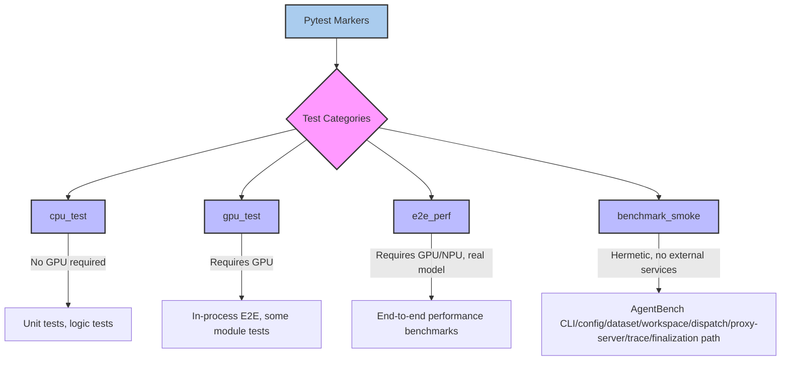
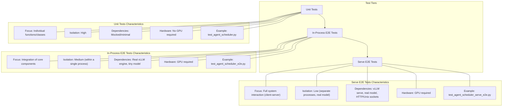

<!-- source: DeepWiki mcp.deepwiki.com · repo openJiuwen-ai/agent-infer · page 5.1 Test Suites and Markers · fetched 2026-11-02 -->

# Test Suites and Markers

Relevant source files

The following files were used as context for generating this wiki page:

- [.markdownlint.json](.markdownlint.json)
- [docs/en/how-to/integrate-vllm.md](docs/en/how-to/integrate-vllm.md)
- [docs/zh/how-to/integrate-vllm.md](docs/zh/how-to/integrate-vllm.md)
- [tests/README.md](tests/README.md)
- [tests/__init__.py](tests/__init__.py)
- [tests/agentbench/README.md](tests/agentbench/README.md)
- [tests/conftest.py](tests/conftest.py)

This page details the testing infrastructure of the AgentInfer codebase, focusing on the `tests/` directory layout, the various `pytest` markers used to categorize tests, and the different tiers of end-to-end testing. Understanding this structure is crucial for developers to effectively run, debug, and contribute to the project's quality assurance.

## Test Directory Layout

The `tests/` directory mirrors the structure of the `vllm-project/vllm` repository, specifically under `tests/agentcache/core/` for AgentInfer-specific tests [tests/README.md:3-4](). This organization helps in maintaining consistency and clarity, especially for developers familiar with vLLM's testing practices.

The primary subdirectories within `tests/` are:
*   `tests/agentcache/`: Contains tests related to the `agentinfer.agentcache` module, which is the vLLM integration layer.
    *   `tests/agentcache/core/`: Houses core AgentInfer scheduler tests.
        *   `test_agent_scheduler.py`: Unit tests for `AgentAwareScheduler` resolution and `EngineArgs` patching [tests/README.md:8-9]().
        *   `test_agent_scheduler_e2e.py`: In-process end-to-end tests using `agentinfer.LLM` [tests/README.md:21-23]().
        *   `test_agent_scheduler_serve_e2e.py`: Subprocess end-to-end tests via `vllm serve` [tests/README.md:31-33]().
*   `tests/agentbench/`: Contains tests for the AgentBench benchmarking harness. This directory has its own detailed README [tests/agentbench/README.md:1-2]().

Sources: [tests/README.md:3-4](), [tests/README.md:8-9](), [tests/README.md:21-23](), [tests/README.md:31-33](), [tests/agentbench/README.md:1-2]()

## Pytest Markers

`pytest` markers are used to categorize tests based on their requirements and scope. These markers are defined in `tests/conftest.py` [tests/conftest.py:7-11]() and allow for selective execution of test suites.

### Diagram: Pytest Markers and Their Scope

Title: Pytest Markers and Their Scope

*   `cpu_test`: Marks tests that do not require a GPU to run [tests/conftest.py:8](). These are typically pure unit tests or tests of logic that do not interact with the underlying hardware acceleration.
*   `gpu_test`: Marks tests that require a CUDA-enabled GPU [tests/conftest.py:9](). This includes in-process end-to-end tests with tiny models and some module-level tests that might touch GPU-dependent components.
*   `e2e_perf`: Designates end-to-end performance benchmarks [tests/conftest.py:10](). These tests are resource-intensive, requiring a GPU or NPU and a real model, and are typically not part of standard CPU CI [tests/README.md:59-60]().
*   `benchmark_smoke`: Identifies hermetic AgentBench benchmark contract tests [tests/conftest.py:11](). These tests validate the AgentBench pipeline end-to-end but use a test runtime and loopback model backend instead of external software, ensuring they are self-contained [tests/agentbench/README.md:11-14]().

### Running Tests with Markers

To run specific sets of tests, `pytest` can be invoked with the `-m` flag:
*   Run all tests: `pytest tests/agentcache/ tests/agentbench/ -v` [tests/README.md:55-56]()
*   Run unit tests only (no GPU needed): `pytest tests/agentcache/core/test_agent_scheduler.py -v` [tests/README.md:63-64]()
*   Run in-process E2E test (requires GPU, tiny model): `pytest tests/agentcache/core/test_agent_scheduler_e2e.py -v` [tests/README.md:68-69]()
*   Run serve E2E test (requires GPU, real model): `pytest tests/agentcache/core/test_agent_scheduler_serve_e2e.py -v` [tests/README.md:73-74]()
*   Run AgentBench tests excluding `benchmark_smoke`: `python -m pytest -q -m "not benchmark_smoke" tests/agentbench` [tests/agentbench/README.md:26]()
*   Run only `benchmark_smoke` tests: `python -m pytest -q tests/agentbench/test_benchmark_smoke.py` [tests/agentbench/README.md:27]()

Sources: [tests/conftest.py:7-11](), [tests/README.md:55-56](), [tests/README.md:59-60](), [tests/README.md:63-64](), [tests/README.md:68-69](), [tests/README.md:73-74](), [tests/agentbench/README.md:11-14](), [tests/agentbench/README.md:26](), [tests/agentbench/README.md:27]()

## Test Tiers: Unit, In-Process E2E, and Serve E2E

The testing strategy employs different tiers to cover various aspects of the codebase, from isolated components to full system interactions.

### Diagram: Test Tiers and Their Characteristics

Title: Test Tiers and Their Characteristics

1.  **Unit Tests**:
    *   **Purpose**: Verify the correctness of individual functions, methods, or classes in isolation.
    *   **Implementation**: These tests typically mock external dependencies to ensure the component under test is the only variable.
    *   **Example**: `tests/agentcache/core/test_agent_scheduler.py` contains unit tests for `AgentAwareScheduler` and its interaction with `EngineArgs` [tests/README.md:8-9](). These tests confirm that `AgentAwareScheduler` correctly extends vLLM's `Scheduler` and satisfies the `SchedulerInterface` [tests/README.md:12-15](). They also verify the `SchedulerConfig.get_scheduler_cls()` resolution and `EngineArgs.__post_init__` patching behavior [tests/README.md:16-19]().
    *   **Hardware**: No GPU is required for these tests, making them suitable for CPU-only CI environments [tests/README.md:63-64]().

2.  **In-Process End-to-End (E2E) Tests**:
    *   **Purpose**: Validate the integration of core AgentInfer components with a vLLM engine within a single Python process.
    *   **Implementation**: These tests use `agentinfer.LLM` (which wraps `vllm.LLM`) and typically load a tiny model to minimize resource requirements and execution time [tests/README.md:21-23]().
    *   **Example**: `tests/agentcache/core/test_agent_scheduler_e2e.py` verifies that `AgentAwareScheduler` is correctly configured in the running engine and that text generation works as expected [tests/README.md:28-29]().
    *   **Hardware**: Requires a GPU, even with a tiny model [tests/README.md:68-69]().

3.  **Serve End-to-End (E2E) Tests**:
    *   **Purpose**: Test the complete AgentInfer serving stack, including the `vllm serve` process, API middleware, and client interactions.
    *   **Implementation**: These tests launch `vllm serve` as a subprocess, often with a real model, and interact with it via HTTP requests (e.g., OpenAI-compatible API endpoints) [tests/README.md:31-33](). They involve configuring the `vllm serve` command with AgentInfer's scheduler, middleware, and additional configuration [docs/en/how-to/integrate-vllm.md:43-51]().
    *   **Example**: `tests/agentcache/core/test_agent_scheduler_serve_e2e.py` checks if the server logs indicate `AgentAwareScheduler` is configured and verifies successful completion and chat completion requests [tests/README.md:37-39]().
    *   **Hardware**: Requires a GPU and a real model (e.g., ~1.3 GB) [tests/README.md:73-74]().

Sources: [tests/README.md:8-9](), [tests/README.md:12-15](), [tests/README.md:16-19](), [tests/README.md:21-23](), [tests/README.md:28-29](), [tests/README.md:31-33](), [tests/README.md:37-39](), [tests/README.md:63-64](), [tests/README.md:68-69](), [tests/README.md:73-74](), [docs/en/how-to/integrate-vllm.md:43-51]()

---

