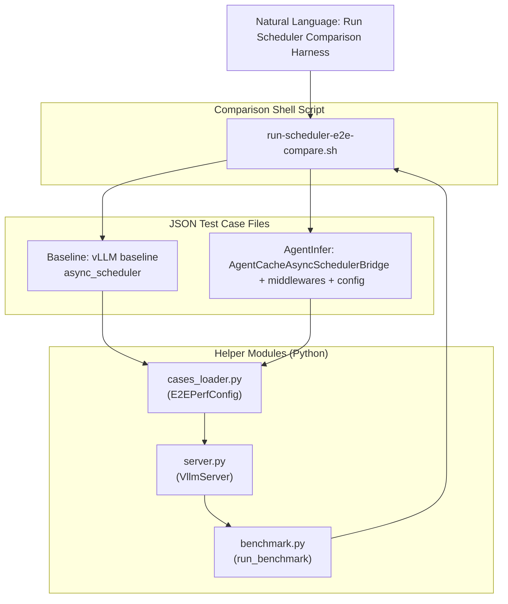
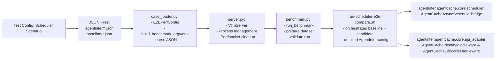

<!-- source: DeepWiki mcp.deepwiki.com · repo openJiuwen-ai/agent-infer · page 5.2 End-to-End Scheduler Comparison Harness · fetched 2026-11-02 -->

# 5.2 End-to-End Scheduler Comparison Harness

<details>
<summary>Relevant source files</summary>

The following files were used as context for generating this wiki page:

- [tests/agentbench/run-scheduler-e2e-compare.sh](tests/agentbench/run-scheduler-e2e-compare.sh)
- [tests/e2e/README.md](tests/e2e/README.md)
- [tests/e2e/__init__.py](tests/e2e/__init__.py)
- [tests/e2e/cases/agentinfer/glm52_16x8_plan_subagent.json](tests/e2e/cases/agentinfer/glm52_16x8_plan_subagent.json)
- [tests/e2e/cases/agentinfer/glm52_24x12_plan_subagent.json](tests/e2e/cases/agentinfer/glm52_24x12_plan_subagent.json)
- [tests/e2e/cases/agentinfer/glm52_32x16_plan_subagent.json](tests/e2e/cases/agentinfer/glm52_32x16_plan_subagent.json)
- [tests/e2e/cases/agentinfer/glm52_480x12_plan_subagent.json](tests/e2e/cases/agentinfer/glm52_480x12_plan_subagent.json)
- [tests/e2e/cases/agentinfer/glm52_8x4_plan_subagent.json](tests/e2e/cases/agentinfer/glm52_8x4_plan_subagent.json)
- [tests/e2e/helpers/benchmark.py](tests/e2e/helpers/benchmark.py)
- [tests/e2e/helpers/server.py](tests/e2e/helpers/server.py)

</details>


This section describes the end-to-end (E2E) scheduler comparison harness implemented in the `tests/e2e` directory of the AgentInfer codebase. The harness provides test cases, helpers, and scripts to benchmark and compare the performance of the baseline vLLM scheduler against the AgentInfer scheduler bridge in realistic workloads. It orchestrates vLLM serving processes, runs benchmark workloads, collects results, and facilitates comprehensive scheduler policy comparisons.

---

## Purpose and Scope

The E2E Scheduler Comparison Harness tests the integration of the AgentInfer scheduler within the full vLLM serving stack under realistic load scenarios. It provides:

- JSON-configured test cases that specify different workloads, hardware marks, environment variables, and serving parameters for both baseline (vLLM native scheduler) and AgentInfer scenarios.
- Helper modules to manage the lifecycle of vLLM serve subprocesses, load and validate case configurations, and run BenchKit benchmark workloads.
- A shell script to automate launching cold scheduler benchmarks and invoke comparison utilities for baseline vs. AgentInfer results.

The harness validates correctness and measures end-to-end scheduler impact on throughput, latency, and stability, supporting both short smoke tests and long soak/stability tests (e.g., 480 tasks concurrency scenario).

---

## 1. Test Case JSON Files

Test cases for E2E scheduler benchmarks are stored as JSON files under:

- `tests/e2e/cases/baseline/` — vLLM baseline scheduler serve and plan-subagent benchmark configurations.
- `tests/e2e/cases/agentinfer/` — AgentInfer scheduler bridge serve and benchmark configurations.

### Key Fields

Each JSON file defines:

- `test_name`: Unique identifier.
- `scenario`: Either `"baseline"` or `"agentinfer"` (legacy `"arm"` still accepted).
- `mark`: Optional metadata like hardware marks (e.g., NPU type, number of cards).
- `description`: Human-readable test description.
- `serve_env`: Environment variables for vLLM serve process.
- `server_params`: Model path, middleware classes (AgentInfer middlewares for AgentInfer cases), `vllm serve` CLI flags like tensor parallel size, scheduling options, and additional AgentInfer configs.
- `benchmark_params`: BenchKit configs for dataset, host, port, agent binary, concurrency, etc.
- `result_root`: Directory root path pattern for test results.

### Example AgentInfer Case Snippet

```json
{
  "test_name": "glm52_16x8_plan_subagent",
  "scenario": "agentinfer",
  "description": "GLM-5.2 AgentInfer scheduler bridge, SWE-bench 16 tasks x 8 concurrency",
  "serve_env": {
    "HCCL_OP_EXPANSION_MODE": "AIV",
    ...
  },
  "server_params": {
    "model": "Eco-Tech/GLM-5.2-w4a8c8",
    "middleware": [
      "agentinfer.agentcache.core.api_adapter.AgentCacheIdentityMiddleware",
      "agentinfer.agentcache.core.api_adapter.AgentCacheLifecycleMiddleware"
    ],
    "serve_args": {
      "async-scheduling": true,
      "scheduler-cls": "agentinfer.agentcache.core.scheduler.AgentCacheAsyncSchedulerBridge",
      "additional-config": {
        "agentcache": {
          "controller_factory": "agentinfer.agentcache.core.factory.build_progress_ttl_controller",
          "schedule_interval_seconds": 3,
          ...
        }
      }
    }
  },
  "benchmark_params": {
    "config": "agentinfer/agentbench/configs/swebench_vllm.yaml",
    ...
  }
}
```

These JSON case files are comprehensive, fully independent, and can be invoked individually using pytest to run the corresponding benchmark and vLLM serve instance.

_Sources: `tests/e2e/cases/agentinfer/*.json`_, `tests/e2e/README.md:1-94`()

---

## 2. Helper Modules

The E2E harness relies on three main helper modules under `tests/e2e/helpers` to implement its orchestration:

### 2.1. Server Lifecycle Management (`helpers/server.py`)

- Launches and manages the vLLM serve subprocesses for each test scenario using the configured scheduler (baseline or AgentInfer).
- Manages socket files and port binding sanity to avoid conflicts.
- Streams combined stdout/stderr output with optional terminal echo and logs to files.
- Polls the `/v1/models` API endpoint to detect readiness before triggering benchmarks.
- Cleans up lifecycle socket files and kills stale servers.

Key class:  
`VllmServer` — wraps launching, waiting, streaming logs, and cleanly tearing down vLLM processes based on `E2EPerfConfig` inputs.

Key functions:  
- `start_streaming_output()`  
- `wait_for_port_free()`, `ensure_port_free()`  
- `_wait_for_vllm_ready()`  
- `_remove_lifecycle_sockets()`  

This module abstracts vLLM serve process management in a reusable context manager style.

_Sources: `tests/e2e/helpers/server.py:1-202`_

---

### 2.2. Case Loading and Configuration (`helpers/case_loader.py`)

- Parses the JSON test case files into structured `E2EPerfConfig` dataclasses.
- Validates required fields and provides helpers to build CLI argument vectors and environment variables dynamically.
- Supports overwriting parameters such as concurrency or task count at runtime.
- Encapsulates pre-flight checks for prerequisites and resource availability.
- Provides translators between the natural JSON schema and command-line invocations with sudo wrapping if needed.

This loader is responsible for preparing the case-specific configurations to feed into server and benchmark helpers.

_Sources: `tests/e2e/README.md:89-95`_

---

### 2.3. Benchmark Orchestration and Validation (`helpers/benchmark.py`)

- Prepares datasets for the benchmark workload if not already present, ensuring required task lists are ready.
- Warms up repo caches if benchmarks run as root with sudo.
- Runs the BenchKit benchmarks with the prepared configurations and the running vLLM serve endpoint.
- Validates benchmarks completion by checking metadata and logs.
- Wraps calls to `vllm bench serve` as subprocesses.
- Provides utility functions to load and validate run summaries after completion.

The benchmark runner takes an `E2EPerfConfig`, ensures inputs are ready, runs the agentinfer benchmark, and returns the result directory path for further use.

_Sources: `tests/e2e/helpers/benchmark.py:1-181`_

---

## 3. Comparison Shell Script: `run-scheduler-e2e-compare.sh`

This shell script automates a cold run comparison between the baseline vLLM async scheduler and the AgentInfer scheduler bridge. It:

- Requires environment variables to be set for repository base, virtual environment, model path, and optionally agent binary, concurrency, ports, etc.
- Starts a baseline vLLM serve instance using the upstream async scheduler (`vllm.v1.core.sched.async_scheduler.AsyncScheduler`) with prefix caching enabled.
- Runs the BenchKit benchmark workload (`vllm bench serve --agentinfer run`) against the baseline server, saving results to a timestamped directory.
- Shuts down the baseline server.
- Starts a candidate AgentInfer vLLM serve instance using the `AgentCacheAsyncSchedulerBridge` scheduler class, specifying AgentInfer middlewares (`AgentCacheIdentityMiddleware`, `AgentCacheLifecycleMiddleware`).
- Passes detailed AgentInfer-specific configuration parameters for progress-TTL scheduling, decode step timings, etc.
- Runs the same benchmark workload against the candidate server, saving results separately.
- Shuts down the candidate server.
- Finally, invokes a `vllm bench serve --agentinfer compare` command to compare baseline and candidate results and outputs a textual diff report.

The script also performs port conflict checks, lifecycle socket cleanups, and readiness waits with curl.

### Key Environment Variables and Parameters

| Variable                              | Purpose                                                               |
|-------------------------------------|-----------------------------------------------------------------------|
| `REPO`                              | Root directory of the AgentInfer checkout                             |
| `VENV`                              | Path to the Python virtual environment for running the tests          |
| `MODEL`                             | Model path to pass to vllm serve                                      |
| `AGENT_BIN`                         | Agent executable path for BenchKit runs (default: `claude`)            |
| `TASK_NUM`, `CONCURRENCY`           | Number of tasks and concurrency for workload                           |
| `VLLM_PORT`                         | TCP port for vLLM serve API (default 8000)                            |
| `LIFECYCLE_SOCKET`                  | UNIX socket path for AgentInfer lifecycle signaling                   |
| AgentInfer scheduler config options | TTL timings, decode step estimates, capacity ratios, etc.             |

This script (`tests/agentbench/run-scheduler-e2e-compare.sh`) is the primary automation entrypoint for E2E scheduler comparison runs in the repository CI and local smoke workflows.

_Sources: `tests/agentbench/run-scheduler-e2e-compare.sh:1-128`_

---

## 4. Data Flow and Orchestration

The end-to-end flow proceeds as follows:



**Explanation:**

- The shell script `run-scheduler-e2e-compare.sh` is invoked to start the comparison.
- It reads two JSON scenario definitions (baseline and AgentInfer).
- The `case_loader.py` parses these JSON files into `E2EPerfConfig` objects.
- The `server.py` helper launches vLLM serve processes for each scheduler with appropriate flags and environment.
- The `benchmark.py` helper runs BenchKit workloads (`vllm bench serve --agentinfer run`) against the running vLLM servers.
- Benchmark results are collected into separate directories for baseline and candidate.
- Finally, the shell script invokes a comparison command to compare the results and outputs discrepancies or improvements.

_Sources: `tests/agentbench/run-scheduler-e2e-compare.sh:1-128`_, `tests/e2e/helpers/*.py`(), `tests/e2e/cases/agentinfer/*.json`()

---

## 5. Key Code Entities and Roles Mapping

This diagram maps the main system components (starting from natural language concepts) to code entities across case files, helpers, and shell script:



This shows the layered handoff from natural language test configuration → JSON case files → Python helpers for config loading, server lifecycle, benchmarking → final shell script glue → core AgentInfer scheduler classes plugged in at vLLM serve runtime via middleware and scheduler bridge.

_Sources: `tests/agentbench/run-scheduler-e2e-compare.sh:3-125`, `tests/e2e/helpers/case_loader.py:10-30`, `tests/e2e/helpers/server.py:176-200`, `tests/e2e/helpers/benchmark.py:27-130`_

---

## 6. Usage Example and Test Invocation

To run a specific E2E test case with pytest, target the JSON config file:

```bash
pytest -s -v tests/e2e/run_benchmark.py \
  --test-config-file tests/e2e/cases/agentinfer/glm52_8x4_plan_subagent.json
```

To override workload concurrency parameters on the fly:

```bash
pytest -s -v tests/e2e/run_benchmark.py \
  --test-config-file tests/e2e/cases/agentinfer/glm52_8x4_plan_subagent.json \
  --task-num 16 --max-concurrency 8
```

For full baseline vs. AgentInfer comparison runs, invoke the shell script (with environment variables):

```bash
export REPO=/path/to/agentinfer
export VENV=/path/to/venv
export MODEL=/path/to/model

./tests/agentbench/run-scheduler-e2e-compare.sh
```

This will perform cold boot runs of baseline and AgentInfer scheduler variants and produce a report in the logs directory.

_Sources: `tests/e2e/README.md:50-75`, `tests/agentbench/run-scheduler-e2e-compare.sh`_

---

## Summary

The End-to-End Scheduler Comparison Harness provides a critical integration and performance testing framework for AgentInfer. By maintaining independent, repeatable JSON-defined test cases and combining targeted server lifecycle and benchmark helpers with a robust comparison script, it supports rigorous scheduling policy evaluation under realistic and varied workloads. This harness ensures that AgentInfer's scheduler bridge improvements are validated in full-stack conditions against the baseline vLLM scheduler, supporting ongoing reliability and performance regression tracking.

---

# Appendix: Summary Table of Key Files

| File Path                                      | Description                                     |
|------------------------------------------------|-------------------------------------------------|
| `tests/e2e/cases/agentinfer/*.json`            | AgentInfer scheduler test case JSON definitions |
| `tests/e2e/cases/baseline/*.json`               | Baseline vLLM scheduler test case JSON definitions |
| `tests/e2e/helpers/case_loader.py`               | Parsing and environment/argv builders for test configs |
| `tests/e2e/helpers/server.py`                    | vLLM serve process management, logging, ready wait |
| `tests/e2e/helpers/benchmark.py`                 | Benchmark orchestration, dataset prep, validation |
| `tests/agentbench/run-scheduler-e2e-compare.sh` | Shell script for cold baseline vs candidate runs and comparison |

---

# Additional Notes

- The AgentInfer scheduler bridge class used at serve time is:  
  `agentinfer.agentcache.core.scheduler.AgentCacheAsyncSchedulerBridge`
- Two critical AgentInfer middlewares for identification and lifecycle signaling are:  
  `AgentCacheIdentityMiddleware`, `AgentCacheLifecycleMiddleware`
- The scheduling policy configuration typically uses the factory:  
  `agentinfer.agentcache.core.factory.build_progress_ttl_controller`
- BenchKit workload configuration references the SWE-bench dataset with template config:  
  `agentinfer/agentbench/configs/swebench_vllm.yaml`

---

End of 5.2 "End-to-End Scheduler Comparison Harness".  
Sources:  
`tests/agentbench/run-scheduler-e2e-compare.sh:1-128`  
`tests/e2e/cases/agentinfer/*.json`  
`tests/e2e/README.md:1-95`  
`tests/e2e/helpers/case_loader.py:1-50` (partial overview)  
`tests/e2e/helpers/server.py:1-202`  
`tests/e2e/helpers/benchmark.py:1-181`

---

