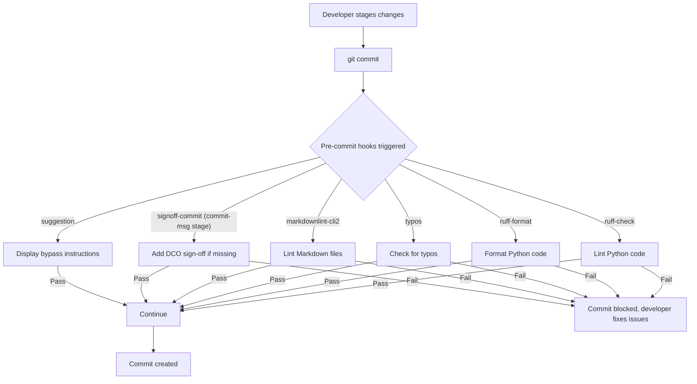

<!-- source: DeepWiki mcp.deepwiki.com · repo openJiuwen-ai/agent-infer · page 5.3 CI, Pre-commit and Contribution Workflow · fetched 2026-11-02 -->

# CI, Pre-commit and Contribution Workflow

<details>
<summary>Relevant source files</summary>

The following files were used as context for generating this wiki page:

- [.github/PULL_REQUEST_TEMPLATE.md](.github/PULL_REQUEST_TEMPLATE.md)
- [.github/workflows/ci.yml](.github/workflows/ci.yml)
- [.github/workflows/matchers/markdownlint.json](.github/workflows/matchers/markdownlint.json)
- [.pre-commit-config.yaml](.pre-commit-config.yaml)
- [CHANGELOG.md](CHANGELOG.md)
- [CONTRIBUTING.md](CONTRIBUTING.md)
- [DCO](DCO)
- [design/ci-ut-fixes.md](design/ci-ut-fixes.md)

</details>


This page details the continuous integration (CI) setup, pre-commit hooks, and the contribution guidelines for the AgentInfer project. It covers the GitHub Actions workflows, local development tools like `pre-commit` and `markdownlint`, the Developer Certificate of Origin (DCO) requirement, and the project's templates and documentation for contributors.

## GitHub Actions CI

The project utilizes GitHub Actions for continuous integration, defined in [.github/workflows/ci.yml](). This workflow is triggered on `pull_request` and `push` events to the `main` branch [.github/workflows/ci.yml:4-7](). It includes several jobs to ensure code quality, test functionality, and verify contribution standards.

### CI Workflow Overview

The CI workflow consists of the following main jobs:

*   **`pre-commit`**: Runs pre-commit hooks to enforce code style and linting.
*   **`agent-hint-middleware-patch`**: Verifies that the `agentrouter` patch applies correctly to the upstream vLLM router.
*   **`cpu-tests`**: Executes CPU-only unit tests across different Python versions.
*   **`dco`**: Checks for Developer Certificate of Origin (DCO) sign-offs on all commits in a pull request.

```mermaid
graph TD
    A[Push or Pull Request to main] --> B{GitHub Actions Workflow Trigger};
    B --> C[pre-commit Job];
    B --> D[agent-hint-middleware-patch Job];
    B --> E[cpu-tests Job];
    B --> F[dco Job];

    C --> C1[Checkout Code];
    C --> C2[Setup Python 3.10];
    C --> C3[Add markdownlint matcher];
    C --> C4[Run pre-commit hooks];

    D --> D1[Checkout Code];
    D --> D2{Check for agentrouter patch changes?};
    D2 -- Yes --> D3[Verify patch applies on upstream Router pin];

    E --> E1[Checkout Code];
    E --> E2[Setup Python (matrix: 3.10, 3.12)];
    E --> E3[Setup Node.js 20];
    E --> E4[Install dependencies];
    E --> E5[Run CPU unit tests];

    F --> F1[Checkout Code];
    F --> F2[Check DCO sign-off];

    C4 -- Success --> G[All Jobs Pass];
    D3 -- Success --> G;
    E5 -- Success --> G;
    F2 -- Success --> G;
    C4 -- Failure --> H[Workflow Failed];
    D3 -- Failure --> H;
    E5 -- Failure --> H;
    F2 -- Failure --> H;
```
Title: GitHub Actions CI Workflow
Sources: [.github/workflows/ci.yml:1-110]()

### Pre-commit Job

The `pre-commit` job runs on `ubuntu-latest` and executes the configured pre-commit hooks. It checks out the repository, sets up Python 3.10, and then runs `pre-commit/action@v3.0.1` with `extra_args: --all-files --hook-stage manual` [.github/workflows/ci.yml:18-33](). This ensures that all files are checked against the pre-commit configuration, including those not staged for commit. A custom problem matcher for `markdownlint` is also added [.github/workflows/ci.yml:27-28](), defined in [.github/workflows/matchers/markdownlint.json]().

Sources: [.github/workflows/ci.yml:18-33](), [.github/workflows/matchers/markdownlint.json:1-16]()

### Agent-Hint Middleware Patch Job

This job is conditional and only runs if changes are detected in the `agentinfer/agentrouter/**` path [.github/workflows/ci.yml:39-46](). Its purpose is to verify that the `0001-agent-hint-native-middleware.patch` located in `agentinfer/agentrouter/patches` can be successfully applied to the pinned upstream vLLM router version [CHANGELOG.md:10-11](). It fetches a specific commit of the `vllm-project/router` repository and attempts to apply the patch, then verifies the existence of patched files and content [.github/workflows/ci.yml:48-63]().

Sources: [.github/workflows/ci.yml:35-63](), [CHANGELOG.md:10-11]()

### CPU Tests Job

The `cpu-tests` job runs unit tests that do not require a GPU. It uses a strategy matrix to test against Python versions 3.10 and 3.12 [.github/workflows/ci.yml:67-69](). After checking out the code and setting up Python and Node.js, it installs project dependencies using `pip install -e ".[dev]"` [.github/workflows/ci.yml:84-85](). The tests are then executed using `pytest`, specifically targeting `tests/agentbench`, `tests/scheduling`, and `tests/agentcache/test_entrypoints.py` [.github/workflows/ci.yml:88-92](). It explicitly ignores `tests/e2e` and `tests/agentcache/core` and skips tests marked with `gpu_test` or `e2e_perf` [design/ci-ut-fixes.md:115-118](). This is because `tests/agentcache/core` contains vLLM integration tests that require a GPU and `vllm` and `openai` dependencies, which are not installed in this CPU-only environment [design/ci-ut-fixes.md:99-106]().

Sources: [.github/workflows/ci.yml:65-92](), [design/ci-ut-fixes.md:99-106](), [design/ci-ut-fixes.md:115-118]()

### DCO Job

The `dco` job is triggered only on pull requests [.github/workflows/ci.yml:96](). It checks that every commit in the pull request includes a "Signed-off-by:" line, enforcing the Developer Certificate of Origin (DCO) [.github/workflows/ci.yml:102-110](). This is a standard practice to ensure contributors agree to the project's licensing terms [DCO:1-35]().

Sources: [.github/workflows/ci.yml:94-110](), [DCO:1-35]()

## Pre-commit Hooks

The project uses `pre-commit` hooks to automate code quality checks before commits are made. The configuration is defined in [.pre-commit-config.yaml]().

### Configured Hooks

The `pre-commit` configuration includes the following hooks:

*   **`ruff-check`**: Lints Python code using Ruff, with output formatted for GitHub and automatic fixes enabled [.pre-commit-config.yaml:8-12]().
*   **`ruff-format`**: Formats Python code using Ruff [.pre-commit-config.yaml:13-14]().
*   **`typos`**: Checks for typos in text files, excluding the `Third_Party_Open_Source_Software_Notice.txt` file [.pre-commit-config.yaml:15-20]().
*   **`markdownlint-cli2`**: Lints Markdown files, with automatic fixes enabled [.pre-commit-config.yaml:21-26]().
*   **`signoff-commit`**: A local hook that automatically adds a "Signed-off-by:" line to the commit message if it's missing [.pre-commit-config.yaml:28-40](). This hook runs during the `commit-msg` stage.
*   **`suggestion`**: A local hook that provides a helpful message on how to bypass pre-commit hooks [.pre-commit-config.yaml:41-45]().


Title: Pre-commit Hook Workflow
Sources: [.pre-commit-config.yaml:1-45]()

Sources: [.pre-commit-config.yaml:1-45]()

## Contribution Workflow

The `CONTRIBUTING.md` file outlines the guidelines for contributing to AgentInfer.

### Development Environment Setup

Contributors are advised to set up a virtual environment and install the project and development tools using `pip install -e .` and `pip install pre-commit pytest`, followed by `pre-commit install` [CONTRIBUTING.md:9-17](). For vLLM integration tests, a Linux or WSL 2 environment with vLLM 0.23.0 is required [CONTRIBUTING.md:18-20]().

Sources: [CONTRIBUTING.md:9-20]()

### Change Requirements

Key requirements for changes include:
*   Focusing each change and adding/updating tests for behavioral changes [CONTRIBUTING.md:23-24]().
*   Updating both `docs/zh/` and `docs/en/` for changes under `agentinfer/` [CONTRIBUTING.md:25-27]().
*   Categorizing new documents into Tutorial, How-to, Reference, or Explanation, with specific naming conventions [CONTRIBUTING.md:28-30]().
*   Avoiding committing sensitive information [CONTRIBUTING.md:31-32]().

Sources: [CONTRIBUTING.md:23-32]()

### Local Validation

Before submitting a pull request, contributors should run tests directly related to their changes and then execute the same checks as the CI: `python -m pytest tests -q` and `pre-commit run --all-files --hook-stage manual` [CONTRIBUTING.md:36-39](). If GPU or external-service tests cannot be run locally, this should be noted in the pull request [CONTRIBUTING.md:40-42]().

Sources: [CONTRIBUTING.md:36-42]()

### Commits and Pull Requests

The project adheres to the Developer Certificate of Origin (DCO) [CONTRIBUTING.md:45](). Every commit must include a sign-off, which can be added using `git commit --signoff -m "type(scope): summary"` [CONTRIBUTING.md:49-50](). The repository's pull request template, defined in [.github/PULL_REQUEST_TEMPLATE.md](), must be used, and sections like Purpose, Changes, Test Plan, and Test Result must be completed [CONTRIBUTING.md:52-54](). Feature changes require documentation, and new public APIs need documentation of their signature, parameters, return value, and exceptions in the Reference documentation [CONTRIBUTING.md:54-56](). Contributions are released under the Apache License 2.0 [CONTRIBUTING.md:57-58]().

Sources: [CONTRIBUTING.md:45-58](), [.github/PULL_REQUEST_TEMPLATE.md:1-21]()

### Changelog

The `CHANGELOG.md` file records notable changes to AgentInfer. New entries are initially placed under an `Unreleased` section and moved to a versioned section upon release [CHANGELOG.md:1-5](). This provides a clear history of additions, changes, and core subsystem updates for each release [CHANGELOG.md:8-50]().

Sources: [CHANGELOG.md:1-50]()

---

