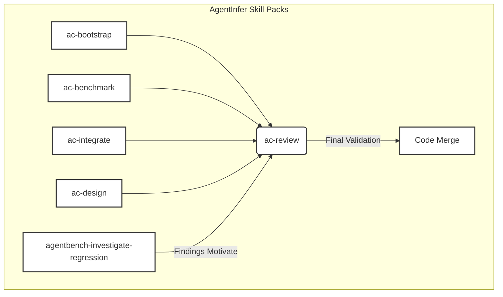
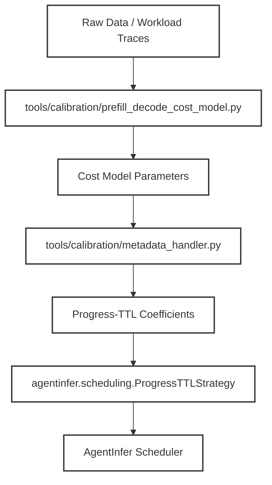

<!-- source: DeepWiki mcp.deepwiki.com · repo openJiuwen-ai/agent-infer · page 6 Developer Skills and Tooling · fetched 2026-11-02 -->

# Developer Skills and Tooling

Relevant source files

The following files were used as context for generating this wiki page:

- [skills/README.md](skills/README.md)
- [tools/__init__.py](tools/__init__.py)

This page provides a high-level overview of the "skills" or agent-skill packs and the "tools" or calibration utilities available within the AgentInfer codebase. These components are designed to assist developers and integrators in various stages of development, from scaffolding new features to benchmarking and reviewing code.

The `skills/` directory contains AI agent-invocable skills that streamline common development workflows. The `tools/` directory houses utilities primarily for calibration and data handling, crucial for optimizing the AgentInfer scheduler.

## ac-* Skill Packs

The `ac-*` skill packs are a collection of AI agent-invocable workflows designed to automate and standardize common development tasks within the AgentInfer project [skills/README.md:1-5](). Each skill is defined in its own directory as a `SKILL.md` file and is invoked by an AI agent via the Skill tool [skills/README.md:25-26](). These skills cover a range of activities from bootstrapping new components to benchmarking and code review.

The primary skill packs include:
*   `ac-bootstrap`: Used for scaffolding new cache integrations, scheduling components, or entry points [skills/README.md:11]().
*   `ac-benchmark`: Facilitates running the benchmark harness against vLLM, capturing, and comparing metrics [skills/README.md:12]().
*   `ac-integrate`: Guides the process of plugging AgentInfer's AgentCache into a vLLM serving deployment [skills/README.md:13]().
*   `ac-review`: A critical skill for reviewing changes against established repository conventions and evolving criteria [skills/README.md:14, 29-30]().
*   `ac-design`: Assists in analyzing cache patterns and writing design documents for optimization strategies [skills/README.md:15]().
*   `agentbench-investigate-regression`: Helps diagnose AgentBench regressions by examining evidence from finalized runs, tasks, sessions, and service data [skills/README.md:16]().

Most producer skills (`ac-bootstrap`, `ac-benchmark`, `ac-integrate`, `ac-design`) automatically invoke `ac-review` as a final pre-merge validation step [skills/README.md:18-20]().

For details on each skill pack, see [ac-* Skill Packs](#6.1).

### AgentInfer Skill Pack Overview

Sources: [skills/README.md:1-22]()

## ac-review Criteria System

The `ac-review` skill pack incorporates a robust criteria system to ensure code quality and adherence to project conventions. This system is defined by a set of criteria files located in `ac-review/criteria/*.md` [skills/README.md:29-30](). These criteria evolve over time and are subject to a weekly refresh protocol.

The criteria cover various aspects of development, including:
*   **00-meta**: Metadata and general project information.
*   **10-style**: Coding style and formatting guidelines.
*   **20-api**: API design and consistency.
*   **30-testing**: Testing practices and coverage.
*   **40-perf**: Performance considerations.
*   **50-safety**: Code safety and security.
*   **60-workflow**: Development workflow and process.
*   **70-regression**: Regression prevention.
*   **80-architecture**: Architectural principles.
*   **90-observability**: Observability and monitoring.

This structured approach helps maintain a high standard across the codebase. For a detailed breakdown of the severity model and individual criteria, see [ac-review Criteria System](#6.2).

## Calibration Tools

The `tools/calibration` package provides utilities for calibrating the prefill and decode cost models, handling metadata, and conducting related tests. These tools are essential for generating the coefficients used by the Progress-TTL scheduling policy.

The calibration process involves:
*   **Cost Model Calibration**: Adjusting parameters for prefill and decode operations to accurately reflect resource consumption.
*   **Metadata Handling**: Managing and processing metadata crucial for scheduler decisions.
*   **Testing**: Ensuring the accuracy and reliability of the calibration outputs.

These calibrated values directly influence the `Progress-TTL` policy, which is a core component of the AgentInfer scheduler. For more information on the specific utilities and their usage, see [Calibration Tools](#6.3).

### Calibration Tooling Flow

Sources: [tools/__init__.py:1-3]()

## Design Documents

The `design/` directory contains comprehensive documentation outlining the architectural and functional specifications of various AgentInfer components. These documents are crucial for understanding the rationale behind design choices and for guiding future development.

Key areas covered by the design documents include:
*   **Module Specifications**: Detailed descriptions of individual modules within the scheduling and benchmarking subsystems.
*   **Superpowers Specs/Plans**: Outlines for advanced features and capabilities planned for AgentInfer.
*   **AGENTS.md Conventions**: Guidelines and conventions related to agent implementation and interaction within the system.

These documents serve as a central reference for developers, ensuring consistency and clarity across the project. For a deeper dive into the design principles and specifications, see [Design Documents](#6.4).

---

