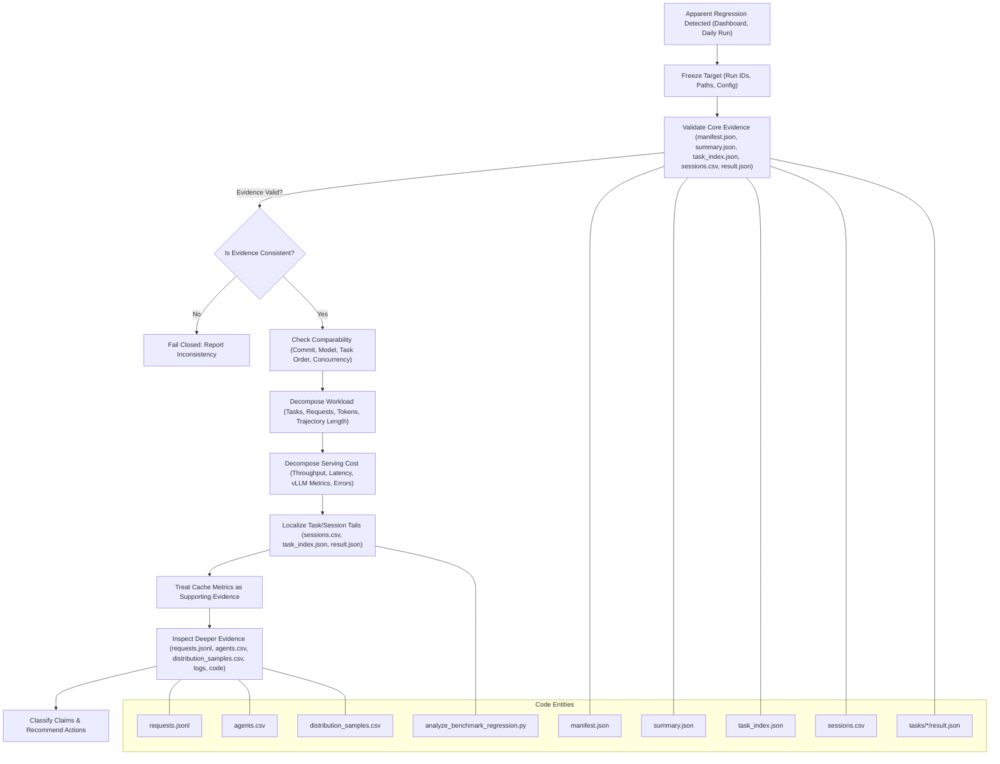

<!-- source: DeepWiki mcp.deepwiki.com · repo openJiuwen-ai/agent-infer · page 6.1 ac-* Skill Packs · fetched 2026-11-02 -->

# ac-* Skill Packs

<details>
<summary>Relevant source files</summary>

The following files were used as context for generating this wiki page:

- [skills/ac-benchmark/SKILL.md](skills/ac-benchmark/SKILL.md)
- [skills/ac-bootstrap/SKILL.md](skills/ac-bootstrap/SKILL.md)
- [skills/ac-design/SKILL.md](skills/ac-design/SKILL.md)
- [skills/ac-integrate/SKILL.md](skills/ac-integrate/SKILL.md)
- [skills/agentbench-investigate-regression/SKILL.md](skills/agentbench-investigate-regression/SKILL.md)

</details>


This page details the `ac-*` skill packs, which are specialized workflows designed to guide developers through common tasks within the `agent-infer` codebase. These skills provide structured steps for bootstrapping new components, integrating AgentInfer with vLLM, benchmarking performance, designing new optimizations, and investigating performance regressions. Each skill emphasizes best practices, required evidence, and common pitfalls to avoid.

## ac-bootstrap

The `ac-bootstrap` skill pack is used for scaffolding new AgentInfer components such as cache backends, policies, scheduling components, integration adapters, or public entry points. It guides the developer to discover existing ownership boundaries and analogous code to ensure consistency and proper placement of new files.

### Workflow

1.  **Identify Responsibility**: Determine if the new component is a backend, policy, scheduling component, integration adapter, or public entry point [skills/ac-bootstrap/SKILL.md:30-31]().
2.  **Discover Ownership Boundary**: Use `Glob` and `Grep` to find analogous interfaces, implementations, exports, and tests. Consult `pyproject.toml` for the top-level package structure [skills/ac-bootstrap/SKILL.md:33-36]().
    *   Engine-neutral components belong under `agentinfer/scheduling/` [skills/ac-bootstrap/SKILL.md:39-40]().
    *   vLLM-specific adapters belong under `agentinfer/agentcache/` [skills/ac-bootstrap/SKILL.md:40-41]().
3.  **Place New File**: Position the new file next to analogous code, maintaining the boundary between engine-specific adapters and engine-neutral scheduling contracts [skills/ac-bootstrap/SKILL.md:43-55]().
4.  **Add Symbol to `__init__.py`**: Only add the symbol to the owning `__init__.py` if it is intended to be public [skills/ac-bootstrap/SKILL.md:57-58]().
5.  **Add Focused Tests**: Create tests beside the analogous suite. Examples include `tests/agentcache/` for cache/engine integration, `tests/scheduling/` for scheduling components, and `tests/agentbench/` for benchmark behavior [skills/ac-bootstrap/SKILL.md:60-66]().
6.  **Run Focused Tests and Pre-commit**: Execute `pytest <matching-test-files> -v` and `pre-commit run --files <changed-files>` to fix any reported issues [skills/ac-bootstrap/SKILL.md:73-76]().
7.  **Confirm Commit Message**: Ensure the commit message includes the DCO `Signed-off-by:` line [skills/ac-bootstrap/SKILL.md:78-81]().

### Code Entity Mapping for `ac-bootstrap`

```mermaid
graph TD
    subgraph "Natural Language Space"
        A["User wants to add a new component"]
        B["Identify component type (backend, policy, adapter, etc.)"]
        C["Find existing analogous code"]
        D["Place new file in correct location"]
        E["Add to public API (if applicable)"]
        F["Write focused tests"]
        G["Run tests and pre-commit"]
        H["Commit with DCO"]
    end

    subgraph "Code Entity Space"
        P1["`agentinfer/scheduling/`"]
        P2["`agentinfer/agentcache/`"]
        P3["`pyproject.toml`"]
        P4["`__init__.py`"]
        P5["`tests/agentcache/`"]
        P6["`tests/scheduling/`"]
        P7["`tests/agentbench/`"]
        P8["`pytest` CLI"]
        P9["`pre-commit` CLI"]
        P10["`git commit`"]
        P11["`Glob` tool"]
        P12["`Grep` tool"]
    end

    A --> B
    B --> C
    C --> P1
    C --> P2
    C --> P3
    C --> P11
    C --> P12
    D --> P1
    D --> P2
    E --> P4
    F --> P5
    F --> P6
    F --> P7
    G --> P8
    G --> P9
    H --> P10
```
Sources:
- skills/ac-bootstrap/SKILL.md:30-31
- skills/ac-bootstrap/SKILL.md:33-36
- skills/ac-bootstrap/SKILL.md:39-41
- skills/ac-bootstrap/SKILL.md:43-55
- skills/ac-bootstrap/SKILL.md:57-58
- skills/ac-bootstrap/SKILL.md:60-66
- skills/ac-bootstrap/SKILL.md:73-76
- skills/ac-bootstrap/SKILL.md:78-81

## ac-design

The `ac-design` skill pack is used for analyzing cache patterns in coding-agent workloads and writing RFC/design documents for AgentInfer optimization strategies. It focuses on producing measurable success criteria and PR evidence checklists.

### Workflow

1.  **Gather Current Evidence**: Read the current repository state, user-provided traces, benchmark artifacts, RFCs, or PR comments [skills/ac-design/SKILL.md:31-34]().
2.  **Scope the Optimization**: Determine if the design addresses single-agent scenarios (tool-aware KV retention, prefix-aware scheduling, predictor-guided eviction) or subagent concurrency (task/agent lifecycle tracking, value/cost scoring, KV lifecycle management, isolation), or both [skills/ac-design/SKILL.md:36-48]().
3.  **Write the RFC/Design Contract**: Use `.github/ISSUE_TEMPLATE/750-RFC.yml` as a guide. Include motivation, proposed change, alternatives/tradeoffs, configuration, metrics/success criteria, correctness guardrails, and a phased roadmap [skills/ac-design/SKILL.md:50-63]().
4.  **Produce a PR Acceptance Checklist**: Convert RFC success criteria into reviewer-facing PR evidence requirements, specifying evidence sources (tests, benchmark artifacts, logs, config files) [skills/ac-design/SKILL.md:65-78]().
5.  **Verify Current Paths**: Inventory the current repository with read-only search before citing benchmark/config/script paths [skills/ac-design/SKILL.md:80-83]().

### Design Document Structure

The `ac-design` skill emphasizes a structured approach to design documents, as outlined in the workflow. The key sections of an RFC/design contract are:

*   **Motivation**: Problem statement, user need, or roadmap goal.
*   **Proposed Change**: Architecture overview, components, and data flow.
*   **Alternatives and Tradeoffs**: Simpler options and rejected designs.
*   **Configuration**: Typed/config-file and CLI knobs, distinguishing runtime scheduler config from benchmark workload config.
*   **Metrics and Success Criteria**: Measurable targets and verification steps.
*   **Correctness Guardrails**: Pass-rate, prefix alignment, subagent isolation, tool-call integrity, or other relevant safety constraints.
*   **Phased Roadmap**: Incremental, mergeable milestones.

Sources:
- skills/ac-design/SKILL.md:31-34
- skills/ac-design/SKILL.md:36-48
- skills/ac-design/SKILL.md:50-63
- skills/ac-design/SKILL.md:65-78
- skills/ac-design/SKILL.md:80-83

## ac-integrate

The `ac-integrate` skill pack is used for plugging AgentInfer AgentCache into a vLLM serving deployment. It involves discovering the installed integration surface, checking runtime capabilities, configuring the adapter, and validating cache evidence.

### Workflow

1.  **Detect Target Engine and Version**: Check the vLLM version using `python -c "import vllm; print(vllm.__version__)"`. If vLLM is not importable or the version differs from `0.23.0`, stop and resolve the mismatch [skills/ac-integrate/SKILL.md:31-42]().
2.  **Select Deployment Parameters**: Read the runbook and deployment config for model, tensor parallelism, tool parser, port, and environment variables. An example for Q3 Linux/WSL baseline is provided [skills/ac-integrate/SKILL.md:44-63]().
3.  **Discover and Preflight Integration Surface**: Verify that selected symbols import correctly. This includes `agentinfer/agentcache/`, `agentinfer/scheduling/`, and relevant tests. An example preflight script checks `AgentCacheIdentityMiddleware`, `AgentCacheLifecycleMiddleware`, `build_progress_ttl_controller`, and `AgentCacheAsyncSchedulerBridge` [skills/ac-integrate/SKILL.md:65-94]().
    *   If imports fail, install the required runtime build or choose an available integration path [skills/ac-integrate/SKILL.md:96-98]().
    *   Follow `docs/en/how-to/run-benchmark.md` for launch flags [skills/ac-integrate/SKILL.md:100-101]().
4.  **Validate from Benchmark Evidence**: Run identical cold baseline and candidate workloads through the Request Proxy and compare using `vllm bench serve --agentinfer compare`. Inspect `manifest.json`, `summary.json`, `requests.jsonl`, and `evidence/vllm_metrics_*.prom` to confirm expected scheduler/middleware loading, lifecycle events, and cache metrics [skills/ac-integrate/SKILL.md:106-119]().
5.  **Document Deployment Specifics**: Record engine/version, scheduler/middleware classes, endpoint shape, lifecycle socket, controller configuration, service logs, and artifact paths for reproducibility [skills/ac-integrate/SKILL.md:121-124]().

### Key Integration Components

The `ac-integrate` skill highlights several key components involved in integrating AgentInfer with vLLM:

*   **`AgentCacheAsyncSchedulerBridge`**: A scheduler bridge for asynchronous operations [skills/ac-integrate/SKILL.md:88]().
*   **`AgentCacheIdentityMiddleware`**: Middleware for managing request identity [skills/ac-integrate/SKILL.md:84]().
*   **`AgentCacheLifecycleMiddleware`**: Middleware for managing request lifecycle [skills/ac-integrate/SKILL.md:85]().
*   **`build_progress_ttl_controller`**: A factory function for building the Progress-TTL controller [skills/ac-integrate/SKILL.md:86]().

### Integration Flow

```mermaid
graph TD
    A["User Request: Integrate AgentInfer with vLLM"] --> B["Detect vLLM Version"]
    B -- "vLLM version 0.23.0?" --> C{Is Version Compatible?}
    C -- "No" --> D["Stop: Report Mismatch"]
    C -- "Yes" --> E["Select Deployment Parameters (Model, TP, etc.)"]
    E --> F["Preflight Integration Surface (Import Checks)"]
    F -- "Imports successful?" --> G{Are Symbols Importable?}
    G -- "No" --> H["Stop: Install Runtime or Choose Path"]
    G -- "Yes" --> I["Configure AgentInfer Launch Flags"]
    I --> J["Run Benchmark (Baseline & Candidate)"]
    J --> K["Compare Benchmark Artifacts (`vllm bench serve --agentinfer compare`)"]
    K --> L["Validate Cache Behavior & Metrics"]
    L --> M["Document Deployment Specifics"]
    M --> N["Integration Complete"]

    subgraph "Code Entities"
        B_code["`python -c \"import vllm; print(vllm.__version__)\"`"]
        E_code["`export VLLM_ENABLE_CUDA_COMPATIBILITY=1`"]
        E_code_2["`vllm serve \"$MODEL\" ...`"]
        F_code["`from agentinfer.agentcache.core.api_adapter import ...`"]
        F_code_2["`from agentinfer.agentcache.core.factory import ...`"]
        F_code_3["`from agentinfer.agentcache.core.scheduler import ...`"]
        K_code["`vllm bench serve --agentinfer compare ...`"]
        K_code_2["`manifest.json`, `summary.json`, `requests.jsonl`, `vllm_metrics_*.prom`"]
    end

    B --- B_code
    E --- E_code
    E --- E_code_2
    F --- F_code
    F --- F_code_2
    F --- F_code_3
    K --- K_code
    K --- K_code_2
```
Sources:
- skills/ac-integrate/SKILL.md:31-42
- skills/ac-integrate/SKILL.md:44-63
- skills/ac-integrate/SKILL.md:65-94
- skills/ac-integrate/SKILL.md:96-98
- skills/ac-integrate/SKILL.md:100-101
- skills/ac-integrate/SKILL.md:106-119
- skills/ac-integrate/SKILL.md:121-124
- skills/ac-integrate/SKILL.md:88
- skills/ac-integrate/SKILL.md:84
- skills/ac-integrate/SKILL.md:85
- skills/ac-integrate/SKILL.md:86

## ac-benchmark

The `ac-benchmark` skill pack is used for measuring AgentInfer cache performance against a target LLM serving engine (vLLM or vLLM Prefix Cache). It involves discovering benchmark paths, running experiments, capturing artifacts, and comparing against a baseline.

### Workflow

1.  **Discover Benchmark Surfaces**: Identify configs and datasets in `agentinfer/agentbench/`, tests in `tests/agentbench/`, the CLI entry point `vllm bench serve --agentinfer`, and the runbook `docs/en/how-to/run-benchmark.md` [skills/ac-benchmark/SKILL.md:28-33]().
2.  **Define Experiment Matrix**: Record all intended modes, workload shapes, task selections, agent profiles, concurrency, and trials. Ensure baseline and candidate use the same commit, model, ordered task list, profile, concurrency, timeouts, tensor parallelism, vLLM options, and hardware [skills/ac-benchmark/SKILL.md:37-41]().
3.  **Prepare Inputs and Preflight Environment**: Derive the data directory and prepare inputs. For SWE-bench, use `vllm bench serve --agentinfer prepare swebench`. Confirm the supported vLLM version (`0.23.0`), branch/commit, host, working directory, virtualenv, service port, dataset/config paths, result directories, and launch commands [skills/ac-benchmark/SKILL.md:43-57]().
4.  **Run Each Arm from Cold State**: Start the serving backend, verify health, then run the workload for both baseline and candidate. Example command: `vllm bench serve --agentinfer run --config <config.yaml> ...` [skills/ac-benchmark/SKILL.md:59-70]().
    *   Fully stop the baseline service before starting the candidate to reset Prefix Cache state and cumulative metrics [skills/ac-benchmark/SKILL.md:74-75]().
5.  **Summarize and Compare Source Artifacts**: Use `vllm bench serve --agentinfer summarize` and `vllm bench serve --agentinfer compare`. Parse `manifest.json`, `summary.json`, `requests.jsonl`, and `evidence/vllm_metrics_*.prom` [skills/ac-benchmark/SKILL.md:79-92]().
6.  **Report Performance and Evidence Quality**: Cover end-to-end wall time, prefix hit rate, task execution status, TTFT percentiles, source-health evidence, cold-state confirmation, and unavailable artifacts [skills/ac-benchmark/SKILL.md:94-98]().
7.  **Report Regressions and Omissions**: Explicitly report any regressions or omitted metrics [skills/ac-benchmark/SKILL.md:100-102]().

### Benchmark CLI Commands

The `ac-benchmark` skill leverages the `vllm bench serve --agentinfer` CLI entry point for various operations:

*   **`prepare`**: Prepares benchmark inputs, e.g., `vllm bench serve --agentinfer prepare swebench --output-dir agentinfer/agentbench/data/swebench` [skills/ac-benchmark/SKILL.md:46-48]().
*   **`run`**: Executes a benchmark run, e.g., `vllm bench serve --agentinfer run --config <config.yaml> ...` [skills/ac-benchmark/SKILL.md:62-69]().
*   **`summarize`**: Summarizes benchmark results, e.g., `vllm bench serve --agentinfer summarize results/agentinfer/run1 --output-csv combined-summary.csv` [skills/ac-benchmark/SKILL.md:81-82]().
*   **`compare`**: Compares baseline and candidate runs, e.g., `vllm bench serve --agentinfer compare --baseline results/vllm/run1 --candidate results/agentinfer/run1` [skills/ac-benchmark/SKILL.md:84-86]().

Sources:
- skills/ac-benchmark/SKILL.md:28-33
- skills/ac-benchmark/SKILL.md:37-41
- skills/ac-benchmark/SKILL.md:43-57
- skills/ac-benchmark/SKILL.md:59-70
- skills/ac-benchmark/SKILL.md:74-75
- skills/ac-benchmark/SKILL.md:79-92
- skills/ac-benchmark/SKILL.md:94-98
- skills/ac-benchmark/SKILL.md:100-102
- skills/ac-benchmark/SKILL.md:46-48
- skills/ac-benchmark/SKILL.md:62-69
- skills/ac-benchmark/SKILL.md:81-82
- skills/ac-benchmark/SKILL.md:84-86

## agentbench-investigate-regression

The `agentbench-investigate-regression` skill pack is used when an AgentBench metric appears slower or regressed. It focuses on validating source artifacts, separating workload amplification from serving cost, localizing task/session tails, and producing an evidence-ranked diagnosis.

### Workflow

1.  **Freeze the Target**: Record exact run IDs, paths, host, commit, model, agent/profile, task selection and order, concurrency, task timeout, TP, vLLM options, scheduler/policy, and service-log paths [skills/agentbench-investigate-regression/SKILL.md:56-60]().
2.  **Validate Core Evidence**: Verify `manifest.json` and `summary.json` report `completed`, task identities agree across `task_index.json`, `sessions.csv`, and per-task `result.json`. Confirm cold status is evidence-based [skills/agentbench-investigate-regression/SKILL.md:62-69]().
    *   Refer to `docs/en/reference/run-artifacts.md` and `design/module/benchmarking/artifacts-and-evaluation.md` for metric and evidence contracts [skills/agentbench-investigate-regression/SKILL.md:71-72]().
    *   Prefer `vllm bench serve --agentinfer compare` for summary-level comparison [skills/agentbench-investigate-regression/SKILL.md:72-73]().
3.  **Check Comparability**: Require equality for task identities/order, commit, model, profile, task count, concurrency, timeout, and material benchmark configuration. Check TP, hardware, endpoint, serve flags, environment, and CLI provenance [skills/agentbench-investigate-regression/SKILL.md:78-85]().
4.  **Decompose Workload**: Measure candidate-versus-baseline changes in completed/failed tasks, request count, input/output tokens, per-session agent count, trajectory length, and termination reasons. Large differences indicate the agent performed a different amount of work [skills/agentbench-investigate-regression/SKILL.md:90-96]().
5.  **Decompose Serving Cost**: Independently compare request, input-token, and output-token throughput; latency and TTFT percentiles; vLLM queue, prefill, decode, and inference means; service restarts, OOM, tracebacks, request failures, and scheduler warnings [skills/agentbench-investigate-regression/SKILL.md:100-106]().
6.  **Localize Task/Session Tails**: Join `sessions.csv` by `instance_id` with `task_index.json` and per-task `result.json`. Report candidate-slower/faster task counts, median paired task-duration delta, top deltas, straggler contribution, and completion/termination transitions [skills/agentbench-investigate-regression/SKILL.md:110-126]().
    *   Optionally use `analyze_benchmark_regression.py` for repeatable pair/task tables [skills/agentbench-investigate-regression/SKILL.md:128-129]().
7.  **Treat Cache Metrics as Supporting Evidence**: Keep API cache rates distinct from vLLM prefix/prompt-token rates. A higher cache hit rate alone does not prove causality or end-to-end performance gain [skills/agentbench-investigate-regression/SKILL.md:133-138]().
8.  **Inspect Deeper Evidence as Needed**: Use the smallest source to answer remaining questions: `requests.jsonl` for request ownership/timing, `agents.csv` for actor-level attribution, `distribution_samples.csv` for drill-down, task transcripts for tool/agent trajectory, service/launcher logs for backend lifecycle, and code/commit history for implementation cause [skills/agentbench-investigate-regression/SKILL.md:142-155]().
9.  **Classify and Recommend**: Classify each claim as `PROVEN`, `PLAUSIBLE`, `UNPROVEN`, `DISPROVEN`, or `UNSUPPORTED` [skills/agentbench-investigate-regression/SKILL.md:158-161]().

### Regression Investigation Data Flow


Sources:
- skills/agentbench-investigate-regression/SKILL.md:56-60
- skills/agentbench-investigate-regression/SKILL.md:62-69
- skills/agentbench-investigate-regression/SKILL.md:71-72
- skills/agentbench-investigate-regression/SKILL.md:72-73
- skills/agentbench-investigate-regression/SKILL.md:78-85
- skills/agentbench-investigate-regression/SKILL.md:90-96
- skills/agentbench-investigate-regression/SKILL.md:100-106
- skills/agentbench-investigate-regression/SKILL.md:110-126
- skills/agentbench-investigate-regression/SKILL.md:128-129
- skills/agentbench-investigate-regression/SKILL.md:133-138
- skills/agentbench-investigate-regression/SKILL.md:142-155
- skills/agentbench-investigate-regression/SKILL.md:158-161

---

