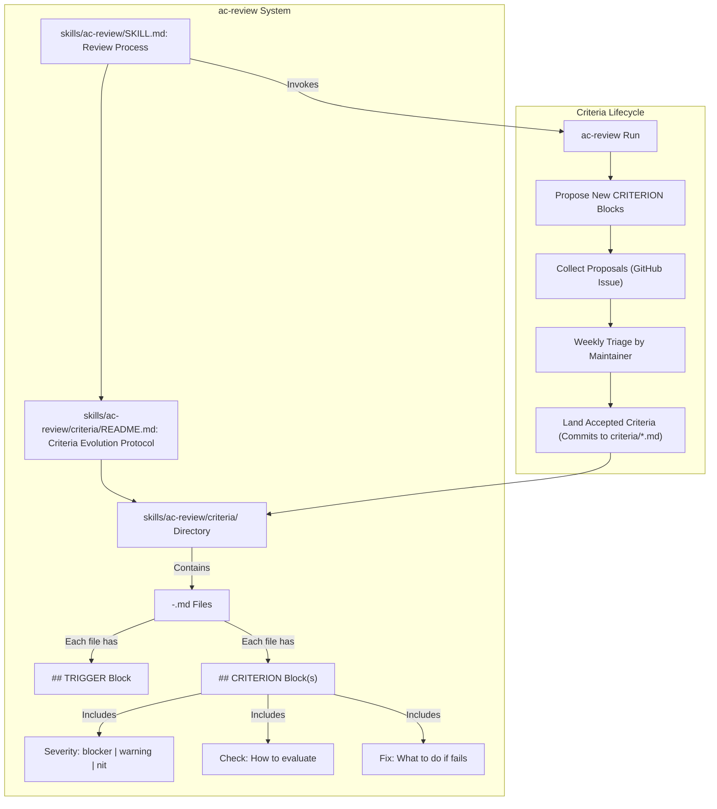

<!-- source: DeepWiki mcp.deepwiki.com · repo openJiuwen-ai/agent-infer · page 6.2 ac-review Criteria System · fetched 2026-11-02 -->

# ac-review Criteria System

Relevant source files

The following files were used as context for generating this wiki page:

- [skills/ac-review/SKILL.md](skills/ac-review/SKILL.md)
- [skills/ac-review/criteria/00-meta.md](skills/ac-review/criteria/00-meta.md)
- [skills/ac-review/criteria/10-style.md](skills/ac-review/criteria/10-style.md)
- [skills/ac-review/criteria/20-api.md](skills/ac-review/criteria/20-api.md)
- [skills/ac-review/criteria/30-testing.md](skills/ac-review/criteria/30-testing.md)
- [skills/ac-review/criteria/40-perf.md](skills/ac-review/criteria/40-perf.md)
- [skills/ac-review/criteria/50-safety.md](skills/ac-review/criteria/50-safety.md)
- [skills/ac-review/criteria/60-workflow.md](skills/ac-review/criteria/60-workflow.md)
- [skills/ac-review/criteria/80-architecture.md](skills/ac-review/criteria/80-architecture.md)
- [skills/ac-review/criteria/README.md](skills/ac-review/criteria/README.md)
- [skills/ac-review/criteria/_template.md](skills/ac-review/criteria/_template.md)

The `ac-review` criteria system defines the standards and guidelines for reviewing code changes within the AgentInfer codebase. It provides a structured approach to evaluating pull requests (PRs) and diffs, ensuring consistency, quality, and adherence to established conventions. This system is designed to evolve with the codebase, with criteria being regularly refreshed and updated.

The core of the system consists of a set of criteria files, organized by topic and numbered for evaluation order. These files, ranging from `00-meta.md` to `90-observability.md`, cover various aspects of development including code style, API design, testing, performance, safety, workflow, regression, and architecture.

## Review Process and Criteria Evolution

The `ac-review` process is stable and documented in `skills/ac-review/SKILL.md` [skills/ac-review/SKILL.md:1-178](). The criteria themselves, however, are dynamic and reside in the `skills/ac-review/criteria/` directory [skills/ac-review/criteria/README.md:3-5](). They are refreshed weekly to adapt to the evolving needs of the repository [skills/ac-review/criteria/README.md:24-26]().

### Criteria File Structure

Each criterion file follows a specific structure [skills/ac-review/criteria/README.md:7-20]():
*   **Naming Convention**: Files are named `<NN>-<topic>.md`, where `NN` is a zero-padded number indicating evaluation order [skills/ac-review/criteria/README.md:8-9]().
*   **TRIGGER Block**: Every file begins with a `## TRIGGER` block that describes which diffs the criteria within that file apply to [skills/ac-review/criteria/README.md:10-11]().
*   **CRITERION Blocks**: Following the trigger, one or more `## CRITERION` blocks define specific checks. Each criterion includes:
    *   **Severity**: `blocker`, `warning`, or `nit` [skills/ac-review/criteria/README.md:17]().
    *   **Check**: Instructions on how to evaluate the criterion against a diff [skills/ac-review/criteria/README.md:18]().
    *   **Fix**: Guidance on what the author should do if the criterion fails [skills/ac-review/criteria/README.md:19]().

### Weekly Refresh Mechanism

New criteria are proposed during `ac-review` runs and collected as comments on a recurring GitHub issue [skills/ac-review/criteria/README.md:27-32](). A maintainer triages these proposals weekly and lands accepted ones as small commits to the relevant `criteria/*.md` files [skills/ac-review/criteria/README.md:33-36]().

### Diagram: `ac-review` Criteria System Overview

Sources:
- [skills/ac-review/SKILL.md:1-178]()
- [skills/ac-review/criteria/README.md:3-39]()

## Severity Model

The `ac-review` system uses a three-tiered severity model for criteria [skills/ac-review/criteria/README.md:17]():

*   **Blocker**: Issues that must be resolved before a PR can be merged. These typically indicate critical problems with correctness, security, or fundamental repository rules.
*   **Warning**: Issues that should be addressed but may not strictly block a PR from merging, depending on context. They often point to potential problems, best practices, or areas for improvement.
*   **Nit**: Minor issues, often related to style or minor inconsistencies, that are good to fix but generally do not impact functionality or review readiness.

## Criteria Categories

The `skills/ac-review/criteria/` directory contains several categories of criteria, each focusing on a different aspect of the codebase [skills/ac-review/criteria/README.md:41-52]().

### 00-meta: Meta (always-true repo rules)

These are fundamental repository rules that apply to every diff [skills/ac-review/criteria/00-meta.md:4-5]().

*   **CRITERION M1: DCO sign-off present**: Ensures every commit has a `Signed-off-by` trailer, enforced by CI [skills/ac-review/criteria/00-meta.md:8-13]().
*   **CRITERION M2: pre-commit clean**: Verifies that `pre-commit run --all-files` exits successfully, covering formatting, linting, and other checks [skills/ac-review/criteria/00-meta.md:17-22]().
*   **CRITERION M3: PR template fields filled**: Checks that the PR description uses and fills out the required sections of `.github/PULL_REQUEST_TEMPLATE.md` [skills/ac-review/criteria/00-meta.md:25-29]().
*   **CRITERION M4: no secrets or tokens**: Prohibits the inclusion of API keys, tokens, or private URLs in diffs [skills/ac-review/criteria/00-meta.md:32-36]().

Sources:
- [skills/ac-review/criteria/00-meta.md:1-36]()

### 10-style: Style

Applies to any diff that adds or modifies Python files under `agentinfer/` or `tests/` [skills/ac-review/criteria/10-style.md:4-5]().

*   **CRITERION S1: formatting passes ruff format**: Ensures code adheres to `ruff format` standards [skills/ac-review/criteria/10-style.md:8-12]().
*   **CRITERION S2: imports sorted and first-party known**: Checks for clean `ruff check --select I` output and correct first-party configuration for `agentinfer` [skills/ac-review/criteria/10-style.md:15-20]().
*   **CRITERION S3: naming follows snake_case for functions/variables**: Enforces `snake_case` for functions/variables, `PascalCase` for classes, and `UPPER_SNAKE` for constants [skills/ac-review/criteria/10-style.md:23-27]().
*   **CRITERION S4: module-level docstring on every new module**: Requires a one-line module docstring for new `.py` files [skills/ac-review/criteria/10-style.md:30-33]().
*   **CRITERION S5: function names describe observable behavior**: Functions should be named based on their observable transformation or side effect, not implementation details [skills/ac-review/criteria/10-style.md:36-43]().
*   **CRITERION S6: every function has a contract docstring**: Demands precise docstrings for new or materially changed functions, detailing their contract [skills/ac-review/criteria/10-style.md:46-51]().

Sources:
- [skills/ac-review/criteria/10-style.md:1-51]()

### 20-api: Public API

Applies when a diff modifies `agentinfer/**/__init__.py`, anything exported via `__all__`, a registered CLI entry point, or a public scheduling contract [skills/ac-review/criteria/20-api.md:4-6]().

*   **CRITERION A1: public functions/classes have docstrings**: Requires docstrings with at least a one-line summary for all exported symbols [skills/ac-review/criteria/20-api.md:9-14]().
*   **CRITERION A2: public API changes are documented in the PR**: Mandates explicit call-outs in the PR description for any changes to public API signatures [skills/ac-review/criteria/20-api.md:17-22]().
*   **CRITERION A3: no unintended private-symbol leakage**: Ensures private symbols are prefixed with `_` and not exposed via `__all__` [skills/ac-review/criteria/20-api.md:25-30]().

Sources:
- [skills/ac-review/criteria/20-api.md:1-30]()

### 30-testing: Testing

Applies to any diff that adds or modifies `*.py` files under `agentinfer/` or `tests/` [skills/ac-review/criteria/30-testing.md:4-5]().

*   **CRITERION T1: behavior changes have focused tests**: Requires focused tests for any new or changed cache mutation, scheduling decision, lifecycle transition, request adaptation, or benchmark orchestration path [skills/ac-review/criteria/30-testing.md:8-14]().
*   **CRITERION T2: tests do not depend on ordering**: Ensures tests pass independently of their execution order [skills/ac-review/criteria/30-testing.md:17-21]().
*   **CRITERION T3: smoke test imports succeed**: For newly added public symbols, a smoke test asserting successful import must exist [skills/ac-review/criteria/30-testing.md:24-28]().

Sources:
- [skills/ac-review/criteria/30-testing.md:1-28]()

### 40-perf: Performance

Applies when the diff changes cache behavior, scheduling or admission decisions, request handling, or anything under `agentinfer/agentbench/` or `tests/agentbench/` [skills/ac-review/criteria/40-perf.md:4-7]().

*   **CRITERION P1: no unmeasured perf claim**: Any performance claim in a PR must be backed by a benchmark run compared against a baseline [skills/ac-review/criteria/40-perf.md:10-15]().
*   **CRITERION P2: no obvious O(n^2) in the hot path**: Checks that cache lookup/insert/evict paths avoid `O(n^2)` or worse complexity [skills/ac-review/criteria/40-perf.md:18-22]().
*   **CRITERION P3: baseline only updated with a measured run**: If a performance baseline is modified, the PR must include the result file justifying the new baseline [skills/ac-review/criteria/40-perf.md:25-30]().

Sources:
- [skills/ac-review/criteria/40-perf.md:1-31]()

### 50-safety: Safety / correctness

Applies when the diff touches eviction policy, cache key construction, or any path that decides whether cached data is returned to a request [skills/ac-review/criteria/50-safety.md:4-6]().

*   **CRITERION F1: no cross-request cache poisoning**: Ensures cache keys include all elements affecting the response to prevent collisions between distinct requests [skills/ac-review/criteria/50-safety.md:9-16]().
*   **CRITERION F2: eviction does not corrupt in-flight reads**: Verifies that eviction mechanisms do not free entries actively being consumed by concurrent readers [skills/ac-review/criteria/50-safety.md:19-24]().
*   **CRITERION F3: invalidation covers all derived entries**: When an entry is invalidated, any derived entries (e.g., longer prefixes) must also be invalidated [skills/ac-review/criteria/50-safety.md:27-32]().

Sources:
- [skills/ac-review/criteria/50-safety.md:1-33]()

### 60-workflow: PR / RFC workflow

Applies to diffs that change behavior, public API, benchmark or test utilities, review criteria, PR/RFC templates, or developer workflow docs. Also applies to CI configuration diffs [skills/ac-review/criteria/60-workflow.md:4-8]().

*   **CRITERION W1: RFC or issue linkage present when needed**: Requires linking a related RFC or issue for significant changes, or an explanation for its absence [skills/ac-review/criteria/60-workflow.md:13-18]().
*   **CRITERION W2: RFC success criteria map to PR evidence**: If an RFC exists, the PR must map its success criteria to implementation or validation evidence [skills/ac-review/criteria/60-workflow.md:21-26]().
*   **CRITERION W3: PR claims match the diff and evidence**: Ensures PR claims about behavior, tests, or artifacts are consistent with the provided diff and evidence [skills/ac-review/criteria/60-workflow.md:29-34]().
*   **CRITERION W4: open questions are resolved or deferred**: Open RFC or reviewer questions must be resolved, explicitly deferred, or marked out of scope [skills/ac-review/criteria/60-workflow.md:37-42]().
*   **CRITERION W5: validation command and result are present**: The PR must include exact validation commands and relevant output/artifact paths, or a justified explanation for not running validation [skills/ac-review/criteria/60-workflow.md:45-52]().
*   **CRITERION W6: CI/workflow edits remain locally checkable**: If CI or workflow configurations change, the PR must explain how they were validated locally or why validation is deferred [skills/ac-review/criteria/60-workflow.md:55-60]().

Sources:
- [skills/ac-review/criteria/60-workflow.md:1-61]()

### 70-regression: Regression

This category is mentioned in the `README.md` [skills/ac-review/criteria/README.md:50]() and `60-workflow.md` [skills/ac-review/criteria/60-workflow.md:11]() but its specific criteria file is not provided in the input. It is expected to cover benchmark, command, artifact, fallback-smoke, and performance regression evidence.

Sources:
- [skills/ac-review/criteria/README.md:50]()
- [skills/ac-review/criteria/60-workflow.md:11]()

### 80-architecture: Architecture

Applies to any diff that adds or modifies core Python code under `agentinfer/`, especially public APIs, engine-neutral scheduling contracts, vLLM adapters, shared utilities, or files that own request/cache/benchmark behavior [skills/ac-review/criteria/80-architecture.md:4-7]().

*   **Global Architecture Review Goals**: Defines reviewer-level goals such as clear file headers, comprehensive docstrings for public/core classes, explicit typing, proper placement of reusable helpers, and justification for new methods on core classes [skills/ac-review/criteria/80-architecture.md:9-22]().
*   **CRITERION AR1: file boundary header present**: Requires a short header for new or substantially changed files defining ownership, covered behavior, and key entry points [skills/ac-review/criteria/80-architecture.md:25-30]().
*   **CRITERION AR2: clear core contracts**: Demands precise docstrings and explicit typing for public/core classes and functions, avoiding broad `Any` or vague `**kwargs` [skills/ac-review/criteria/80-architecture.md:33-41]().
*   **CRITERION AR3: shared helpers live in domain utilities**: Reusable helper behavior should be placed in named utility/domain modules, not buried within feature files [skills/ac-review/criteria/80-architecture.md:44-50]().
*   **CRITERION AR4: core class surface is intentional**: New methods on key classes must be justified by class responsibility and call-site evidence, maintaining an intentional design [skills/ac-review/criteria/80-architecture.md:53-59]().
*   **CRITERION AR5: public API first, private helpers later**: Modules should present their public API and core reader entry points before private implementation helpers [skills/ac-review/criteria/80-architecture.md:62-68]().

Sources:
- [skills/ac-review/criteria/80-architecture.md:1-69]()

### 90-observability: Observability

This category is mentioned in the `README.md` [skills/ac-review/criteria/README.md:52]() but its specific criteria file is not provided in the input. It is expected to cover logging boundaries, context, secrets, levels, stack traces, and duplicate logs.

Sources:
- [skills/ac-review/criteria/README.md:52]()

## Diagram: Criteria Categories and Their Focus

```mermaid
graph TD
    A[ac-review Criteria System] --> B["00-meta: Repo Rules"]
    A --> C["10-style: Code Style"]
    A --> D["20-api: Public API"]
    A --> E["30-testing: Testing Expectations"]
    A --> F["40-perf: Performance Bar"]
    A --> G["50-safety: Correctness & Eviction"]
    A --> H["60-workflow: PR/RFC Process"]
    A --> I["70-regression: Regression Evidence"]
    A --> J["80-architecture: Code Structure"]
    A --> K["90-observability: Logging & Metrics"]

    B -- "Focuses on" --> B1["DCO, pre-commit, PR template, no secrets"]
    C -- "Focuses on" --> C1["ruff format, imports, naming, docstrings"]
    D -- "Focuses on" --> D1["Docstrings, API changes, private symbol leakage"]
    E -- "Focuses on" --> E1["Behavior changes, test ordering, smoke tests"]
    F -- "Focuses on" --> F1["Measured perf claims, O(n^2) hot paths, baseline updates"]
    G -- "Focuses on" --> G1["Cache poisoning, eviction safety, invalidation"]
    H -- "Focuses on" --> H1["RFC/issue linkage, PR claims, validation evidence"]
    I -- "Focuses on" --> I1["Benchmark, command, artifact, fallback-smoke, perf regression"]
    J -- "Focuses on" --> J1["File headers, clear contracts, shared helpers, class surface"]
    K -- "Focuses on" --> K1["Logging boundaries, context, levels, stack traces"]
```

Sources:
- [skills/ac-review/criteria/README.md:41-52]()
- [skills/ac-review/criteria/00-meta.md:1-36]()
- [skills/ac-review/criteria/10-style.md:1-51]()
- [skills/ac-review/criteria/20-api.md:1-30]()
- [skills/ac-review/criteria/30-testing.md:1-28]()
- [skills/ac-review/criteria/40-perf.md:1-31]()
- [skills/ac-review/criteria/50-safety.md:1-33]()
- [skills/ac-review/criteria/60-workflow.md:1-61]()
- [skills/ac-review/criteria/80-architecture.md:1-69]()

---

