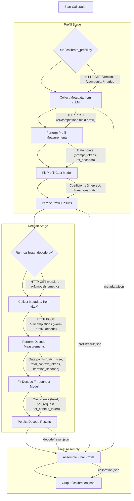

<!-- source: DeepWiki mcp.deepwiki.com · repo openJiuwen-ai/agent-infer · page 6.3 Calibration Tools · fetched 2026-11-02 -->

# Calibration Tools

Relevant source files

The following files were used as context for generating this wiki page:

- [tests/tools/test_calibration.py](tests/tools/test_calibration.py)
- [tools/calibration/README.md](tools/calibration/README.md)
- [tools/calibration/calibrate_decode.py](tools/calibration/calibrate_decode.py)
- [tools/calibration/calibrate_prefill.py](tools/calibration/calibrate_prefill.py)
- [tools/calibration/common.py](tools/calibration/common.py)
- [tools/calibration/metadata.py](tools/calibration/metadata.py)

The `tools/calibration` package provides utilities for measuring and modeling the performance characteristics of a vLLM backend. Specifically, it focuses on calibrating the prefill and decode cost models, handling metadata related to the vLLM deployment, and generating coefficients that can be fed into the Progress-TTL scheduling policy.

This page details the implementation of these calibration tools, including their data flow, key functions, and how they interact with the vLLM server to gather necessary performance metrics.

Sources:
- [tools/calibration/README.md:1-5]()

## Purpose and Scope

The calibration tools are designed to measure the cold-prefill cost model and warm-prefix decode throughput surface against a running vLLM server. They operate as standalone commands and do not interfere with AgentInfer's runtime scheduling or native vLLM behavior. The output of these tools is a set of coefficients that describe the performance of the vLLM deployment, which are then used by the Progress-TTL scheduler.

The initial implementation supports homogeneous vLLM internal Data Parallel (DP) deployments. It automatically discovers and targets a specific EngineCore rank for calibration. The generated coefficients are reusable across all homogeneous engines in such a deployment.

Sources:
- [tools/calibration/README.md:1-5]()
- [tools/calibration/README.md:9-13]()

## Data Flow and Key Components

The calibration process involves two main stages: prefill calibration and decode calibration. Both stages interact with a running vLLM server to collect performance data.

### Calibration Process Overview

The overall calibration process can be visualized as follows:

Title: Calibration Process Flow
Sources:
- [tools/calibration/calibrate_prefill.py:77-167]()
- [tools/calibration/calibrate_decode.py:102-312]()
- [tools/calibration/metadata.py:109-134]()

### Common Utilities (`tools/calibration/common.py`)

The `common.py` module provides shared functionalities used by both prefill and decode calibration scripts.

- `CompletionResult` [tools/calibration/common.py:23-40](): A dataclass to store client-observed lengths and timing for a streamed completion, including `request_id`, `prompt_tokens`, `completion_tokens`, `cached_prompt_tokens`, `ttft_seconds`, `decode_seconds`, `e2e_latency_seconds`, and `token_timestamps_monotonic`.
- `JsonlRecorder` [tools/calibration/common.py:42-57](): A utility to append and flush JSON records to a `.jsonl` file, ensuring immediate persistence of each completed calibration request.
- `exact_prompt_tokens(length: int, variant: int)` [tools/calibration/common.py:59-64](): Generates a deterministic exact-length token-ID prompt, useful for reproducible calibration runs.
- `stream_completion(...)` [tools/calibration/common.py:67-137](): An asynchronous function to send a completion request to the vLLM server and parse the streamed response. It extracts timing and token usage information, including `ttft_seconds` (time to first token) and `decode_seconds`. This function can optionally pin the request to a specific internal-DP EngineCore rank using the `X-data-parallel-rank` header.
- Argument parsing helpers [tools/calibration/common.py:140-182](): Functions like `parse_positive_int_list`, `parse_positive_int`, `parse_nonnegative_int`, and `parse_positive_float` are used to validate command-line arguments.

Sources:
- [tools/calibration/common.py:23-40]()
- [tools/calibration/common.py:42-57]()
- [tools/calibration/common.py:59-64]()
- [tools/calibration/common.py:67-137]()
- [tools/calibration/common.py:140-182]()

### Metadata Handling (`tools/calibration/metadata.py`)

The `metadata.py` module is responsible for collecting and persisting stable metadata about the vLLM deployment.

- `THROUGHPUT_COUNTERS` [tools/calibration/metadata.py:17-22](): A tuple defining the Prometheus counter names used for throughput measurement (e.g., `vllm:prompt_tokens_total`, `vllm:generation_tokens_total`).
- `collect_metadata(client: httpx.AsyncClient, model: str)` [tools/calibration/metadata.py:25-62](): Asynchronously collects metadata from the vLLM server's `/version`, `/v1/models`, and `/metrics` endpoints. It extracts information like vLLM version, model details, deployment configuration (e.g., `engine_count`, `cache_config`), and available throughput metric names. It also identifies the `engine_ids` for internal DP.
- `collect_throughput_counters(client: httpx.AsyncClient, engine: int)` [tools/calibration/metadata.py:65-80](): Reads selected cumulative Prometheus counters for a specific EngineCore/DP rank.
- `counter_delta(before: dict[str, float], after: dict[str, float])` [tools/calibration/metadata.py:82-85](): Calculates the non-negative delta between two sets of counter values, used to measure throughput over a specific measurement window.
- `metadata_hash(metadata: dict[str, object])` [tools/calibration/metadata.py:87-92](): Computes a SHA-256 hash over the canonical UTF-8 JSON representation of the metadata. This ensures that calibration results are tied to a specific, immutable deployment configuration.
- `persist_metadata(root: Path, metadata: dict[str, object])` [tools/calibration/metadata.py:94-107](): Persists the collected metadata to `metadata.json` within the calibration output directory. It checks for consistency if metadata already exists, preventing mixing results from different deployments.
- `assemble_profile(root: Path)` [tools/calibration/metadata.py:109-134](): After both prefill and decode stages are complete, this function combines the metadata, prefill results, and decode results into a single `calibration.json` profile. It validates that the metadata hashes and calibration scopes match between the stages.
- `infer_kv_capacity_tokens(metadata: dict[str, object])` [tools/calibration/metadata.py:152-161](): Derives the logical HBM KV capacity for one EngineCore rank from the `vllm:cache_config_info` metrics. This is crucial for the decode calibration to avoid over-allocating KV cache.
- `resolve_calibration_engine(requested_engine: int | None, engine_ids: tuple[int, ...])` [tools/calibration/metadata.py:143-149](): Selects the target engine for calibration. If `requested_engine` is `None`, it defaults to the first discovered engine. It also determines if the `X-data-parallel-rank` header should be sent (only for multi-DP deployments).

Sources:
- [tools/calibration/metadata.py:17-22]()
- [tools/calibration/metadata.py:25-62]()
- [tools/calibration/metadata.py:65-80]()
- [tools/calibration/metadata.py:82-85]()
- [tools/calibration/metadata.py:87-92]()
- [tools/calibration/metadata.py:94-107]()
- [tools/calibration/metadata.py:109-134]()
- [tools/calibration/metadata.py:152-161]()
- [tools/calibration/metadata.py:143-149]()

### Prefill Calibration (`tools/calibration/calibrate_prefill.py`)

The `calibrate_prefill.py` script measures the cold-prefill latency and fits a quadratic cost model.

- `fit_prefill(points: list[dict[str, object]])` [tools/calibration/calibrate_prefill.py:41-74](): Fits a nonnegative quadratic model to the observed Time-To-First-Token (TTFT) values against uncached prompt tokens. The formula is `seconds = intercept + linear*x + quadratic*x^2`, where `x` is `uncached_tokens/1000`. It uses nonnegative least squares to ensure physically meaningful coefficients.
- `calibrate(args: argparse.Namespace)` [tools/calibration/calibrate_prefill.py:77-167](): The main asynchronous function for prefill calibration.
    1. Prepares the output directory.
    2. Collects metadata using `collect_metadata()` [tools/calibration/calibrate_prefill.py:83]().
    3. Resolves the target calibration engine using `resolve_calibration_engine()` [tools/calibration/calibrate_prefill.py:84]().
    4. Persists metadata using `persist_metadata()` [tools/calibration/calibrate_prefill.py:99]().
    5. Performs a warmup request to ensure the server is ready [tools/calibration/calibrate_prefill.py:104-111]().
    6. Collects initial throughput counters using `collect_throughput_counters()` [tools/calibration/calibrate_prefill.py:112]().
    7. Iterates through a shuffled list of `(prompt_length, repeat)` cases [tools/calibration/calibrate_prefill.py:113-142](). For each case, it calls `stream_completion()` [tools/calibration/calibrate_prefill.py:121]() with a unique `cache_salt` to ensure a cold prefill.
    8. Records each `CompletionResult` to `requests.jsonl`.
    9. Collects final throughput counters.
    10. Aggregates results by prompt length, calculating median TTFT.
    11. Calls `fit_prefill()` [tools/calibration/calibrate_prefill.py:163]() to derive coefficients.
    12. Writes the prefill calibration results to `prefill/result.json`.
    13. Attempts to assemble the final profile using `assemble_profile()` [tools/calibration/calibrate_prefill.py:168]().

Sources:
- [tools/calibration/calibrate_prefill.py:41-74]()
- [tools/calibration/calibrate_prefill.py:77-167]()
- [tools/calibration/calibrate_prefill.py:83]()
- [tools/calibration/calibrate_prefill.py:84]()
- [tools/calibration/calibrate_prefill.py:99]()
- [tools/calibration/calibrate_prefill.py:104-111]()
- [tools/calibration/calibrate_prefill.py:112]()
- [tools/calibration/calibrate_prefill.py:113-142]()
- [tools/calibration/calibrate_prefill.py:121]()
- [tools/calibration/calibrate_prefill.py:163]()
- [tools/calibration/calibrate_prefill.py:168]()

### Decode Calibration (`tools/calibration/calibrate_decode.py`)

The `calibrate_decode.py` script measures warm-prefix decode throughput and fits a batch/context surface model.

- `steady_measurement(results: list[CompletionResult])` [tools/calibration/calibrate_decode.py:45-60](): Calculates the net decode throughput over the common active output interval for a batch of completions. It identifies the overlapping time window where all requests are actively decoding.
- `fit_decode(points: list[dict[str, object]])` [tools/calibration/calibrate_decode.py:63-99](): Fits a linear model for iteration time against batch size and total logical context. The formula is `throughput=B/(fixed+per_request*B+per_context_token*K)`, where `B` is batch size and `K` is total context tokens. It also uses nonnegative least squares.
- `run_case(...)` [tools/calibration/calibrate_decode.py:102-178](): Executes a single decode calibration case for a given batch size and context length.
    1. Generates prompts and unique `cache_salt` values for each request in the batch.
    2. Performs "warmup" requests for each prompt, generating only one token, to ensure private prefixes are cached [tools/calibration/calibrate_decode.py:116-138]().
    3. Introduces a `warmup_settle_seconds` delay [tools/calibration/calibrate_decode.py:144]() to allow EngineCore to release KV blocks, preventing cold prefill from mixing into decode samples.
    4. Sends the actual "measurement" requests for the batch, generating `output_tokens` [tools/calibration/calibrate_decode.py:145-156]().
    5. Records both warmup and measurement results.
    6. Calls `steady_measurement()` [tools/calibration/calibrate_decode.py:169]() to calculate throughput for the batch.
- `calibrate(args: argparse.Namespace)` [tools/calibration/calibrate_decode.py:181-312](): The main asynchronous function for decode calibration.
    1. Prepares the output directory.
    2. Collects metadata and resolves the target engine, similar to prefill calibration.
    3. Infers KV capacity using `infer_kv_capacity_tokens()` [tools/calibration/calibrate_decode.py:200]().
    4. Persists metadata.
    5. Collects initial throughput counters.
    6. Generates a list of `(batch_size, context_length, repeat)` cases, filtering out cases that exceed `max_kv_fraction` of the observed KV capacity [tools/calibration/calibrate_decode.py:209-224]().
    7. Shuffles the cases.
    8. Executes each case by calling `run_case()` [tools/calibration/calibrate_decode.py:230]().
    9. Aggregates results by `(batch_size, total_context_tokens)`, calculating median iteration seconds.
    10. Calls `fit_decode()` [tools/calibration/calibrate_decode.py:299]() to derive coefficients.
    11. Writes the decode calibration results to `decode/result.json`.
    12. Attempts to assemble the final profile.

Sources:
- [tools/calibration/calibrate_decode.py:45-60]()
- [tools/calibration/calibrate_decode.py:63-99]()
- [tools/calibration/calibrate_decode.py:102-178]()
- [tools/calibration/calibrate_decode.py:116-138]()
- [tools/calibration/calibrate_decode.py:144]()
- [tools/calibration/calibrate_decode.py:145-156]()
- [tools/calibration/calibrate_decode.py:169]()
- [tools/calibration/calibrate_decode.py:181-312]()
- [tools/calibration/calibrate_decode.py:200]()
- [tools/calibration/calibrate_decode.py:209-224]()
- [tools/calibration/calibrate_decode.py:230]()
- [tools/calibration/calibrate_decode.py:299]()

### Final Profile Assembly

Once both `calibrate_prefill.py` and `calibrate_decode.py` have been run against the same deployment and output directory, the `assemble_profile()` function [tools/calibration/metadata.py:109-134]() combines the `metadata.json`, `prefill/result.json`, and `decode/result.json` into a single `calibration.json` file. This file contains the complete set of coefficients and deployment metadata required by the Progress-TTL scheduler.

The `calibration.json` file has three top-level fields: `metadata`, `metadata_hash`, and `calibration`. The `calibration` field contains `scope`, `prefill` (with its fitted coefficients), and `decode` (with its fitted coefficients).

Sources:
- [tools/calibration/metadata.py:109-134]()
- [tests/tools/test_calibration.py:165]()

## Command-Line Interface

Both calibration scripts (`calibrate_prefill.py` and `calibrate_decode.py`) are designed to be run from the repository root. They share common parameters and have stage-specific parameters.

### Common Parameters

| Parameter | Default | Purpose |
|---|---|---|
| `--base-url` | `http://127.0.0.1:8000` | Base URL of the running vLLM server. |
| `--model` | Required | Served model ID accepted by `/v1/completions`. |
| `--output-dir` | `tools/calibration/results` | Shared root for all calibration artifacts. |
| `--data-parallel-rank` | Auto | Optional internal-DP EngineCore rank. Auto-selects the first engine; header sent only for multi-DP. |
| `--timeout` | `3600` seconds | HTTP timeout for one request. |
| `--overwrite` | Disabled | Replace only the current command's stage directory. |

Sources:
- [tools/calibration/README.md:56-64]()
- [tests/tools/test_calibration.py:90-100]()

### Prefill Parameters

| Parameter | Default | Purpose |
|---|---|---|
| `--prompt-lengths` | `1024,2048,4096,8192,16384,32768,65536` | Exact cold-prompt token counts. At least three distinct lengths are required. |
| `--repeats` | `2` | Number of cold requests measured at each prompt length. |
| `--shuffle-seed` | `260901` | Seed for shuffling prompt-length/repeat order. |

Sources:
- [tools/calibration/README.md:68-73]()
- [tests/tools/test_calibration.py:90-100]()

### Decode Parameters

| Parameter | Default | Purpose |
|---|---|---|
| `--batch-sizes` | `1,2,4,8,16,32` | Concurrent request counts to sample batch gain. |
| `--context-lengths` | `1024,8192,16384,32768` | Exact logical context length per request. |
| `--output-tokens` | `128` | Tokens generated per measurement request. |
| `--warmup-settle-seconds` | `1.0` | Delay after sequential prefix warmup to prevent mixing cold Prefill. |
| `--repeats` | `1` | Measurements for every valid batch/context pair. |
| `--max-kv-fraction` | `0.9` | Maximum fraction of observed per-rank HBM KV capacity a case may occupy. |
| `--shuffle-seed` | `260901` | Seed for shuffling valid batch/context/repeat cases. |

Sources:
- [tools/calibration/README.md:77-84]()
- [tests/tools/test_calibration.py:90-100]()

## Testing

The `tests/tools/test_calibration.py` module contains unit and integration tests for the calibration tools.

- `test_http_metadata_discovers_homogeneous_internal_dp()` [tests/tools/test_calibration.py:64-87](): Verifies that `collect_metadata` correctly discovers engine IDs and cache configurations from mock HTTP responses, and that `infer_kv_capacity_tokens` correctly derives KV capacity.
- `test_cli_uses_repository_results_and_observed_capacity()` [tests/tools/test_calibration.py:89-102](): Checks default argument values for CLI parsers, ensuring `output_dir` defaults to `tools/calibration/results` and `kv_capacity_tokens` is not a manual parameter for decode.
- `test_cli_rejects_invalid_numeric_options()` [tests/tools/test_calibration.py:104-127](): Parameterized test to ensure CLI parsers reject invalid numeric inputs (e.g., non-positive integers, out-of-range floats).
- `test_engine_selection_omits_unnecessary_dp_header()` [tests/tools/test_calibration.py:129-134](): Validates `resolve_calibration_engine` behavior for single-DP (no `X-data-parallel-rank` header) and multi-DP (header sent).
- `test_metadata_hash_is_key_order_independent()` [tests/tools/test_calibration.py:136-139](): Confirms that `metadata_hash` produces consistent hashes regardless of dictionary key order.
- `test_profile_has_exactly_three_top_level_fields()` [tests/tools/test_calibration.py:141-167](): Verifies that `assemble_profile` correctly combines metadata and stage results into a `calibration.json` with the expected structure.
- `test_prefill_and_decode_models_fit_exact_points()` [tests/tools/test_calibration.py:169-173](): Tests the `fit_prefill` and `fit_decode` functions with reference data points to ensure they reproduce expected coefficients.

Sources:
- [tests/tools/test_calibration.py:64-87]()
- [tests/tools/test_calibration.py:89-102]()
- [tests/tools/test_calibration.py:104-127]()
- [tests/tools/test_calibration.py:129-134]()
- [tests/tools/test_calibration.py:136-139]()
- [tests/tools/test_calibration.py:141-167]()
- [tests/tools/test_calibration.py:169-173]()

## Progress-TTL Coefficients

The output `calibration.json` file contains the `ttl_prefill_model_*` and `decode_step_*` coefficients. These coefficients are directly consumed by the Progress-TTL scheduling policy to estimate request costs and make admission/scheduling decisions.

For example, the prefill model provides:
- `ttl_prefill_model_intercept_seconds`
- `ttl_prefill_model_linear_seconds_per_1k_tokens`
- `ttl_prefill_model_quadratic_seconds_per_1k_tokens_squared`

And the decode model provides:
- `decode_step_fixed_seconds`
- `decode_step_seconds_per_request`
- `decode_step_seconds_per_context_token`

These coefficients allow the scheduler to predict the time required for prefill and decode operations based on prompt length, batch size, and context length, enabling more informed scheduling decisions.

Sources:
- [tools/calibration/calibrate_prefill.py:59-62]()
- [tools/calibration/calibrate_decode.py:79-81]()

---

