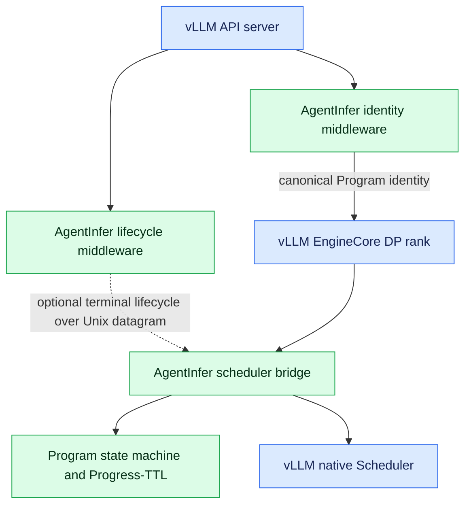

<!-- source: DeepWiki mcp.deepwiki.com · repo openJiuwen-ai/agent-infer · page 6.4 Design Documents · fetched 2026-11-02 -->

# Design Documents

<details>
<summary>Relevant source files</summary>

The following files were used as context for generating this wiki page:

- [AGENTS.md](AGENTS.md)
- [design/module/scheduling/program-state-machine.md](design/module/scheduling/program-state-machine.md)
- [design/module/scheduling/vllm-runtime-integration.md](design/module/scheduling/vllm-runtime-integration.md)
- [design/superpowers/plans/agentcache-skills-implementation.md](design/superpowers/plans/agentcache-skills-implementation.md)
- [design/superpowers/specs/agentcache-skills-batch2.md](design/superpowers/specs/agentcache-skills-batch2.md)

</details>


This page provides an overview of the design documents within the `design/` directory, covering module specifications for scheduling and benchmarking, plans for "superpowers" (AI agent skills), and conventions for AI-assisted contributions outlined in `AGENTS.md`. It details the architecture, purpose, and key components of these design artifacts.

## Scheduling Module Specifications

The `design/module/scheduling/` directory contains normative specifications for core scheduling components. These documents define the contracts, state machines, and integration points for AgentInfer's scheduling capabilities.

### Program State Machine

The Program state machine defines the host-neutral runtime contract between an adapter and a scheduling strategy. It is central to how `ProgramScheduler` manages live Program records, request retention, snapshot construction, transition validation, event dispatch, and periodic scheduling [design/module/scheduling/program-state-machine.md:33-40](). A strategy determines transitions but cannot directly alter runtime state [design/module/scheduling/program-state-machine.md:39-40]().

This module explicitly does not handle Progress-TTL scores, API protocol parsing, native request execution, backend discovery, or retries [design/module/scheduling/program-state-machine.md:42-43]().

#### Program Identity and Generation

A `program_id` uniquely identifies a logical Program across multiple request attempts. A `ProgramRef` combines `program_id` with a `generation` counter to identify a specific live incarnation of a Program [design/module/scheduling/program-state-machine.md:45-46](). When a Program is released and then re-materialized, its generation counter increments [design/module/scheduling/program-state-machine.md:46-47]().

The `ProgramRegistry` is responsible for managing the current record for each `program_id`, tracking the last generation counter, task membership, and blocking-parent indexes. It provides immutable `ProgramView` values to scheduling strategies [design/module/scheduling/program-state-machine.md:52-54]().

#### Program-owned Runtime Fields

The `RuntimeProgram` is the primary mutable record for a single live Program generation. Its fields represent runtime facts rather than Progress-TTL scores [design/module/scheduling/program-state-machine.md:56-57]().

The following table summarizes key fields of `RuntimeProgram`:

| Field | Meaning | Updated when |
| --- | --- | --- |
| `ref` | Exact `(program_id, generation)` identity. | Set on materialization; never changes within the generation. |
| `state` | Forwarding state: `ACTIVE`, `PAUSED`, or `TERMINATED`. | Changed only by accepted `ADMIT`, `RESUME`, `PAUSE`, or `RELEASE` transitions. |
| `status` | Demand state: `REASONING` or `ACTING`. | Set to reasoning on request arrival; set to acting after the last overlapping request completes or is cancelled. |
| `tokens` | Latest context, growth, shared-prefix, and optional physical cache observation. | Context is raised on arrival and finalized on completion; shared-prefix fields are refreshed only when their freshness deadline permits. |
| `backend_id` | Backend that owns an active Program. | Set by admit/resume; cleared by pause/release. |
| `task_id` | Stable grouping for related Programs. | Set at materialization or filled once from later compatible metadata; cannot change afterward. |
| `parent_program_id`, `blocks_parent` | Supplied parent relationship and whether the child blocks it. | Applied from compatible identity metadata; registry relationship indexes are updated atomically. |
| `blocked_on_child`, `blocking_children` | Derived live blocking-child state. | Recomputed when a blocking child is attached, detached, changed, or released. |
| `expected_resume` | Upstream expectation that another model request will follow. | Refreshed from identity metadata; it is a hint and does not itself change state. |
| `agent_role`, `spawn_reason` | Optional upstream diagnostic metadata. | Refreshed when later compatible identity metadata supplies a non-null value. |
| `step_count` | Number of completed model requests. | Incremented once by `record_completion()`. |
| `wait_started_at_monotonic_s` | Core scheduling wait timestamp exposed in `ProgramView`. | Reserved by the runtime model; Progress-TTL uses its own policy-specific wait timestamps described below. |
| `marked_for_pause` | Delayed pause requested for in-flight reasoning. | Set by `MARK_FOR_PAUSE`; cleared by admit/resume/pause and consumed after the last request completes. |
| `release_after_inflight` | Reserved flag for a terminal fact observed while work overlaps. | Present in the runtime record but not used by the current main-branch transition path. |

Sources: [design/module/scheduling/program-state-machine.md:56-76]()

`ProgramTokenObservation` distinguishes between estimated and actual backend facts:

| Field | Meaning and update rule |
| --- | --- |
| `estimated_context_tokens` | Maximum known prompt/context on arrival, then trustworthy final total tokens on completion. |
| `shared_prefix_tokens` | Reusable prefix observed for the current segment; bounded by prompt length. |
| `shared_prefix_fresh_until_monotonic_s` | Deadline that prevents pause/resume churn from repeatedly refreshing the same prefix observation. |
| `actual_resident_tokens`, `actual_allocated_blocks`, `block_size_tokens` | Optional physical observations. The current vLLM bridge does not populate per-Program resident-block facts. |
| `shared_prefix_attribution`, `source`, `observed_at_monotonic_s` | Observation quality, source, and timestamp. |

Sources: [design/module/scheduling/program-state-machine.md:77-87]()

The runtime also maintains request-scoped indexes such as `_request_bindings`, `_program_requests`, `_last_request_finished_at`, and `_shared_prefix_freshness_anchor_at` [design/module/scheduling/program-state-machine.md:89-93]().

#### Policy-owned Program Factors

Scheduling policy values are not stored within `RuntimeProgram`. Instead, `StrategyFactors` holds a global factor object and a per-generation factor object, both managed under the same serialized mutation boundary [design/module/scheduling/program-state-machine.md:94-96](). For Progress-TTL, `ProgressTTLProgramFactors` includes:

| Group | Fields | Update points |
| --- | --- | --- |
| Current segment | `segment_served_rounds`, `segment_started_at_monotonic_s`, `segment_prompt_tokens`, `segment_completion_tokens`, `segment_first_request_pending`, `last_request_prompt_tokens`, `last_request_context_tokens`, `segment_share_tokens` | Reset on admit/resume; accumulated on completion; frozen and cleared on pause. The first-request flag prevents repeated same-segment cache observations from being treated as new shared reuse. |
| Lifetime progress | `lifetime_generated_tokens`, `rounds_since_ttl_pause`, `previous_ttl_seconds`, `last_inter_request_gap_seconds`, `is_evictable_after_min_rounds` | Updated on completion; used by privilege promotion, continuity estimation, and acting-TTL accounting. |
| Previous segment | `last_segment_served_rounds`, `last_segment_prompt_tokens`, `last_segment_completion_tokens` | Copied from the current segment on pause for diagnostics and capacity ordering. |

Sources: [design/module/scheduling/program-state-machine.md:99-103]()

Sources: [design/module/scheduling/program-state-machine.md]()

### vLLM Runtime Integration

AgentInfer integrates Program scheduling into vLLM V1 without replacing vLLM's token scheduler [design/module/scheduling/vllm-runtime-integration.md:36-37](). AgentInfer can retain an agent request before native admission, but vLLM retains ownership of its waiting queue, token budget, batching, preemption, KV allocation, model execution, and output processing after admission [design/module/scheduling/vllm-runtime-integration.md:37-40]().

The integration components are located under `agentinfer.agentcache.core`, as they adapt vLLM request and scheduler objects. Host-neutral identity contracts, the Program state machine, and Progress-TTL remain under `agentinfer.scheduling` [design/module/scheduling/vllm-runtime-integration.md:41-43]().

#### Requirements for Integration

To integrate AgentInfer with vLLM, the following requirements must be met:
*   AgentInfer must be installed in the same Python environment as vLLM [design/module/scheduling/vllm-runtime-integration.md:45]().
*   The appropriate scheduler bridge (`--async-scheduling` with `AgentCacheAsyncSchedulerBridge` or `--no-async-scheduling` with `AgentCacheSyncSchedulerBridge`) must be used [design/module/scheduling/vllm-runtime-integration.md:46]().
*   Prefix caching must be enabled for Progress-TTL to observe reusable prefixes [design/module/scheduling/vllm-runtime-integration.md:47]().
*   Program identity must be provided via canonical request metadata or the identity middleware [design/module/scheduling/vllm-runtime-integration.md:48]().
*   A compatible vLLM version whose V1 scheduler interfaces match the AgentInfer release must be used [design/module/scheduling/vllm-runtime-integration.md:49-50]().

#### Starting a Server

To start a server with AgentInfer integration, first install AgentInfer into the activated vLLM environment [design/module/scheduling/vllm-runtime-integration.md:52-56]().

The recommended asynchronous configuration involves setting `AGENTCACHE_VLLM_LIFECYCLE_SOCKET` and using specific `vllm serve` arguments [design/module/scheduling/vllm-runtime-integration.md:60-84]().

```bash
export AGENTCACHE_VLLM_LIFECYCLE_SOCKET=/tmp/agentinfer-vllm-lifecycle.sock

vllm serve MODEL \
  --async-scheduling \
  --scheduler-cls agentinfer.agentcache.core.scheduler.AgentCacheAsyncSchedulerBridge \
  --middleware agentinfer.agentcache.core.api_adapter.AgentCacheIdentityMiddleware \
  --middleware agentinfer.agentcache.core.api_adapter.AgentCacheLifecycleMiddleware \
  --enable-prefix-caching \
  --enable-prompt-tokens-details \
  --additional-config '{
    "agentcache": {
      "controller_factory": "agentinfer.agentcache.core.factory.build_progress_ttl_controller",
      "progress_ttl": {
        "mode": "on"
      },
      "observability": {
        "enabled": true,
        "log_interval_seconds": 5
      }
    }
  }'
```

Sources: [design/module/scheduling/vllm-runtime-integration.md:60-84]()

The `AgentCacheAsyncSchedulerBridge` rejects configurations where async scheduling is disabled. For synchronous deployments, `--no-async-scheduling` and `agentinfer.agentcache.core.scheduler.AgentCacheSyncSchedulerBridge` must be explicitly selected [design/module/scheduling/vllm-runtime-integration.md:86-89]().

The lifecycle middleware is optional; if omitted, `AGENTCACHE_VLLM_LIFECYCLE_SOCKET` should also be omitted [design/module/scheduling/vllm-runtime-integration.md:91-92](). The identity middleware is required for framework headers, `agent_hint`, and `/v1/messages` [design/module/scheduling/vllm-runtime-integration.md:92-95]().

The command-line options have distinct responsibilities:

| Option | Responsibility |
| --- | --- |
| `--async-scheduling` | Enables vLLM's native asynchronous scheduling path. It must match the async bridge. |
| `--no-async-scheduling` | Explicitly disables vLLM async scheduling. It must match the sync bridge. |
| `--scheduler-cls ...AgentCacheAsyncSchedulerBridge` | Wraps native `AsyncScheduler` with Program admission hooks while preserving native token scheduling. |
| `--middleware ...AgentCacheIdentityMiddleware` | Normalizes framework headers or `agent_hint`, and bridges Anthropic Messages identity into internal `vllm_xargs.agentic_context`. |
| `--middleware ...AgentCacheLifecycleMiddleware` | Optionally parses final API response semantics and sends terminal lifecycle facts to the selected EngineCore rank. |
| `--enable-prefix-caching` | Enables the vLLM prefix cache whose reusable-prefix boundary is observed by Progress-TTL. |
| `--enable-prompt-tokens-details` | Makes prompt/cache token evidence available to API clients and benchmark tooling; it does not select the policy. |
| `--additional-config` | Supplies the `agentcache` adapter, policy, and observability namespaces. |
| `AGENTCACHE_VLLM_LIFECYCLE_SOCKET` | Selects the API-side Unix datagram base path; the receiver uses a `.dpN` suffix. It is needed only with lifecycle middleware. |

Sources: [design/module/scheduling/vllm-runtime-integration.md:101-109]()

It is important not to select the legacy `agentinfer.agentcache.core.scheduler.AgentAwareScheduler` for this configuration, as it replaces vLLM's waiting queue and is not the Progress-TTL integration path [design/module/scheduling/vllm-runtime-integration.md:111-113]().

#### Architecture Diagram

The following diagram illustrates the architecture of AgentInfer's integration with vLLM:


Diagram: AgentInfer vLLM Integration Architecture
Sources: [design/module/scheduling/vllm-runtime-integration.md:117-139]()

Blue nodes represent native vLLM components, while green nodes represent AgentInfer components [design/module/scheduling/vllm-runtime-integration.md:141]().

#### Relationship to Native vLLM Async Scheduling

`AgentCacheAsyncSchedulerBridge` extends vLLM's native `AsyncScheduler` without replacing its token-level scheduling algorithm [design/module/scheduling/vllm-runtime-integration.md:144-145](). Each call performs an AgentInfer pre-schedule hook, calls `super().schedule()` once, and then records computed-prefix observations from the native scheduling output [design/module/scheduling/vllm-runtime-integration.md:145-148](). Once a request enters vLLM's waiting queue, vLLM's native scheduler manages token-budget allocation, continuous batching, KV-block allocation, preemption, model execution, and output processing [design/module/scheduling/vllm-runtime-integration.md:148-151]().

AgentInfer influences the request set and order visible to the native scheduler. `add_request()` can retain tracked agentic work in `RequestPool`, and a subsequent Program decision transfers an admitted request to the native waiting queue [design/module/scheduling/vllm-runtime-integration.md:151-154]().

Sources: [design/module/scheduling/vllm-runtime-integration.md]()

## Superpowers Specifications and Plans

The `design/superpowers/` directory contains specifications and plans for AI agent skills, which guide AI agents in contributing to AgentInfer.

### AgentCache Skills — Batch 2 Design

The Batch 2 design for AgentCache skills extends the initial catalog with new capabilities, particularly focusing on design-stage skills and enhanced review criteria [design/superpowers/specs/agentcache-skills-batch2.md:19-21]().

#### Context and Goals

The initial batch of skills (`ac-bootstrap`, `ac-benchmark`, `ac-integrate`, `ac-review`) focused on workflow stages [design/superpowers/specs/agentcache-skills-batch2.md:9-10](). Batch 2 aims to:
*   Add a design-stage skill for cache optimization proposals [design/superpowers/specs/agentcache-skills-batch2.md:19]().
*   Extend `ac-review` with workflow, regression, and architecture criteria [design/superpowers/specs/agentcache-skills-batch2.md:20]().
*   Keep the skill catalog aligned with the evolving benchkit layout [design/superpowers/specs/agentcache-skills-batch2.md:21]().

Non-goals include rewriting the batch-1 spec, adding generic Python coding standards, or replacing benchmark runbooks with skill text [design/superpowers/specs/agentcache-skills-batch2.md:25-28]().

#### Catalog Additions

The following skills and criteria have been added:

| Skill / criterion | Purpose |
| --- | --- |
| `ac-design` | Analyze cache patterns and write RFC-style design documents for AgentCache optimization strategies. |
| `60-workflow.md` | Review CI/workflow configuration, pre-commit compatibility, CI time, and DCO checks. |
| `70-regression.md` | Review benchmark and performance-regression evidence against baseline runs. |
| `80-architecture.md` | Review file ownership boundaries, contracts, utility placement, and key class surface area. |

Sources: [design/superpowers/specs/agentcache-skills-batch2.md:31-37]()

#### `ac-design` Skill

`ac-design` is a producer skill for design work preceding implementation. It is triggered by requests to analyze AgentCache cache patterns, write design documents, or evaluate benchmark data for optimization strategies [design/superpowers/specs/agentcache-skills-batch2.md:39-43](). This skill is grounded in project RFCs, such as single-agent tool-call optimization (RFC #10), subagent concurrency optimization (RFC #9), and correctness guardrails (RFC #2) [design/superpowers/specs/agentcache-skills-batch2.md:45-49](). It requires designs to specify measurable success criteria and correctness guardrails before implementation [design/superpowers/specs/agentcache-skills-batch2.md:51-52]().

#### `ac-review` Criteria Extensions

The `ac-review` skill has been extended with new criteria:

*   **Workflow (`60-workflow.md`)**: Covers GitHub Actions, pre-commit configuration, tool-version compatibility, CI runtime impact, and DCO. This ensures workflow changes are reviewed separately from style and clarifies build-system ownership [design/superpowers/specs/agentcache-skills-batch2.md:57-60]().
*   **Regression (`70-regression.md`)**: Stricter than the general performance bar in `40-perf.md`. It mandates baseline/candidate comparisons for benchmark-sensitive changes, blocks pass-rate regressions, and emphasizes TTFT checks for scheduling work [design/superpowers/specs/agentcache-skills-batch2.md:62-66]().
*   **Architecture (`80-architecture.md`)**: Adds reviewer-level gates for later phases, including defining ownership boundaries in file headers, documenting public/core contracts, placing reusable helpers in domain utilities, justifying key class method surfaces, and ensuring public APIs precede private helpers [design/superpowers/specs/agentcache-skills-batch2.md:68-76]().

#### Benchmark Skill Alignment

`ac-benchmark` now uses a discovery-first workflow, inventorying the current repository for benchmark configuration files, task lists, launch scripts, status/runbook documentation, and output directories, rather than relying on hardcoded path assumptions [design/superpowers/specs/agentcache-skills-batch2.md:79-89](). Concrete experiment states should be generated from verified current templates or configurations [design/superpowers/specs/agentcache-skills-batch2.md:90-91]().

Sources: [design/superpowers/specs/agentcache-skills-batch2.md]()

### AgentCache Skills Implementation Plan

This plan outlines the creation of four ZCode/agent skills (`ac-bootstrap`, `ac-benchmark`, `ac-integrate`, `ac-review`) under the `skills/` directory, designed to guide AI agents working on AgentCache [design/superpowers/plans/agentcache-skills-implementation.md:4-6](). The `ac-review` skill is designed for weekly criteria refresh [design/superpowers/plans/agentcache-skills-implementation.md:6]().

#### Architecture

Each skill is defined by a `SKILL.md` file within its respective `skills/<name>/` directory, including `name` and `description` frontmatter for auto-discovery [design/superpowers/plans/agentcache-skills-implementation.md:7-8](). The `ac-review` skill separates its stable process (`SKILL.md`) from evolving criteria (`criteria/*.md`), which are refreshed weekly via a recurring issue [design/superpowers/plans/agentcache-skills-implementation.md:8-9](). A `skills/README.md` indexes all four skills, and all three producer skills link to `ac-review` as the final pre-merge step [design/superpowers/plans/agentcache-skills-implementation.md:10]().

The tech stack is Markdown only, with conventions for ruff formatting, DCO sign-off, and markdownlint-cleanliness [design/superpowers/plans/agentcache-skills-implementation.md:11-12]().

#### File Structure

```
skills/
  README.md                          # index: one line per skill (Task 1)
  ac-bootstrap/
    SKILL.md                         # scaffold skill (Task 2)
  ac-benchmark/
    SKILL.md                         # benchmark skill (Task 3)
  ac-integrate/
    SKILL.md                         # integration skill (Task 4)
  ac-review/
    SKILL.md                         # review PROCESS (stable) (Task 5)
    criteria/
      README.md                      # evolution protocol + weekly cadence (Task 5)
      00-meta.md                     # DCO, ruff, PR template (Task 6)
      10-style.md                    # formatting, imports, naming (Task 6)
      20-api.md                      # public API docstring rule (Task 6)
      30-testing.md                  # cache mutation = test required (Task 6)
      40-perf.md                     # performance bar (Task 6)
      50-safety.md                   # cache poisoning, eviction correctness (Task 6)
      _template.md                   # template for adding a new criterion file (Task 6)
```
Diagram: AgentCache Skills File Structure
Sources: [design/superpowers/plans/agentcache-skills-implementation.md:16-35]()

Each file has a single, clear responsibility: `SKILL.md` files define the skill's process and steps, `criteria/*.md` files define review checks, `criteria/_template.md` provides a template for new criteria, and `criteria/README.md` outlines the weekly refresh protocol [design/superpowers/plans/agentcache-skills-implementation.md:38-42]().

A verification gate (Task 7) involves running pre-commit on the entire skills tree to fix markdownlint/ruff/typos findings before the final commit [design/superpowers/plans/agentcache-skills-implementation.md:44-45]().

Sources: [design/superpowers/plans/agentcache-skills-implementation.md]()

## AGENTS.md Conventions

The `AGENTS.md` file provides instructions for AI-assisted contributions to `agent-infer`, which publishes the `agentinfer` Python package [AGENTS.md:1-3](). It focuses on stable, repo-wide norms, while evolving RFC workflow, benchmark environment facts, and reviewer criteria are located in `skills/`, `skills/ac-review/criteria/`, specs, handoff docs, or benchmark artifacts [AGENTS.md:4-7]().

### Development Setup

AI agents should use the repository's Python and pre-commit configuration as the source of truth. A typical local setup involves creating a `uv venv`, activating it, installing the package in editable mode, and installing pre-commit hooks [AGENTS.md:9-19]().

```bash
uv venv --python 3.10
source .venv/bin/activate
uv pip install -e .
pre-commit install
```

Sources: [AGENTS.md:14-19]()

### Validation

Before submitting changes, relevant local checks for touched files should be run. For broad changes, `pytest tests/` and `pre-commit run --all-files` are preferred [AGENTS.md:22-29](). For focused changes, the smallest relevant pytest/pre-commit command should be run, and the exact command and result included in the PR [AGENTS.md:30-32]().

### Commit and PR Hygiene

*   Every commit must include a `Signed-off-by:` trailer for DCO compliance [AGENTS.md:35]().
*   Agent co-author attribution should not be included in commit messages [AGENTS.md:36]().
*   The `.github/PULL_REQUEST_TEMPLATE.md` must be filled out with purpose, test plan, and test results [AGENTS.md:37]().
*   Relevant issues or RFCs should be linked when changes affect design, behavior, public API, benchmarks, or developer workflow [AGENTS.md:38-40]().
*   Pushing, force-pushing, or rewriting shared history is prohibited unless explicitly requested [AGENTS.md:41]().

Sources: [AGENTS.md:35-41]()

### Documentation and Benchmark Evidence

*   Dated, historical, or archival documentation should be preserved unless explicitly asked to rewrite [AGENTS.md:44]().
*   Append-only notes or handoffs are preferred over rewriting historical material [AGENTS.md:45]().
*   Benchmark host, model, environment, path, or matrix assumptions should not be frozen in repo-level agent guidance; current artifacts, configs, logs, or handoff docs should be cited instead [AGENTS.md:46-49]().
*   Benchmark and performance claims must be supported by reviewer-readable commands, raw artifacts/logs, parsed summaries, and an explicit explanation if full validation was not run [AGENTS.md:50-52]().

Sources: [AGENTS.md:44-52]()

Sources: [AGENTS.md]()

---

