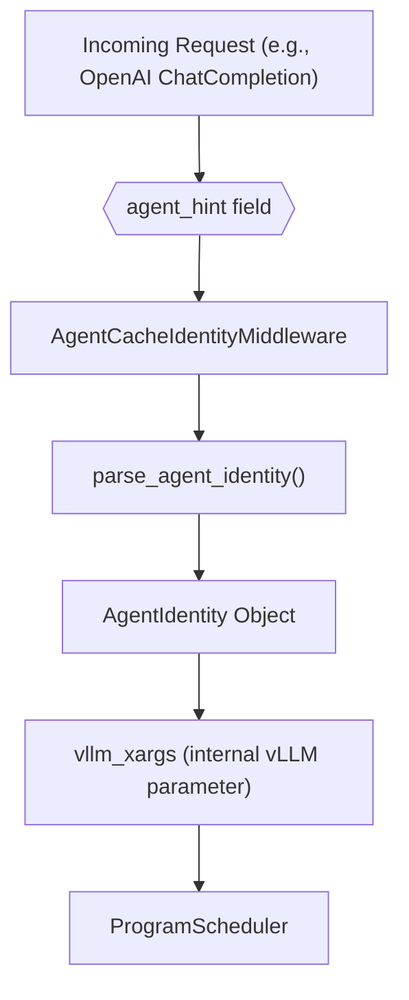
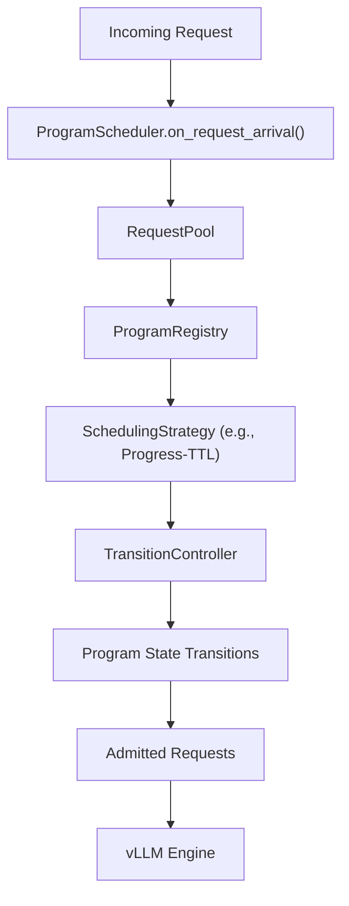

<!-- source: DeepWiki mcp.deepwiki.com · repo openJiuwen-ai/agent-infer · page 7 Glossary · fetched 2026-11-02 -->

# Glossary

Relevant source files

The following files were used as context for generating this wiki page:

- [agentinfer/agentbench/benchkit/artifacts/summary.py](agentinfer/agentbench/benchkit/artifacts/summary.py)
- [agentinfer/agentbench/benchkit/runner.py](agentinfer/agentbench/benchkit/runner.py)
- [agentinfer/agentcache/core/api_adapter.py](agentinfer/agentcache/core/api_adapter.py)
- [agentinfer/scheduling/progress_ttl/__init__.py](agentinfer/scheduling/progress_ttl/__init__.py)
- [agentinfer/scheduling/progress_ttl/factors.py](agentinfer/scheduling/progress_ttl/factors.py)
- [agentinfer/scheduling/progress_ttl/rolling_stats.py](agentinfer/scheduling/progress_ttl/rolling_stats.py)
- [agentinfer/scheduling/runtime.py](agentinfer/scheduling/runtime.py)
- [pyproject.toml](pyproject.toml)
- [tests/agentbench/test_compare.py](tests/agentbench/test_compare.py)
- [tests/agentcache/core/test_vllm_api_adapter.py](tests/agentcache/core/test_vllm_api_adapter.py)
- [tests/agentcache/core/test_vllm_factory.py](tests/agentcache/core/test_vllm_factory.py)
- [tests/scheduling/test_progress_ttl_runtime.py](tests/scheduling/test_progress_ttl_runtime.py)
- [tests/scheduling/test_scheduling_contracts.py](tests/scheduling/test_scheduling_contracts.py)

This page defines key terms specific to the AgentInfer project, providing context, implementation details, and pointers to relevant code. It aims to clarify concepts for developers working with the codebase.

## Program

A `Program` represents a logical unit of work within AgentInfer, typically corresponding to an agent's execution or a sequence of related requests. It encapsulates the state and lifecycle of an agent's interaction with the LLM. The scheduler manages `Program` instances, transitioning them between states like `ACTIVE`, `PAUSED`, and `TERMINAL`.

A `Program` is identified by a `ProgramRef` [agentinfer/scheduling/domain.py](). The actual runtime representation is `RuntimeProgram` [agentinfer/scheduling/program_runtime.py]().

Sources:
* [agentinfer/scheduling/domain.py]()
* [agentinfer/scheduling/program_runtime.py]()
* [agentinfer/scheduling/runtime.py:53-54]()
* [tests/scheduling/test_progress_ttl_runtime.py:52-53]()

## ProgramRef

A `ProgramRef` is a unique identifier for a `Program` instance. It's used by the `ProgramScheduler` to track and manage programs throughout their lifecycle. The `ProgramRegistry` [agentinfer/scheduling/program_registry.py]() maps `ProgramRef` to `RuntimeProgram` objects.

Sources:
* [agentinfer/scheduling/domain.py]()
* [agentinfer/scheduling/program_registry.py]()
* [agentinfer/scheduling/runtime.py:23]()

## Progress-TTL

`Progress-TTL` (Time-To-Live) is the primary scheduling strategy implemented in AgentInfer. It's a policy that balances fairness, resource utilization, and agent progress by assigning a "time-to-live" to paused programs. Programs that exceed their TTL without being resumed may be evicted from the cache. The strategy considers factors like segment progress, cache recency, and privilege.

The core components of the Progress-TTL strategy are defined in `agentinfer.scheduling.progress_ttl` [agentinfer/scheduling/progress_ttl/__init__.py](). The configuration is managed by `ProgressTTLConfig` [agentinfer/scheduling/progress_ttl/config.py](), and the decision logic is within `ProgressTTLStrategy` [agentinfer/scheduling/progress_ttl/strategy.py]().

Sources:
* [agentinfer/scheduling/progress_ttl/__init__.py]()
* [agentinfer/scheduling/progress_ttl/config.py]()
* [agentinfer/scheduling/progress_ttl/strategy.py]()
* [tests/agentcache/core/test_vllm_factory.py:8-9]()
* [tests/scheduling/test_progress_ttl_runtime.py:35-41]()

## DP rank

`DP rank` refers to the Data Parallelism rank in a distributed inference setup, typically within vLLM. Each DP rank represents a GPU or a group of GPUs responsible for a portion of the model's computation. AgentInfer's scheduler needs to be aware of the DP ranks to manage HBM KV tokens and other resources effectively. `DpRankInfo` [agentinfer/scheduling/backend.py]() encapsulates information about a specific DP rank.

Sources:
* [agentinfer/scheduling/backend.py]()
* [agentinfer/scheduling/runtime.py:80]()
* [tests/agentcache/core/test_vllm_factory.py:8]()
* [tests/scheduling/test_progress_ttl_runtime.py:9]()

## HBM KV tokens

`HBM KV tokens` refers to the Key-Value cache tokens stored in High Bandwidth Memory (HBM) on the GPU. This memory is crucial for efficient inference, especially with long contexts. AgentInfer's scheduler, particularly the Progress-TTL strategy, manages the allocation and eviction of these tokens to optimize overall throughput and minimize cache churn. `DpRankInfo.total_hbm_kv_tokens` [agentinfer/scheduling/backend.py]() indicates the capacity.

Sources:
* [agentinfer/scheduling/backend.py]()
* [tests/agentcache/core/test_vllm_factory.py:8]()
* [tests/scheduling/test_progress_ttl_runtime.py:28]()

## force-resume

`force-resume` is a mechanism within the Progress-TTL strategy to prioritize the resumption of a paused program. This can be triggered by various factors, such as a program waiting for an extended period or a specific policy configuration. The `ProgressTTLProgramFactors` [agentinfer/scheduling/progress_ttl/factors.py]() dataclass contains fields like `force_resume_timeout_seconds` and `force_resume_deadline_monotonic_s` to manage this behavior.

Sources:
* [agentinfer/scheduling/progress_ttl/factors.py:41-45]()

## continuity mode

`continuity mode` is a feature of the Progress-TTL strategy that aims to protect programs from excessive cache misses and ensure a smoother execution flow. When enabled, the scheduler attempts to maintain a certain level of "continuity" for programs, potentially by adjusting TTLs or resume priorities. The `ContinuitySample` [agentinfer/scheduling/progress_ttl/rolling_stats.py]() dataclass is used to evaluate continuity protection.

Sources:
* [agentinfer/scheduling/progress_ttl/rolling_stats.py:38-43]()

## segment tenure

`segment tenure` refers to the duration or progress of a program within its current execution segment. The Progress-TTL strategy uses this concept to make scheduling decisions. For example, programs with longer segment tenure might be prioritized for continued execution or have their TTL adjusted. `ProgressTTLProgramFactors.segment_served_rounds` [agentinfer/scheduling/progress_ttl/factors.py]() tracks this.

Sources:
* [agentinfer/scheduling/progress_ttl/factors.py:20]()

## agent_hint

`agent_hint` is a field within an incoming request that provides metadata about the agent's intent or context. This hint is used by AgentInfer's `AgentCacheIdentityMiddleware` [agentinfer/agentcache/core/api_adapter.py]() to extract `AgentIdentity` [agentinfer/scheduling/identity.py]() information, which is then used by the scheduler for program identification and lifecycle management. It can include details like `session_id`, `parent_session_id`, and `expected_resume`.

Sources:
* [agentinfer/agentcache/core/api_adapter.py:10-14]()
* [agentinfer/agentcache/core/api_adapter.py:178-186]()
* [agentinfer/scheduling/identity.py]()

## vllm_xargs

`vllm_xargs` is an internal vLLM parameter used by AgentInfer to pass agent-specific metadata to the vLLM engine. The `AgentCacheIdentityMiddleware` [agentinfer/agentcache/core/api_adapter.py]() serializes the `AgentIdentity` into this field, allowing the vLLM backend to access information relevant to AgentInfer's scheduling decisions.

Sources:
* [agentinfer/agentcache/core/api_adapter.py:10-14]()
* [agentinfer/agentcache/core/api_adapter.py:65]()
* [agentinfer/agentcache/core/test_vllm_api_adapter.py:165-177]()

## RunSummary

`RunSummary` is a dataclass [agentinfer/agentbench/benchkit/artifacts/summary.py:49-65]() that encapsulates the aggregated results and metrics of a benchmark run in AgentBench. It includes various statistics related to tasks, requests, vLLM performance, correctness, and overall execution. This summary is a key artifact for analyzing and comparing benchmark results.

Sources:
* [agentinfer/agentbench/benchkit/artifacts/summary.py:49-65]()
* [agentinfer/agentbench/benchkit/runner.py:23]()
* [tests/agentbench/test_compare.py:62-71]()

## EvidenceCapture

`EvidenceCapture` is a dataclass [agentinfer/agentbench/benchkit/metrics/schema.py]() used in AgentBench to store various pieces of evidence or diagnostic information collected during a benchmark run. This can include vLLM metrics, environment details, source control information, and any errors encountered during finalization. It helps in debugging and understanding the context of a run.

Sources:
* [agentinfer/agentbench/benchkit/metrics/schema.py]()
* [agentinfer/agentbench/benchkit/runner.py:34]()
* [agentinfer/agentbench/benchkit/runner.py:77-81]()

## ProgramScheduler

The `ProgramScheduler` [agentinfer/scheduling/runtime.py:69-70]() is the core component of AgentInfer's scheduling system. It owns the `RequestPool`, manages `Program` runtime records, executes scheduling strategies (like Progress-TTL), and handles transitions between program states. It's responsible for deciding which requests are admitted, paused, resumed, or released.

Sources:
* [agentinfer/scheduling/runtime.py:69-70]()
* [tests/scheduling/test_progress_ttl_runtime.py:45-48]()

## RequestPool

The `RequestPool` [agentinfer/scheduling/request_pool.py]() is a component within the `ProgramScheduler` [agentinfer/scheduling/runtime.py:88]() that holds incoming requests before they are admitted to the vLLM engine. It manages the retention and lifecycle of these requests, allowing the scheduler to make informed decisions about admission and prioritization.

Sources:
* [agentinfer/scheduling/request_pool.py]()
* [agentinfer/scheduling/runtime.py:88]()

## ProgramRegistry

The `ProgramRegistry` [agentinfer/scheduling/program_registry.py]() is a central repository within the `ProgramScheduler` [agentinfer/scheduling/runtime.py:89]() that stores and manages `RuntimeProgram` objects. It provides methods to retrieve, update, and track the state of all active and paused programs.

Sources:
* [agentinfer/scheduling/program_registry.py]()
* [agentinfer/scheduling/runtime.py:89]()

## RuntimeProgram

`RuntimeProgram` [agentinfer/scheduling/program_runtime.py]() is the mutable, in-memory representation of a `Program` within the `ProgramScheduler`. It holds the current state, status, and various metrics and factors relevant to scheduling decisions for a specific program.

Sources:
* [agentinfer/scheduling/program_runtime.py]()
* [agentinfer/scheduling/runtime.py:35]()

## AgentIdentity

`AgentIdentity` [agentinfer/scheduling/identity.py]() is a dataclass that encapsulates the unique identification and contextual metadata of an agent's request. It includes fields like `program_id`, `session_id`, `task_id`, `agent_id`, `parent_program_id`, and flags like `blocks_parent` and `expected_resume`. This identity is crucial for the scheduler to understand the relationships between requests and programs.

Sources:
* [agentinfer/scheduling/identity.py]()
* [agentinfer/scheduling/runtime.py:31]()
* [tests/scheduling/test_progress_ttl_runtime.py:90-93]()

## ProgramLifecycle

`ProgramLifecycle` [agentinfer/scheduling/lifecycle.py]() is an Enum that defines the possible lifecycle states of a `Program` as observed from the API boundary. These states include `CONTINUE`, `TERMINAL`, and `UNKNOWN`. The `AgentCacheLifecycleMiddleware` [agentinfer/agentcache/core/api_adapter.py]() maps API response semantics (e.g., `stop_reason` in Anthropic, `finish_reason` in OpenAI) to these lifecycle states.

Sources:
* [agentinfer/scheduling/lifecycle.py]()
* [agentinfer/agentcache/core/api_adapter.py:37]()
* [tests/agentcache/core/test_vllm_api_adapter.py:87-88]()

## TransitionController

The `TransitionController` [agentinfer/scheduling/transitions.py]() is responsible for executing state transitions for programs based on the scheduling strategy's decisions. It processes `TransitionRequest` objects and produces `TransitionResult` objects, which dictate actions like admitting, pausing, resuming, or queuing requests.

Sources:
* [agentinfer/scheduling/transitions.py]()
* [agentinfer/scheduling/runtime.py:41]()

## TransitionRequest

A `TransitionRequest` [agentinfer/scheduling/transitions.py]() is an instruction from the scheduling strategy to the `TransitionController` to perform a specific action on a program or request. This includes requests to `ADMIT`, `PAUSE`, `RESUME`, or `QUEUE` a program.

Sources:
* [agentinfer/scheduling/transitions.py]()
* [agentinfer/scheduling/runtime.py:42]()
* [tests/scheduling/test_progress_ttl_runtime.py:16]()

## TransitionResult

A `TransitionResult` [agentinfer/scheduling/transitions.py]() is the outcome of a `TransitionRequest` processed by the `TransitionController`. It indicates whether the requested action was successful and provides any relevant information, such as the disposition of an admission attempt.

Sources:
* [agentinfer/scheduling/transitions.py]()
* [agentinfer/scheduling/runtime.py:43]()

## SchedulingStrategy

The `SchedulingStrategy` [agentinfer/scheduling/strategy.py]() is an interface that defines the contract for scheduling policies within AgentInfer. The `ProgramScheduler` interacts with an implementation of this interface (e.g., `ProgressTTLStrategy`) to determine how to manage programs and requests. It takes `StrategyGlobalFactors` and `StrategyProgramFactors` as input to make decisions.

Sources:
* [agentinfer/scheduling/strategy.py]()
* [agentinfer/scheduling/runtime.py:38]()

## StrategyGlobalFactors

`StrategyGlobalFactors` [agentinfer/scheduling/factors.py]() (specifically `ProgressTTLGlobalFactors` [agentinfer/scheduling/progress_ttl/rolling_stats.py]()) are policy-wide decision factors derived from bounded recent request and pause windows. These factors provide a global view of the system's workload and performance, influencing scheduling decisions across all programs. They include rolling averages of prompt tokens, request latency, active programs, and more.

Sources:
* [agentinfer/scheduling/factors.py]()
* [agentinfer/scheduling/progress_ttl/rolling_stats.py:66-67]()
* [tests/scheduling/test_progress_ttl_runtime.py:43]()

## StrategyProgramFactors

`StrategyProgramFactors` [agentinfer/scheduling/factors.py]() (specifically `ProgressTTLProgramFactors` [agentinfer/scheduling/progress_ttl/factors.py]()) are per-program decision factors maintained by the scheduling strategy. These factors track the progress, TTL, privilege, recency, and bounded waiting status for a specific program, enabling fine-grained scheduling decisions.

Sources:
* [agentinfer/scheduling/factors.py]()
* [agentinfer/scheduling/progress_ttl/factors.py:17-18]()
* [tests/scheduling/test_progress_ttl_runtime.py:43]()

## AgentCacheIdentityMiddleware

`AgentCacheIdentityMiddleware` [agentinfer/agentcache/core/api_adapter.py:166]() is an ASGI middleware that intercepts incoming API requests to extract `agent_hint` metadata. It parses this information into an `AgentIdentity` object and serializes it into vLLM's internal `vllm_xargs` parameter, making agent-specific context available to the scheduler.

Sources:
* [agentinfer/agentcache/core/api_adapter.py:10-14]()
* [agentinfer/agentcache/core/api_adapter.py:166]()
* [tests/agentcache/core/test_vllm_api_adapter.py:177-178]()

## AgentCacheLifecycleMiddleware

`AgentCacheLifecycleMiddleware` [agentinfer/agentcache/core/api_adapter.py:166]() is an ASGI middleware that observes the final response semantics of OpenAI or Anthropic API calls. It determines the `ProgramLifecycle` (e.g., `CONTINUE` for tool calls, `TERMINAL` for final responses) and sends this information over a local Unix datagram socket to the scheduler bridge. This allows the scheduler to update program states based on API outcomes.

Sources:
* [agentinfer/agentcache/core/api_adapter.py:5-9]()
* [agentinfer/agentcache/core/api_adapter.py:166]()

## UnixLifecycleReceiver

The `UnixLifecycleReceiver` [agentinfer/agentcache/core/api_adapter.py:115]() is a non-blocking endpoint within the vLLM engine core that listens for `LifecycleSignal` messages from the `AgentCacheLifecycleMiddleware`. It receives program lifecycle facts over a local Unix datagram socket, allowing the scheduler bridge to poll for updates without blocking the engine.

Sources:
* [agentinfer/agentcache/core/api_adapter.py:115]()
* [agentinfer/agentcache/core/api_adapter.py:130-131]()

## LifecycleSignal

A `LifecycleSignal` [agentinfer/agentcache/core/api_adapter.py:104]() is a small, serialized message sent over a Unix datagram socket from the `AgentCacheLifecycleMiddleware` to the `UnixLifecycleReceiver`. It contains a `program_id` and its observed `ProgramLifecycle` state, informing the scheduler about the completion or continuation of an agent's turn.

Sources:
* [agentinfer/agentcache/core/api_adapter.py:104]()
* [agentinfer/agentcache/core/api_adapter.py:146-147]()

## build_progress_ttl_controller

`build_progress_ttl_controller` [agentinfer/agentcache/core/factory.py]() is a factory function responsible for constructing and configuring the `ProgressTTLController`. It takes `BackendPoolInfo` and policy settings (often from CLI arguments or configuration files) to instantiate the Progress-TTL scheduling strategy with the appropriate parameters.

Sources:
* [agentinfer/agentcache/core/factory.py]()
* [tests/agentcache/core/test_vllm_factory.py:7]()
* [tests/agentcache/core/test_vllm_factory.py:29-30]()

## RequestStatSample

`RequestStatSample` [agentinfer/scheduling/progress_ttl/rolling_stats.py:18]() is a dataclass used by the Progress-TTL strategy to store sanitized per-request observations. These samples are collected in a bounded rolling window to calculate global statistics, such as average prompt tokens, request latency, and inter-request gaps, which inform scheduling decisions.

Sources:
* [agentinfer/scheduling/progress_ttl/rolling_stats.py:18]()

## RequestIntervalSample

`RequestIntervalSample` [agentinfer/scheduling/progress_ttl/rolling_stats.py:57]() is a dataclass that captures information about a completed request interval, specifically its start and finish monotonic timestamps. These samples are retained in a rolling window to estimate busy-time throughput, a factor used by the Progress-TTL strategy.

Sources:
* [agentinfer/scheduling/progress_ttl/rolling_stats.py:57]()

## TTLEstimate

`TTLEstimate` [agentinfer/scheduling/progress_ttl/rolling_stats.py:48]() is a dataclass that represents a single TTL decision and its associated fitted expected utility. It captures the calculated TTL, a candidate TTL, and the utility, indicating whether a fitted distribution was used for the estimation.

Sources:
* [agentinfer/scheduling/progress_ttl/rolling_stats.py:48]()

## _agentinfer_replay_sampling

`_agentinfer_replay_sampling` [agentinfer/agentcache/core/api_adapter.py:47]() is a special key used within the Anthropic `metadata` field to convey replay-specific sampling parameters. These parameters, such as `seed`, `min_tokens`, and `ignore_eos`, are parsed by `_parse_anthropic_replay_sampling` [agentinfer/agentcache/core/api_adapter.py:71]() and used to override vLLM's default sampling behavior during trace replay.

Sources:
* [agentinfer/agentcache/core/api_adapter.py:47]()
* [agentinfer/agentcache/core/api_adapter.py:71]()
* [tests/agentcache/core/test_vllm_api_adapter.py:33]()