# Page: Overview

# Overview

<details>
<summary>Relevant source files</summary>

The following files were used as context for generating this wiki page:

- [README.md](README.md)
- [README.zh.md](README.zh.md)
- [docs/en/explanation/architecture.md](docs/en/explanation/architecture.md)
- [pyproject.toml](pyproject.toml)
- [setup.py](setup.py)
- [tests/scheduling/test_scheduling_contracts.py](tests/scheduling/test_scheduling_contracts.py)

</details>


## Purpose and Scope

AgentInfer provides agent-aware caching and request scheduling designed to run inside or in front of LLM serving engines such as vLLM [README.md:1-3](). It manages agent workflow requests by introducing extensible admission decisions, retaining and pausing agent programs through an embedded Progress-TTL controller, and tracking agent identity and lifecycle observations without altering model execution or physical KV block management [docs/en/explanation/architecture.md:3-6]().

Sources: `README.md:1-3`, `docs/en/explanation/architecture.md:3-6`

---

## Deployment Topologies

AgentInfer supports two primary deployment topologies depending on whether scheduling is embedded directly inside the inference engine or placed in front as an external routing layer:

1. **In-Engine Scheduler Topology**: AgentInfer embeds directly into vLLM by composing async/sync scheduler bridges, API identity and lifecycle middleware, and an inference engine controller (`build_progress_ttl_controller`) [README.md:9-12](), [docs/en/explanation/architecture.md:25-39](). In this mode, requests are intercepted before entering vLLM's native waiting queue [docs/en/explanation/architecture.md:3-5]().
2. **Request Router Topology**: AgentInfer can act as a request router or use a native middleware patch (`agentinfer/agentrouter`) providing support for `agent_hint_affinity` and `agent_hint_token_offsets` without requiring a full vendored router tree [README.md:12-14]().

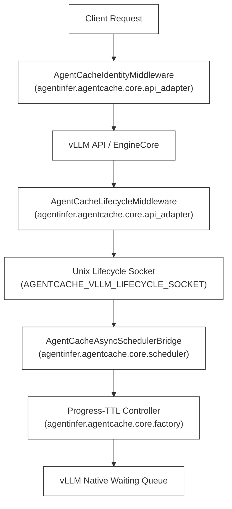
*Figure 1: Natural language to code entity mapping of the in-engine scheduler serving path.*

Sources: `README.md:9-14`, `docs/en/explanation/architecture.md:25-39`

---

## Key Subsystems and Repository Layout

The codebase is organized into several modular subsystems handling scheduling, vLLM integration, benchmarking, and developer utilities:

- `agentinfer/scheduling`: The environment-neutral scheduling core, containing runtime definitions, program ref contracts, transition controllers, and the Progress-TTL strategy family.
- `agentinfer/agentcache`: The vLLM integration layer, holding scheduler bridges (`AgentCacheAsyncSchedulerBridge`, `AgentCacheSyncSchedulerBridge`), API adapters/middleware, controller factories, and CLI entrypoints [docs/en/explanation/architecture.md:30-41]().
- `agentinfer/agentagentbench`: The benchmarking harness and workspace orchestration engine (`run_benchmark`, dataset handling, metrics, and agent adapters) [docs/en/explanation/architecture.md:76-80]().
- `agentinfer/agentrouter`: Native router middleware patches supporting agent hint affinities and token offsets [README.md:12-14]().
- `tools/` and `design/`: Calibration utilities, pre-fill/decode cost estimators, design specifications, and skill packs (`ac-*`).

Sources: `README.md:9-14`, `docs/en/explanation/architecture.md:30-80`

---

## Getting Started & Installation

For details on package requirements (`>=python3.10`, vLLM 0.23.0), installation from source (`pyproject.toml`), serving flags, and quick-start tutorials, see [Getting Started & Installation](#1.1).

Sources: `pyproject.toml:5-10`, `README.md:22-68`

---

## Documentation Map (docs/ en & zh)

For a complete tour of the bilingual documentation tree—including tutorials, how-to guides, reference manuals, architectural explanations, and design specifications—see [Documentation Map (docs/ en & zh)](#1.2).

Sources: `README.md:16-20`, `docs/en/explanation/architecture.md:82-85`

---

# Page: Getting Started & Installation

# Getting Started & Installation

<details>
<summary>Relevant source files</summary>

The following files were used as context for generating this wiki page:

- [README.md](README.md)
- [docs/en/tutorial/01-quick-start.md](docs/en/tutorial/01-quick-start.md)
- [examples/serve-progress-ttl.sh](examples/serve-progress-ttl.sh)
- [pyproject.toml](pyproject.toml)
- [setup.py](setup.py)
- [tests/scheduling/test_scheduling_contracts.py](tests/scheduling/test_scheduling_contracts.py)

</details>


## Purpose and Scope
This section covers the foundational prerequisites, build configurations, package installation workflows, and runtime serving parameters required to deploy `agentinfer`. It details version constraints (Python and vLLM), package metadata defined in `pyproject.toml` and `setup.py`, command-line interface (CLI) entrypoints, and standard serving deployment commands using the AgentInfer scheduler bridge, API middleware, and Progress-TTL controller.

Sources: `README.md:1-84`, `pyproject.toml:1-57`, `docs/en/tutorial/01-quick-start.md:1-75`

---

## 1. System Requirements and Environment Setup
Running AgentInfer requires a compatible host environment equipped with appropriate Python runtimes, dependencies, and vLLM serving binaries.

- **Operating System**: Linux, or Windows with WSL 2 (`README.md:24`).
- **Python**: Version `3.10` or later, matching `requires-python` in `pyproject.toml` (`README.md:25`, `pyproject.toml:8`).
- **Inference Runtime**: `vLLM 0.23.0` (`README.md:26`, `docs/en/tutorial/01-quick-start.md:14`).
- **Hardware**: A CUDA-capable GPU supported by vLLM, sized appropriately for the target model weights (`README.md:27`, `docs/en/tutorial/01-quick-start.md:4`).

Dependencies declared in project metadata include dataset utilities, web frameworks, asynchronous communication libraries, and serialization components (`pyproject.toml:9`):
```toml
dependencies = ["datasets", "fastapi", "httpx", "matplotlib", "numpy", "prometheus-client", "PyYAML", "pydantic>=2", "tqdm", "uvicorn", "websockets", "zstandard"]
```

Sources: `README.md:22-29`, `pyproject.toml:5-16`, `docs/en/tutorial/01-quick-start.md:6-19`

---

## 2. Package Installation and Build Configuration
AgentInfer uses a standard setuptools build backend governed by `pyproject.toml` and a compatibility stub in `setup.py`.

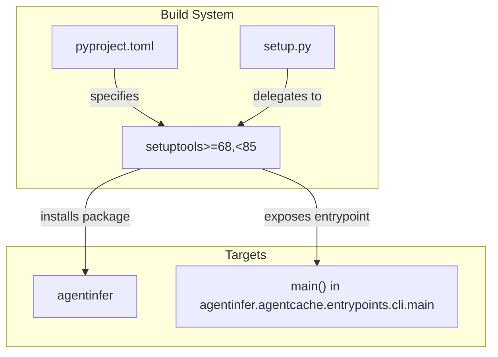
*Figure 1: Build system and installation entrypoints bridging package specifications to executable commands.*

Sources: `pyproject.toml:1-10`, `setup.py:1-10`

### Installation from Source
For development and source-based deployments, clone the repository and install the package in editable mode within an active vLLM environment (`README.md:33-41`, `docs/en/tutorial/01-quick-start.md:20-28`):
```bash
git clone https://github.com/openjiuwen-ai/agent-infer.git
cd agent-infer
python -m pip install -e .
```

### Installation from Release Wheels
To install a pre-built distribution wheel in the target environment (`README.md:43-49`, `docs/en/tutorial/01-quick-start.md:30-35`):
```bash
python -m pip install agentinfer-0.1.0-py3-none-any.whl
```

The package configuration maps the `vllm` console script entrypoint directly to AgentInfer's CLI handler (`pyproject.toml:28-29`):
```toml
[project.scripts]
vllm = "agentinfer.agentcache.entrypoints.cli.main:main"
```

Sources: `README.md:31-49`, `pyproject.toml:28-30`, `setup.py:1-10`, `docs/en/tutorial/01-quick-start.md:20-36`

---

## 3. Serving Architecture and Flag Configuration
Deploying AgentInfer with vLLM involves passing specific scheduler classes, middleware hooks, and controller configurations via the vLLM serving CLI flags.

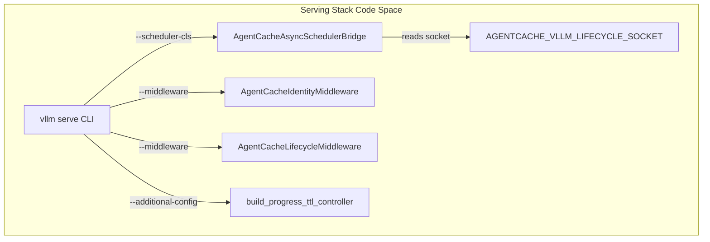
*Figure 2: Mapping natural language serving parameters to core agentinfer classes and middleware components.*

Sources: `README.md:51-68`, `examples/serve-progress-ttl.sh:1-13`, `docs/en/tutorial/01-quick-start.md:37-55`

### Key Serving Parameters

| Flag / Environment Variable | Target Code Entity / Component | Role & Description |
| :--- | :--- | :--- |
| `AGENTCACHE_VLLM_LIFECYCLE_SOCKET` | Unix Datagram Socket | Path to the local Unix socket used for lifecycle signalling across Data Parallel (DP) ranks (`README.md:57`). |
| `--async-scheduling` | vLLM Engine Core | Enables asynchronous scheduling execution mode; required by `AgentCacheAsyncSchedulerBridge` (`README.md:60`, `docs/en/tutorial/01-quick-start.md:56`). |
| `--scheduler-cls` | `agentinfer.agentcache.core.scheduler.AgentCacheAsyncSchedulerBridge` | Instructs vLLM to utilize AgentInfer's asynchronous scheduling bridge (`README.md:61`). |
| `--middleware` | `AgentCacheIdentityMiddleware`, `AgentCacheLifecycleMiddleware` | Intercepts HTTP/API requests to inject agent identity and emit lifecycle events (`README.md:62-63`). |
| `--additional-config` | `agentinfer.agentcache.core.factory.build_progress_ttl_controller` | Injects JSON configuration specifying the factory builder for the Progress-TTL controller (`README.md:64-65`). |

Sources: `README.md:53-66`, `docs/en/tutorial/01-quick-start.md:39-51`

---

## 4. Quick Start Tutorial and Example Execution Script
The reference serving script [`examples/serve-progress-ttl.sh`](../../../examples/serve-progress-ttl.sh) automates environment variable setup and executes `vllm serve` with the full AgentInfer component stack.

```bash
#!/usr/bin/env bash
set -euo pipefail

MODEL=${MODEL:-meta-llama/Llama-3.1-8B-Instruct}
export AGENTCACHE_VLLM_LIFECYCLE_SOCKET=${AGENTCACHE_VLLM_LIFECYCLE_SOCKET:-/tmp/agentinfer-vllm-lifecycle.sock}

exec vllm serve "$MODEL" \
  --async-scheduling \
  --scheduler-cls agentinfer.agentcache.core.scheduler.AgentCacheAsyncSchedulerBridge \
  --middleware agentinfer.agentcache.core.api_adapter.AgentCacheIdentityMiddleware \
  --middleware agentinfer.agentcache.core.api_adapter.AgentCacheLifecycleMiddleware \
  --additional-config \
  '{"agentcache":{"controller_factory":"agentinfer.agentcache.core.factory.build_progress_ttl_controller"}}'
```

### Verification
Once the server finishes loading model weights, query the vLLM models endpoint to confirm operational status (`docs/en/tutorial/01-quick-start.md:59-70`):
```bash
curl http://127.0.0.1:8000/v1/models
```

Sources: `README.md:51-74`, `examples/serve-progress-ttl.sh:1-13`, `docs/en/tutorial/01-quick-start.md:37-75`

---

# Page: Documentation Map (docs/ en & zh)

# Documentation Map (docs/ en & zh)

<details>
<summary>Relevant source files</summary>

The following files were used as context for generating this wiki page:

- [agentinfer/agentrouter/README.md](agentinfer/agentrouter/README.md)
- [agentinfer/agentrouter/patches/0001-agent-hint-native-middleware.patch](agentinfer/agentrouter/patches/0001-agent-hint-native-middleware.patch)
- [design/README.md](design/README.md)
- [docs/README.md](docs/README.md)
- [docs/en/explanation/design-documents.md](docs/en/explanation/design-documents.md)
- [docs/en/reference/python-api.md](docs/en/reference/python-api.md)
- [docs/zh/explanation/design-documents.md](docs/zh/explanation/design-documents.md)
- [docs/zh/tutorial/01-quick-start.md](docs/zh/tutorial/01-quick-start.md)

</details>


## Purpose and Scope
This page provides a structural tour and technical reference for AgentInfer's bilingual documentation tree (`docs/zh/` and `docs/en/`) and its companion internal design registry (`design/`). It details how user-facing documentation categories (Tutorials, How-to Guides, References, and Explanations) map to concrete codebase entities, subsystems, and runtime components, ensuring developers can navigate between natural language specifications and implementation modules.

Sources: `docs/README.md:1-36` [docs/README.md]()

---

## 1. Bilingual Documentation Tree Layout (`docs/`)

AgentInfer maintains structurally symmetric documentation trees in Chinese (`docs/zh/`) and English (`docs/en/`). The documentation is categorized using the Diátaxis framework, splitting operational goals from conceptual understanding.

### 1.1 Tutorials and Getting Started
Tutorials guide first-time users through installing the package, satisfying environment constraints, and launching a minimal serving instance with vLLM integration.
- **Quick Start**: Covered in `docs/zh/tutorial/01-quick-start.md` and `docs/en/tutorial/01-quick-start.md`, outlining Python 3.10+ and vLLM 0.23.0 environment setups, wheel installations, and `vllm serve` commands.
- **Serving Flags**: Details the required `--async-scheduling` flag, `--scheduler-cls`, middleware insertions, and additional config dictionaries [`docs/zh/tutorial/01-quick-start.md:37-56`]().

Sources: `docs/README.md:6-31`, `docs/zh/tutorial/01-quick-start.md:1-57` [docs/README.md](), [docs/zh/tutorial/01-quick-start.md]()

### 1.2 How-to Guides and Integration Procedures
How-to guides are task-oriented documents explaining how to perform specific integrations and benchmark evaluations:
- **vLLM Integration**: `docs/en/how-to/integrate-vllm.md` describes how to configure `AgentCacheAsyncSchedulerBridge` and unix socket datagrams for rank-local lifecycle signaling.
- **Benchmark Execution**: `docs/en/how-to/run-benchmark.md` and `docs/en/how-to/run-trace-replay.md` document how to run reproducible agent workload tests and replay captured evaluation traces.
- **Router Middleware**: `agentinfer/agentrouter/README.md` documents native Rust middleware patches (`agent_hint_affinity` and `agent_hint_token_offsets`) [agentinfer/agentrouter/README.md:1-29]().

Sources: `docs/README.md:9-11`, `agentinfer/agentrouter/README.md:1-29` [docs/README.md](), [agentinfer/agentrouter/README.md]()

### 1.3 Reference Materials
Reference pages specify the formal public interfaces, API signatures, CLI arguments, and configuration schemas:
- **Python API**: Defined in `docs/en/reference/python-api.md`, detailing classes like `AgentCacheAsyncSchedulerBridge`, `AgentCacheSyncSchedulerBridge`, `AgentCacheIdentityMiddleware`, `AgentCacheLifecycleMiddleware`, and factory functions such as `build_progress_ttl_controller` [docs/en/reference/python-api.md:8-79]().
- **CLI & Configurations**: `docs/en/reference/benchmark-cli.md`, `docs/en/reference/benchmark-config.md`, and `docs/en/reference/run-artifacts.md` define CLI flags, YAML parsing schemas, and execution summaries.

Sources: `docs/en/reference/python-api.md:1-120`, `docs/README.md:12-13` [docs/en/reference/python-api.md](), [docs/README.md]()

### 1.4 Explanations and Architecture
Explanations provide conceptual context, architectural overviews, and benchmark methodology designs:
- **Architecture**: `docs/en/explanation/architecture.md` outlines agent-aware caching, session affinity, and scheduling hierarchies.
- **Internal Design Index**: `docs/en/explanation/design-documents.md` and `docs/zh/explanation/design-documents.md` point to contributor-level subsystem specs located in the repository root `design/` directory [docs/en/explanation/design-documents.md:1-36]().

Sources: `docs/README.md:14-16`, `docs/en/explanation/design-documents.md:1-37` [docs/README.md](), [docs/en/explanation/design-documents.md]()

---

## 2. Internal Contributor Design Registry (`design/`)

Development designs, implementation plans, and module invariants live under the repository root `design/` folder. These files record architectural boundaries and development invariants (`BENCH-INV-*`) rather than stable public API commitments [design/README.md:1-30]().

```mermaid
graph TD
    subgraph "Natural Language Design Registry"
        A["design/README.md"] --> B["module/scheduling/"]
        A --> C["module/benchmarking/"]
        A --> D["superpowers/"]
        A --> E["ci-ut-fixes.md"]
    end

    subgraph "Scheduling Subsystem Specs"
        B --> B1["program-state-machine.md"]
        B --> B2["progress-ttl-scheduling.md"]
        B --> B3["vllm-runtime-integration.md"]
    end

    subgraph "Benchmarking Subsystem Specs"
        C --> C1["index.md"]
        C --> C2["benchkit-orthocation.md"]
        C --> C3["agent-runtime-adapters.md"]
        C --> C4["request-proxy-and-hints.md"]
        C --> C5["artifacts-and-evaluation.md"]
    end

    Sources: design/README.md:1-31
```
*Figure 1: Internal design document hierarchy mapping repository root design specifications.*

Sources: `design/README.md:1-31` [design/README.md]()

---

## 3. Natural Language Space to Code Entity Space Mapping

To bridge documentation topics with concrete code artifacts, the following diagram maps core user concepts and documentation headings directly to their implementation classes and python/rust modules.

```mermaid
graph LR
    subgraph "Natural Language Concepts"
        NL1["Async Scheduler Bridge"]
        NL2["Progress-TTL Controller"]
        NL3["Identity Middleware"]
        NL4["AgentRouter Native Patch"]
    end

    subgraph "Code Entity Space"
        CE1["AgentCacheAsyncSchedulerBridge\n(agentinfer.agentcache.core.scheduler)"]
        CE2["build_progress_ttl_controller\n(agentinfer.agentcache.core.factory)"]
        CE3["AgentCacheIdentityMiddleware\n(agentinfer.agentcache.core.api_adapter)"]
        CE4["vllm_router / agent_hint_affinity\n(agentinfer/agentrouter)"]
    end

    NL1 --> CE1
    NL2 --> CE2
    NL3 --> CE3
    NL4 --> CE4

    Sources: docs/en/reference/python-api.md:1-96, agentinfer/agentrouter/README.md:1-29
```
*Figure 2: Mapping natural language features to precise code classes, functions, and paths.*

Sources: `docs/en/reference/python-api.md:1-96`, `agentinfer/agentrouter/README.md:1-29` [docs/en/reference/python-api.md](), [agentinfer/agentrouter/README.md]()

---

## 4. Documentation Structure to Source Code Directory Tour

The documentation and codebase maintain parallel hierarchies. Below is the explicit mapping between the documentation indices and the actual source directories in `agentinfer/`.

```mermaid
graph TD
    subgraph "Documentation Source Tree"
        D_ROOT["docs/"] --> D_ZH["zh/ (Chinese Authority)"]
        D_ROOT --> D_EN["en/ (English Symmetric)"]
        D_ROOT --> D_DES["explanation/design-documents.md"]
    end

    subgraph "Codebase Implementation Subdirectories"
        C_ROOT["agentinfer/"] --> C_SCH["scheduling/\n(agentinfer.scheduling)"]
        C_ROOT --> C_ACC["agentcache/\n(agentinfer.agentcache)"]
        C_ROOT --> C_BEN["agentbench/\n(agentinfer.agentbench)"]
        C_ROOT --> C_ROU["agentrouter/\n(agentrouter patches)"]
    end

    D_EN --> C_ACC
    D_ZH --> C_ACC
    D_DES --> C_SCH
    D_DES --> C_BEN

    Sources: docs/README.md:1-36, docs/en/explanation/design-documents.md:1-37
```
*Figure 3: Mapping documentation trees to core implementation directories.*

Sources: `docs/README.md:1-36`, `docs/en/explanation/design-documents.md:1-37` [docs/README.md](), [docs/en/explanation/design-documents.md]()

---

# Page: Scheduling Core (agentinfer.scheduling)

# Scheduling Core (agentinfer.scheduling)

<details>
<summary>Relevant source files</summary>

The following files were used as context for generating this wiki page:

- [agentinfer/agentcache/core/vllm_logging.py](agentinfer/agentcache/core/vllm_logging.py)
- [agentinfer/scheduling/__init__.py](agentinfer/scheduling/__init__.py)
- [agentinfer/scheduling/observability.py](agentinfer/scheduling/observability.py)
- [agentinfer/scheduling/program_registry.py](agentinfer/scheduling/program_registry.py)
- [agentinfer/scheduling/program_runtime.py](agentinfer/scheduling/program_runtime.py)
- [agentinfer/scheduling/request_pool.py](agentinfer/scheduling/request_pool.py)
- [agentinfer/scheduling/runtime.py](agentinfer/scheduling/runtime.py)
- [agentinfer/scheduling/transitions.py](agentinfer/scheduling/transitions.py)
- [tests/scheduling/test_progress_ttl_runtime.py](tests/scheduling/test_progress_ttl_runtime.py)
- [tests/scheduling/test_strategy_contracts.py](tests/scheduling/test_strategy_contracts.py)

</details>


The `agentinfer.scheduling` package provides an environment-neutral core engine for agent-aware caching and request scheduling. It decouples agent execution states, token tracking, capacity management, and scheduling policies from concrete inference runtimes like vLLM. The scheduling core manages request retention, session-to-program bindings, transactional state transitions, and pluggable strategies.

For a comprehensive tour of the bilingual documentation tree, see [Documentation Map (docs/ en & zh)](../README.md).

---

## 1. Architecture and Component Overview

The scheduling subsystem is organized around clean boundaries separating the runtime state container, the request retention pool, the program registry, and strategy-driven decision logic. Host adapters feed normalized requests into `ProgramScheduler`, which evaluates them against backend capacity using a `SchedulingStrategy`.

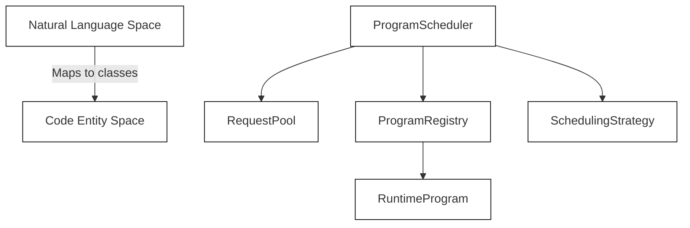
*Figure 1: Bridging scheduling architecture concepts to classes in `agentinfer.scheduling`.*

Sources: [agentinfer/scheduling/runtime.py:69-101](), [agentinfer/scheduling/request_pool.py:49-55](), [agentinfer/scheduling/program_registry.py:31-44]()

---

## 2. Scheduling Contracts and Domain Model

The domain model establishes robust type contracts for identities, tokens, backend topologies, and immutable snapshots. Objects such as `ProgramRef` provide generation safety to prevent stale async updates from mutating superseded program contexts. Backend information is encapsulated via `BackendPoolInfo` and `DpRankInfo`, tracking data-parallel worker topology and HBM KV memory availability.

For detailed documentation on program identity, token observation sources, lifecycle events, and admission outcomes, see [Scheduling Contracts and Domain Model](#2.1).

Sources: [agentinfer/scheduling/domain.py:1-25](), [agentinfer/scheduling/backend.py:1-30]()

---

## 3. ProgramScheduler Runtime and Transitions

`ProgramScheduler` acts as the primary synchronization boundary, maintaining request retention, periodic check schedules, and prefix-cache observation refreshes. The scheduler uses `RequestPool` to retain incoming attempts before admission and `ProgramRegistry` to track active or paused program generations.

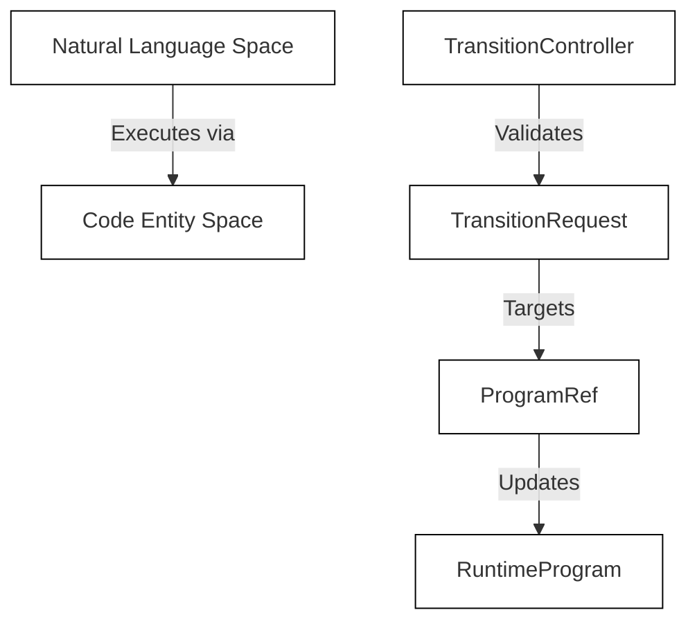
*Figure 2: Execution flow for strategy-driven transitions using runtime classes.*

Strategies interact with the runtime via `TransitionController`, issuing typed requests such as `ADMIT`, `QUEUE`, `PAUSE`, `RESUME`, or `RELEASE`. For complete details on the request-arrival flow, retention mechanics, schedule cycles, and transition semantics, see [ProgramScheduler Runtime](#2.2) and its sub-section [Transitions and Strategy Interface](#2.2.1).

Sources: [agentinfer/scheduling/runtime.py:69-128](), [agentinfer/scheduling/transitions.py:100-123]()

---

## 4. Progress-TTL Policy Framework

The `Progress-TTL` strategy family implements advanced agent-aware scheduling policies, balancing continuous-growth reserves, segment tenures, and lognormal time-to-live (TTL) distributions. It dynamically manages program priorities, privilege handoffs, and capacity repairs based on rolling statistics and configuration parameters.

For in-depth coverage of configuration validation, factor calculation, rolling statistics, decision logic, and TTL fitting, see [Progress-TTL Policy](#2.3), [ProgressTTLStrategy Decision Logic](#2.3.1), and [Configuration, Factors and Rolling Statistics](#2.3.2).

Sources: [agentinfer/scheduling/progress_ttl.py:1-50]()

---

## 5. Observability and Metrics

Observability in `agentinfer.scheduling` is governed by `SchedulerObservabilityConfig`, which allows opt-in event logging and periodic strategy diagnostic emissions without altering decision semantics. Diagnostics integrate smoothly with upstream logging architectures such as vLLM logging hooks and Prometheus metric exposers.

For details on scheduling observability hooks, diagnostics emission, and metrics exposure, see [Observability and Metrics](#2.4).

Sources: [agentinfer/scheduling/observability.py:11-28]()

---

# Page: Scheduling Contracts and Domain Model

# Scheduling Contracts and Domain Model

<details>
<summary>Relevant source files</summary>

The following files were used as context for generating this wiki page:

- [agentinfer/__init__.py](agentinfer/__init__.py)
- [agentinfer/scheduling/admission_outcome.py](agentinfer/scheduling/admission_outcome.py)
- [agentinfer/scheduling/backend.py](agentinfer/scheduling/backend.py)
- [agentinfer/scheduling/domain.py](agentinfer/scheduling/domain.py)
- [agentinfer/scheduling/events.py](agentinfer/scheduling/events.py)
- [agentinfer/scheduling/factors.py](agentinfer/scheduling/factors.py)
- [agentinfer/scheduling/identity.py](agentinfer/scheduling/identity.py)
- [agentinfer/scheduling/lifecycle.py](agentinfer/scheduling/lifecycle.py)
- [agentinfer/scheduling/snapshot.py](agentinfer/scheduling/snapshot.py)
- [pyproject.toml](pyproject.toml)
- [tests/scheduling/test_identity.py](tests/scheduling/test_identity.py)
- [tests/scheduling/test_scheduling_contracts.py](tests/scheduling/test_scheduling_contracts.py)

</details>


This page documents the environment-neutral domain models, immutable state contracts, identity normalization layers, and event primitives defined in `agentinfer.scheduling`. These types establish the shared vocabulary and boundary contracts between host adapters, router runtimes, and pluggable scheduling strategies without depending on vLLM engine internals or transport protocols.

---

## Program Identity and Token Observation

The core scheduling entity is a logical program incarnation. Programs are tracked via generation-safe references, core forwarding states, model-service statuses, and token observations.

### ProgramRef and View

`ProgramRef` provides a stable, generation-safe identity combining an external `program_id` with an incremented runtime `generation` `[agentinfer/scheduling/domain.py:49-67]()`. `ProgramView` wraps these identifiers alongside runtime-owned flags like `state` (`ACTIVE`, `PAUSED`, `TERMINATED`), `status` (`REASONING`, `ACTING`), and step counters into an immutable view passed to strategies `[agentinfer/scheduling/domain.py:118-150]()`.

```
[ProgramRef] ---> (program_id, generation)
[ProgramView] ---> (ref, state, status, tokens, backend_id, step_count)
```
Sources: `[agentinfer/scheduling/domain.py:49-150]()`

### Token Observations

`ProgramTokenObservation` records estimated context sizes, shared prefix token counts, freshness deadlines, and optional physical KV block allocations observed from backend engines `[agentinfer/scheduling/domain.py:70-94]()`. It supports attribution markers (`EXACT`, `PARTIAL`, `UNKNOWN`) and source annotations (`ROUTER_ESTIMATE`, `BACKEND_USAGE`, `MIXED`) `[agentinfer/scheduling/domain.py:33-47]()`.

Sources: `[agentinfer/scheduling/domain.py:33-116]()`

---

## Backend Topology and Data-Parallel Ranks

Capacities and execution targets are modeled across data-parallel (DP) ranks, backend instances, and remote storage pools.

### DpRankInfo, BackendInfo, and BackendPoolInfo

- **`DpRankInfo`**: Encapsulates health, schedulability, running/waiting request counts, and per-rank local HBM, DRAM, and SSD KV token capacities `[agentinfer/scheduling/backend.py:18-38]()`.
- **`BackendInfo`**: Groups an individual backend instance (`backend_id`, `backend_url`) with its aggregate DP ranks and observation timestamps `[agentinfer/scheduling/backend.py:64-72]()`.
- **`BackendPoolInfo`**: Aggregates all backend observations along with the shared remote KV store token capacity `[agentinfer/scheduling/backend.py:86-92]()`.
- **`DispatchTarget`**: Represents the concrete routing destination (`backend_id`, optional `dp_rank`) selected for an admitted request `[agentinfer/scheduling/backend.py:106-111]()`.

```
DpRankInfo (rank-local HBM/DRAM quotas) 
    -> BackendInfo (grouped DP ranks)
        -> BackendPoolInfo (global cluster + remote KV store)
```
Sources: `[agentinfer/scheduling/backend.py:18-117]()`

---

## Scheduling Snapshots and Strategy Factors

Policy decisions rely on immutable read snapshots coupled with synchronized strategy factor stores.

### SchedulingSnapshot

`SchedulingSnapshot` provides the complete read model used for a single admission, resume, or capacity-repair strategy hook invocation `[agentinfer/scheduling/snapshot.py:23-35]()`. It contains monotonic timestamps, active backend capacity (`total_kv_tokens`), native vLLM utilization metrics, waiting request pool counts, and immutable tuples of all live `ProgramView` items and waiting program references `[agentinfer/scheduling/snapshot.py:37-44]()`.

Sources: `[agentinfer/scheduling/snapshot.py:23-86]()`

### StrategyFactors

`StrategyFactors` maintains policy-owned global and per-Program decision metadata (e.g., sliding statistics, weights, decay timers) `[agentinfer/scheduling/factors.py:27-38]()`. It is synchronized directly with the host router lock, eliminating copy-on-write overhead during execution passes `[agentinfer/scheduling/factors.py:12-14]()`.

Sources: `[agentinfer/scheduling/factors.py:1-93]()`

---

## Natural Language Space to Code Entity Space Mapping

The following diagram bridges conceptual scheduling entities to their exact Python implementations within `agentinfer.scheduling`.

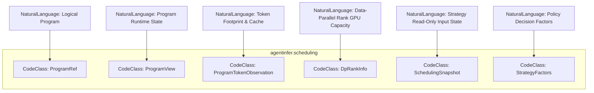
Sources: `[agentinfer/scheduling/domain.py:49-150](), [agentinfer/scheduling/backend.py:18-38](), [agentinfer/scheduling/snapshot.py:23-44](), [agentinfer/scheduling/factors.py:27-38]()`

---

## Agent Identity Normalization

API gateways and routers parse diverse framework headers and custom payload extensions into a uniform host-neutral `AgentIdentity` structure `[agentinfer/scheduling/identity.py:27-53]()`.

### AgentIdentity and parse_agent_identity

`parse_agent_identity` extracts or infers `program_id`, `task_id`, `session_id`, `agent_id`, parent relationships, and flow expectations (`blocks_parent`, `expected_resume`) from `vllm_xargs`, `agent_hint`, or framework-specific request headers (`X-Claude-Code-Session-Id`, `session-id`, `X-Session-Id`) `[agentinfer/scheduling/identity.py:97-164]()`.

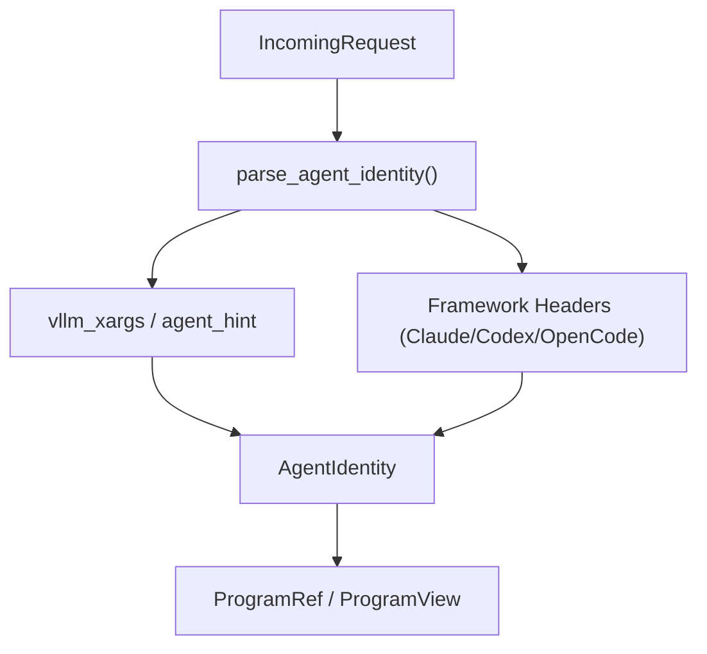
Sources: `[agentinfer/scheduling/identity.py:27-165](), [tests/scheduling/test_identity.py:15-194]()`

---

## Events, Diagnostics, and Admission Outcomes

Scheduling operations emit sink-neutral immutable audit structures after state transitions are committed.

### SchedulingEvent and StrategyDiagnostic

- **`SchedulingEvent`**: Represents a committed lifecycle fact (e.g., `REQUEST_ADMITTED`, `PROGRAM_PAUSED`, `CAPACITY_OBSERVED`) along with monotonic timestamps, reasons, and typed key-value diagnostic fields `[agentinfer/scheduling/events.py:25-86]()`.
- **`StrategyDiagnostic`**: Captures how a policy calculated a decision during a strategy hook invocation without mutating core runtime state `[agentinfer/scheduling/events.py:116-121]()`.

Sources: `[agentinfer/scheduling/events.py:25-133]()`

### AdmissionOutcome and ProgramLifecycle

- **`AdmissionOutcome`**: Returned synchronously by admission hooks, indicating whether a candidate should be `ADMITTED` or `QUEUED`, alongside deficit metrics and transitioned program references `[agentinfer/scheduling/admission_outcome.py:20-45]()`.
- **`ProgramLifecycle`**: A closed vocabulary (`UNKNOWN`, `CONTINUE`, `TERMINAL`) capturing whether a completed response implies further agent execution steps `[agentinfer/scheduling/lifecycle.py:14-19]()`.

Sources: `[agentinfer/scheduling/admission_outcome.py:1-53](), [agentinfer/scheduling/lifecycle.py:1-19]()`

---

# Page: ProgramScheduler Runtime

# ProgramScheduler Runtime

<details>
<summary>Relevant source files</summary>

The following files were used as context for generating this wiki page:

- [agentinfer/agentcache/core/vllm_logging.py](agentinfer/agentcache/core/vllm_logging.py)
- [agentinfer/scheduling/__init__.py](agentinfer/scheduling/__init__.py)
- [agentinfer/scheduling/observability.py](agentinfer/scheduling/observability.py)
- [agentinfer/scheduling/program_registry.py](agentinfer/scheduling/program_registry.py)
- [agentinfer/scheduling/program_runtime.py](agentinfer/scheduling/program_runtime.py)
- [agentinfer/scheduling/request_pool.py](agentinfer/scheduling/request_pool.py)
- [agentinfer/scheduling/runtime.py](agentinfer/scheduling/runtime.py)
- [agentinfer/scheduling/strategy.py](agentinfer/scheduling/strategy.py)
- [agentinfer/scheduling/transitions.py](agentinfer/scheduling/transitions.py)
- [tests/scheduling/test_program_runtime.py](tests/scheduling/test_program_runtime.py)
- [tests/scheduling/test_progress_ttl_runtime.py](tests/scheduling/test_progress_ttl_runtime.py)
- [tests/scheduling/test_strategy_contracts.py](tests/scheduling/test_strategy_contracts.py)

</details>


## Purpose and Scope

The `ProgramScheduler` runtime provides an environment-neutral coordination core that manages request arrival, retention, program lifecycle state, strategy execution, and periodic scheduling cycles [agentinfer/scheduling/runtime.py:3-9](). It integrates request handling via an embedded `RequestPool` [agentinfer/scheduling/request_pool.py:49-50](), tracks live agent program instances using `ProgramRegistry` [agentinfer/scheduling/program_registry.py:31-37]() and `RuntimeProgram` [agentinfer/scheduling/program_runtime.py:26-47](), and evaluates scheduling policies through the `SchedulingStrategy` interface [agentinfer/scheduling/strategy.py:31-33]().

For detailed coverage of transition mechanics, the `TransitionController` interface, and policy contract tests, see [Transitions and Strategy Interface](#2.2.1).

Sources: `agentinfer/scheduling/runtime.py:3-9`, `agentinfer/scheduling/request_pool.py:49-50`, `agentinfer/scheduling/program_registry.py:31-37`, `agentinfer/scheduling/program_runtime.py:26-47`, `agentinfer/scheduling/strategy.py:31-33`

---

## Architecture and Core Components

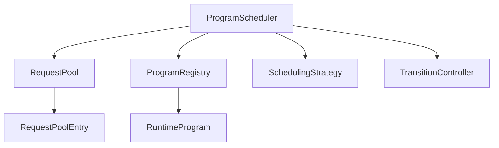
*Figure 1: `ProgramScheduler` subsystem relationships connecting `agentinfer/scheduling/runtime.py`, `agentinfer/scheduling/request_pool.py`, `agentinfer/scheduling/program_registry.py`, and `agentinfer/scheduling/strategy.py`.*

Sources: `agentinfer/scheduling/runtime.py:69-96`, `agentinfer/scheduling/request_pool.py:49-52`, `agentinfer/scheduling/program_registry.py:31-37`, `agentinfer/scheduling/strategy.py:31-33`

---

## Request Arrival and Retention (`RequestPool`)

When a request arrives at the scheduler via `on_request_arrival()`, the scheduler binds the request to an agent program identity [agentinfer/scheduling/runtime.py:50-67](). Unadmitted or waiting request attempts are buffered inside the scheduler-owned `RequestPool` [agentinfer/scheduling/request_pool.py:49-50](). 

Each request attempt is represented as a `RequestPoolEntry` tracking its status (`WAITING` or `ADMITTED`) and target dispatch details [agentinfer/scheduling/request_pool.py:30-40](). The pool manages insertion order, allowing the scheduler to evaluate waiting attempts during periodic schedule cycles [agentinfer/scheduling/request_pool.py:57-81]().

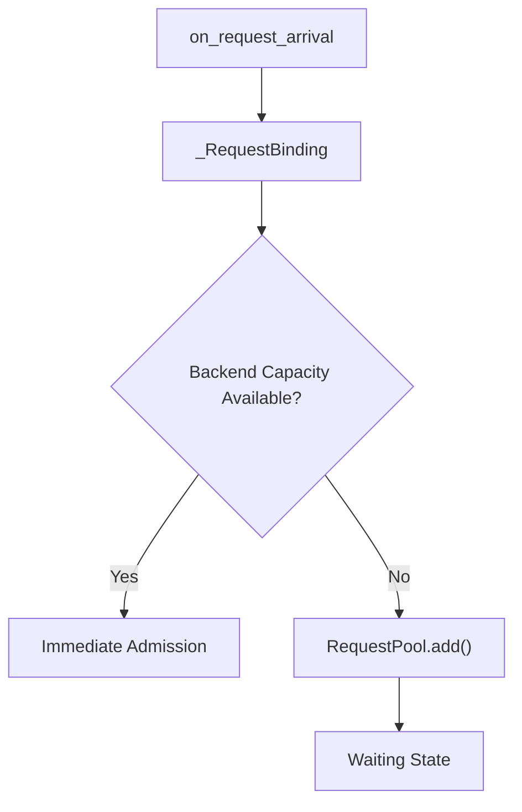
*Figure 2: Request arrival and retention flow within `ProgramScheduler` (`agentinfer/scheduling/runtime.py` and `agentinfer/scheduling/request_pool.py`).*

Sources: `agentinfer/scheduling/runtime.py:50-67`, `agentinfer/scheduling/request_pool.py:30-81`

---

## Program Registry and Runtime Records

The scheduler decouples physical request execution from logical agent programs using `ProgramRegistry` [agentinfer/scheduling/program_registry.py:31-37]() and `RuntimeProgram` [agentinfer/scheduling/program_runtime.py:26-47](). 

- **`ProgramRegistry`**: Maintains live `RuntimeProgram` records, generation counters, task groupings, and parent-child blocking edges [agentinfer/scheduling/program_registry.py:39-44](). It protects against stale references using generation-safe `ProgramRef` instances [agentinfer/scheduling/program_registry.py:103-108]().
- **`RuntimeProgram`**: Stores mutable core attributes including scheduling eligibility (`ProgramState`), model service status (`ProgramStatus`), step counts, and token observations (`ProgramTokenObservation`) [agentinfer/scheduling/program_runtime.py:26-65]().

Sources: `agentinfer/scheduling/program_registry.py:31-44`, `agentinfer/scheduling/program_runtime.py:26-65`

---

## Schedule Cycles, Prefix-Cache Observation, and Completion

The runtime evaluates scheduling decisions periodically or when triggered by dirty state updates via `needs_schedule_cycle()` [agentinfer/scheduling/runtime.py:130-141](). During a schedule cycle:
1. **Prefix-Cache Observation**: `prefix_cache_candidates()` identifies paused reasoning requests whose reusable prefix cache attribution must be refreshed [agentinfer/scheduling/runtime.py:112-128]().
2. **Strategy Hook Execution**: The scheduler invokes strategy hooks (`handle_admission`, `schedule_resume`, and `repair_capacity`) under a protected mutation boundary [agentinfer/scheduling/strategy.py:46-90]().
3. **Completion and Cancellation**: Request completions update token usage and program states, while `cancel_request()` clears stale bindings from the request pool without affecting completed metrics [agentinfer/scheduling/request_pool.py:114-117]().

Sources: `agentinfer/scheduling/runtime.py:112-141`, `agentinfer/scheduling/strategy.py:46-90`, `agentinfer/scheduling/request_pool.py:114-117`

---

## Transitions and Strategy Interface

For detailed specifications on how policies request state changes via `TransitionController`, apply `ADMIT`, `PAUSE`, `RESUME`, `QUEUE`, `MARK_FOR_PAUSE`, and `RELEASE` semantics, and execute contract tests, see [Transitions and Strategy Interface](#2.2.1).

Sources: `agentinfer/scheduling/transitions.py:22-40`, `agentinfer/scheduling/strategy.py:31-90`

---

# Page: Transitions and Strategy Interface

# Transitions and Strategy Interface

<details>
<summary>Relevant source files</summary>

The following files were used as context for generating this wiki page:

- [agentinfer/agentcache/core/vllm_logging.py](agentinfer/agentcache/core/vllm_logging.py)
- [agentinfer/scheduling/__init__.py](agentinfer/scheduling/__init__.py)
- [agentinfer/scheduling/observability.py](agentinfer/scheduling/observability.py)
- [agentinfer/scheduling/program_registry.py](agentinfer/scheduling/program_registry.py)
- [agentinfer/scheduling/program_runtime.py](agentinfer/scheduling/program_runtime.py)
- [agentinfer/scheduling/request_pool.py](agentinfer/scheduling/request_pool.py)
- [agentinfer/scheduling/strategy.py](agentinfer/scheduling/strategy.py)
- [agentinfer/scheduling/transitions.py](agentinfer/scheduling/transitions.py)
- [design/module/scheduling/program-state-machine.md](design/module/scheduling/program-state-machine.md)
- [tests/scheduling/test_program_runtime.py](tests/scheduling/test_program_runtime.py)
- [tests/scheduling/test_strategy_contracts.py](tests/scheduling/test_strategy_contracts.py)

</details>


## Purpose and Scope

This page details the scheduling transition semantics, the lock-scoped strategy interface, and their corresponding contract tests within `agentinfer.scheduling`. It covers how strategies inspect immutable scheduling snapshots and request state mutations exclusively through typed controllers without bypassing host runtime synchronization or state machines.

---

## 1. Transition Semantics and Controller

The host-neutral scheduling boundary uses strict typed requests to decouple strategy decisions from host runtime execution. `TransitionRequest` and `TransitionResult` represent attempted and committed state modifications against exact generation-safe program identities (`ProgramRef`) [agentinfer/scheduling/transitions.py:3-10]().

### Core Transition Kinds

`TransitionKind` enumerates the six supported core transitions validated and executed by the host runtime [agentinfer/scheduling/transitions.py:22-31]():
- `ADMIT`: Move a waiting candidate program into active execution on a specific target backend. Requires a valid `backend_id` [agentinfer/scheduling/transitions.py:63-65]().
- `QUEUE`: Place a candidate program into the waiting pool.
- `PAUSE`: Immediately pause an eligible active/acting program.
- `MARK_FOR_PAUSE`: Request a delayed pause for an in-flight reasoning program upon completion of its current model request.
- `RESUME`: Resume a paused program on a target backend. Requires a valid `backend_id` [agentinfer/scheduling/transitions.py:63-65]().
- `RELEASE`: Terminate and release a program.

### Validation and Controller Mechanics

`TransitionRequest.__post_init__()` validates that every transition specifies a non-empty reason and strictly enforces that `backend_id` is supplied *only* for `ADMIT` and `RESUME` requests [agentinfer/scheduling/transitions.py:59-68](). 

`TransitionResult.__post_init__()` guarantees consistency by ensuring that applied transitions carry their matching committed `SchedulingEvent`, and that unapplied transitions carry no event or mismatched event kinds [agentinfer/scheduling/transitions.py:88-98]().

`TransitionController` wraps the underlying host runtime application callback (`apply_transition`), filtering and recording all accepted transition requests during a single lock-scoped strategy Hook execution [agentinfer/scheduling/transitions.py:100-123]().

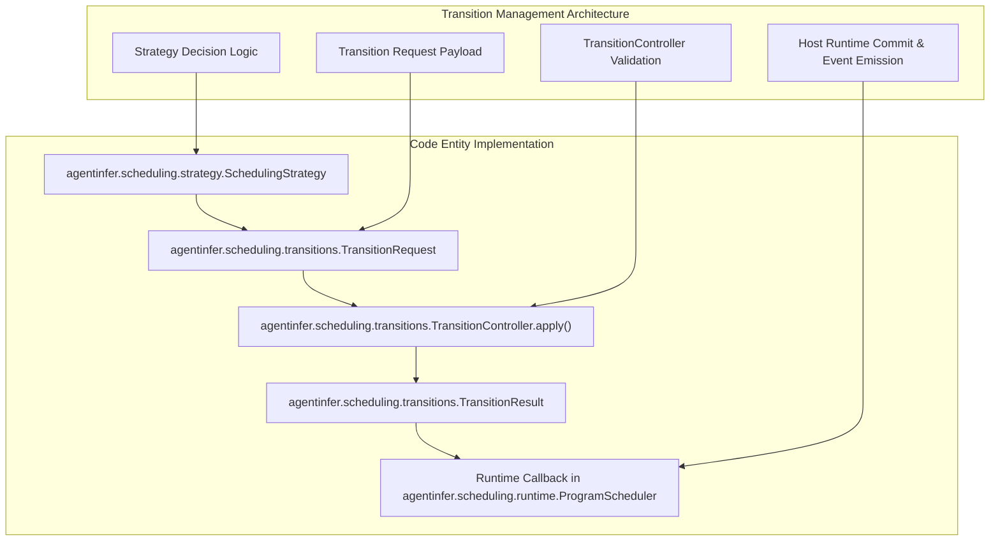
*Sources: [agentinfer/scheduling/transitions.py:43-123](), [agentinfer/scheduling/strategy.py:31-90]()*

---

## 2. Strategy Protocol and Lifecycle Hooks

`SchedulingStrategy` is the abstract base protocol implemented by concrete scheduling policies (such as the Progress-TTL family) [agentinfer/scheduling/strategy.py:31-33](). For each decision cycle, the caller holds the scheduling lock and passes an immutable `SchedulingSnapshot`, strategy-owned decision factors (`StrategyFactors`), and a lock-scoped `TransitionController` [agentinfer/scheduling/strategy.py:5-10]().

### Abstract and Optional Hooks

Concrete strategies must implement the following core methods:
- `handle_admission(...)`: Adopts or queues a candidate program generation, returning an `AdmissionOutcome` [agentinfer/scheduling/strategy.py:45-60]().
- `schedule_resume(...)`: Selects and applies a fixed resume batch from the current snapshot [agentinfer/scheduling/strategy.py:62-75]().
- `repair_capacity(...)`: Selects and applies a pause or mark-for-pause plan when resource bounds are exceeded [agentinfer/scheduling/strategy.py:77-90]().

Optional hooks include `handle_request_completion(...)`, `on_schedule_cycle_start(...)`, `diagnostics(...)`, and `event_diagnostics(...)` [agentinfer/scheduling/strategy.py:92-144](). Additionally, the strategy protocol defines an optional timer contract via `next_check_at(...)` and `handle_scheduled_check(...)` to allow monotonic deadline-driven checks without stale factors [agentinfer/scheduling/strategy.py:12-15]().

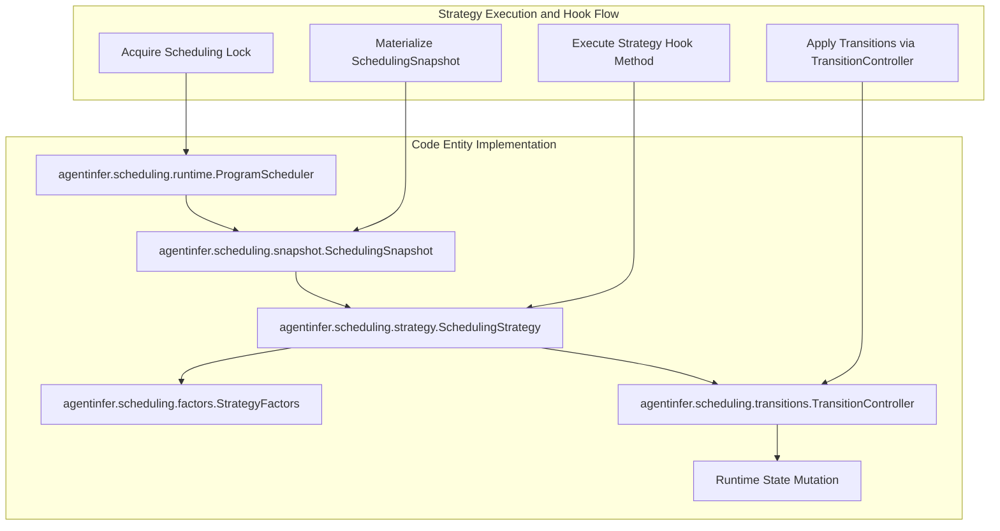
*Sources: [agentinfer/scheduling/strategy.py:31-144](), [agentinfer/scheduling/transitions.py:100-153]()`*

---

## 3. Contract Tests and Verification

The scheduling subsystem includes comprehensive test suites under `tests/scheduling/` to verify execution boundaries, generation safety, and transition validation independently of concrete policies [tests/scheduling/test_strategy_contracts.py:3-9]().

### Key Contract Test Suites

- `tests/scheduling/test_strategy_contracts.py`: Validates `ProgramRef` generation constraints (rejecting empty ids and negative generations), token observation bounds, snapshot immutability, lock-protected factors, single lifecycle callback dispatches, and multi-step transition ledgers [tests/scheduling/test_strategy_contracts.py:196-214]() et al.
- `tests/scheduling/test_program_runtime.py`: Exercises generation-safe programs, retained requests, and runtime lifecycle hooks using test double strategies such as `_AdmissionStrategy`, `_ScheduledCheckStrategy`, and `_SnapshotLedgerStrategy` [tests/scheduling/test_program_runtime.py:3-180]().

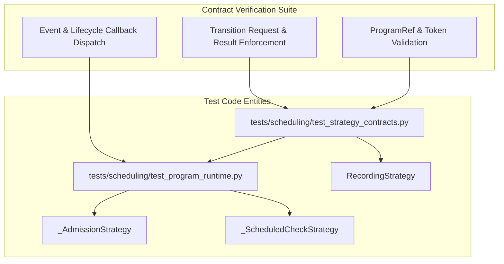
*Sources: [tests/scheduling/test_strategy_contracts.py:3-10](), [tests/scheduling/test_program_runtime.py:3-180]()`*

---

# Page: Progress-TTL Policy

# Progress-TTL Policy

<details>
<summary>Relevant source files</summary>

The following files were used as context for generating this wiki page:

- [agentinfer/scheduling/progress_ttl/__init__.py](agentinfer/scheduling/progress_ttl/__init__.py)
- [agentinfer/scheduling/progress_ttl/factors.py](agentinfer/scheduling/progress_ttl/factors.py)
- [agentinfer/scheduling/progress_ttl/rolling_stats.py](agentinfer/scheduling/progress_ttl/rolling_stats.py)
- [design/module/scheduling/progress-ttl-scheduling.md](design/module/scheduling/progress-ttl-scheduling.md)

</details>


## Purpose and Scope

This page provides a high-level overview of the Progress-TTL strategy family in AgentInfer (`agentinfer/scheduling/progress_ttl`) [agentinfer/scheduling/progress_ttl/__init__.py:1-21](). Progress-TTL is an agent-aware caching and scheduling policy that manages Program execution across consecutive tool-call rounds under tight HBM KV cache constraints [design/module/scheduling/progress-ttl-scheduling.md:27-38](). 

As a parent page, this document outlines the overarching package architecture, global rolling statistics, configuration factors, and decision flows. For in-depth technical details, refer to the child pages:
- [ProgressTTLStrategy Decision Logic](#2.3.1)
- [Configuration, Factors and Rolling Statistics](#2.3.2)

---

## 1. Overview of Progress-TTL Strategy Family

The Progress-TTL module packages configuration models, global workload statistics, per-program decision factors, and strategy execution builders [agentinfer/scheduling/progress_ttl/__init__.py:1-21](). It coordinates with the scheduling core runtime to decide when programs are admitted, paused, resumed, or released based on cache-locality and throughput trade-offs [design/module/scheduling/progress-ttl-scheduling.md:27-58]().

The primary components exposed by the package include `ProgressTTLStrategy`, `ProgressTTLConfig`, `ProgressTTLGlobalFactors`, `ProgressTTLProgramFactors`, and `build_progress_ttl_strategy` [agentinfer/scheduling/progress_ttl/__init__.py:6-20]().

### Diagram 1: Progress-TTL Subsystem Component Architecture

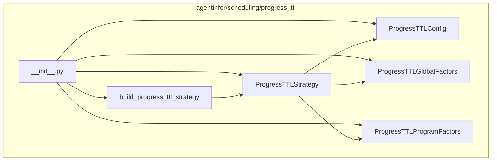
Sources: `agentinfer/scheduling/progress_ttl/__init__.py:1-21`, `agentinfer/scheduling/progress_ttl/factors.py:17-56`, `agentinfer/scheduling/progress_ttl/rolling_stats.py:66-94`

---

## 2. ProgressTTLStrategy Decision Logic

The core decision logic—including admission control, resume ordering tiers, capacity repair, TTL expiry enforcement, privilege management, batch-gain calculations, and continuous-growth reserves—is implemented by `ProgressTTLStrategy` [agentinfer/scheduling/progress_ttl/__init__.py:10]() and specified in `design/module/scheduling/progress-ttl-scheduling.md:27-58` [design/module/scheduling/progress-ttl-scheduling.md:27-58](). It protects HBM cache utilization during short agent tool-call intervals while preventing request starvation.

For detailed coverage of admission criteria, resume queues, and state transition mechanics, see [ProgressTTLStrategy Decision Logic](#2.3.1).

Sources: `agentinfer/scheduling/progress_ttl/__init__.py:1-21`, `design/module/scheduling/progress-ttl-scheduling.md:27-58`

---

## 3. Configuration, Factors and Rolling Statistics

Configuration validation, operating modes, resume orders (`ProgressTTLResumeOrder`), global workload aggregates (`ProgressTTLGlobalFactors`), and per-program runtime records (`ProgressTTLProgramFactors`) are managed across `config.py`, `factors.py`, and `rolling_stats.py` [agentinfer/scheduling/progress_ttl/__init__.py:6-10](). These structures maintain bounded rolling windows and fit lognormal TTL distributions to dynamically adapt thresholds to active agent behaviors [design/module/scheduling/progress-ttl-scheduling.md:59-74]().

For detailed configuration parameters, validation rules, and statistical window formulas, see [Configuration, Factors and Rolling Statistics](#2.3.2).

Sources: `agentinfer/scheduling/progress_ttl/__init__.py:1-21`, `agentinfer/scheduling/progress_ttl/factors.py:17-56`, `agentinfer/scheduling/progress_ttl/rolling_stats.py:66-94`

---

## 4. Observation and Decision Flow

Progress-TTL listens to runtime events such as request arrivals, stream outputs, request completions, prefix-cache observations, and backend schedule cycles to update `ProgressTTLGlobalFactors` and `ProgressTTLProgramFactors`, which in turn drive typed strategy decisions [design/module/scheduling/progress-ttl-scheduling.md:75-117]().

### Diagram 2: Observation and Decision Control Flow

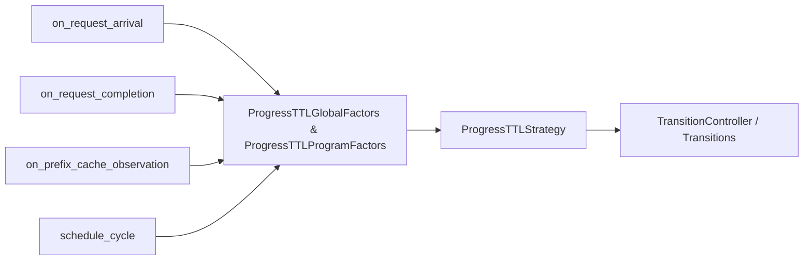
Sources: `agentinfer/scheduling/progress_ttl/factors.py:17-56`, `agentinfer/scheduling/progress_ttl/rolling_stats.py:66-94`, `design/module/scheduling/progress-ttl-scheduling.md:75-117`

---

# Page: ProgressTTLStrategy Decision Logic

# ProgressTTLStrategy Decision Logic

<details>
<summary>Relevant source files</summary>

The following files were used as context for generating this wiki page:

- [agentinfer/scheduling/progress_ttl/builder.py](agentinfer/scheduling/progress_ttl/builder.py)
- [agentinfer/scheduling/progress_ttl/strategy.py](agentinfer/scheduling/progress_ttl/strategy.py)
- [tests/scheduling/test_progress_ttl_strategy.py](tests/scheduling/test_progress_ttl_strategy.py)

</details>


## Purpose and Scope
This page details the implementation, decision algorithms, and data flow of the `ProgressTTLStrategy` class (`[agentinfer/scheduling/progress_ttl/strategy.py:41-43]`). It covers admission control, continuous-growth reserve modeling, resume ordering, capacity repair, Time-To-Live (TTL) expiry, privilege handling, and batch-gain optimizations within the `agentinfer.scheduling.progress_ttl` subsystem.

---

## 1. Strategy Architecture and Initialization
`ProgressTTLStrategy` is a concrete implementation of the scheduling strategy protocol (`[agentinfer/scheduling/progress_ttl/strategy.py:41-43]`). It operates without direct side-effects, querying system snapshots and strategy factors to produce deterministic scheduling outcomes (`[agentinfer/scheduling/progress_ttl/strategy.py:47-51]`).

Strategy construction is handled by `build_progress_ttl_strategy()`, which pairs the strategy with empty global and program-level rolling statistics (`[agentinfer/scheduling/progress_ttl/builder.py:24-30]`).

```mermaid
graph TD
    A["ProgressTTLConfig"] --> B["ProgressTTLStrategy"]
    C["ProgressTTLGlobalFactors"] --> D["StrategyFactors"]
    B --> E["ProgressTTLComponents"]
    D --> E
    
    sub: "Code Entity Space"
    class B "ProgressTTLStrategy"
    class A "ProgressTTLConfig"
    class C "ProgressTTLGlobalFactors"
    class D "StrategyFactors"
    class E "ProgressTTLComponents"
```
*Figure 1: Component wiring mapping natural language configuration and factors to concrete strategy classes (`[agentinfer/scheduling/progress_ttl/builder.py:16-30]`).*

Sources: `[agentinfer/scheduling/progress_ttl/strategy.py:41-43]`, `[agentinfer/scheduling/progress_ttl/builder.py:16-30]()`.

---

## 2. Admission Control and Continuous-Growth Reserve
Admission decisions balance incoming prompt token requirements against available High Bandwidth Memory (HBM) KV cache tokens, factoring in historical input token growth and shared prefix freshness (`[agentinfer/scheduling/progress_ttl/strategy.py:53-121]`).

The strategy computes dynamic capacity reserves by projecting active token consumption across target segment rounds (`[agentinfer/scheduling/progress_ttl/strategy.py:55-65]`). The continuous-growth reserve ensures that active programs can complete their current segment without running out of KV cache capacity, preventing mid-computation thrashing.

```mermaid
graph TD
    SN[SchedulingSnapshot] --> DIAG[ProgressTTLStrategy.diagnostics]
    SF[StrategyFactors] --> DIAG
    DIAG --> RES[Projected Active Reserve Calculation]
    RES --> AC[Admission & Resume Capacity Check]
    
    sub: "Code Entity Space"
    class DIAG "ProgressTTLStrategy.diagnostics"
    class SN "SchedulingSnapshot"
    class SF "StrategyFactors"
```
*Figure 2: Diagnostic and reserve projection flow mapping `SchedulingSnapshot` and `StrategyFactors` to capacity evaluations (`[agentinfer/scheduling/progress_ttl/strategy.py:47-121]`).*

Sources: `[agentinfer/scheduling/progress_ttl/strategy.py:47-121]`, `[tests/scheduling/test_progress_ttl_strategy.py:178-191]()`.

---

## 3. Resume Ordering and Capacity Repair
When capacity frees up or paused programs request resumption, `ProgressTTLStrategy` dictates the precise queue order and priority (`[agentinfer/scheduling/progress_ttl/strategy.py:41-43]`).
- **Resume Ordering**: Pending reasoning programs take precedence over idle acting programs (`[agentinfer/scheduling/progress_ttl/strategy.py:3-8]`).
- **Capacity Repair**: If capacity is breached, the strategy identifies candidates for pausing based on segment-tenure priority, targeting programs that have exceeded their target segment duration or hold stale prefixes (`[agentinfer/scheduling/progress_ttl/strategy.py:3-8]`).

Sources: `[agentinfer/scheduling/progress_ttl/strategy.py:3-8]`, `[tests/scheduling/test_progress_ttl_strategy.py:178-191]()`.

---

## 4. TTL Expiry, Privilege, and Batch-Gain
To prevent resource starvation and guarantee progress, acting segments are bound by a Time-To-Live (TTL) expiry mechanism (`[agentinfer/scheduling/progress_ttl/strategy.py:123-132]`).

- **Forced Resume & TTL**: The internal dataclass `_ForceResumeTimeoutEstimate` calculates work-ahead estimates and arms force-resume deadlines based on request throughput and active remaining rounds (`[agentinfer/scheduling/progress_ttl/strategy.py:31-40]`).
- **Event Diagnostics**: `event_diagnostics()` evaluates newly armed acting TTLs and force-resume timeouts once their corresponding events are committed (`[agentinfer/scheduling/progress_ttl/strategy.py:123-132]`).
- **Privilege & Batch-Gain**: Programs within configured context token limits (`privileged_max_context_tokens`) receive preferential admission, while batch-gain logic groups similar prompt patterns to maximize vLLM batch efficiency (`[tests/scheduling/test_progress_ttl_strategy.py:165-176]`).

```mermaid
graph TD
    EV[SchedulingEvent] --> ED[ProgressTTLStrategy.event_diagnostics]
    SF[StrategyFactors] --> ED
    ED --> FRT[_ForceResumeTimeoutEstimate]
    FRT --> TTL[TTL Expiry & Force-Resume Arming]
    
    sub: "Code Entity Space"
    class ED "ProgressTTLStrategy.event_diagnostics"
    class FRT "_ForceResumeTimeoutEstimate"
    class EV "SchedulingEvent"
    class SF "StrategyFactors"
```
*Figure 3: Event diagnostic flow for force-resume timeouts and TTL management (`[agentinfer/scheduling/progress_ttl/strategy.py:31-40]`, `[agentinfer/scheduling/progress_ttl/strategy.py:123-132]`).*

Sources: `[agentinfer/scheduling/progress_ttl/strategy.py:31-40]`, `[agentinfer/scheduling/progress_ttl/strategy.py:123-132]`, `[tests/scheduling/test_progress_ttl_strategy.py:165-176]()`.

---

# Page: Configuration, Factors and Rolling Statistics

# Configuration, Factors and Rolling Statistics

<details>
<summary>Relevant source files</summary>

The following files were used as context for generating this wiki page:

- [agentinfer/scheduling/progress_ttl/__init__.py](agentinfer/scheduling/progress_ttl/__init__.py)
- [agentinfer/scheduling/progress_ttl/config.py](agentinfer/scheduling/progress_ttl/config.py)
- [agentinfer/scheduling/progress_ttl/factors.py](agentinfer/scheduling/progress_ttl/factors.py)
- [agentinfer/scheduling/progress_ttl/rolling_stats.py](agentinfer/scheduling/progress_ttl/rolling_stats.py)
- [tests/scheduling/test_progress_ttl_rolling_stats.py](tests/scheduling/test_progress_ttl_rolling_stats.py)

</details>


## Purpose and Scope
This document covers the configuration framework, global rolling workload statistics, per-program decision factors, and bounded-window metrics that underpin the Progress-TTL scheduling policy in `agent-infer`. The Progress-TTL policy combines workload-derived continuous-growth protection, capacity-aware pause/resume logic, and an active Time-To-Live (TTL) derived from estimated cold-prefill costs. 

The implementation resides in `agentinfer/scheduling/progress_ttl/` and provides policy-owned configuration classes, request sample accumulators, factor trackers, and validation pipelines that operate independently of router or backend transport layers.

---

## 1. `ProgressTTLConfig`: Parameters and Validation Semantics

The static policy configuration is governed by `ProgressTTLConfig`, defined in `agentinfer/scheduling/progress_ttl/config.py`. It controls segment constraints, TTL bounds, prefill regression models, decode cost models, and scheduling behavior modes.

### Control Modes and Resume Ordering
Two primary enums define top-level behavior and tie-breaking rules:
- `ProgressTTLMode`: Operator-selected control mode (`ON = "on"`, `OFF = "off"`, `AUTO = "auto"`). Defined in `agentinfer/scheduling/progress_ttl/config.py:16-22` [agentinfer/scheduling/progress_ttl/config.py:16-22]().
- `ProgressTTLResumeOrder`: Ordering strategy applied to ordinary paused reasoning programs (`MRU = "mru"`, `FCFS = "fcfs"`). Defined in `agentinfer/scheduling/progress_ttl/config.py:24-29` [agentinfer/scheduling/progress_ttl/config.py:24-29]().

### Validation Logic
`ProgressTTLConfig` enforces invariants during initialization within its `__post_init__` method (`agentinfer/scheduling/progress_ttl/config.py:66-131`) [agentinfer/scheduling/progress_ttl/config.py:66-131](). Key validation checks include:
- `target_max_segment_rounds` must be strictly positive (`agentinfer/scheduling/progress_ttl/config.py:72-73`) [agentinfer/scheduling/progress_ttl/config.py:72-73]().
- All timing bounds, prefill quadratic model intercept/linear/quadratic coefficients, and decode throughput alpha parameters must be finite and non-negative (`agentinfer/scheduling/progress_ttl/config.py:74-95`) [agentinfer/scheduling/progress_ttl/config.py:74-95]().
- `ttl_max_seconds` must be greater than or equal to `ttl_min_seconds` (`agentinfer/scheduling/progress_ttl/config.py:96-97`) [agentinfer/scheduling/progress_ttl/config.py:96-97]().
- `ttl_max_cache_miss_impact_ratio` must fall within `[0, 1]` (`agentinfer/scheduling/progress_ttl/config.py:100-101`) [agentinfer/scheduling/progress_ttl/config.py:100-101]().
- `resume_capacity_ratio` and `pause_capacity_ratio` must fall within `(0, 1]` (`agentinfer/scheduling/progress_ttl/config.py:110-115`) [agentinfer/scheduling/progress_ttl/config.py:110-115]().

Sources: `agentinfer/scheduling/progress_ttl/config.py:1-132` [agentinfer/scheduling/progress_ttl/config.py:1-131](), `tests/scheduling/test_progress_ttl_rolling_stats.py:12-48` [tests/scheduling/test_progress_ttl_rolling_stats.py:12-48]().

---

## 2. Global Rolling Statistics (`ProgressTTLGlobalFactors`)

Global workload dynamics are maintained by `ProgressTTLGlobalFactors` in `agentinfer/scheduling/progress_ttl/rolling_stats.py`. This class provides windowed tracking of token usage, request latencies, queue durations, active program counts, and busy-time request throughput.

### Data Structures
- `RequestStatSample`: Sanitized observation representing a completed request, capturing prompt tokens, cached prefix tokens, completion tokens, latency, active/waiting program counts, and inter-request gaps (`agentinfer/scheduling/progress_ttl/rolling_stats.py:18-35`) [agentinfer/scheduling/progress_ttl/rolling_stats.py:18-35]().
- `RequestIntervalSample`: Records start and finish monotonic timestamps for busy-time throughput estimation (`agentinfer/scheduling/progress_ttl/rolling_stats.py:58-63`) [agentinfer/scheduling/progress_ttl/rolling_stats.py:58-63]().

### Cold-Start and Half-Window Rules
`ProgressTTLGlobalFactors` initializes with sensible defaults (e.g., `avg_prompt_tokens = 1024.0`, `request_window_size = 100`) (`agentinfer/scheduling/progress_ttl/rolling_stats.py:66-93`) [agentinfer/scheduling/progress_ttl/rolling_stats.py:66-93](). To prevent skew from initial default constants during cold start, metrics wait for half of the `request_window_size` samples before replacing baseline parameters (`tests/scheduling/test_progress_ttl_rolling_stats.py:148-157`) [tests/scheduling/test_progress_ttl_rolling_stats.py:148-157]().

Sources: `agentinfer/scheduling/progress_ttl/rolling_stats.py:1-147` [agentinfer/scheduling/progress_ttl/rolling_stats.py:1-147](), `tests/scheduling/test_progress_ttl_rolling_stats.py:50-168` [tests/scheduling/test_progress_ttl_rolling_stats.py:50-168]().

---

## 3. Per-Program Decision Factors (`ProgressTTLProgramFactors`)

While global rolling stats track aggregate system behavior, per-program state is managed via `ProgressTTLProgramFactors` in `agentinfer/scheduling/progress_ttl/factors.py`. 

### Responsibilities and Attributes
`ProgressTTLProgramFactors` tracks generation-specific metadata without duplicating the lifecycle facts owned directly by the Scheduler runtime:
- **Segment Execution**: `segment_served_rounds`, `segment_started_at_monotonic_s`, `segment_prompt_tokens`, `segment_completion_tokens`.
- **TTL and Deadlines**: `ttl_deadline_monotonic_s`, `ttl_expiry_observed`, `previous_ttl_seconds`, `rounds_since_ttl_pause`.
- **Privilege & Timeouts**: `is_privileged`, `privilege_reason`, `privilege_deadline_monotonic_s`, `force_resume_timeout_seconds`, `force_resume_deadline_monotonic_s`.
- **Pause/Resume Handoffs**: `last_pause_at_monotonic_s`, `last_resume_at_monotonic_s`, `pause_reason`, `resume_reason`.

`__post_init__` verifies that all numeric counters are non-negative, timestamps are finite and non-negative, and boolean factors are valid booleans (`agentinfer/scheduling/progress_ttl/factors.py:57-113`) [agentinfer/scheduling/progress_ttl/factors.py:57-112]().

Sources: `agentinfer/scheduling/progress_ttl/factors.py:1-113` [agentinfer/scheduling/progress_ttl/factors.py:1-112]().

---

## 4. Bounded Windows and Lognormal TTL Fitting

### Throughput Calculation over Bounded Intervals
Busy-time request throughput is computed using a bounded queue of `RequestIntervalSample` records. Overlapping request execution intervals are merged or counted correctly to avoid overestimating system throughput during bursty or idle workloads (`tests/scheduling/test_progress_ttl_rolling_stats.py:83-123`) [tests/scheduling/test_progress_ttl_rolling_stats.py:83-123]().

### Architecture and Data Flow

Diagram: Architecture of Progress-TTL Configuration and State Containers
```mermaid
graph TD
    subgraph NaturalLanguageSpace["Natural Language Space"]
        ConfigDesc["Operator Config & Tuning Policy"]
        GlobalWorkload["Global Workload Statistics"]
        ProgramFactors["Per-Program Generation State"]
    end

    subgraph CodeEntitySpace["Code Entity Space"]
        ConfigClass["ProgressTTLConfig\nagentinfer/scheduling/progress_ttl/config.py"]
        GlobalFactorsClass["ProgressTTLGlobalFactors\nagentinfer/scheduling/progress_ttl/rolling_stats.py"]
        ProgramFactorsClass["ProgressTTLProgramFactors\nagentinfer/scheduling/progress_ttl/factors.py"]
        Strategy["ProgressTTLStrategy\nagentinfer/scheduling/progress_ttl/strategy.py"]
    end

    ConfigDesc --> ConfigClass
    GlobalWorkload --> GlobalFactorsClass
    ProgramFactors --> ProgramFactorsClass

    ConfigClass --> Strategy
    GlobalFactorsClass --> Strategy
    ProgramFactorsClass --> Strategy
```
Sources: `agentinfer/scheduling/progress_ttl/config.py` [agentinfer/scheduling/progress_ttl/config.py](), `agentinfer/scheduling/progress_ttl/rolling_stats.py` [agentinfer/scheduling/progress_ttl/rolling_stats.py](), `agentinfer/scheduling/progress_ttl/factors.py` [agentinfer/scheduling/progress_ttl/factors.py]()

Diagram: Data Flow for Rolling Statistics and TTL Fitting
```mermaid
graph TD
    subgraph NaturalLanguageSpace["Natural Language Space"]
        ReqObs["Raw Request Observation"]
        WindowUpdate["Windowed Aggregation & Sanitization"]
        TTLFit["Lognormal TTL Distribution Fitting"]
    end

    subgraph CodeEntitySpace["Code Entity Space"]
        ReqSample["RequestStatSample\nagentinfer/scheduling/progress_ttl/rolling_stats.py"]
        UpdateReq["ProgressTTLGlobalFactors.update_request()\nagentinfer/scheduling/progress_ttl/rolling_stats.py"]
        ContinuitySampleClass["ContinuitySample\nagentinfer/scheduling/progress_ttl/rolling_stats.py"]
        TTLEstimateClass["TTLEstimate\nagentinfer/scheduling/progress_ttl/rolling_stats.py"]
    end

    ReqObs --> ReqSample
    ReqSample --> UpdateReq
    UpdateReq --> ContinuitySampleClass
    ContinuitySampleClass --> TTLEstimateClass
```
Sources: `agentinfer/scheduling/progress_ttl/rolling_stats.py` [agentinfer/scheduling/progress_ttl/rolling_stats.py]()

---

## Sources
- `agentinfer/scheduling/progress_ttl/config.py` [agentinfer/scheduling/progress_ttl/config.py]()
- `agentinfer/scheduling/progress_ttl/factors.py` [agentinfer/scheduling/progress_ttl/factors.py]()
- `agentinfer/scheduling/progress_ttl/rolling_stats.py` [agentinfer/scheduling/progress_ttl/rolling_stats.py]()
- `tests/scheduling/test_progress_ttl_rolling_stats.py` [tests/scheduling/test_progress_ttl_rolling_stats.py]()

---

# Page: Observability and Metrics

# Observability and Metrics

<details>
<summary>Relevant source files</summary>

The following files were used as context for generating this wiki page:

- [agentinfer/agentcache/core/vllm_logging.py](agentinfer/agentcache/core/vllm_logging.py)
- [agentinfer/scheduling/__init__.py](agentinfer/scheduling/__init__.py)
- [agentinfer/scheduling/observability.py](agentinfer/scheduling/observability.py)
- [agentinfer/scheduling/program_registry.py](agentinfer/scheduling/program_registry.py)
- [agentinfer/scheduling/program_runtime.py](agentinfer/scheduling/program_runtime.py)
- [agentinfer/scheduling/request_pool.py](agentinfer/scheduling/request_pool.py)
- [agentinfer/scheduling/transitions.py](agentinfer/scheduling/transitions.py)
- [skills/ac-review/criteria/90-observability.md](skills/ac-review/criteria/90-observability.md)
- [tests/agentcache/core/test_vllm_logging.py](tests/agentcache/core/test_vllm_logging.py)
- [tests/scheduling/test_strategy_contracts.py](tests/scheduling/test_strategy_contracts.py)

</details>


## Purpose and Scope
This section details the observability and metrics subsystem within `agent-infer`, covering validated control mechanisms for scheduler logging, additive integration with `vLLM`’s logging hierarchy, strategy diagnostics emission, and Prometheus exposure hooks. Observability in AgentInfer is designed to provide actionable context at system boundaries without exposing secrets or private prompt data, conforming to strict quality review criteria [skills/ac-review/criteria/90-observability.md:1-60]().

---

## 1. Scheduling Observability Configuration

Scheduler-level observability is controlled via the immutable `SchedulerObservabilityConfig` dataclass located in `agentinfer/scheduling/observability.py`. It validates opt-in event tracing and periodic strategy diagnostic logging intervals.

```python
@dataclass(frozen=True)
class SchedulerObservabilityConfig:
    enabled: bool = False
    log_interval_seconds: float = 5.0
```

`SchedulerObservabilityConfig` rejects non-boolean activation flags and ensures that diagnostic log intervals are finite, positive numbers during its `__post_init__` phase [agentinfer/scheduling/observability.py:12-28]().

### Diagram: Observability Control & Diagnostic Data Flow

```mermaid
graph TD
    subgraph "Code Entity Space"
    A["SchedulerObservabilityConfig"] -->|Validates| B["__post_init__"]
    B -->|Enforces| C["log_interval_seconds > 0"]
    D["ProgramScheduler"] -->|Inspects| A
    D -->|Emits| E["StrategyDiagnostic"]
    end
```
*Figure 1: Validation and emission flow governed by `SchedulerObservabilityConfig`.*

Sources: `agentinfer/scheduling/observability.py:12-29](), `agentinfer/scheduling/__init__.py:22`

---

## 2. vLLM Logging Integration

AgentInfer runs a separate logger hierarchy (`agentinfer`) from `vLLM` (`vllm`) and `uvicorn`. To prevent unhandled log records while preserving native `vLLM` formatting, filters, and stream configurations, AgentInfer provides an additive logging bridge function: `attach_agentinfer_to_vllm_logging()` in `agentinfer/agentcache/core/vllm_logging.py`.

```python
def attach_agentinfer_to_vllm_logging() -> None:
    agentinfer_logger = logging.getLogger("agentinfer")
    if agentinfer_logger.handlers:
        return

    vllm_logger = logging.getLogger("vllm")
    if not vllm_logger.handlers:
        return

    for handler in vllm_logger.handlers:
        agentinfer_logger.addHandler(handler)
    agentinfer_logger.setLevel(vllm_logger.getEffectiveLevel())
    agentinfer_logger.propagate = False
```

### Key Behavioral Traits of the Logging Bridge:
* **Additive Handler Attachment**: Reuses `vLLM` handlers without replacing user-configured or `uvicorn` handlers [agentinfer/agentcache/core/vllm_logging.py:10-20]().
* **Idempotency**: Explicit AgentInfer handlers take precedence; calling `attach_agentinfer_to_vllm_logging()` multiple times is safe and avoids duplicate records [agentinfer/agentcache/core/vllm_logging.py:18-23]().
* **Deferred Initialization**: If imported before `vLLM` initializes its loggers, the attachment remains a safe no-op until handlers exist [tests/agentcache/core/test_vllm_logging.py:75-84]().

### Diagram: Logging Bridge Architecture

```mermaid
graph TD
    subgraph "Code Entity Space"
    VL["logging.getLogger('vllm')"] -->|Contains Handlers| H["vllm_logger.handlers"]
    AI["logging.getLogger('agentinfer')"] -->|Checked by| FN["attach_agentinfer_to_vllm_logging()"]
    FN -->|Copies Handlers if Empty| H
    FN -->|Sets Effective Level| LVL["agentinfer_logger.setLevel()"]
    FN -->|Disables Propagation| PROP["agentinfer_logger.propagate = False"]
    end
```
*Figure 2: Process-global logger hierarchy integration between `vllm` and `agentinfer`.*

Sources: `agentinfer/agentcache/core/vllm_logging.py:10-33](), `tests/agentcache/core/test_vllm_logging.py:1-118`

---

## 3. Event Diagnostics and Review Standards

AgentInfer adheres to the `ac-review` quality criteria for observability (`90-observability.md`), ensuring that operational telemetry meets strict guidelines:
* **System Boundaries (`O1`)**: Important events across request handling, transitions, and admission checks generate structured event records [skills/ac-review/criteria/90-observability.md:9-14]().
* **Contextual Richness (`O2`)**: Logs contain relevant `ProgramRef`, transition kinds, operation statuses, and durations [skills/ac-review/criteria/90-observability.md:16-22]().
* **Secret Redaction (`O3`)**: Passwords, API tokens, and private user content are strictly excluded from log outputs [skills/ac-review/criteria/90-observability.md:24-30]().
* **Log Levels (`O4`)**: Uses `DEBUG` for local traces, `INFO` for state transitions, `WARN` for recoverable bottlenecks, and `ERROR` for operation failures [skills/ac-review/criteria/90-observability.md:31-38]().

Sources: `skills/ac-review/criteria/90-observability.md:1-61]()`

---

# Page: AgentCache: vLLM Integration Layer

# AgentCache: vLLM Integration Layer

<details>
<summary>Relevant source files</summary>

The following files were used as context for generating this wiki page:

- [agentinfer/agentcache/__init__.py](agentinfer/agentcache/__init__.py)
- [agentinfer/agentcache/core/__init__.py](agentinfer/agentcache/core/__init__.py)
- [agentinfer/agentcache/core/factory.py](agentinfer/agentcache/core/factory.py)
- [agentinfer/agentcache/core/scheduler.py](agentinfer/agentcache/core/scheduler.py)
- [design/module/scheduling/vllm-runtime-integration.md](design/module/scheduling/vllm-runtime-integration.md)

</details>


## Purpose and Scope

The AgentCache integration layer embeds AgentInfer's agent-aware scheduling and prefix-caching policies into vLLM V1 [design/module/scheduling/vllm-runtime-integration.md:36-38](). It acts as an integration bridge that intercepts request arrivals and completions, manages request retention before native vLLM admission, and communicates lifecycle events across Data Parallel (DP) ranks—all without replacing vLLM's underlying token-level scheduler, block allocator, or continuous batching engine [agentinfer/agentcache/core/scheduler.py:5-7](). 

This parent page provides a high-level overview of the vLLM integration subsystems. For granular technical specifications, please consult the child pages linked below.

---

## 3.1 Scheduler Bridges and Controller Factory

AgentCache integrates with vLLM's execution loop through specialized scheduler subclasses: `AgentCacheAsyncSchedulerBridge` (for asynchronous V1 execution) and `AgentCacheSyncSchedulerBridge` (for synchronous setups) [agentinfer/agentcache/core/__init__.py:8-9](). These bridges inherit from vLLM's native scheduler classes (`AsyncScheduler` and `Scheduler`) and coordinate with an underlying `EmbeddedSchedulerController` [agentinfer/agentcache/core/scheduler.py:20-21, 45-104]().

The policy controller itself is instantiated via `build_progress_ttl_controller`, which parses `additional_config.agentcache` properties to construct a configured `ProgramScheduler` running the Progress-TTL strategy [agentinfer/agentcache/core/factory.py:76-80]().

### Diagram: Scheduler Integration Architecture
```mermaid
flowchart TB
    subcode["Code Entity Space"]
        subclass1["AgentCacheAsyncSchedulerBridge\n(agentinfer/agentcache/core/scheduler.py)"]
        subclass2["AgentCacheSyncSchedulerBridge\n(agentinfer/agentcache/core/scheduler.py)"]
        controller["build_progress_ttl_controller\n(agentinfer/agentcache/core/factory.py)"]
        queue["AgentAwareQueue\n(agentinfer/agentcache/core/request_queue.py)"]
        engine["vLLM EngineCore\n(vLLM V1 Scheduler)"]
    end

    subnat["Natural Language Space"]
        ns1["Async vLLM Server Mode"]
        ns2["Sync vLLM Server Mode"]
        ns3["Policy Rule Validation"]
    end

    ns1 --> subclass1
    ns2 --> subclass2
    ns3 --> controller
    subclass1 --> engine
    subclass2 --> engine
    controller --> subclass1
    controller --> subclass2
    queue --> subclass1

    classDef code fill:#f9f9f9,stroke:#333,stroke-width:1px;
    class subclass1,subclass2,controller,queue,engine code;
```
*Sources: [agentinfer/agentcache/core/scheduler.py:20-43](), [agentinfer/agentcache/core/factory.py:76-80]()*

For details on scheduler bridges, the `AgentAwareQueue` waiting queue [agentinfer/agentcache/core/scheduler.py:36-43](), and policy configuration validation, see [Scheduler Bridges and Controller Factory](#3.1).

---

## 3.2 API Adapter: Identity and Lifecycle Middleware

To extract session headers and track conversational programs, AgentCache provides ASGI/WSGI middleware components: `AgentCacheIdentityMiddleware` and `AgentCacheLifecycleMiddleware` [agentinfer/agentcache/core/api_adapter.py:6-7](). 

The identity middleware normalizes incoming framework headers, processes `agent_hint` fields, and bridges Anthropic Messages protocol semantics into vLLM's internal `vllm_xargs.agentic_context` [design/module/scheduling/vllm-runtime-integration.md:104](). Meanwhile, the lifecycle middleware optionally parses API output streams for tool-use completions, emitting terminal signals across DP ranks via Unix datagram sockets (`AGENTCACHE_VLLM_LIFECYCLE_SOCKET`) [design/module/scheduling/vllm-runtime-integration.md:63, 105]().

### Diagram: API Middleware and Datagram Lifecycle Signalling
```mermaid
flowchart LR
    subcode["Code Entity Space"]
        im["AgentCacheIdentityMiddleware\n(agentinfer/agentcache/core/api_adapter.py)"]
        lm["AgentCacheLifecycleMiddleware\n(agentinfer/agentcache/core/api_adapter.py)"]
        sock["UnixLifecycleReceiver\n(agentinfer/agentcache/core/api_adapter.py)"]
    end

    subnat["Natural Language Space"]
        req["Incoming HTTP Request"]
        resp["Streaming API Response"]
        dp["Multi-DP Rank Cluster"]
    end

    req --> im
    im -->|identity mapping| req
    resp --> lm
    lm -->|Unix Datagrams| sock
    sock --> dp

    classDef code fill:#f9f9f9,stroke:#333,stroke-width:1px;
    class im,lm,sock code;
```
*Sources: [agentinfer/agentcache/core/api_adapter.py:1-25](), [design/module/scheduling/vllm-runtime-integration.md:63-109]()*

For details on middleware lifecycle interception, socket communication, and request normalization, see [API Adapter: Identity and Lifecycle Middleware](#3.2).

---

## 3.3 Entrypoints, LLM Wrapper and AgentRouter

Client interactions with AgentCache are mediated via several high-level entrypoints and wrappers. The `agentinfer.LLM` class exposes an embedding wrapper for programmatic usage, while the `agentcache` command-line entrypoint (`vllm` integration mode) and benchmark runners simplify server provisioning [design/module/scheduling/vllm-runtime-integration.md:57-84](). Additionally, native middleware patches for `agentrouter` inject `agent_hint_affinity` parameters and manage token offsets prior to backend dispatch.

For details on the LLM wrapper, command-line entrypoints, and agentrouter middleware patches, see [Entrypoints, LLM Wrapper and AgentRouter](#3.3).

---

# Page: Scheduler Bridges and Controller Factory

# Scheduler Bridges and Controller Factory

<details>
<summary>Relevant source files</summary>

The following files were used as context for generating this wiki page:

- [agentinfer/agentcache/core/api_adapter.py](agentinfer/agentcache/core/api_adapter.py)
- [agentinfer/agentcache/core/factory.py](agentinfer/agentcache/core/factory.py)
- [agentinfer/agentcache/core/scheduler.py](agentinfer/agentcache/core/scheduler.py)
- [tests/agentcache/core/test_vllm_adapter.py](tests/agentcache/core/test_vllm_adapter.py)
- [tests/agentcache/core/test_vllm_api_adapter.py](tests/agentcache/core/test_vllm_api_adapter.py)
- [tests/agentcache/core/test_vllm_factory.py](tests/agentcache/core/test_vllm_factory.py)

</details>


## Purpose and Scope

This page covers the vLLM integration layer for AgentInfer's scheduling subsystem, specifically focusing on scheduler bridges, the `AgentAwareScheduler` extension point, request queues, and the policy validation performed by the controller factory (`build_progress_ttl_controller`). These components embed environment-neutral scheduling logic into vLLM's execution engine without altering native token-level scheduling or KV cache operations.

---

## 1. Scheduler Bridges and vLLM Integration

The scheduler integration bridges vLLM's engine lifecycle with AgentInfer's environment-neutral controllers. The base integration is anchored by `AgentAwareScheduler`, which preserves vLLM's FCFS-compatible extension interface [agentinfer/agentcache/core/scheduler.py:36-43]().

### `AgentAwareScheduler` and Waiting Queues

`AgentAwareScheduler` subclasses vLLM's `Scheduler` and initializes its waiting queue using `AgentAwareQueue` [agentinfer/agentcache/core/scheduler.py:36-43](). 

```python
class AgentAwareScheduler(Scheduler):
    """Preserve the packaged AgentAwareQueue scheduler extension point."""

    def __init__(self, *args, **kwargs):
        super().__init__(*args, **kwargs)
        self.waiting = AgentAwareQueue()
        logger.warning("AgentAwareQueue initialized as waiting queue")
```
*(Source: [agentinfer/agentcache/core/scheduler.py:36-43]())*

### The `EmbeddedSchedulerController` Protocol

To decouple the vLLM engine from specific scheduling strategies (such as Progress-TTL), `EmbeddedSchedulerController` defines the strict interface consumed by embedded engine bridges [agentinfer/agentcache/core/scheduler.py:45-105](). Key methods include:
* `on_request_arrival`: Retains a request before native admission [agentinfer/agentcache/core/scheduler.py:59-67]().
* `schedule_cycle`: Refreshes strategy decisions and populates recent-admit results [agentinfer/agentcache/core/scheduler.py:69-70]().
* `consume_admitted_requests`: Returns and removes newly admitted retained requests [agentinfer/agentcache/core/scheduler.py:78-81]().
* `cancel_request`: Removes and returns a request retained prior to native admission [agentinfer/agentcache/core/scheduler.py:102-103]().

### `_VllmAdmissionHooks` Composition Helper

The `_VllmAdmissionHooks` class manages configuration extraction from vLLM's `additional_config`, locating the `agentcache` namespace, determining the data-parallel rank (`dp_rank`), calculating local HBM KV tokens, and dynamically resolving the controller factory [agentinfer/agentcache/core/scheduler.py:109-144]().

```mermaid
title "Scheduler Bridge to Code Entity Architecture"
graph TD
    VllmEngine["vLLM AsyncEngine / EngineCore"] -->|instantiates| AsyncBridge["AgentCacheAsyncSchedulerBridge"]
    AsyncBridge -->|composes| Hooks["_VllmAdmissionHooks"]
    Hooks -->|reads config| AddConfig["additional_config.agentcache"]
    AddConfig -->|resolves factory| Factory["build_progress_ttl_controller"]
    Factory -->|returns instance| Controller["ProgramScheduler / EmbeddedSchedulerController"]
    Hooks -->|manages waiting| WaitingQueue["AgentAwareQueue"]
    Controller -->|coordinates admission| RequestPool["RequestPool"]

    subsch[agentinfer.agentcache.core.scheduler]
    fact[agentinfer.agentcache.core.factory]
    
    classDef fileStyle fill:#fff,stroke:#333,stroke-width:2px;
    class AsyncBridge,Hooks,WaitingQueue subsch;
    class Factory fact;
```
*(Sources: [agentinfer/agentcache/core/scheduler.py:36-144](), [agentinfer/agentcache/core/factory.py:76-84]())*

Sources:
- `agentinfer/agentcache/core/scheduler.py` [agentinfer/agentcache/core/scheduler.py:36-144]()
- `agentinfer/agentcache/core/factory.py` [agentinfer/agentcache/core/factory.py:76-84]()

---

## 2. Controller Factory and Policy Validation

The controller factory module (`agentinfer.agentcache.core.factory`) converts read-only `additional_config.agentcache` policy settings into instantiated scheduling controllers [agentinfer/agentcache/core/factory.py:3-84]().

### `build_progress_ttl_controller`

The `build_progress_ttl_controller` function inspects the supplied settings mapping, rejects obsolete or fixed implementation values, and constructs a configured `ProgramScheduler` running the Progress-TTL strategy [agentinfer/agentcache/core/factory.py:76-169]().

```python
def build_progress_ttl_controller(
    backend_pool_info: BackendPoolInfo,
    settings: JsonMapping,
) -> ProgramScheduler[Request, ProgressTTLGlobalFactors, ProgressTTLProgramFactors]:
    """Build an explicitly configured embedded Progress-TTL Scheduler."""
```
*(Source: [agentinfer/agentcache/core/factory.py:76-80]())*

### Policy Validation Rules

The factory enforces strict validation boundaries:
1. **Fixed Implementation Settings**: Settings such as `decode_buffer_tokens` are rejected to prevent overriding internal invariants [agentinfer/agentcache/core/factory.py:24-24](), [agentinfer/agentcache/core/factory.py:88-91]().
2. **Removed Policy Settings**: Deprecated parameters (e.g., `ttl_impact_multiplier`, `uncached_ratio_default`, `force_resume_timeout_seconds`) trigger explicit `ValueError` exceptions [agentinfer/agentcache/core/factory.py:60-73](), [agentinfer/agentcache/core/factory.py:92-95]().
3. **Unknown Settings**: Any keys outside the explicit `_CONFIGURABLE_PROGRESS_TTL_SETTINGS` set are rejected [agentinfer/agentcache/core/factory.py:26-58](), [agentinfer/agentcache/core/factory.py:96-99]().

```mermaid
title "Factory Policy Validation Data Flow"
graph TD
    InputSettings["JsonMapping settings"] -->|passed to| Factory["build_progress_ttl_controller"]
    Factory -->|extracts| ProgressTTLRaw["settings.get('progress_ttl', {})"]
    ProgressTTLRaw -->|checks against| FixedCheck["_FIXED_PROGRESS_TTL_SETTINGS"]
    ProgressTTLRaw -->|checks against| RemovedCheck["_REMOVED_PROGRESS_TTL_SETTINGS"]
    ProgressTTLRaw -->|checks against| UnknownCheck["_CONFIGURABLE_PROGRESS_TTL_SETTINGS"]
    
    FixedCheck -->|if intersected| RaiseFixed["Raise ValueError: fixed implementation values"]
    RemovedCheck -->|if intersected| RaiseRemoved["Raise ValueError: settings were removed"]
    UnknownCheck -->|if difference| RaiseUnknown["Raise ValueError: not supported"]
    
    ProgressTTLRaw -->|valid values| ConfigInst["ProgressTTLConfig(...)"]
    ConfigInst -->|builds strategy| Strategy["build_progress_ttl_strategy"]
    Strategy -->|returns| Scheduler["ProgramScheduler instance"]

    subFact[agentinfer.agentcache.core.factory]
    classDef fileStyle fill:#fff,stroke:#333,stroke-width:2px;
    class Factory,ConfigInst,Strategy subFact;
```
*(Sources: [agentinfer/agentcache/core/factory.py:24-169]())*

Sources:
- `agentinfer/agentcache/core/factory.py` [agentinfer/agentcache/core/factory.py:24-169]()
- `tests/agentcache/core/test_vllm_factory.py` [tests/agentcache/core/test_vllm_factory.py:28-162]()

---

## 3. Behavioral Testing and Integration Validation

Integration behavior between the scheduler bridge, request retention, and factory validation is verified via targeted unit and mock test suites:

* **Factory Policy Application**: Tests verify that nested settings correctly populate configuration attributes on the resulting controller's strategy [tests/agentcache/core/test_vllm_factory.py:28-71]() and that invalid types or unsupported keys raise appropriate errors [tests/agentcache/core/test_vllm_factory.py:105-162]().
* **Request Retention and Release**: Behavioral tests validate that `AsyncScheduler` bridges retain inbound requests prior to native admission and successfully dispatch them upon scheduler cycles [tests/agentcache/core/test_vllm_adapter.py:130-176]().

Sources:
- `tests/agentcache/core/test_vllm_factory.py` [tests/agentcache/core/test_vllm_factory.py:28-162]()
- `tests/agentcache/core/test_vllm_adapter.py` [tests/agentcache/core/test_vllm_adapter.py:130-176]()

---

# Page: API Adapter: Identity and Lifecycle Middleware

# API Adapter: Identity and Lifecycle Middleware

<details>
<summary>Relevant source files</summary>

The following files were used as context for generating this wiki page:

- [agentinfer/__init__.py](agentinfer/__init__.py)
- [agentinfer/agentcache/core/api_adapter.py](agentinfer/agentcache/core/api_adapter.py)
- [agentinfer/scheduling/admission_outcome.py](agentinfer/scheduling/admission_outcome.py)
- [agentinfer/scheduling/events.py](agentinfer/scheduling/events.py)
- [agentinfer/scheduling/factors.py](agentinfer/scheduling/factors.py)
- [agentinfer/scheduling/identity.py](agentinfer/scheduling/identity.py)
- [agentinfer/scheduling/lifecycle.py](agentinfer/scheduling/lifecycle.py)
- [tests/agentcache/core/test_vllm_api_adapter.py](tests/agentcache/core/test_vllm_api_adapter.py)
- [tests/agentcache/core/test_vllm_factory.py](tests/agentcache/core/test_vllm_factory.py)

</details>


## Purpose and Scope

The API adapter subsystem provides ASGI middleware components and protocol translation bridges that integrate vLLM HTTP entrypoints with AgentInfer's session identity parsing and asynchronous scheduling mechanics [agentinfer/agentcache/core/api_adapter.py:3-15](). It consists of two primary middleware classes (`AgentCacheIdentityMiddleware` and `AgentCacheLifecycleMiddleware`) [agentinfer/agentcache/core/api_adapter.py:5-13](), protocol-specific request/response adapters for OpenAI and Anthropic formats [agentinfer/agentcache/core/api_adapter.py:96-101](), and an inter-process Unix datagram signaling channel for communicating program lifecycle events across Data Parallel (DP) ranks [agentinfer/agentcache/core/api_adapter.py:115-160]().

Sources: `agentinfer/agentcache/core/api_adapter.py:1-163()`

---

## Identity Extraction and `vllm_xargs`/Anthropic Bridge

`AgentCacheIdentityMiddleware` intercepts inbound HTTP requests at the ASGI boundary to resolve session context and agent metadata using the shared identity parser [agentinfer/agentcache/core/api_adapter.py:10-13](). 

### Identity Parsing Workflow

The middleware inspects request payloads and HTTP headers to construct a canonical `AgentIdentity` record [agentinfer/scheduling/identity.py:28-54](). It serializes the canonical representation into vLLM's scalar `vllm_xargs` transport layer [agentinfer/agentcache/core/api_adapter.py:11-13]().

```mermaid
graph TD
    subcode["InboundASGIRequest"] --> idware["AgentCacheIdentityMiddleware"]
    idware --> parse["parse_agent_identity"]
    parse --> xargs["vllm_xargs['agentic_context']"]
    xargs --> engine["vllm EngineCore"]
```
Sources: `agentinfer/agentcache/core/api_adapter.py:11-13()`, `agentinfer/scheduling/identity.py:97-115()`

### Anthropic Bridge and Replay Sampling

For Anthropic Messages API requests, identity metadata and replay-only sampling configurations are embedded within the `metadata` dictionary and subsequently adapted into internal vLLM chat request parameters [agentinfer/agentcache/core/api_adapter.py:11-13]().

| Metadata Key | Target Field | Validation Rules |
| :--- | :--- | :--- |
| `_agentinfer_agentic_context` | `vllm_xargs["agentic_context"]` | Must serialize within `_MAX_AGENTIC_CONTEXT_BYTES` (16KB) [agentinfer/scheduling/identity.py:20()]. |
| `_agentinfer_replay_sampling` | `seed`, `min_tokens`, `ignore_eos` | Requires non-negative integer `seed`, non-negative integer `min_tokens`, and boolean `ignore_eos` [agentinfer/agentcache/core/api_adapter.py:71-93()]. |

Sources: `agentinfer/agentcache/core/api_adapter.py:46-93()`, `tests/agentcache/core/test_vllm_api_adapter.py:32-58()`

---

## Lifecycle Observation and SSE Parsing

`AgentCacheLifecycleMiddleware` leverages vLLM's public middleware hooks to observe response semantics after tool calling and generation completion [agentinfer/agentcache/core/api_adapter.py:5-8](). It evaluates both non-streaming JSON responses and Server-Sent Events (SSE) streaming streams via `_LifecycleResponseObserver` [agentinfer/agentcache/core/api_adapter.py:130-141]().

### Protocol-Neutral Lifecycle Mapping

Wire-specific completion reasons are mapped into the closed `ProgramLifecycle` vocabulary (`UNKNOWN`, `CONTINUE`, `TERMINAL`) [agentinfer/scheduling/lifecycle.py:14-19]() without modifying response bytes or buffering streaming payloads unnecessarily [agentinfer/agentcache/core/api_adapter.py:5-8]().

```mermaid
graph TD
    resp["APIResponse"] --> obs["_LifecycleResponseObserver"]
    obs --> check{"Protocol Type?"}
    check -->|OpenAI| oai["_response_lifecycle (OPENAI_CHAT_COMPLETIONS)"]
    check -->|Anthropic| ant["_response_lifecycle (ANTHROPIC_MESSAGES)"]
    oai --> term["ProgramLifecycle"]
    ant --> term
```
Sources: `agentinfer/agentcache/core/api_adapter.py:96-127()`, `tests/agentcache/core/test_vllm_api_adapter.py:81-127()`

Sources: `agentinfer/agentcache/core/api_adapter.py:1-163()`

---

## Cross-DP-Rank Unix Datagram Signaling

To support multi-GPU deployments where API workers run separately from DP-ranked inference engines, the lifecycle middleware transmits observed program states over local Unix datagram sockets [agentinfer/agentcache/core/api_adapter.py:5-8]().

### Signal Architecture

```mermaid
graph TD
    mw["AgentCacheLifecycleMiddleware"] -->|UnixDatagram| sender["UnixLifecycleSender"]
    sender -->|AF_UNIX| recv["UnixLifecycleReceiver"]
    recv -->|Non-blockingDrain| bridge["Scheduler Bridge"]
```
Sources: `agentinfer/agentcache/core/api_adapter.py:115-160()`

* **`LIFECYCLE_SOCKET_ENV`**: Environment variable (`AGENTCACHE_VLLM_LIFECYCLE_SOCKET`) pointing to the base socket path [agentinfer/agentcache/core/api_adapter.py:41()].
* **`UnixLifecycleReceiver`**: Bound per DP-rank (`_rank_socket_path(socket_path, dp_rank)`) [agentinfer/agentcache/core/api_adapter.py:118-126()]. Operates in non-blocking mode (`setblocking(False)`) to drain validated `LifecycleSignal` objects during scheduler ticks without stalling the engine core [agentinfer/agentcache/core/api_adapter.py:8-9,127-149()].
* **`LifecycleSignal`**: Dataclass pairing a `program_id` string with a `ProgramLifecycle` enumeration value [agentinfer/agentcache/core/api_adapter.py:103-113()].

Sources: `agentinfer/agentcache/core/api_adapter.py:41-163()`, `tests/agentcache/core/test_vllm_api_adapter.py:3-29()`

---

## Code Entity Mapping

The following diagram bridges the natural language concepts of the API adapter layer to exact classes and functions defined in the codebase.

```mermaid
graph TD
    subgraph NaturalLanguageSpace
        ID["IdentityParser"]
        LW["LifecycleMiddleware"]
        SOCK["DatagramSignaling"]
    end

    subgraph CodeEntitySpace
        ID --> A1["parse_agent_identity in agentinfer.scheduling.identity"]
        ID --> A2["AgentCacheIdentityMiddleware in agentinfer.agentcache.core.api_adapter"]
        LW --> B1["AgentCacheLifecycleMiddleware in agentinfer.agentcache.core.api_adapter"]
        LW --> B2["_response_lifecycle in agentinfer.agentcache.core.api_adapter"]
        SOCK --> C1["UnixLifecycleReceiver in agentinfer.agentcache.core.api_adapter"]
        SOCK --> C2["UnixLifecycleSender in agentinfer.agentcache.core.api_adapter"]
    end
```
Sources: `agentinfer/agentcache/core/api_adapter.py:1-163()`, `agentinfer/scheduling/identity.py:97-115()`

---

# Page: Entrypoints, LLM Wrapper and AgentRouter

# Entrypoints, LLM Wrapper and AgentRouter

<details>
<summary>Relevant source files</summary>

The following files were used as context for generating this wiki page:

- [agentinfer/agentbench/agents/claude/runner.py](agentinfer/agentbench/agents/claude/runner.py)
- [agentinfer/agentbench/benchkit/collectors/source_control.py](agentinfer/agentbench/benchkit/collectors/source_control.py)
- [agentinfer/agentbench/benchkit/metrics/request.py](agentinfer/agentbench/benchkit/metrics/request.py)
- [agentinfer/agentbench/benchkit/metrics/source_health.py](agentinfer/agentbench/benchkit/metrics/source_health.py)
- [agentinfer/agentcache/entrypoints/bench.py](agentinfer/agentcache/entrypoints/bench.py)
- [agentinfer/agentcache/entrypoints/cli/main.py](agentinfer/agentcache/entrypoints/cli/main.py)
- [agentinfer/agentrouter/README.md](agentinfer/agentrouter/README.md)
- [agentinfer/agentrouter/patches/0001-agent-hint-native-middleware.patch](agentinfer/agentrouter/patches/0001-agent-hint-native-middleware.patch)
- [docs/README.md](docs/README.md)

</details>


## Purpose and Scope
This page details the integration entrypoints, client wrappers, and router-level extensions provided by AgentInfer. It covers the `agentcache` CLI wrapper (`agentinfer.agentcache.entrypoints.cli.main`), the benchmark delegation entrypoint (`agentinfer.agentcache.entrypoints.bench`), and the Rust-native `agentrouter` middleware patches that process agent hints, affinity, and token offsets (`agentinfer/agentrouter/`).

---

## 1. AgentCache CLI and vLLM Entrypoint

The AgentCache command-line interface intercepts standard vLLM entrypoints to detect explicit AgentInfer benchmark requests or delegate execution to upstream vLLM implementations while preserving command-line arguments.

The entrypoint logic is rooted in `agentinfer/agentcache/entrypoints/cli/main.py` [agentinfer/agentcache/entrypoints/cli/main.py:1-46](). The function `_is_bench_delegation` parses `sys.argv` to check whether a request targets the benchmark subsystem (`bench serve --agentinfer`) [agentinfer/agentcache/entrypoints/cli/main.py:10-18](). If detected, `main()` routes control to the benchmark dispatcher; otherwise, it invokes `_delegate_vllm()`, which safely swaps `sys.argv` and invokes the upstream vLLM CLI [agentinfer/agentcache/entrypoints/cli/main.py:21-46]().

### CLI Delegation Data Flow

```mermaid
graph TD
  UserInvocation["User CLI Invocation"] --> MainCheck["agentinfer.agentcache.entrypoints.cli.main.main()"]
  MainCheck --> IsBench{"_is_bench_delegation()?"}
  IsBench -->|Yes| BenchRouter["agentinfer.agentcache.entrypoints.bench.main()"]
  IsBench -->|No| VllmDelegate["agentinfer.agentcache.entrypoints.cli.main._delegate_vllm()"]
  VllmDelegate --> UpstreamVllm["vllm.entrypoints.cli.main.main()"]

  style UserInvocation fill:none,stroke:#000,stroke-width:2px
  style MainCheck fill:none,stroke:#000,stroke-width:2px
  style IsBench fill:none,stroke:#000,stroke-width:2px
  style BenchRouter fill:none,stroke:#000,stroke-width:2px
  style VllmDelegate fill:none,stroke:#000,stroke-width:2px
  style UpstreamVllm fill:none,stroke:#000,stroke-width:2px
```

Sources: `agentinfer/agentcache/entrypoints/cli/main.py:1-47`

---

## 2. Benchmark Entrypoint and BenchKit Delegation

When an AgentInfer benchmark is invoked via the CLI, control transfers to `agentinfer/agentcache/entrypoints/bench.py` [agentinfer/agentcache/entrypoints/bench.py:1-50](). 

The module normalizes argument vectors through `_strip_program_name` and `_normalize_delegated_argv`, stripping console-script names like `agentinfer-bench` or `vllm` and validating the presence of `--agentinfer` [agentinfer/agentcache/entrypoints/bench.py:12-36](). Recognized subcommands (`compare`, `prepare`, `replay`, `run`, `summarize`) are delegated directly to the BenchKit CLI (`agentinfer.agentbench.benchkit.cli.main`) [agentinfer/agentcache/entrypoints/bench.py:9-47]().

### Benchmark Invocation Mapping

| Natural Language Concept | Code Entity / Function | File Path |
| :--- | :--- | :--- |
| CLI Entrypoint Dispatch | `main(argv)` | `agentinfer/agentcache/entrypoints/bench.py:38-47` |
| Argument Normalization | `_normalize_delegated_argv(argv)` | `agentinfer/agentcache/entrypoints/bench.py:20-35` |
| BenchKit Hand-off | `benchkit_main(normalized, cli_metadata)` | `agentinfer/agentbench/benchkit/cli.py` |

Sources: `agentinfer/agentcache/entrypoints/bench.py:1-51`

---

## 3. AgentRouter Native Middleware Patch

AgentInfer provides opt-in native middleware for the Rust-based vLLM Router (`agentrouter`) to handle agent session affinity and KV cache token offsets without Python ASGI overhead [agentinfer/agentrouter/README.md:1-29]().

The patch `agentinfer/agentrouter/patches/0001-agent-hint-native-middleware.patch` introduces two mutually exclusive middleware implementations selectable via `--middleware` [agentinfer/agentrouter/patches/0001-agent-hint-native-middleware.patch:52-118]():

1. **`agent_hint_affinity`**: Copies `agent_hint.session_id` into `session_params.session_id` prior to routing OpenAI-compatible chat completion requests [agentinfer/agentrouter/patches/0001-agent-hint-native-middleware.patch:52-54]().
2. **`agent_hint_token_offsets`**: Translates `agent_hint.cache_control.msg_offset` into concrete `token_offset`, `block_offset`, and `intra_block_offset` coordinates using a configured tokenizer, chat template, and block size [agentinfer/agentrouter/patches/0001-agent-hint-native-middleware.patch:97-116]().

### Router Middleware Architecture

```mermaid
graph TD
  IncomingRequest["OpenAI /v1/chat/completions"] --> RouterCore["vllm_router Rust Core"]
  RouterCore --> MiddlewareSelect{"--middleware Option"}
  MiddlewareSelect -->|agent_hint_affinity| AffinityPatch["Copy agent_hint.session_id to session_params"]
  MiddlewareSelect -->|agent_hint_token_offsets| OffsetPatch["Calculate token/block offsets via Tokenizer & Jinja Template"]
  AffinityPatch --> CacheAwareRoute["Cache-Aware Routing Policy"]
  OffsetPatch --> CacheAwareRoute
  CacheAwareRoute --> DownstreamWorker["Backend vLLM DP Rank Worker"]

  style IncomingRequest fill:none,stroke:#000,stroke-width:2px
  style RouterCore fill:none,stroke:#000,stroke-width:2px
  style MiddlewareSelect fill:none,stroke:#000,stroke-width:2px
  style AffinityPatch fill:none,stroke:#000,stroke-width:2px
  style OffsetPatch fill:none,stroke:#000,stroke-width:2px
  style CacheAwareRoute fill:none,stroke:#000,stroke-width:2px
  style DownstreamWorker fill:none,stroke:#000,stroke-width:2px
```

Sources: `agentinfer/agentrouter/README.md:1-54`, `agentinfer/agentrouter/patches/0001-agent-hint-native-middleware.patch:52-118`

---

# Page: AgentBench: Benchmarking Harness

# AgentBench: Benchmarking Harness

<details>
<summary>Relevant source files</summary>

The following files were used as context for generating this wiki page:

- [agentinfer/agentbench/README.md](agentinfer/agentbench/README.md)
- [agentinfer/agentbench/benchkit/artifacts/summary.py](agentinfer/agentbench/benchkit/artifacts/summary.py)
- [agentinfer/agentbench/benchkit/runner.py](agentinfer/agentbench/benchkit/runner.py)
- [design/module/benchmarking/agent-runtime-adapters.md](design/module/benchmarking/agent-runtime-adapters.md)
- [design/module/benchmarking/artifacts-and-evaluation.md](design/module/benchmarking/artifacts-and-evaluation.md)
- [design/module/benchmarking/benchkit-orchestration.md](design/module/benchmarking/benchkit-orchestration.md)
- [design/module/benchmarking/index.md](design/module/benchmarking/index.md)
- [design/module/benchmarking/request-proxy-and-hints.md](design/module/benchmarking/request-proxy-and-hints.md)
- [tests/agentbench/test_compare.py](tests/agentbench/test_compare.py)

</details>


## Purpose and Scope

AgentBench is the reproducible benchmarking harness for evaluating agent-aware caching and scheduling strategies in `agentinfer` [agentinfer/agentbench/README.md:1-5](). It decouples workload orchestration, agent execution, request observation, and metric artifact generation to provide side-by-side comparison between standard vLLM baselines and AgentCache-enabled router candidates [design/module/benchmarking/index.md:21-28](). 

This page serves as a high-level parent overview of the benchmarking system. For granular technical specifications, refer to the child pages:
- [Benchkit Orchestration and CLI](#4.1)
- [Artifacts, Metrics and Comparison](#4.2)
- [Agent Runtime Adapters](#4.3)
- [Request Proxy and Trace Replay](#4.4)

```mermaid
graph TD
    subgraph Natural_Language_Space ["Natural Language Space"]
    BenchmarkingHarness["AgentBench Workload Benchmarker"]
    OrchestrationEngine["BenchKit Task Orchestrator"]
    AgentRunners["Agent Runtime Adapters"]
    ProxyServer["Request Proxy & Trace Capture"]
    end

    subgraph Code_Entity_Space ["Code Entity Space"]
    RunBenchmarkFunc["agentinfer.agentbench.benchkit.runner.run_benchmark"]
    WorkspaceOwner["agentinfer.agentbench.benchkit.workspace.WorkspaceProcessOwner"]
    ClaudeRunner["agentinfer.agentbench.agents.claude.runner.run_agent"]
    ProxyLifecycle["agentinfer.agentbench.request_proxy.create_request_proxy_lifecycle"]
    end

    BenchmarkingHarness --> RunBenchmarkFunc
    OrchestrationEngine --> WorkspaceOwner
    AgentRunners --> ClaudeRunner
    ProxyServer --> ProxyLifecycle
```
*Figure 1: Bridging AgentBench components to code entities.*

Sources: `agentinfer/agentbench/README.md:1-8`, `agentinfer/agentbench/benchkit/runner.py:41-95`, `design/module/benchmarking/index.md:21-41`.

---

## Subpackages and Architecture Overview

The AgentBench harness comprises four major subpackages interacting to execute tasks, capture proxy metrics, and evaluate regressions:
1. `benchkit/`: Orchestrates the run lifecycle, workspace setup, datasets, concurrency, and final artifacts [design/module/benchmarking/benchkit-orchestration.md:27-38]().
2. `agents/`: Manages agent runtimes (such as Claude Code) via explicit dispatch, contracts, and preflight checks [design/module/benchmarking/agent-runtime-adapters.md:22-31]().
3. `request_proxy/`: Provides a transparent observation boundary forwarding Anthropic API requests while recording request facts [design/module/benchmarking/request-proxy-and-hints.md:24-34]().
4. `replay/`: Reconstructs replayable sessions and token targets from captured `requests.jsonl` traces for deterministic cache evaluation [agentinfer/agentbench/README.md:10-16]().

```mermaid
graph TD
    subgraph Natural_Language_Space ["Natural Language Space"]
    RunSummaryArtifact["Run Summary & Manifests"]
    ComparisonModule["Regression Analysis & Compare"]
    MetricCollectors["Environment & vLLM Metrics Collector"]
    end

    subgraph Code_Entity_Space ["Code Entity Space"]
    RunSummaryClass["agentinfer.agentbench.benchkit.artifacts.summary.RunSummary"]
    CompareFunc["agentinfer.agentbench.benchkit.compare.compare"]
    VllmCollector["agentinfer.agentbench.benchkit.collectors.vllm.capture_vllm_metrics"]
    end

    RunSummaryArtifact --> RunSummaryClass
    ComparisonModule --> CompareFunc
    MetricCollectors --> VllmCollector
```
*Figure 2: Mapping evaluation artifacts to underlying metric classes and functions.*

Sources: `agentinfer/agentbench/benchkit/artifacts/summary.py:48-69`, `agentinfer/agentbench/benchkit/compare.py`, `agentinfer/agentbench/benchkit/collectors/vllm.py`, `design/module/benchmarking/artifacts-and-evaluation.md:30-40`.

---

## 4.1 Benchkit Orchestration and CLI

The `benchkit/` package controls configuration loading, task index resolution, temporary workspace isolation, concurrency limits, and the execution lifecycle orchestrated by `run_benchmark` [agentinfer/agentbench/benchkit/runner.py:49-100](). CLI commands (`prepare`, `run`, `summarize`, `compare`) thin-wrap these core operations.

For details, see [Benchkit Orchestration and CLI](#4.1).

Sources: `agentinfer/agentbench/benchkit/runner.py:41-100`, `design/module/benchmarking/benchkit-orchestration.md:27-49`.

---

## 4.2 Artifacts, Metrics and Comparison

AgentBench captures comprehensive metrics across tasks, requests, vLLM server counters, and source control state, serializing them into structured `RunSummary` and manifest schemas [agentinfer/agentbench/benchkit/artifacts/summary.py:48-69](). The comparison harness evaluates baseline versus candidate outputs to generate regression analysis and delta reports [tests/agentbench/test_compare.py:87-105]().

For details, see [Artifacts, Metrics and Comparison](#4.2).

Sources: `agentinfer/agentbench/benchkit/artifacts/summary.py:18-69`, `tests/agentbench/test_compare.py:87-105`, `design/module/benchmarking/artifacts-and-evaluation.md:30-50`.

---

## 4.3 Agent Runtime Adapters

The `agents/` package defines standard execution contracts (`AgentRunRequest`, `AgentRunResult`) to drive individual task agents [agentinfer/agentbench/benchkit/runner.py:17](). It handles environment preflight checks, workspace credentials sanitization, and runtime-specific runners like Claude Code [design/module/benchmarking/agent-runtime-adapters.md:22-37]().

For details, see [Agent Runtime Adapters](#4.3).

Sources: `agentinfer/agentbench/benchkit/runner.py:17-18`, `design/module/benchmarking/agent-runtime-adapters.md:22-47`.

---

## 4.4 Request Proxy and Trace Replay

The `request_proxy/` server transparently intercepts and forwards `POST /v1/messages` traffic between agents and vLLM without modifying request protocol semantics [design/module/benchmarking/request-proxy-and-hints.md:24-34](). Additionally, the replay package parses `requests.jsonl` traces to reproduce shared-prefix structures and measure cache hit performance [agentinfer/agentbench/README.md:10-22]().

For details, see [Request Proxy and Trace Replay](#4.4).

Sources: `agentinfer/agentbench/README.md:10-22`, `design/module/benchmarking/request-proxy-and-hints.md:24-48`.

---

# Page: Benchkit Orchestration and CLI

# Benchkit Orchestration and CLI

<details>
<summary>Relevant source files</summary>

The following files were used as context for generating this wiki page:

- [agentinfer/agentbench/benchkit/artifacts/summary.py](agentinfer/agentbench/benchkit/artifacts/summary.py)
- [agentinfer/agentbench/benchkit/cli.py](agentinfer/agentbench/benchkit/cli.py)
- [agentinfer/agentbench/benchkit/runner.py](agentinfer/agentbench/benchkit/runner.py)
- [docs/en/reference/benchmark-config.md](docs/en/reference/benchmark-config.md)
- [tests/agentbench/test_cli.py](tests/agentbench/test_cli.py)
- [tests/agentbench/test_compare.py](tests/agentbench/test_compare.py)

</details>


This page documents the functional orchestration, configuration schema, workspace/dataset management, concurrency control, and command-line interface (CLI) of **AgentBench** (`benchkit`), the reproducible agent workload benchmarking system within the `agent-infer` codebase.

---

## 1. `run_benchmark` Lifecycle and Execution Flow

The benchmark runner coordinates the complete execution lifecycle of agent workloads against a vLLM inference backend. Orchestrated primarily through `run_benchmark` in `agentinfer/agentbench/benchkit/runner.py`, a benchmark execution flows through initialization, task discovery, proxy lifecycle management, execution, and robust finalization.

```mermaid
graph TD
    subcode["Runner Code Entities"]
        RB["run_benchmark() \n agentinfer/agentbench/benchkit/runner.py:49-164"]
        CHK["check_preflight() \n agentinfer/agentbench/benchkit/runner.py:72"]
        LST["load_tasks() \n agentinfer/agentbench/benchkit/dataset.py"]
        PRX["create_request_proxy_lifecycle() \n agentinfer/agentbench/benchkit/runner.py:85"]
        TSK["_run_tasks() \n agentinfer/agentbench/benchkit/runner.py:94"]
        FIN["finalize_async() / finalize_sync() \n agentinfer/agentbench/benchkit/runner.py:106-118"]
    end

    Start["CLI Invocation"] --> RB
    RB --> CHK
    CHK --> LST
    LST --> PRX
    PRX --> TSK
    TSK --> FIN
    FIN --> End["Run Summary & Artifacts Written"]

    style RB fill:none,stroke:#000,stroke-width:2px
    style CHK fill:none,stroke:#000,stroke-width:1px
    style LST fill:none,stroke:#000,stroke-width:1px
    style PRX fill:none,stroke:#000,stroke-width:1px
    style TSK fill:none,stroke:#000,stroke-width:1px
    style FIN fill:none,stroke:#000,stroke-width:1px
```

### Lifecycle Phases
1. **Directory & Manifest Initialization**: The experiment result directory (`config.experiment.result_dir`) is created, and an initial `manifest.json` is atomically written via `build_run_manifest` [agentinfer/agentbench/benchkit/runner.py:50-54]().
2. **Preflight Checks & Task Loading**: Agent preflight requirements are validated (`check_preflight`) [agentinfer/agentbench/benchkit/runner.py:72](), and tasks are loaded from selection paths (`load_tasks`) [agentinfer/agentbench/benchkit/runner.py:74]().
3. **Backend Metric Capture & Proxy Launch**: Initial vLLM backend metrics are sampled (`capture_vllm_metrics`) [agentinfer/agentbench/benchkit/runner.py:76](), and the request proxy lifecycle is started (`create_request_proxy_lifecycle`) to capture traces and inject agent hints [agentinfer/agentbench/benchkit/runner.py:85-92]().
4. **Task Execution & Timeouts**: Tasks execute under configured concurrency limits, wrapped by optional run-level timeouts (`asyncio.wait_for`) [agentinfer/agentbench/benchkit/runner.py:97-100]().
5. **Finalization & Cleanup**: Regardless of success or exception, the `finally` block ensures proxy shutdown, final metrics capture (`vllm_end`), and environment/source-control metadata collection [agentinfer/agentbench/benchkit/runner.py:104-164]().

Sources: `agentinfer/agentbench/benchkit/runner.py:41-164`

---

## 2. Configuration Schema

BenchKit validates configuration strictly using Pydantic models [docs/en/reference/benchmark-config.md:3](). Configuration precedence follows a strict hierarchy: **built-in defaults $\rightarrow$ YAML configuration file $\rightarrow$ explicit command-line overrides** [docs/en/reference/benchmark-config.md:4]().

The configuration schema is divided into five core sections:
- **`experiment`**: Controls task limits, result directories, max concurrency, and timeouts (`task_timeout_seconds`, `run_timeout_seconds`, etc.) [docs/en/reference/benchmark-config.md:9-17,45-56]().
- **`dataset`**: Specifies benchmark dataset parameters, including metadata JSONL paths (`index_path`), task selection lists (`selection_path`), and repository caches (`cache_dir`) [docs/en/reference/benchmark-config.md:18-23,57-64]().
- **`agent`**: Selects runner types (`claude`, `jiuwenswarm`, `dsh`), execution profiles, executables, and tmux timeout behaviors [docs/en/reference/benchmark-config.md:24-30,66-77]().
- **`backend`**: Configures inference engine endpoints (`base_url`, `model`, `endpoint`, and API key environment variables) [docs/en/reference/benchmark-config.md:31-37,79-88]().
- **`request_proxy`**: Manages the local interception proxy bind addresses, request timeouts, and startup/shutdown limits [docs/en/reference/benchmark-config.md:38-43,89-97]().

### Path Resolution
Paths defined in YAML (`result_dir`, dataset paths, and `agent.executable`) resolve relative to the configuration file's parent directory [docs/en/reference/benchmark-config.md:100](). Bare executable names are resolved via `PATH`, while CLI-supplied paths resolve relative to the current working directory of invocation [docs/en/reference/benchmark-config.md:101]().

Sources: `docs/en/reference/benchmark-config.md:1-112`, `agentinfer/agentbench/benchkit/config.py`

---

## 3. Workspace and Dataset Handling

The dataset subsystem loads benchmark targets and manages isolated code repositories for evaluation tasks.
- **Task Indexing**: Tasks are loaded via `load_tasks()`, filtering benchmark instances from an `index_path` JSONL file according to IDs specified in `selection_path` [agentinfer/agentbench/benchkit/runner.py:74](), [docs/en/reference/benchmark-config.md:57-63]().
- **Workspace Owners**: `WorkspaceProcessOwner` tracks process and task lifecycles alongside timeout boundaries, ensuring orphan processes and workspace files are cleaned up upon failure or timeout [agentinfer/agentbench/benchkit/runner.py:65-67,102]().
- **Repository Caching**: Workspaces ensure Git repository states are cached and correctly provisioned per task session (`ensure_repo_cache`, `prepare_workspace`) [agentinfer/agentbench/benchkit/runner.py:36]().

Sources: `agentinfer/agentbench/benchkit/runner.py:31-37,65-74`, `docs/en/reference/benchmark-config.md:57-64`

---

## 4. Concurrency Model

Concurrency within BenchKit spans two distinct layers:
1. **Run-Level Concurrency (`experiment.max_concurrency`)**: Limits the number of concurrent agent sessions executing tasks simultaneously [docs/en/reference/benchmark-config.md:51]().
2. **Backend Request Concurrency**: Managed by the inference engine (vLLM) and intercepted by the `request_proxy` to inject agent affinities and trace hints.

When `run_timeout_seconds` or `task_timeout_seconds` are set, asyncio task groups and timeouts enforce strict bounded execution limits across active agent subprocesses [agentinfer/agentbench/benchkit/runner.py:65-67,97-100]().

Sources: `agentinfer/agentbench/benchkit/runner.py:65-67,97-100`, `docs/en/reference/benchmark-config.md:51-53`

---

## 5. CLI Commands and Overrides

The BenchKit CLI (`agentinfer.agentbench.benchkit.cli`) provides a comprehensive command-line interface for executing, replaying, comparing, and summarizing benchmark runs.

```mermaid
graph TD
    subcode["CLI Code Entities & Architecture"]
        CLI_MAIN["main() \n agentinfer/agentbench/benchkit/cli.py:17"]
        DISC["_discover_overrides() \n agentinfer/agentbench/benchkit/cli.py:62-98"]
        CONF["AgentBenchConfig \n agentinfer/agentbench/benchkit/config.py"]
        APP["_apply_cli_overrides() \n agentinfer/agentbench/benchkit/cli.py:159-170"]
        RUN["run_benchmark() \n agentinfer/agentbench/benchkit/runner.py:49"]
    end

    ArgParser["Command Line Args"] --> CLI_MAIN
    CLI_MAIN --> DISC
    DISC --> CONF
    CLI_MAIN --> APP
    APP --> RUN

    style CLI_MAIN fill:none,stroke:#000,stroke-width:2px
    style DISC fill:none,stroke:#000,stroke-width:1px
    style CONF fill:none,stroke:#000,stroke-width:1px
    style APP fill:none,stroke:#000,stroke-width:1px
    style RUN fill:none,stroke:#000,stroke-width:1px
```

### Subcommands and Operations
- **`run`**: Loads configuration, applies dynamic Pydantic-derived schema CLI overrides (discovered via `_discover_overrides`), and executes `run_benchmark` [agentinfer/agentbench/benchkit/cli.py:62-98,159-170](), [tests/agentbench/test_cli.py:65-78]().
- **`replay`**: Replays captured trace files using the trace planner and replay runner config schema [agentinfer/agentbench/benchkit/cli.py:18,98,173-187](), [tests/agentbench/test_cli.py:98-146]().
- **`compare`**: Compares two finalized run summaries (`baseline` vs `candidate`), outputting formatted metric diffs and regression analyses [tests/agentbench/test_compare.py:13-90](), [tests/agentbench/test_cli.py:148-156]().
- **`summarize`**: Combines multiple run summaries into unified CSV reports and tables [tests/agentbench/test_cli.py:158-176]().

Sources: `agentinfer/agentbench/benchkit/cli.py:1-197`, `tests/agentbench/test_cli.py:1-176`, `tests/agentbench/test_compare.py:1-170`

---

# Page: Artifacts, Metrics and Comparison

# Artifacts, Metrics and Comparison

<details>
<summary>Relevant source files</summary>

The following files were used as context for generating this wiki page:

- [agentinfer/agentbench/benchkit/artifacts/manifest.py](agentinfer/agentbench/benchkit/artifacts/manifest.py)
- [agentinfer/agentbench/benchkit/common.py](agentinfer/agentbench/benchkit/common.py)
- [agentinfer/agentbench/benchkit/compare.py](agentinfer/agentbench/benchkit/compare.py)
- [agentinfer/agentbench/benchkit/metrics/task.py](agentinfer/agentbench/benchkit/metrics/task.py)
- [agentinfer/agentbench/benchkit/metrics/vllm.py](agentinfer/agentbench/benchkit/metrics/vllm.py)
- [agentinfer/agentbench/benchkit/summarize.py](agentinfer/agentbench/benchkit/summarize.py)
- [docs/en/reference/run-artifacts.md](docs/en/reference/run-artifacts.md)
- [tests/agentbench/metrics/test_vllm.py](tests/agentbench/metrics/test_vllm.py)
- [tests/agentbench/test_summarize.py](tests/agentbench/test_summarize.py)

</details>


## Purpose and Scope

This page details the implementation of AgentBench's artifact collection, metric aggregation subsystems, flattening routines, and statistical comparison engines. It covers the data structures governing run manifests and summaries, the ingestion and parsing of Prometheus time-series snapshots for vLLM instances, task execution aggregation, CSV export generation, and rigorous regression analysis with student's t-distribution confidence intervals.

---

## 1. Run Artifacts and Manifest Schemas

AgentBench enforces a strict run directory layout where raw data streams (such as request facts, terminal logs, and workspace checkpoints) are aggregated into normalized canonical artifacts: `manifest.json` and `summary.json` [docs/en/reference/run-artifacts.md:3-38](). 

The run lifecycle is tracked via the `RunManifest` structure defined in `agentinfer/agentbench/benchkit/artifacts/manifest.py`. It holds schema versioning, unique run identification, execution status, timestamps, and evidence records [agentinfer/agentbench/benchkit/artifacts/manifest.py:17-25]().

```mermaid
graph TD
    subgraph "Artifact Pipeline"
        A["build_run_manifest"] --> B["RunManifest [running]"]
        B --> C["ExecutionWorkload"]
        C --> D["finalize_run_manifest"]
        D --> E["RunManifest [completed/failed]"]
        E --> F["summary.json"]
    end
    
    subgraph "Directory Layout"
        G["result_dir/manifest.json"]
        H["result_dir/summary.json"]
        I["result_dir/requests.jsonl"]
        J["result_dir/evidence/"]
        K["result_dir/tasks/"]
    end

    Sources: agentinfer/agentbench/benchkit/artifacts/manifest.py:33-44(), docs/en/reference/run-artifacts.md:8-26()
```

The manifest lifecycle functions initialize and finalize records atomically using UTC timestamps:
* `build_run_manifest(run_id, config)` creates an active `RunManifest` instance with status `"running"` [agentinfer/agentbench/benchkit/artifacts/manifest.py:33-34]().
* `finalize_run_manifest(manifest, evidence, finished_at, status)` transitions the manifest to completion or failure while attaching evidence catalogs [agentinfer/agentbench/benchkit/artifacts/manifest.py:37-44]().

Sources: `agentinfer/agentbench/benchkit/artifacts/manifest.py:1-45()`, `docs/en/reference/run-artifacts.md:1-86()`

---

## 2. Metric Subsystems: Tasks, Requests, and vLLM Prometheus Deltas

The metrics module divides performance collection into isolated domains: task execution outcomes, request-level latency profiles, and vLLM engine-wide counters and histograms.

### Task Execution Metrics
Task outcomes are computed by `aggregate_task_results()`, which accepts an iterable of `AgentRunResult` records and produces a `TaskMetrics` container [agentinfer/agentbench/benchkit/metrics/task.py:15-40](). It isolates execution success from correctness testing by aggregating:
* Completed versus failed outcomes (`AgentRunOutcome.COMPLETED`) [agentinfer/agentbench/benchkit/metrics/task.py:31-32]().
* Patch generation frequency (`with_patch`) [agentinfer/agentbench/benchkit/metrics/task.py:33]().
* Duration distribution percentiles (`mean`, `p50`, `p95`, `p99`) derived via NumPy quantiles [agentinfer/agentbench/benchkit/metrics/task.py:34-39]().

### vLLM Prometheus Snapshot Integration
To measure vLLM behavior without relying on ad-hoc logging, BenchKit captures raw Prometheus text payloads at the start (`vllm_metrics_start.prom`) and end (`vllm_metrics_end.prom`) of each run [docs/en/reference/run-artifacts.md:48-49](). These are parsed and differenced using `parse_prometheus()` and `aggregate_vllm_metrics()` [agentinfer/agentbench/benchkit/metrics/vllm.py:58-73]().

```mermaid
graph TD
    subgraph "Prometheus Processing Pipeline"
        A["Start/End .prom Text"] --> B["parse_prometheus"]
        B --> C["PrometheusSnapshot"]
        C --> D["_check_lifecycle (process_start_time_seconds)"]
        D -->|Valid / No Reset| E["Compute Series Deltas"]
        E --> F["Extract Histogram Summaries (queue/prefill/decode/inference)"]
        E --> G["Extract Counters (prefix_cache, prompt_tokens)"]
        F --> H["VllmMetrics Container"]
        G --> H
    end

    Sources: agentinfer/agentbench/benchkit/metrics/vllm.py:58-157()
```

Key structures and validation steps in `agentinfer/agentbench/benchkit/metrics/vllm.py`:
* `PrometheusSnapshot`: Immutable dataclass storing metric samples keyed by `SeriesKey` (metric name and sorted label tuples) [agentinfer/agentbench/benchkit/metrics/vllm.py:18-22]().
* `VllmMetrics`: Holds availability status, failure reasons, counter reset flags, and latency breakdowns [agentinfer/agentbench/benchkit/metrics/vllm.py:25-37]().
* Lifecycle Verification: Asserts that `process_start_time_seconds` remains invariant across snapshots to detect process restarts or counter resets mid-run [agentinfer/agentbench/benchkit/metrics/vllm.py:86-97]().

Sources: `agentinfer/agentbench/benchkit/metrics/task.py:1-40()`, `agentinfer/agentbench/benchkit/metrics/vllm.py:1-189()`, `tests/agentbench/metrics/test_vllm.py:1-194()`

---

## 3. Summarization and CSV Flat Export

When analyzing multiple runs, `combine_summaries()` in `agentinfer/agentbench/benchkit/summarize.py` reads `summary.json` from target run directories, validates uniqueness of `run_id`s, flattens nested dictionary hierarchies into dot-notation keys, and outputs a joint CSV export [agentinfer/agentbench/benchkit/summarize.py:13-40]().

```mermaid
graph TD
    subgraph "Summarize Pipeline"
        A["run_dirs (Path list)"] --> B["_load_record (summary.json)"]
        B --> C["_flatten (nested dict to dot-notation)"]
        C --> D["Collect Unique Metric Keys"]
        D --> E["Construct Matrix Rows"]
        E --> F["atomic_write_csv (combined.csv)"]
        F -->|Optional| G["_load_distributions & write_distribution_plots_from_rows"]
    end

    Sources: agentinfer/agentbench/benchkit/summarize.py:13-40(), agentinfer/agentbench/benchkit/summarize.py:70-83()
```

The flattening helper `_flatten(value, prefix)` recursively converts nested metadata structures into single-level key-value mappings [agentinfer/agentbench/benchkit/summarize.py:70-83]():
```python
def _flatten(value: object, prefix: str = "") -> dict[str, object]:
    if isinstance(value, dict) and value:
        flattened = {}
        for key, child in value.items():
            name = f"{prefix}.{key}" if prefix else str(key)
            flattened.update(_flatten(child, name))
        return flattened
    ...
```
If a `figures_dir` is provided, `combine_summaries()` triggers distribution analysis across runs, reading `distribution_samples.csv` from each run directory to generate comparative box and density plots [agentinfer/agentbench/benchkit/summarize.py:20-39]().

Sources: `agentinfer/agentbench/benchkit/summarize.py:1-84()`, `tests/agentbench/test_summarize.py:1-203()`

---

## 4. Comparison, Statistical Aggregation, and Regression Analysis

Comparative evaluations between baseline and candidate arms are managed by `agentinfer/agentbench/benchkit/compare.py`. The comparison engine validates run health, extracts execution metrics via `_extract()`, computes sample means, standard deviations, and constructs 95% confidence intervals using Student's t-distribution critical values (`_t_crit`) [agentinfer/agentbench/benchkit/compare.py:64-147]().

```mermaid
graph TD
    subgraph "Comparison & Regression Pipeline"
        A["Run Directory Arm A & B"] --> B["load_summary (Validates Manifest & Summary Schema)"]
        B --> C["_extract (Flattened Metric Lookup)"]
        C --> D["_aggregate (Compute Mean, Stdev, CI)"]
        D --> E["_t_crit (Lookup t-distribution threshold for n <= 11)"]
        E --> F["Comparative Delta & Regression Report"]
    end

    Sources: agentinfer/agentbench/benchkit/compare.py:64-147()
```

### Key Functions and Validation Rules
* `load_summary(run_dir)`: Loads `manifest.json` and `summary.json`, asserts that `manifest.status == "completed"`, verifies run ID consistency, and applies backward compatibility fallbacks for wall-time throughput calculation [agentinfer/agentbench/benchkit/compare.py:64-112]().
* `_aggregate(values, confidence)`: Computes statistical descriptors for sample lists. For single samples, `stddev` is set to `0.0` and confidence intervals collapse to the point estimate [agentinfer/agentbench/benchkit/compare.py:139-147]().
* `_t_crit(n, confidence)`: Enforces 95% confidence bounds (`confidence=0.95`) and limits sample arm sizes to at most 11 runs using precomputed Student's t values (`_T95`) [agentinfer/agentbench/benchkit/compare.py:131-136]().

Sources: `agentinfer/agentbench/benchkit/compare.py:1-263()`

---

# Page: Agent Runtime Adapters

# Agent Runtime Adapters

<details>
<summary>Relevant source files</summary>

The following files were used as context for generating this wiki page:

- [agentinfer/agentbench/agents/claude/runner.py](agentinfer/agentbench/agents/claude/runner.py)
- [agentinfer/agentbench/agents/claude/settings.py](agentinfer/agentbench/agents/claude/settings.py)
- [agentinfer/agentbench/benchkit/collectors/source_control.py](agentinfer/agentbench/benchkit/collectors/source_control.py)
- [agentinfer/agentbench/benchkit/metrics/request.py](agentinfer/agentbench/benchkit/metrics/request.py)
- [agentinfer/agentbench/benchkit/metrics/source_health.py](agentinfer/agentbench/benchkit/metrics/source_health.py)
- [agentinfer/agentcache/entrypoints/bench.py](agentinfer/agentcache/entrypoints/bench.py)
- [tests/agentbench/agents/claude/test_settings.py](tests/agentbench/agents/claude/test_settings.py)
- [tests/agentbench/test_runner_lifecycle.py](tests/agentbench/test_runner_lifecycle.py)

</details>


## Purpose and Scope
The `agentinfer.agentbench.agents` package implements isolated agent execution environments, configuration bootstrapping, runner dispatch, and lifecycle management for benchmarking frameworks like AgentBench. It standardizes how agent runtimes (such as Claude Code, Dsh, and JiuwenSwarm) interface with proxy routers and vLLM backends under sandboxed configurations.

Sources: `agentinfer/agentbench/agents/claude/settings.py:1-110` [agentinfer/agentbench/agents/claude/settings.py:1-109](), `tests/agentbench/agents/claude/test_settings.py:1-68` [tests/agentbench/agents/claude/test_settings.py:1-67]()

---

## 1. Contracts and Data Models
Agent execution follows a strict contract defined by `AgentRunRequest`, `AgentRunResult`, and `AgentRunOutcome`. These data structures encapsulate session parameters, target workspaces, artifact directories, and execution outcomes.

- `AgentRunRequest`: Defines task identifiers, agent profiles, timeout parameters, and workspace roots.
- `AgentRunResult`: Captures `AgentRunOutcome` (e.g., `COMPLETED`, `FAILED`, `TIMEOUT`), session identifiers, duration, and termination reasons.

Sources: `tests/agentbench/test_runner_lifecycle.py:11-45` [tests/agentbench/test_runner_lifecycle.py:11-45]()

---

## 2. Registry, Dispatch, and Preflight Checks
The agent subsystem provides dispatch logic to route benchmark tasks to the appropriate runner based on configuration parameters (`agent_type`, profile name). Before task execution, preflight checks validate environment variables, tool availability (e.g., `tmux`, `bubblewrap`), and backend reachability.

Diagram 1: Agent Dispatch and Runner Lifecycle (Natural Language to Code Entity Space)
```mermaid
graph TD
    A["BenchmarkRunnerTask"] --> B["_run_single_task"]
    B --> C["AgentRegistryDispatch"]
    C --> D["claude_runner_run_agent"]
    C --> E["dsh_runner"]
    C --> F["jiuwenswarm_runner"]
    D --> G["build_claude_settings"]
    D --> H["build_claude_env"]
    D --> I["tmux session_exists or send_keys"]
```
Sources: `tests/agentbench/test_runner_lifecycle.py:64-80` [tests/agentbench/test_runner_lifecycle.py:64-80](), `agentinfer/agentbench/agents/claude/settings.py:32-110` [agentinfer/agentbench/agents/claude/settings.py:32-109]()

---

## 3. Claude Runner and Settings Implementation
The Claude agent adapter (`agentinfer.agentbench.agents.claude`) handles state bootstrapping, sandbox security configurations, environment injection, and interactive terminal session management via `tmux`.

### State Bootstrap and Environment Preparation
`bootstrap_claude_state()` populates `.claude.json` configuration files with onboarding completion flags (`onboardingComplete`, `hasCompletedOnboarding`, `projectTrustAccepted`) to bypass interactive setup prompts in automated test environments [agentinfer/agentbench/agents/claude/settings.py:15-30]().

`build_claude_settings()` generates non-secret configuration payloads defining API endpoints (`ANTHROPIC_BASE_URL`), subagent models (`CLAUDE_CODE_SUBAGENT_MODEL`), sandbox policies (`bubblewrap` enforcement), and `PreToolUse` security hooks that restrict file modifications to the designated task workspace [agentinfer/agentbench/agents/claude/settings.py:32-85]().

`build_claude_env()` constructs environment variables, handling authentication token fallbacks (`ANTHROPIC_AUTH_TOKEN`) and configuration directory pointers (`CLAUDE_CONFIG_DIR`) [agentinfer/agentbench/agents/claude/settings.py:88-109](). Unit tests verify that sensitive auth tokens are never persisted in static settings payloads while remaining correctly passed through runtime environment injection [tests/agentbench/agents/claude/test_settings.py:28-67]().

Diagram 2: Claude Settings and Environment Generation Data Flow
```mermaid
graph TD
    A["test_settings_never_contain_auth_token"] --> B["build_claude_settings"]
    B --> C["settings_json_payload"]
    C --> D["env_dict_without_token"]
    E["test_launch_environment"] --> F["build_claude_env"]
    F --> G["runtime_env_dict_with_token"]
    G --> H["tmux_session_launch"]
```
Sources: `agentinfer/agentbench/agents/claude/settings.py:15-110` [agentinfer/agentbench/agents/claude/settings.py:15-109](), `tests/agentbench/agents/claude/test_settings.py:28-67` [tests/agentbench/agents/claude/test_settings.py:28-67]()

---

## 4. Execution Flow and Tmux Orchestration
Claude Code tasks execute inside managed `tmux` sessions. The runner interacts with panes through asynchronous wrappers (`_capture_pane_async`, `_send_keys_async`, `_paste_prompt_async`) to deliver prompts, monitor transcript files (`.jsonl`), detect stuck states via `StuckDetector`, and collect final evidence artifacts (`terminal-final.log`) [agentinfer/agentbench/agents/claude/runner.py:77-204]().

Sources: `agentinfer/agentbench/agents/claude/runner.py:77-204` [agentinfer/agentbench/agents/claude/runner.py:77-204]()

---

## 5. Dsh and JiuwenSwarm Adapters
Alongside Claude Code, the `agents/` package includes adapters for alternative agent frameworks:
- **Dsh Runner**: Integrates lightweight shell-based autonomous agent loops with agent-aware proxy routing.
- **JiuwenSwarm Runner**: Manages multi-agent orchestrated execution graphs, coordinating cooperative token generation and cache locality across distributed backends.

Sources: `tests/agentbench/test_runner_lifecycle.py:64-80` [tests/agentbench/test_runner_lifecycle.py:64-80]()

---

# Page: Request Proxy and Trace Replay

# Request Proxy and Trace Replay

<details>
<summary>Relevant source files</summary>

The following files were used as context for generating this wiki page:

- [agentinfer/agentbench/README.md](agentinfer/agentbench/README.md)
- [agentinfer/agentbench/request_proxy/server.py](agentinfer/agentbench/request_proxy/server.py)
- [design/module/benchmarking/agent-runtime-adapters.md](design/module/benchmarking/agent-runtime-adapters.md)
- [design/module/benchmarking/artifacts-and-evaluation.md](design/module/benchmarking/artifacts-and-evaluation.md)
- [design/module/benchmarking/benchkit-orchestration.md](design/module/benchmarking/benchkit-orchestration.md)
- [design/module/benchmarking/index.md](design/module/benchmarking/index.md)
- [design/module/benchmarking/request-proxy-and-hints.md](design/module/benchmarking/request-proxy-and-hints.md)
- [docs/en/explanation/benchmark-methodology.md](docs/en/explanation/benchmark-methodology.md)
- [tests/agentbench/request_proxy/test_server.py](tests/agentbench/request_proxy/test_server.py)

</details>


## Purpose and Scope

This page documents the **Request Proxy** and **Trace Replay** subsystem within `agentinfer.agentbench`. The Request Proxy acts as a transparent observation boundary situated between agent runtimes (such as Claude Code, JiuwenSwarm, or DSH) and the model backend (`vLLM` baseline or the AgentCache Router candidate). It records immutable `RequestFact` entries and forwards Anthropic or OpenAI-compatible requests without mutating core semantic payloads. The Trace Replay package reconstructs recorded sessions, actors, request kinds, token targets, and synthetic shared-prefix structures from captured trace logs (e.g., `requests.jsonl`) to validate cold-start prefix cache reproducibility across benchmark runs.

---

## 1. Request Proxy Server and Launch Configuration

The proxy runs as an asynchronous FastAPI application managed by BenchKit via `RequestProxyLaunchConfig`. It binds to loopback interfaces, exposing health check endpoints, model request forwarders, and authenticated shutdown triggers.

### Launch Configuration

The `RequestProxyLaunchConfig` dataclass carries pickleable per-run execution state from BenchKit into the spawned proxy subprocess:

```python
@dataclass(frozen=True)
class RequestProxyLaunchConfig:
    host: str
    port: int
    upstream_url: str
    run_id: str
    trace_path: Path
    request_timeout_seconds: float
    shutdown_timeout_seconds: float
    shutdown_token: str
    stdout_path: Path
    stderr_path: Path
    endpoint: str
```
*Source: [agentinfer/agentbench/request_proxy/server.py:63-78]()*

### Server Initialization and Lifecycle

`RequestProxyServer` initializes an `httpx.AsyncClient` with specific connection limits and disabled keep-alive reuse to ensure clean, isolated benchmark network measurements. It registers API routes for health (`/health`), model traffic (`endpoint`, e.g., `/v1/messages`), and graceful shutdown (`/shutdown`).

```mermaid
graph TD
    Client["AgentRuntime (e.g., ClaudeCode)"] -->|POST endpoint| Proxy["RequestProxyServer (FastAPI)"]
    Proxy -->|_admit() check| InFlight["Active Request Tracker"]
    InFlight -->|Build Upstream Request| Upstream["vLLM or AgentRouter"]
    Upstream -->|Stream / Non-stream Response| Proxy
    Proxy -->|Submit RequestFact| Writer["RequestTraceWriter"]
    Proxy -->|Relay Bytes| Client
```
*Diagram: Request Proxy Server Request Handling Flow*
*Sources: [agentinfer/agentbench/request_proxy/server.py:80-117](), [tests/agentbench/request_proxy/test_server.py:87-97]()*

---

## 2. Request Interception, Forwarding, and Trace Capture

When a request arrives at `handle_model_request`, the proxy admits the connection, extracts identity and metadata, constructs an upstream HTTP request, and dispatches it.

### Request Admission and Forwarding

1. **Admission Control:** `_admit()` increments the active request count under an asynchronous condition block, rejecting requests with HTTP 503 if the proxy is shutting down `[agentinfer/agentbench/request_proxy/server.py:121-126]()`.
2. **Identity Extraction:** Extracts agent and session identities from headers or request bodies (`_request_fact_identity`) `[agentinfer/agentbench/request_proxy/server.py:138-139]()`.
3. **Upstream Transport:** Uses `httpx.AsyncClient` to send the payload to `${upstream_url}${endpoint}` while filtering protocol and hop-by-hop headers (`_upstream_headers`) `[agentinfer/agentbench/request_proxy/server.py:144-150]()`.
4. **Response Handling:** Supports both streaming (Server-Sent Events / `text/event-stream`) and non-streaming responses, intercepting usage metrics and recording facts upon completion or cancellation `[agentinfer/agentbench/request_proxy/server.py:160-187]()`.

```python
async def handle_model_request(self, request: Request) -> Response:
    await self._admit()
    release_here = True
    response: httpx.Response | None = None
    try:
        body = await request.body()
        identity = _request_fact_identity(request.headers, body)
        request_id = str(uuid.uuid4())
        started = datetime.now(timezone.utc)
        started_clock = time.monotonic()
        ...
```
*Source: [agentinfer/agentbench/request_proxy/server.py:133-143]()*

*Sources: [agentinfer/agentbench/request_proxy/server.py:133-187](), [tests/agentbench/request_proxy/test_server.py:142-184]()*

---

## 3. Trace Replay Subsystem

The replay package processes captured `requests.jsonl` trace files to reproduce workloads without needing original prompt plaintext or live agent execution.

### Trace Replay Scope and Components

- **Unified Trace IR:** Deserializes raw `RequestFact` records into structured session, actor, and prompt sequences.
- **Planner & Sampler:** Reconstructs historical start offsets, token targets, context relationships, and synthetic shared-prefix structures.
- **Executor:** Drives the vLLM engine or proxy with the synthesized workloads, simulating realistic arrival rates and prefix reuse patterns.
- **Converters:** Translates trace records across different API response schemas (e.g., Anthropic Messages API vs. OpenAI Chat Completions).

```mermaid
graph TD
    TraceFile["requests.jsonl"] -->|Deserialize| TraceIR["Unified Trace IR"]
    TraceIR -->|Plan & Schedule| Planner["Replay Planner"]
    Planner -->|Sample Tokens & Context| Sampler["Replay Sampler"]
    Sampler -->|Execute Requests| Executor["Replay Executor"]
    Executor -->|Compare Summaries| Summary["run/summary.json (Cold Reproducibility)"]
```
*Diagram: Trace Replay Pipeline*
*Sources: [agentinfer/agentbench/README.md:10-22]()*

### Cold-Start Reproducibility Validation

The validation workflow executes the same trace twice:
1. Starts vLLM in a pristine state and runs the generated replay workload, confirming Prefix Cache counters start at zero.
2. Restarts vLLM completely.
3. Runs the second arm and compares finalized `summary.json` artifacts to verify cold-start reproducibility and cache hit-rate determinism.

*Sources: [agentinfer/agentbench/README.md:10-22](), [docs/en/explanation/benchmark-methodology.md:67-74]()*

---

## 4. Invariants and Design Constraints

The proxy and replay subsystem operate under strict architectural invariants defined in the design documents:

- **BENCH-INV-006 (Proxy forwarding remains transparent):** The proxy must preserve request semantics, relayed response status, headers, body, and stream bytes. Observation failures must remain isolated from forwarding `[design/module/benchmarking/request-proxy-and-hints.md:44-49]()`.
- **BENCH-INV-007 (The control surface remains local and bounded):** The proxy must bind strictly to loopback, authenticate shutdown requests, stop admission cleanly, wait boundedly for in-flight requests, and report process health `[design/module/benchmarking/request-proxy-and-hints.md:53-59]()`.
- **Hint Boundary:** The benchmark proxy acts solely as an observation boundary; protocol adaptations and hinting mechanisms belong at the serving protocol/router boundary rather than inside the proxy `[design/module/benchmarking/request-proxy-and-hints.md:38-42]()`.

*Sources: [design/module/benchmarking/request-proxy-and-hints.md:24-62]()*

---

# Page: Testing and Quality Infrastructure

# Testing and Quality Infrastructure

<details>
<summary>Relevant source files</summary>

The following files were used as context for generating this wiki page:

- [.github/workflows/ci.yml](.github/workflows/ci.yml)
- [.markdownlint.json](.markdownlint.json)
- [tests/README.md](tests/README.md)
- [tests/conftest.py](tests/conftest.py)

</details>


This page provides a high-level overview of the testing taxonomy, continuous integration pipelines, and quality verification workflows implemented in AgentInfer. The testing infrastructure spans hermetic CPU unit tests, GPU-accelerated in-process/serve E2E tiers, automated benchmarking harnesses, and GitHub Actions CI pipelines enforcing rigorous checks.

For technical details, see the child pages:
- [Test Suites and Markers](#5.1) — covers `tests/` layout, pytest markers (`cpu_test`, `gpu_test`, `e2e_perf`, `benchmark_smoke`), and testing tiers.
- [End-to-End Scheduler Comparison Harness](#5.2) — covers `tests/e2e/` fixtures, server helpers, case loaders, and baseline vs agentinfer JSON evaluations.
- [CI, Pre-commit and Contribution Workflow](#5.3) — covers GitHub Actions workflows, `pre-commit` hooks, markdownlint, DCO checks, and PR conventions.

---

## 5.1 Test Suites and Markers

The test suite mirrors the structure of `vllm-project/vllm` under `tests/agentcache/core/` [tests/README.md:1-4] and separates execution requirements using custom pytest markers defined in `tests/conftest.py:7-12`. Tests are categorized into tiers ranging from fast, dependency-free CPU unit tests to full GPU serve-mode E2E runs.

```mermaid
graph TD
subgraph "Natural_Language_Space"
    A["CPU_Unit_Tests"]
    B["In_Process_E2E_Test"]
    C["Serve_E2E_Test"]
    D["Pytest_Markers_Config"]
end
subgraph "Code_Entity_Space"
    E["tests/agentcache/core/test_agent_scheduler.py"]
    F["tests/agentcache/core/test_agent_scheduler_e2e.py"]
    G["tests/agentcache/core/test_agent_scheduler_serve_e2e.py"]
    H["tests/conftest.py:7-12"]
end
A --> E
B --> F
C --> G
D --> H
```
*Figure 1: Mapping test tiers and semantic categories to specific test files and configuration hooks.*

For full details on test layout, execution instructions, and marker definitions, see [Test Suites and Markers](#5.1).

**Sources:** `tests/README.md:1-79`, `tests/conftest.py:1-12`

---

## 5.2 End-to-End Scheduler Comparison Harness

AgentInfer includes an end-to-end evaluation harness under `tests/e2e/` designed to compare scheduling behaviors, latency profiles, and cache hit rates between baseline vLLM deployments and AgentInfer-accelerated engines. 

The harness provides:
- Automated server lifecycle management and process supervision for spawned vLLM instances.
- JSON-driven workload specifications (`tests/e2e/README.md`, `tests/e2e/cases/`) supporting replay and assertion evaluation.
- Helper modules (`server.py`, `case_loader.py`, `benchmark.py`) that orchestrate concurrency patterns and capture performance metrics.
- Comparison scripts that compute statistical divergences between baseline and agentinfer outputs.

For details on harness architecture, dataset formats, and execution commands, see [End-to-End Scheduler Comparison Harness](#5.2).

**Sources:** `tests/README.md:58-60`, `tests/conftest.py:10-10`

---

## 5.3 CI, Pre-commit and Contribution Workflow

Quality gates are enforced automatically via GitHub Actions defined in `.github/workflows/ci.yml` and auxiliary pre-commit tooling. The CI runner guarantees that code contributions adhere to styling, documentation formatting, developer certificate of origin (DCO) sign-offs, and upstream middleware patch compatibility.

```mermaid
graph TD
subgraph "Natural_Language_Space"
    A["Pre_commit_Hooks_Check"]
    B["Agent_Hint_Patch_Verification"]
    C["Multi_Python_CPU_Test_Matrix"]
    D["DCO_Sign_off_Validation"]
end
subgraph "Code_Entity_Space"
    E[".github/workflows/ci.yml:18-33"]
    F[".github/workflows/ci.yml:34-63"]
    G[".github/workflows/ci.yml:64-93"]
    H[".github/workflows/ci.yml:94-110"]
end
A --> E
B --> F
C --> G
D --> H
```
*Figure 2: Mapping CI workflow jobs in `.github/workflows/ci.yml` to their corresponding quality enforcement roles.*

Key validation checks executed in CI include:
- **Pre-commit**: Static analysis and markdown linting (`.markdownlint.json:1-6`) across all files `[.github/workflows/ci.yml:18-33]()`.
- **Router Patch Verification**: Confirms that patches in `agentinfer/agentrouter/patches/` apply cleanly against upstream vLLM Router pins (`d60711dc72ab8f073e33f9a3d93ee81b97274c26`) `[.github/workflows/ci.yml:34-63]()`.
- **CPU Test Matrix**: Executes unit tests across Python 3.10 and 3.12 target environments without requiring GPU acceleration `[.github/workflows/ci.yml:64-93]()`.
- **DCO Enforcement**: Validates that all non-merge commits contain a valid `Signed-off-by` trailer `[.github/workflows/ci.yml:94-110]()`.

For full details on workflow triggers, contribution guidelines, and review standards, see [CI, Pre-commit and Contribution Workflow](#5.3).

**Sources:** `.github/workflows/ci.yml:1-110`, `.markdownlint.json:1-6`

---

# Page: Test Suites and Markers

# Test Suites and Markers

<details>
<summary>Relevant source files</summary>

The following files were used as context for generating this wiki page:

- [.markdownlint.json](.markdownlint.json)
- [docs/en/how-to/integrate-vllm.md](docs/en/how-to/integrate-vllm.md)
- [docs/zh/how-to/integrate-vllm.md](docs/zh/how-to/integrate-vllm.md)
- [tests/README.md](tests/README.md)
- [tests/__init__.py](tests/__init__.py)
- [tests/agentbench/README.md](tests/agentbench/README.md)
- [tests/conftest.py](tests/conftest.py)

</details>


This page details the testing infrastructure of the AgentInfer codebase, focusing on the `tests/` directory layout, the various `pytest` markers used to categorize tests, and the different tiers of end-to-end testing. Understanding this structure is crucial for developers to effectively run, debug, and contribute to the project's quality assurance.

## Test Directory Layout

The `tests/` directory mirrors the structure of the `vllm-project/vllm` repository, specifically under `tests/agentcache/core/` for AgentInfer-specific tests [tests/README.md:3-4](). This organization helps in maintaining consistency and clarity, especially for developers familiar with vLLM's testing practices.

The primary subdirectories within `tests/` are:
*   `tests/agentcache/`: Contains tests related to the `agentinfer.agentcache` module, which is the vLLM integration layer.
    *   `tests/agentcache/core/`: Houses core AgentInfer scheduler tests.
        *   `test_agent_scheduler.py`: Unit tests for `AgentAwareScheduler` resolution and `EngineArgs` patching [tests/README.md:8-9]().
        *   `test_agent_scheduler_e2e.py`: In-process end-to-end tests using `agentinfer.LLM` [tests/README.md:21-23]().
        *   `test_agent_scheduler_serve_e2e.py`: Subprocess end-to-end tests via `vllm serve` [tests/README.md:31-33]().
*   `tests/agentbench/`: Contains tests for the AgentBench benchmarking harness. This directory has its own detailed README [tests/agentbench/README.md:1-2]().

Sources: [tests/README.md:3-4](), [tests/README.md:8-9](), [tests/README.md:21-23](), [tests/README.md:31-33](), [tests/agentbench/README.md:1-2]()

## Pytest Markers

`pytest` markers are used to categorize tests based on their requirements and scope. These markers are defined in `tests/conftest.py` [tests/conftest.py:7-11]() and allow for selective execution of test suites.

### Diagram: Pytest Markers and Their Scope

```mermaid
graph TD
    A[Pytest Markers] --> B{Test Categories};

    B --> C[cpu_test];
    C -- "No GPU required" --> C1["Unit tests, logic tests"];

    B --> D[gpu_test];
    D -- "Requires GPU" --> D1["In-process E2E, some module tests"];

    B --> E[e2e_perf];
    E -- "Requires GPU/NPU, real model" --> E1["End-to-end performance benchmarks"];

    B --> F[benchmark_smoke];
    F -- "Hermetic, no external services" --> F1["AgentBench CLI/config/dataset/workspace/dispatch/proxy-server/trace/finalization path"];

    style A fill:#ace,stroke:#333,stroke-width:2px;
    style B fill:#f9f,stroke:#333,stroke-width:2px;
    style C fill:#bbf,stroke:#333,stroke-width:2px;
    style D fill:#bbf,stroke:#333,stroke-width:2px;
    style E fill:#bbf,stroke:#333,stroke-width:2px;
    style F fill:#bbf,stroke:#333,stroke-width:2px;
```
Title: Pytest Markers and Their Scope

*   `cpu_test`: Marks tests that do not require a GPU to run [tests/conftest.py:8](). These are typically pure unit tests or tests of logic that do not interact with the underlying hardware acceleration.
*   `gpu_test`: Marks tests that require a CUDA-enabled GPU [tests/conftest.py:9](). This includes in-process end-to-end tests with tiny models and some module-level tests that might touch GPU-dependent components.
*   `e2e_perf`: Designates end-to-end performance benchmarks [tests/conftest.py:10](). These tests are resource-intensive, requiring a GPU or NPU and a real model, and are typically not part of standard CPU CI [tests/README.md:59-60]().
*   `benchmark_smoke`: Identifies hermetic AgentBench benchmark contract tests [tests/conftest.py:11](). These tests validate the AgentBench pipeline end-to-end but use a test runtime and loopback model backend instead of external software, ensuring they are self-contained [tests/agentbench/README.md:11-14]().

### Running Tests with Markers

To run specific sets of tests, `pytest` can be invoked with the `-m` flag:
*   Run all tests: `pytest tests/agentcache/ tests/agentbench/ -v` [tests/README.md:55-56]()
*   Run unit tests only (no GPU needed): `pytest tests/agentcache/core/test_agent_scheduler.py -v` [tests/README.md:63-64]()
*   Run in-process E2E test (requires GPU, tiny model): `pytest tests/agentcache/core/test_agent_scheduler_e2e.py -v` [tests/README.md:68-69]()
*   Run serve E2E test (requires GPU, real model): `pytest tests/agentcache/core/test_agent_scheduler_serve_e2e.py -v` [tests/README.md:73-74]()
*   Run AgentBench tests excluding `benchmark_smoke`: `python -m pytest -q -m "not benchmark_smoke" tests/agentbench` [tests/agentbench/README.md:26]()
*   Run only `benchmark_smoke` tests: `python -m pytest -q tests/agentbench/test_benchmark_smoke.py` [tests/agentbench/README.md:27]()

Sources: [tests/conftest.py:7-11](), [tests/README.md:55-56](), [tests/README.md:59-60](), [tests/README.md:63-64](), [tests/README.md:68-69](), [tests/README.md:73-74](), [tests/agentbench/README.md:11-14](), [tests/agentbench/README.md:26](), [tests/agentbench/README.md:27]()

## Test Tiers: Unit, In-Process E2E, and Serve E2E

The testing strategy employs different tiers to cover various aspects of the codebase, from isolated components to full system interactions.

### Diagram: Test Tiers and Their Characteristics

```mermaid
graph TD
    subgraph "Test Tiers"
        A[Unit Tests] --> B[In-Process E2E Tests]
        B --> C[Serve E2E Tests]
    end

    subgraph "Unit Tests Characteristics"
        A1["Focus: Individual functions/classes"]
        A2["Isolation: High"]
        A3["Dependencies: Mocked/minimal"]
        A4["Hardware: No GPU required"]
        A5["Example: test_agent_scheduler.py"]
    end

    subgraph "In-Process E2E Tests Characteristics"
        B1["Focus: Integration of core components"]
        B2["Isolation: Medium (within a single process)"]
        B3["Dependencies: Real vLLM engine, tiny model"]
        B4["Hardware: GPU required"]
        B5["Example: test_agent_scheduler_e2e.py"]
    end

    subgraph "Serve E2E Tests Characteristics"
        C1["Focus: Full system interaction (client-server)"]
        C2["Isolation: Low (separate processes, real model)"]
        C3["Dependencies: vLLM serve, real model, HTTP/Unix sockets"]
        C4["Hardware: GPU required"]
        C5["Example: test_agent_scheduler_serve_e2e.py"]
    end

    A --- A1; A --- A2; A --- A3; A --- A4; A --- A5;
    B --- B1; B --- B2; B --- B3; B --- B4; B --- B5;
    C --- C1; C --- C2; C --- C3; C --- C4; C --- C5;
```
Title: Test Tiers and Their Characteristics

1.  **Unit Tests**:
    *   **Purpose**: Verify the correctness of individual functions, methods, or classes in isolation.
    *   **Implementation**: These tests typically mock external dependencies to ensure the component under test is the only variable.
    *   **Example**: `tests/agentcache/core/test_agent_scheduler.py` contains unit tests for `AgentAwareScheduler` and its interaction with `EngineArgs` [tests/README.md:8-9](). These tests confirm that `AgentAwareScheduler` correctly extends vLLM's `Scheduler` and satisfies the `SchedulerInterface` [tests/README.md:12-15](). They also verify the `SchedulerConfig.get_scheduler_cls()` resolution and `EngineArgs.__post_init__` patching behavior [tests/README.md:16-19]().
    *   **Hardware**: No GPU is required for these tests, making them suitable for CPU-only CI environments [tests/README.md:63-64]().

2.  **In-Process End-to-End (E2E) Tests**:
    *   **Purpose**: Validate the integration of core AgentInfer components with a vLLM engine within a single Python process.
    *   **Implementation**: These tests use `agentinfer.LLM` (which wraps `vllm.LLM`) and typically load a tiny model to minimize resource requirements and execution time [tests/README.md:21-23]().
    *   **Example**: `tests/agentcache/core/test_agent_scheduler_e2e.py` verifies that `AgentAwareScheduler` is correctly configured in the running engine and that text generation works as expected [tests/README.md:28-29]().
    *   **Hardware**: Requires a GPU, even with a tiny model [tests/README.md:68-69]().

3.  **Serve End-to-End (E2E) Tests**:
    *   **Purpose**: Test the complete AgentInfer serving stack, including the `vllm serve` process, API middleware, and client interactions.
    *   **Implementation**: These tests launch `vllm serve` as a subprocess, often with a real model, and interact with it via HTTP requests (e.g., OpenAI-compatible API endpoints) [tests/README.md:31-33](). They involve configuring the `vllm serve` command with AgentInfer's scheduler, middleware, and additional configuration [docs/en/how-to/integrate-vllm.md:43-51]().
    *   **Example**: `tests/agentcache/core/test_agent_scheduler_serve_e2e.py` checks if the server logs indicate `AgentAwareScheduler` is configured and verifies successful completion and chat completion requests [tests/README.md:37-39]().
    *   **Hardware**: Requires a GPU and a real model (e.g., ~1.3 GB) [tests/README.md:73-74]().

Sources: [tests/README.md:8-9](), [tests/README.md:12-15](), [tests/README.md:16-19](), [tests/README.md:21-23](), [tests/README.md:28-29](), [tests/README.md:31-33](), [tests/README.md:37-39](), [tests/README.md:63-64](), [tests/README.md:68-69](), [tests/README.md:73-74](), [docs/en/how-to/integrate-vllm.md:43-51]()

---

# Page: End-to-End Scheduler Comparison Harness

# 5.2 End-to-End Scheduler Comparison Harness

<details>
<summary>Relevant source files</summary>

The following files were used as context for generating this wiki page:

- [tests/agentbench/run-scheduler-e2e-compare.sh](tests/agentbench/run-scheduler-e2e-compare.sh)
- [tests/e2e/README.md](tests/e2e/README.md)
- [tests/e2e/__init__.py](tests/e2e/__init__.py)
- [tests/e2e/cases/agentinfer/glm52_16x8_plan_subagent.json](tests/e2e/cases/agentinfer/glm52_16x8_plan_subagent.json)
- [tests/e2e/cases/agentinfer/glm52_24x12_plan_subagent.json](tests/e2e/cases/agentinfer/glm52_24x12_plan_subagent.json)
- [tests/e2e/cases/agentinfer/glm52_32x16_plan_subagent.json](tests/e2e/cases/agentinfer/glm52_32x16_plan_subagent.json)
- [tests/e2e/cases/agentinfer/glm52_480x12_plan_subagent.json](tests/e2e/cases/agentinfer/glm52_480x12_plan_subagent.json)
- [tests/e2e/cases/agentinfer/glm52_8x4_plan_subagent.json](tests/e2e/cases/agentinfer/glm52_8x4_plan_subagent.json)
- [tests/e2e/helpers/benchmark.py](tests/e2e/helpers/benchmark.py)
- [tests/e2e/helpers/server.py](tests/e2e/helpers/server.py)

</details>


This section describes the end-to-end (E2E) scheduler comparison harness implemented in the `tests/e2e` directory of the AgentInfer codebase. The harness provides test cases, helpers, and scripts to benchmark and compare the performance of the baseline vLLM scheduler against the AgentInfer scheduler bridge in realistic workloads. It orchestrates vLLM serving processes, runs benchmark workloads, collects results, and facilitates comprehensive scheduler policy comparisons.

---

## Purpose and Scope

The E2E Scheduler Comparison Harness tests the integration of the AgentInfer scheduler within the full vLLM serving stack under realistic load scenarios. It provides:

- JSON-configured test cases that specify different workloads, hardware marks, environment variables, and serving parameters for both baseline (vLLM native scheduler) and AgentInfer scenarios.
- Helper modules to manage the lifecycle of vLLM serve subprocesses, load and validate case configurations, and run BenchKit benchmark workloads.
- A shell script to automate launching cold scheduler benchmarks and invoke comparison utilities for baseline vs. AgentInfer results.

The harness validates correctness and measures end-to-end scheduler impact on throughput, latency, and stability, supporting both short smoke tests and long soak/stability tests (e.g., 480 tasks concurrency scenario).

---

## 1. Test Case JSON Files

Test cases for E2E scheduler benchmarks are stored as JSON files under:

- `tests/e2e/cases/baseline/` — vLLM baseline scheduler serve and plan-subagent benchmark configurations.
- `tests/e2e/cases/agentinfer/` — AgentInfer scheduler bridge serve and benchmark configurations.

### Key Fields

Each JSON file defines:

- `test_name`: Unique identifier.
- `scenario`: Either `"baseline"` or `"agentinfer"` (legacy `"arm"` still accepted).
- `mark`: Optional metadata like hardware marks (e.g., NPU type, number of cards).
- `description`: Human-readable test description.
- `serve_env`: Environment variables for vLLM serve process.
- `server_params`: Model path, middleware classes (AgentInfer middlewares for AgentInfer cases), `vllm serve` CLI flags like tensor parallel size, scheduling options, and additional AgentInfer configs.
- `benchmark_params`: BenchKit configs for dataset, host, port, agent binary, concurrency, etc.
- `result_root`: Directory root path pattern for test results.

### Example AgentInfer Case Snippet

```json
{
  "test_name": "glm52_16x8_plan_subagent",
  "scenario": "agentinfer",
  "description": "GLM-5.2 AgentInfer scheduler bridge, SWE-bench 16 tasks x 8 concurrency",
  "serve_env": {
    "HCCL_OP_EXPANSION_MODE": "AIV",
    ...
  },
  "server_params": {
    "model": "Eco-Tech/GLM-5.2-w4a8c8",
    "middleware": [
      "agentinfer.agentcache.core.api_adapter.AgentCacheIdentityMiddleware",
      "agentinfer.agentcache.core.api_adapter.AgentCacheLifecycleMiddleware"
    ],
    "serve_args": {
      "async-scheduling": true,
      "scheduler-cls": "agentinfer.agentcache.core.scheduler.AgentCacheAsyncSchedulerBridge",
      "additional-config": {
        "agentcache": {
          "controller_factory": "agentinfer.agentcache.core.factory.build_progress_ttl_controller",
          "schedule_interval_seconds": 3,
          ...
        }
      }
    }
  },
  "benchmark_params": {
    "config": "agentinfer/agentbench/configs/swebench_vllm.yaml",
    ...
  }
}
```

These JSON case files are comprehensive, fully independent, and can be invoked individually using pytest to run the corresponding benchmark and vLLM serve instance.

_Sources: `tests/e2e/cases/agentinfer/*.json`_, `tests/e2e/README.md:1-94`()

---

## 2. Helper Modules

The E2E harness relies on three main helper modules under `tests/e2e/helpers` to implement its orchestration:

### 2.1. Server Lifecycle Management (`helpers/server.py`)

- Launches and manages the vLLM serve subprocesses for each test scenario using the configured scheduler (baseline or AgentInfer).
- Manages socket files and port binding sanity to avoid conflicts.
- Streams combined stdout/stderr output with optional terminal echo and logs to files.
- Polls the `/v1/models` API endpoint to detect readiness before triggering benchmarks.
- Cleans up lifecycle socket files and kills stale servers.

Key class:  
`VllmServer` — wraps launching, waiting, streaming logs, and cleanly tearing down vLLM processes based on `E2EPerfConfig` inputs.

Key functions:  
- `start_streaming_output()`  
- `wait_for_port_free()`, `ensure_port_free()`  
- `_wait_for_vllm_ready()`  
- `_remove_lifecycle_sockets()`  

This module abstracts vLLM serve process management in a reusable context manager style.

_Sources: `tests/e2e/helpers/server.py:1-202`_

---

### 2.2. Case Loading and Configuration (`helpers/case_loader.py`)

- Parses the JSON test case files into structured `E2EPerfConfig` dataclasses.
- Validates required fields and provides helpers to build CLI argument vectors and environment variables dynamically.
- Supports overwriting parameters such as concurrency or task count at runtime.
- Encapsulates pre-flight checks for prerequisites and resource availability.
- Provides translators between the natural JSON schema and command-line invocations with sudo wrapping if needed.

This loader is responsible for preparing the case-specific configurations to feed into server and benchmark helpers.

_Sources: `tests/e2e/README.md:89-95`_

---

### 2.3. Benchmark Orchestration and Validation (`helpers/benchmark.py`)

- Prepares datasets for the benchmark workload if not already present, ensuring required task lists are ready.
- Warms up repo caches if benchmarks run as root with sudo.
- Runs the BenchKit benchmarks with the prepared configurations and the running vLLM serve endpoint.
- Validates benchmarks completion by checking metadata and logs.
- Wraps calls to `vllm bench serve` as subprocesses.
- Provides utility functions to load and validate run summaries after completion.

The benchmark runner takes an `E2EPerfConfig`, ensures inputs are ready, runs the agentinfer benchmark, and returns the result directory path for further use.

_Sources: `tests/e2e/helpers/benchmark.py:1-181`_

---

## 3. Comparison Shell Script: `run-scheduler-e2e-compare.sh`

This shell script automates a cold run comparison between the baseline vLLM async scheduler and the AgentInfer scheduler bridge. It:

- Requires environment variables to be set for repository base, virtual environment, model path, and optionally agent binary, concurrency, ports, etc.
- Starts a baseline vLLM serve instance using the upstream async scheduler (`vllm.v1.core.sched.async_scheduler.AsyncScheduler`) with prefix caching enabled.
- Runs the BenchKit benchmark workload (`vllm bench serve --agentinfer run`) against the baseline server, saving results to a timestamped directory.
- Shuts down the baseline server.
- Starts a candidate AgentInfer vLLM serve instance using the `AgentCacheAsyncSchedulerBridge` scheduler class, specifying AgentInfer middlewares (`AgentCacheIdentityMiddleware`, `AgentCacheLifecycleMiddleware`).
- Passes detailed AgentInfer-specific configuration parameters for progress-TTL scheduling, decode step timings, etc.
- Runs the same benchmark workload against the candidate server, saving results separately.
- Shuts down the candidate server.
- Finally, invokes a `vllm bench serve --agentinfer compare` command to compare baseline and candidate results and outputs a textual diff report.

The script also performs port conflict checks, lifecycle socket cleanups, and readiness waits with curl.

### Key Environment Variables and Parameters

| Variable                              | Purpose                                                               |
|-------------------------------------|-----------------------------------------------------------------------|
| `REPO`                              | Root directory of the AgentInfer checkout                             |
| `VENV`                              | Path to the Python virtual environment for running the tests          |
| `MODEL`                             | Model path to pass to vllm serve                                      |
| `AGENT_BIN`                         | Agent executable path for BenchKit runs (default: `claude`)            |
| `TASK_NUM`, `CONCURRENCY`           | Number of tasks and concurrency for workload                           |
| `VLLM_PORT`                         | TCP port for vLLM serve API (default 8000)                            |
| `LIFECYCLE_SOCKET`                  | UNIX socket path for AgentInfer lifecycle signaling                   |
| AgentInfer scheduler config options | TTL timings, decode step estimates, capacity ratios, etc.             |

This script (`tests/agentbench/run-scheduler-e2e-compare.sh`) is the primary automation entrypoint for E2E scheduler comparison runs in the repository CI and local smoke workflows.

_Sources: `tests/agentbench/run-scheduler-e2e-compare.sh:1-128`_

---

## 4. Data Flow and Orchestration

The end-to-end flow proceeds as follows:

```mermaid
flowchart TD
  NL["Natural Language: Run Scheduler Comparison Harness"]

  subgraph JSONCaseFiles["JSON Test Case Files"]
    BCase["Baseline: vLLM baseline \n async_scheduler"]
    ACase["AgentInfer: AgentCacheAsyncSchedulerBridge \n + middlewares + config"]
  end

  subgraph Helpers["Helper Modules (Python)"]
    CaseLoader["cases_loader.py\n(E2EPerfConfig)"]
    ServerMgr["server.py\n(VllmServer)"]
    BenchmarkRunner["benchmark.py\n(run_benchmark)"]
  end

  subgraph ShellScript["Comparison Shell Script"]
    RunScript["run-scheduler-e2e-compare.sh"]
  end

  NL --> RunScript
  RunScript --> BCase
  RunScript --> ACase
  BCase --> CaseLoader
  ACase --> CaseLoader
  CaseLoader --> ServerMgr
  ServerMgr --> BenchmarkRunner
  BenchmarkRunner --> RunScript
```

**Explanation:**

- The shell script `run-scheduler-e2e-compare.sh` is invoked to start the comparison.
- It reads two JSON scenario definitions (baseline and AgentInfer).
- The `case_loader.py` parses these JSON files into `E2EPerfConfig` objects.
- The `server.py` helper launches vLLM serve processes for each scheduler with appropriate flags and environment.
- The `benchmark.py` helper runs BenchKit workloads (`vllm bench serve --agentinfer run`) against the running vLLM servers.
- Benchmark results are collected into separate directories for baseline and candidate.
- Finally, the shell script invokes a comparison command to compare the results and outputs discrepancies or improvements.

_Sources: `tests/agentbench/run-scheduler-e2e-compare.sh:1-128`_, `tests/e2e/helpers/*.py`(), `tests/e2e/cases/agentinfer/*.json`()

---

## 5. Key Code Entities and Roles Mapping

This diagram maps the main system components (starting from natural language concepts) to code entities across case files, helpers, and shell script:

```mermaid
graph LR
  NL["Test Config: Scheduler Scenario"]
  JSON["JSON Files:\nagentinfer/*.json\nbaseline/*.json"]
  CaseLoader["case_loader.py:\n- E2EPerfConfig\n- build_benchmark_argv/env\n- parse JSON"]
  Server["server.py:\n- VllmServer\n- Process management\n- Port/socket cleanup"]
  Benchmark["benchmark.py:\n- run_benchmark\n- prepare dataset\n- validate run"]
  ShellScript["run-scheduler-e2e-compare.sh\n- orchestrates baseline + candidate\n- detailed AgentInfer config"]
  AgentCacheScheduler["agentinfer.agentcache.core.scheduler:\nAgentCacheAsyncSchedulerBridge"]
  AgentCacheMiddleware["agentinfer.agentcache.core.api_adapter:\nAgentCacheIdentityMiddleware & AgentCacheLifecycleMiddleware"]

  NL --> JSON
  JSON --> CaseLoader
  CaseLoader --> Server
  Server --> Benchmark
  Benchmark --> ShellScript
  ShellScript --> AgentCacheScheduler
  ShellScript --> AgentCacheMiddleware
```

This shows the layered handoff from natural language test configuration → JSON case files → Python helpers for config loading, server lifecycle, benchmarking → final shell script glue → core AgentInfer scheduler classes plugged in at vLLM serve runtime via middleware and scheduler bridge.

_Sources: `tests/agentbench/run-scheduler-e2e-compare.sh:3-125`, `tests/e2e/helpers/case_loader.py:10-30`, `tests/e2e/helpers/server.py:176-200`, `tests/e2e/helpers/benchmark.py:27-130`_

---

## 6. Usage Example and Test Invocation

To run a specific E2E test case with pytest, target the JSON config file:

```bash
pytest -s -v tests/e2e/run_benchmark.py \
  --test-config-file tests/e2e/cases/agentinfer/glm52_8x4_plan_subagent.json
```

To override workload concurrency parameters on the fly:

```bash
pytest -s -v tests/e2e/run_benchmark.py \
  --test-config-file tests/e2e/cases/agentinfer/glm52_8x4_plan_subagent.json \
  --task-num 16 --max-concurrency 8
```

For full baseline vs. AgentInfer comparison runs, invoke the shell script (with environment variables):

```bash
export REPO=/path/to/agentinfer
export VENV=/path/to/venv
export MODEL=/path/to/model

./tests/agentbench/run-scheduler-e2e-compare.sh
```

This will perform cold boot runs of baseline and AgentInfer scheduler variants and produce a report in the logs directory.

_Sources: `tests/e2e/README.md:50-75`, `tests/agentbench/run-scheduler-e2e-compare.sh`_

---

## Summary

The End-to-End Scheduler Comparison Harness provides a critical integration and performance testing framework for AgentInfer. By maintaining independent, repeatable JSON-defined test cases and combining targeted server lifecycle and benchmark helpers with a robust comparison script, it supports rigorous scheduling policy evaluation under realistic and varied workloads. This harness ensures that AgentInfer's scheduler bridge improvements are validated in full-stack conditions against the baseline vLLM scheduler, supporting ongoing reliability and performance regression tracking.

---

# Appendix: Summary Table of Key Files

| File Path                                      | Description                                     |
|------------------------------------------------|-------------------------------------------------|
| `tests/e2e/cases/agentinfer/*.json`            | AgentInfer scheduler test case JSON definitions |
| `tests/e2e/cases/baseline/*.json`               | Baseline vLLM scheduler test case JSON definitions |
| `tests/e2e/helpers/case_loader.py`               | Parsing and environment/argv builders for test configs |
| `tests/e2e/helpers/server.py`                    | vLLM serve process management, logging, ready wait |
| `tests/e2e/helpers/benchmark.py`                 | Benchmark orchestration, dataset prep, validation |
| `tests/agentbench/run-scheduler-e2e-compare.sh` | Shell script for cold baseline vs candidate runs and comparison |

---

# Additional Notes

- The AgentInfer scheduler bridge class used at serve time is:  
  `agentinfer.agentcache.core.scheduler.AgentCacheAsyncSchedulerBridge`
- Two critical AgentInfer middlewares for identification and lifecycle signaling are:  
  `AgentCacheIdentityMiddleware`, `AgentCacheLifecycleMiddleware`
- The scheduling policy configuration typically uses the factory:  
  `agentinfer.agentcache.core.factory.build_progress_ttl_controller`
- BenchKit workload configuration references the SWE-bench dataset with template config:  
  `agentinfer/agentbench/configs/swebench_vllm.yaml`

---

End of 5.2 "End-to-End Scheduler Comparison Harness".  
Sources:  
`tests/agentbench/run-scheduler-e2e-compare.sh:1-128`  
`tests/e2e/cases/agentinfer/*.json`  
`tests/e2e/README.md:1-95`  
`tests/e2e/helpers/case_loader.py:1-50` (partial overview)  
`tests/e2e/helpers/server.py:1-202`  
`tests/e2e/helpers/benchmark.py:1-181`

---

# Page: CI, Pre-commit and Contribution Workflow

# CI, Pre-commit and Contribution Workflow

<details>
<summary>Relevant source files</summary>

The following files were used as context for generating this wiki page:

- [.github/PULL_REQUEST_TEMPLATE.md](.github/PULL_REQUEST_TEMPLATE.md)
- [.github/workflows/ci.yml](.github/workflows/ci.yml)
- [.github/workflows/matchers/markdownlint.json](.github/workflows/matchers/markdownlint.json)
- [.pre-commit-config.yaml](.pre-commit-config.yaml)
- [CHANGELOG.md](CHANGELOG.md)
- [CONTRIBUTING.md](CONTRIBUTING.md)
- [DCO](DCO)
- [design/ci-ut-fixes.md](design/ci-ut-fixes.md)

</details>


This page details the continuous integration (CI) setup, pre-commit hooks, and the contribution guidelines for the AgentInfer project. It covers the GitHub Actions workflows, local development tools like `pre-commit` and `markdownlint`, the Developer Certificate of Origin (DCO) requirement, and the project's templates and documentation for contributors.

## GitHub Actions CI

The project utilizes GitHub Actions for continuous integration, defined in [.github/workflows/ci.yml](). This workflow is triggered on `pull_request` and `push` events to the `main` branch [.github/workflows/ci.yml:4-7](). It includes several jobs to ensure code quality, test functionality, and verify contribution standards.

### CI Workflow Overview

The CI workflow consists of the following main jobs:

*   **`pre-commit`**: Runs pre-commit hooks to enforce code style and linting.
*   **`agent-hint-middleware-patch`**: Verifies that the `agentrouter` patch applies correctly to the upstream vLLM router.
*   **`cpu-tests`**: Executes CPU-only unit tests across different Python versions.
*   **`dco`**: Checks for Developer Certificate of Origin (DCO) sign-offs on all commits in a pull request.

```mermaid
graph TD
    A[Push or Pull Request to main] --> B{GitHub Actions Workflow Trigger};
    B --> C[pre-commit Job];
    B --> D[agent-hint-middleware-patch Job];
    B --> E[cpu-tests Job];
    B --> F[dco Job];

    C --> C1[Checkout Code];
    C --> C2[Setup Python 3.10];
    C --> C3[Add markdownlint matcher];
    C --> C4[Run pre-commit hooks];

    D --> D1[Checkout Code];
    D --> D2{Check for agentrouter patch changes?};
    D2 -- Yes --> D3[Verify patch applies on upstream Router pin];

    E --> E1[Checkout Code];
    E --> E2[Setup Python (matrix: 3.10, 3.12)];
    E --> E3[Setup Node.js 20];
    E --> E4[Install dependencies];
    E --> E5[Run CPU unit tests];

    F --> F1[Checkout Code];
    F --> F2[Check DCO sign-off];

    C4 -- Success --> G[All Jobs Pass];
    D3 -- Success --> G;
    E5 -- Success --> G;
    F2 -- Success --> G;
    C4 -- Failure --> H[Workflow Failed];
    D3 -- Failure --> H;
    E5 -- Failure --> H;
    F2 -- Failure --> H;
```
Title: GitHub Actions CI Workflow
Sources: [.github/workflows/ci.yml:1-110]()

### Pre-commit Job

The `pre-commit` job runs on `ubuntu-latest` and executes the configured pre-commit hooks. It checks out the repository, sets up Python 3.10, and then runs `pre-commit/action@v3.0.1` with `extra_args: --all-files --hook-stage manual` [.github/workflows/ci.yml:18-33](). This ensures that all files are checked against the pre-commit configuration, including those not staged for commit. A custom problem matcher for `markdownlint` is also added [.github/workflows/ci.yml:27-28](), defined in [.github/workflows/matchers/markdownlint.json]().

Sources: [.github/workflows/ci.yml:18-33](), [.github/workflows/matchers/markdownlint.json:1-16]()

### Agent-Hint Middleware Patch Job

This job is conditional and only runs if changes are detected in the `agentinfer/agentrouter/**` path [.github/workflows/ci.yml:39-46](). Its purpose is to verify that the `0001-agent-hint-native-middleware.patch` located in `agentinfer/agentrouter/patches` can be successfully applied to the pinned upstream vLLM router version [CHANGELOG.md:10-11](). It fetches a specific commit of the `vllm-project/router` repository and attempts to apply the patch, then verifies the existence of patched files and content [.github/workflows/ci.yml:48-63]().

Sources: [.github/workflows/ci.yml:35-63](), [CHANGELOG.md:10-11]()

### CPU Tests Job

The `cpu-tests` job runs unit tests that do not require a GPU. It uses a strategy matrix to test against Python versions 3.10 and 3.12 [.github/workflows/ci.yml:67-69](). After checking out the code and setting up Python and Node.js, it installs project dependencies using `pip install -e ".[dev]"` [.github/workflows/ci.yml:84-85](). The tests are then executed using `pytest`, specifically targeting `tests/agentbench`, `tests/scheduling`, and `tests/agentcache/test_entrypoints.py` [.github/workflows/ci.yml:88-92](). It explicitly ignores `tests/e2e` and `tests/agentcache/core` and skips tests marked with `gpu_test` or `e2e_perf` [design/ci-ut-fixes.md:115-118](). This is because `tests/agentcache/core` contains vLLM integration tests that require a GPU and `vllm` and `openai` dependencies, which are not installed in this CPU-only environment [design/ci-ut-fixes.md:99-106]().

Sources: [.github/workflows/ci.yml:65-92](), [design/ci-ut-fixes.md:99-106](), [design/ci-ut-fixes.md:115-118]()

### DCO Job

The `dco` job is triggered only on pull requests [.github/workflows/ci.yml:96](). It checks that every commit in the pull request includes a "Signed-off-by:" line, enforcing the Developer Certificate of Origin (DCO) [.github/workflows/ci.yml:102-110](). This is a standard practice to ensure contributors agree to the project's licensing terms [DCO:1-35]().

Sources: [.github/workflows/ci.yml:94-110](), [DCO:1-35]()

## Pre-commit Hooks

The project uses `pre-commit` hooks to automate code quality checks before commits are made. The configuration is defined in [.pre-commit-config.yaml]().

### Configured Hooks

The `pre-commit` configuration includes the following hooks:

*   **`ruff-check`**: Lints Python code using Ruff, with output formatted for GitHub and automatic fixes enabled [.pre-commit-config.yaml:8-12]().
*   **`ruff-format`**: Formats Python code using Ruff [.pre-commit-config.yaml:13-14]().
*   **`typos`**: Checks for typos in text files, excluding the `Third_Party_Open_Source_Software_Notice.txt` file [.pre-commit-config.yaml:15-20]().
*   **`markdownlint-cli2`**: Lints Markdown files, with automatic fixes enabled [.pre-commit-config.yaml:21-26]().
*   **`signoff-commit`**: A local hook that automatically adds a "Signed-off-by:" line to the commit message if it's missing [.pre-commit-config.yaml:28-40](). This hook runs during the `commit-msg` stage.
*   **`suggestion`**: A local hook that provides a helpful message on how to bypass pre-commit hooks [.pre-commit-config.yaml:41-45]().

```mermaid
graph TD
    A[Developer stages changes] --> B[git commit];
    B --> C{Pre-commit hooks triggered};

    C -- ruff-check --> C1[Lint Python code];
    C -- ruff-format --> C2[Format Python code];
    C -- typos --> C3[Check for typos];
    C -- markdownlint-cli2 --> C4[Lint Markdown files];
    C -- signoff-commit (commit-msg stage) --> C5[Add DCO sign-off if missing];
    C -- suggestion --> C6[Display bypass instructions];

    C1 -- Pass --> D[Continue];
    C2 -- Pass --> D;
    C3 -- Pass --> D;
    C4 -- Pass --> D;
    C5 -- Pass --> D;
    C6 -- Pass --> D;

    C1 -- Fail --> E[Commit blocked, developer fixes issues];
    C2 -- Fail --> E;
    C3 -- Fail --> E;
    C4 -- Fail --> E;
    C5 -- Fail --> E;

    D --> F[Commit created];
```
Title: Pre-commit Hook Workflow
Sources: [.pre-commit-config.yaml:1-45]()

Sources: [.pre-commit-config.yaml:1-45]()

## Contribution Workflow

The `CONTRIBUTING.md` file outlines the guidelines for contributing to AgentInfer.

### Development Environment Setup

Contributors are advised to set up a virtual environment and install the project and development tools using `pip install -e .` and `pip install pre-commit pytest`, followed by `pre-commit install` [CONTRIBUTING.md:9-17](). For vLLM integration tests, a Linux or WSL 2 environment with vLLM 0.23.0 is required [CONTRIBUTING.md:18-20]().

Sources: [CONTRIBUTING.md:9-20]()

### Change Requirements

Key requirements for changes include:
*   Focusing each change and adding/updating tests for behavioral changes [CONTRIBUTING.md:23-24]().
*   Updating both `docs/zh/` and `docs/en/` for changes under `agentinfer/` [CONTRIBUTING.md:25-27]().
*   Categorizing new documents into Tutorial, How-to, Reference, or Explanation, with specific naming conventions [CONTRIBUTING.md:28-30]().
*   Avoiding committing sensitive information [CONTRIBUTING.md:31-32]().

Sources: [CONTRIBUTING.md:23-32]()

### Local Validation

Before submitting a pull request, contributors should run tests directly related to their changes and then execute the same checks as the CI: `python -m pytest tests -q` and `pre-commit run --all-files --hook-stage manual` [CONTRIBUTING.md:36-39](). If GPU or external-service tests cannot be run locally, this should be noted in the pull request [CONTRIBUTING.md:40-42]().

Sources: [CONTRIBUTING.md:36-42]()

### Commits and Pull Requests

The project adheres to the Developer Certificate of Origin (DCO) [CONTRIBUTING.md:45](). Every commit must include a sign-off, which can be added using `git commit --signoff -m "type(scope): summary"` [CONTRIBUTING.md:49-50](). The repository's pull request template, defined in [.github/PULL_REQUEST_TEMPLATE.md](), must be used, and sections like Purpose, Changes, Test Plan, and Test Result must be completed [CONTRIBUTING.md:52-54](). Feature changes require documentation, and new public APIs need documentation of their signature, parameters, return value, and exceptions in the Reference documentation [CONTRIBUTING.md:54-56](). Contributions are released under the Apache License 2.0 [CONTRIBUTING.md:57-58]().

Sources: [CONTRIBUTING.md:45-58](), [.github/PULL_REQUEST_TEMPLATE.md:1-21]()

### Changelog

The `CHANGELOG.md` file records notable changes to AgentInfer. New entries are initially placed under an `Unreleased` section and moved to a versioned section upon release [CHANGELOG.md:1-5](). This provides a clear history of additions, changes, and core subsystem updates for each release [CHANGELOG.md:8-50]().

Sources: [CHANGELOG.md:1-50]()

---

# Page: Developer Skills and Tooling

# Developer Skills and Tooling

<details>
<summary>Relevant source files</summary>

The following files were used as context for generating this wiki page:

- [skills/README.md](skills/README.md)
- [tools/__init__.py](tools/__init__.py)

</details>


This page provides a high-level overview of the "skills" or agent-skill packs and the "tools" or calibration utilities available within the AgentInfer codebase. These components are designed to assist developers and integrators in various stages of development, from scaffolding new features to benchmarking and reviewing code.

The `skills/` directory contains AI agent-invocable skills that streamline common development workflows. The `tools/` directory houses utilities primarily for calibration and data handling, crucial for optimizing the AgentInfer scheduler.

## ac-* Skill Packs

The `ac-*` skill packs are a collection of AI agent-invocable workflows designed to automate and standardize common development tasks within the AgentInfer project [skills/README.md:1-5](). Each skill is defined in its own directory as a `SKILL.md` file and is invoked by an AI agent via the Skill tool [skills/README.md:25-26](). These skills cover a range of activities from bootstrapping new components to benchmarking and code review.

The primary skill packs include:
*   `ac-bootstrap`: Used for scaffolding new cache integrations, scheduling components, or entry points [skills/README.md:11]().
*   `ac-benchmark`: Facilitates running the benchmark harness against vLLM, capturing, and comparing metrics [skills/README.md:12]().
*   `ac-integrate`: Guides the process of plugging AgentInfer's AgentCache into a vLLM serving deployment [skills/README.md:13]().
*   `ac-review`: A critical skill for reviewing changes against established repository conventions and evolving criteria [skills/README.md:14, 29-30]().
*   `ac-design`: Assists in analyzing cache patterns and writing design documents for optimization strategies [skills/README.md:15]().
*   `agentbench-investigate-regression`: Helps diagnose AgentBench regressions by examining evidence from finalized runs, tasks, sessions, and service data [skills/README.md:16]().

Most producer skills (`ac-bootstrap`, `ac-benchmark`, `ac-integrate`, `ac-design`) automatically invoke `ac-review` as a final pre-merge validation step [skills/README.md:18-20]().

For details on each skill pack, see [ac-* Skill Packs](#6.1).

### AgentInfer Skill Pack Overview

```mermaid
graph TD
    subgraph "AgentInfer Skill Packs"
        A[ac-bootstrap] --> R(ac-review)
        B[ac-benchmark] --> R
        C[ac-integrate] --> R
        D[ac-design] --> R
        E[agentbench-investigate-regression]
        R -- "Final Validation" --> Merge["Code Merge"]
        E -- "Findings Motivate" --> R
    end

    style A fill:#fff,stroke:#333,stroke-width:2px
    style B fill:#fff,stroke:#333,stroke-width:2px
    style C fill:#fff,stroke:#333,stroke-width:2px
    style D fill:#fff,stroke:#333,stroke-width:2px
    style E fill:#fff,stroke:#333,stroke-width:2px
    style R fill:#fff,stroke:#333,stroke-width:2px
    style Merge fill:#fff,stroke:#333,stroke-width:2px
```
Sources: [skills/README.md:1-22]()

## ac-review Criteria System

The `ac-review` skill pack incorporates a robust criteria system to ensure code quality and adherence to project conventions. This system is defined by a set of criteria files located in `ac-review/criteria/*.md` [skills/README.md:29-30](). These criteria evolve over time and are subject to a weekly refresh protocol.

The criteria cover various aspects of development, including:
*   **00-meta**: Metadata and general project information.
*   **10-style**: Coding style and formatting guidelines.
*   **20-api**: API design and consistency.
*   **30-testing**: Testing practices and coverage.
*   **40-perf**: Performance considerations.
*   **50-safety**: Code safety and security.
*   **60-workflow**: Development workflow and process.
*   **70-regression**: Regression prevention.
*   **80-architecture**: Architectural principles.
*   **90-observability**: Observability and monitoring.

This structured approach helps maintain a high standard across the codebase. For a detailed breakdown of the severity model and individual criteria, see [ac-review Criteria System](#6.2).

## Calibration Tools

The `tools/calibration` package provides utilities for calibrating the prefill and decode cost models, handling metadata, and conducting related tests. These tools are essential for generating the coefficients used by the Progress-TTL scheduling policy.

The calibration process involves:
*   **Cost Model Calibration**: Adjusting parameters for prefill and decode operations to accurately reflect resource consumption.
*   **Metadata Handling**: Managing and processing metadata crucial for scheduler decisions.
*   **Testing**: Ensuring the accuracy and reliability of the calibration outputs.

These calibrated values directly influence the `Progress-TTL` policy, which is a core component of the AgentInfer scheduler. For more information on the specific utilities and their usage, see [Calibration Tools](#6.3).

### Calibration Tooling Flow

```mermaid
graph TD
    A["Raw Data / Workload Traces"] --> B["tools/calibration/prefill_decode_cost_model.py"]
    B --> C["Cost Model Parameters"]
    C --> D["tools/calibration/metadata_handler.py"]
    D --> E["Progress-TTL Coefficients"]
    E --> F["agentinfer.scheduling.ProgressTTLStrategy"]
    F --> G["AgentInfer Scheduler"]

    style A fill:#fff,stroke:#333,stroke-width:2px
    style B fill:#fff,stroke:#333,stroke-width:2px
    style C fill:#fff,stroke:#333,stroke-width:2px
    style D fill:#fff,stroke:#333,stroke-width:2px
    style E fill:#fff,stroke:#333,stroke-width:2px
    style F fill:#fff,stroke:#333,stroke-width:2px
    style G fill:#fff,stroke:#333,stroke-width:2px
```
Sources: [tools/__init__.py:1-3]()

## Design Documents

The `design/` directory contains comprehensive documentation outlining the architectural and functional specifications of various AgentInfer components. These documents are crucial for understanding the rationale behind design choices and for guiding future development.

Key areas covered by the design documents include:
*   **Module Specifications**: Detailed descriptions of individual modules within the scheduling and benchmarking subsystems.
*   **Superpowers Specs/Plans**: Outlines for advanced features and capabilities planned for AgentInfer.
*   **AGENTS.md Conventions**: Guidelines and conventions related to agent implementation and interaction within the system.

These documents serve as a central reference for developers, ensuring consistency and clarity across the project. For a deeper dive into the design principles and specifications, see [Design Documents](#6.4).

---

# Page: ac-* Skill Packs

# ac-* Skill Packs

<details>
<summary>Relevant source files</summary>

The following files were used as context for generating this wiki page:

- [skills/ac-benchmark/SKILL.md](skills/ac-benchmark/SKILL.md)
- [skills/ac-bootstrap/SKILL.md](skills/ac-bootstrap/SKILL.md)
- [skills/ac-design/SKILL.md](skills/ac-design/SKILL.md)
- [skills/ac-integrate/SKILL.md](skills/ac-integrate/SKILL.md)
- [skills/agentbench-investigate-regression/SKILL.md](skills/agentbench-investigate-regression/SKILL.md)

</details>


This page details the `ac-*` skill packs, which are specialized workflows designed to guide developers through common tasks within the `agent-infer` codebase. These skills provide structured steps for bootstrapping new components, integrating AgentInfer with vLLM, benchmarking performance, designing new optimizations, and investigating performance regressions. Each skill emphasizes best practices, required evidence, and common pitfalls to avoid.

## ac-bootstrap

The `ac-bootstrap` skill pack is used for scaffolding new AgentInfer components such as cache backends, policies, scheduling components, integration adapters, or public entry points. It guides the developer to discover existing ownership boundaries and analogous code to ensure consistency and proper placement of new files.

### Workflow

1.  **Identify Responsibility**: Determine if the new component is a backend, policy, scheduling component, integration adapter, or public entry point [skills/ac-bootstrap/SKILL.md:30-31]().
2.  **Discover Ownership Boundary**: Use `Glob` and `Grep` to find analogous interfaces, implementations, exports, and tests. Consult `pyproject.toml` for the top-level package structure [skills/ac-bootstrap/SKILL.md:33-36]().
    *   Engine-neutral components belong under `agentinfer/scheduling/` [skills/ac-bootstrap/SKILL.md:39-40]().
    *   vLLM-specific adapters belong under `agentinfer/agentcache/` [skills/ac-bootstrap/SKILL.md:40-41]().
3.  **Place New File**: Position the new file next to analogous code, maintaining the boundary between engine-specific adapters and engine-neutral scheduling contracts [skills/ac-bootstrap/SKILL.md:43-55]().
4.  **Add Symbol to `__init__.py`**: Only add the symbol to the owning `__init__.py` if it is intended to be public [skills/ac-bootstrap/SKILL.md:57-58]().
5.  **Add Focused Tests**: Create tests beside the analogous suite. Examples include `tests/agentcache/` for cache/engine integration, `tests/scheduling/` for scheduling components, and `tests/agentbench/` for benchmark behavior [skills/ac-bootstrap/SKILL.md:60-66]().
6.  **Run Focused Tests and Pre-commit**: Execute `pytest <matching-test-files> -v` and `pre-commit run --files <changed-files>` to fix any reported issues [skills/ac-bootstrap/SKILL.md:73-76]().
7.  **Confirm Commit Message**: Ensure the commit message includes the DCO `Signed-off-by:` line [skills/ac-bootstrap/SKILL.md:78-81]().

### Code Entity Mapping for `ac-bootstrap`

```mermaid
graph TD
    subgraph "Natural Language Space"
        A["User wants to add a new component"]
        B["Identify component type (backend, policy, adapter, etc.)"]
        C["Find existing analogous code"]
        D["Place new file in correct location"]
        E["Add to public API (if applicable)"]
        F["Write focused tests"]
        G["Run tests and pre-commit"]
        H["Commit with DCO"]
    end

    subgraph "Code Entity Space"
        P1["`agentinfer/scheduling/`"]
        P2["`agentinfer/agentcache/`"]
        P3["`pyproject.toml`"]
        P4["`__init__.py`"]
        P5["`tests/agentcache/`"]
        P6["`tests/scheduling/`"]
        P7["`tests/agentbench/`"]
        P8["`pytest` CLI"]
        P9["`pre-commit` CLI"]
        P10["`git commit`"]
        P11["`Glob` tool"]
        P12["`Grep` tool"]
    end

    A --> B
    B --> C
    C --> P1
    C --> P2
    C --> P3
    C --> P11
    C --> P12
    D --> P1
    D --> P2
    E --> P4
    F --> P5
    F --> P6
    F --> P7
    G --> P8
    G --> P9
    H --> P10
```
Sources:
- skills/ac-bootstrap/SKILL.md:30-31
- skills/ac-bootstrap/SKILL.md:33-36
- skills/ac-bootstrap/SKILL.md:39-41
- skills/ac-bootstrap/SKILL.md:43-55
- skills/ac-bootstrap/SKILL.md:57-58
- skills/ac-bootstrap/SKILL.md:60-66
- skills/ac-bootstrap/SKILL.md:73-76
- skills/ac-bootstrap/SKILL.md:78-81

## ac-design

The `ac-design` skill pack is used for analyzing cache patterns in coding-agent workloads and writing RFC/design documents for AgentInfer optimization strategies. It focuses on producing measurable success criteria and PR evidence checklists.

### Workflow

1.  **Gather Current Evidence**: Read the current repository state, user-provided traces, benchmark artifacts, RFCs, or PR comments [skills/ac-design/SKILL.md:31-34]().
2.  **Scope the Optimization**: Determine if the design addresses single-agent scenarios (tool-aware KV retention, prefix-aware scheduling, predictor-guided eviction) or subagent concurrency (task/agent lifecycle tracking, value/cost scoring, KV lifecycle management, isolation), or both [skills/ac-design/SKILL.md:36-48]().
3.  **Write the RFC/Design Contract**: Use `.github/ISSUE_TEMPLATE/750-RFC.yml` as a guide. Include motivation, proposed change, alternatives/tradeoffs, configuration, metrics/success criteria, correctness guardrails, and a phased roadmap [skills/ac-design/SKILL.md:50-63]().
4.  **Produce a PR Acceptance Checklist**: Convert RFC success criteria into reviewer-facing PR evidence requirements, specifying evidence sources (tests, benchmark artifacts, logs, config files) [skills/ac-design/SKILL.md:65-78]().
5.  **Verify Current Paths**: Inventory the current repository with read-only search before citing benchmark/config/script paths [skills/ac-design/SKILL.md:80-83]().

### Design Document Structure

The `ac-design` skill emphasizes a structured approach to design documents, as outlined in the workflow. The key sections of an RFC/design contract are:

*   **Motivation**: Problem statement, user need, or roadmap goal.
*   **Proposed Change**: Architecture overview, components, and data flow.
*   **Alternatives and Tradeoffs**: Simpler options and rejected designs.
*   **Configuration**: Typed/config-file and CLI knobs, distinguishing runtime scheduler config from benchmark workload config.
*   **Metrics and Success Criteria**: Measurable targets and verification steps.
*   **Correctness Guardrails**: Pass-rate, prefix alignment, subagent isolation, tool-call integrity, or other relevant safety constraints.
*   **Phased Roadmap**: Incremental, mergeable milestones.

Sources:
- skills/ac-design/SKILL.md:31-34
- skills/ac-design/SKILL.md:36-48
- skills/ac-design/SKILL.md:50-63
- skills/ac-design/SKILL.md:65-78
- skills/ac-design/SKILL.md:80-83

## ac-integrate

The `ac-integrate` skill pack is used for plugging AgentInfer AgentCache into a vLLM serving deployment. It involves discovering the installed integration surface, checking runtime capabilities, configuring the adapter, and validating cache evidence.

### Workflow

1.  **Detect Target Engine and Version**: Check the vLLM version using `python -c "import vllm; print(vllm.__version__)"`. If vLLM is not importable or the version differs from `0.23.0`, stop and resolve the mismatch [skills/ac-integrate/SKILL.md:31-42]().
2.  **Select Deployment Parameters**: Read the runbook and deployment config for model, tensor parallelism, tool parser, port, and environment variables. An example for Q3 Linux/WSL baseline is provided [skills/ac-integrate/SKILL.md:44-63]().
3.  **Discover and Preflight Integration Surface**: Verify that selected symbols import correctly. This includes `agentinfer/agentcache/`, `agentinfer/scheduling/`, and relevant tests. An example preflight script checks `AgentCacheIdentityMiddleware`, `AgentCacheLifecycleMiddleware`, `build_progress_ttl_controller`, and `AgentCacheAsyncSchedulerBridge` [skills/ac-integrate/SKILL.md:65-94]().
    *   If imports fail, install the required runtime build or choose an available integration path [skills/ac-integrate/SKILL.md:96-98]().
    *   Follow `docs/en/how-to/run-benchmark.md` for launch flags [skills/ac-integrate/SKILL.md:100-101]().
4.  **Validate from Benchmark Evidence**: Run identical cold baseline and candidate workloads through the Request Proxy and compare using `vllm bench serve --agentinfer compare`. Inspect `manifest.json`, `summary.json`, `requests.jsonl`, and `evidence/vllm_metrics_*.prom` to confirm expected scheduler/middleware loading, lifecycle events, and cache metrics [skills/ac-integrate/SKILL.md:106-119]().
5.  **Document Deployment Specifics**: Record engine/version, scheduler/middleware classes, endpoint shape, lifecycle socket, controller configuration, service logs, and artifact paths for reproducibility [skills/ac-integrate/SKILL.md:121-124]().

### Key Integration Components

The `ac-integrate` skill highlights several key components involved in integrating AgentInfer with vLLM:

*   **`AgentCacheAsyncSchedulerBridge`**: A scheduler bridge for asynchronous operations [skills/ac-integrate/SKILL.md:88]().
*   **`AgentCacheIdentityMiddleware`**: Middleware for managing request identity [skills/ac-integrate/SKILL.md:84]().
*   **`AgentCacheLifecycleMiddleware`**: Middleware for managing request lifecycle [skills/ac-integrate/SKILL.md:85]().
*   **`build_progress_ttl_controller`**: A factory function for building the Progress-TTL controller [skills/ac-integrate/SKILL.md:86]().

### Integration Flow

```mermaid
graph TD
    A["User Request: Integrate AgentInfer with vLLM"] --> B["Detect vLLM Version"]
    B -- "vLLM version 0.23.0?" --> C{Is Version Compatible?}
    C -- "No" --> D["Stop: Report Mismatch"]
    C -- "Yes" --> E["Select Deployment Parameters (Model, TP, etc.)"]
    E --> F["Preflight Integration Surface (Import Checks)"]
    F -- "Imports successful?" --> G{Are Symbols Importable?}
    G -- "No" --> H["Stop: Install Runtime or Choose Path"]
    G -- "Yes" --> I["Configure AgentInfer Launch Flags"]
    I --> J["Run Benchmark (Baseline & Candidate)"]
    J --> K["Compare Benchmark Artifacts (`vllm bench serve --agentinfer compare`)"]
    K --> L["Validate Cache Behavior & Metrics"]
    L --> M["Document Deployment Specifics"]
    M --> N["Integration Complete"]

    subgraph "Code Entities"
        B_code["`python -c \"import vllm; print(vllm.__version__)\"`"]
        E_code["`export VLLM_ENABLE_CUDA_COMPATIBILITY=1`"]
        E_code_2["`vllm serve \"$MODEL\" ...`"]
        F_code["`from agentinfer.agentcache.core.api_adapter import ...`"]
        F_code_2["`from agentinfer.agentcache.core.factory import ...`"]
        F_code_3["`from agentinfer.agentcache.core.scheduler import ...`"]
        K_code["`vllm bench serve --agentinfer compare ...`"]
        K_code_2["`manifest.json`, `summary.json`, `requests.jsonl`, `vllm_metrics_*.prom`"]
    end

    B --- B_code
    E --- E_code
    E --- E_code_2
    F --- F_code
    F --- F_code_2
    F --- F_code_3
    K --- K_code
    K --- K_code_2
```
Sources:
- skills/ac-integrate/SKILL.md:31-42
- skills/ac-integrate/SKILL.md:44-63
- skills/ac-integrate/SKILL.md:65-94
- skills/ac-integrate/SKILL.md:96-98
- skills/ac-integrate/SKILL.md:100-101
- skills/ac-integrate/SKILL.md:106-119
- skills/ac-integrate/SKILL.md:121-124
- skills/ac-integrate/SKILL.md:88
- skills/ac-integrate/SKILL.md:84
- skills/ac-integrate/SKILL.md:85
- skills/ac-integrate/SKILL.md:86

## ac-benchmark

The `ac-benchmark` skill pack is used for measuring AgentInfer cache performance against a target LLM serving engine (vLLM or vLLM Prefix Cache). It involves discovering benchmark paths, running experiments, capturing artifacts, and comparing against a baseline.

### Workflow

1.  **Discover Benchmark Surfaces**: Identify configs and datasets in `agentinfer/agentbench/`, tests in `tests/agentbench/`, the CLI entry point `vllm bench serve --agentinfer`, and the runbook `docs/en/how-to/run-benchmark.md` [skills/ac-benchmark/SKILL.md:28-33]().
2.  **Define Experiment Matrix**: Record all intended modes, workload shapes, task selections, agent profiles, concurrency, and trials. Ensure baseline and candidate use the same commit, model, ordered task list, profile, concurrency, timeouts, tensor parallelism, vLLM options, and hardware [skills/ac-benchmark/SKILL.md:37-41]().
3.  **Prepare Inputs and Preflight Environment**: Derive the data directory and prepare inputs. For SWE-bench, use `vllm bench serve --agentinfer prepare swebench`. Confirm the supported vLLM version (`0.23.0`), branch/commit, host, working directory, virtualenv, service port, dataset/config paths, result directories, and launch commands [skills/ac-benchmark/SKILL.md:43-57]().
4.  **Run Each Arm from Cold State**: Start the serving backend, verify health, then run the workload for both baseline and candidate. Example command: `vllm bench serve --agentinfer run --config <config.yaml> ...` [skills/ac-benchmark/SKILL.md:59-70]().
    *   Fully stop the baseline service before starting the candidate to reset Prefix Cache state and cumulative metrics [skills/ac-benchmark/SKILL.md:74-75]().
5.  **Summarize and Compare Source Artifacts**: Use `vllm bench serve --agentinfer summarize` and `vllm bench serve --agentinfer compare`. Parse `manifest.json`, `summary.json`, `requests.jsonl`, and `evidence/vllm_metrics_*.prom` [skills/ac-benchmark/SKILL.md:79-92]().
6.  **Report Performance and Evidence Quality**: Cover end-to-end wall time, prefix hit rate, task execution status, TTFT percentiles, source-health evidence, cold-state confirmation, and unavailable artifacts [skills/ac-benchmark/SKILL.md:94-98]().
7.  **Report Regressions and Omissions**: Explicitly report any regressions or omitted metrics [skills/ac-benchmark/SKILL.md:100-102]().

### Benchmark CLI Commands

The `ac-benchmark` skill leverages the `vllm bench serve --agentinfer` CLI entry point for various operations:

*   **`prepare`**: Prepares benchmark inputs, e.g., `vllm bench serve --agentinfer prepare swebench --output-dir agentinfer/agentbench/data/swebench` [skills/ac-benchmark/SKILL.md:46-48]().
*   **`run`**: Executes a benchmark run, e.g., `vllm bench serve --agentinfer run --config <config.yaml> ...` [skills/ac-benchmark/SKILL.md:62-69]().
*   **`summarize`**: Summarizes benchmark results, e.g., `vllm bench serve --agentinfer summarize results/agentinfer/run1 --output-csv combined-summary.csv` [skills/ac-benchmark/SKILL.md:81-82]().
*   **`compare`**: Compares baseline and candidate runs, e.g., `vllm bench serve --agentinfer compare --baseline results/vllm/run1 --candidate results/agentinfer/run1` [skills/ac-benchmark/SKILL.md:84-86]().

Sources:
- skills/ac-benchmark/SKILL.md:28-33
- skills/ac-benchmark/SKILL.md:37-41
- skills/ac-benchmark/SKILL.md:43-57
- skills/ac-benchmark/SKILL.md:59-70
- skills/ac-benchmark/SKILL.md:74-75
- skills/ac-benchmark/SKILL.md:79-92
- skills/ac-benchmark/SKILL.md:94-98
- skills/ac-benchmark/SKILL.md:100-102
- skills/ac-benchmark/SKILL.md:46-48
- skills/ac-benchmark/SKILL.md:62-69
- skills/ac-benchmark/SKILL.md:81-82
- skills/ac-benchmark/SKILL.md:84-86

## agentbench-investigate-regression

The `agentbench-investigate-regression` skill pack is used when an AgentBench metric appears slower or regressed. It focuses on validating source artifacts, separating workload amplification from serving cost, localizing task/session tails, and producing an evidence-ranked diagnosis.

### Workflow

1.  **Freeze the Target**: Record exact run IDs, paths, host, commit, model, agent/profile, task selection and order, concurrency, task timeout, TP, vLLM options, scheduler/policy, and service-log paths [skills/agentbench-investigate-regression/SKILL.md:56-60]().
2.  **Validate Core Evidence**: Verify `manifest.json` and `summary.json` report `completed`, task identities agree across `task_index.json`, `sessions.csv`, and per-task `result.json`. Confirm cold status is evidence-based [skills/agentbench-investigate-regression/SKILL.md:62-69]().
    *   Refer to `docs/en/reference/run-artifacts.md` and `design/module/benchmarking/artifacts-and-evaluation.md` for metric and evidence contracts [skills/agentbench-investigate-regression/SKILL.md:71-72]().
    *   Prefer `vllm bench serve --agentinfer compare` for summary-level comparison [skills/agentbench-investigate-regression/SKILL.md:72-73]().
3.  **Check Comparability**: Require equality for task identities/order, commit, model, profile, task count, concurrency, timeout, and material benchmark configuration. Check TP, hardware, endpoint, serve flags, environment, and CLI provenance [skills/agentbench-investigate-regression/SKILL.md:78-85]().
4.  **Decompose Workload**: Measure candidate-versus-baseline changes in completed/failed tasks, request count, input/output tokens, per-session agent count, trajectory length, and termination reasons. Large differences indicate the agent performed a different amount of work [skills/agentbench-investigate-regression/SKILL.md:90-96]().
5.  **Decompose Serving Cost**: Independently compare request, input-token, and output-token throughput; latency and TTFT percentiles; vLLM queue, prefill, decode, and inference means; service restarts, OOM, tracebacks, request failures, and scheduler warnings [skills/agentbench-investigate-regression/SKILL.md:100-106]().
6.  **Localize Task/Session Tails**: Join `sessions.csv` by `instance_id` with `task_index.json` and per-task `result.json`. Report candidate-slower/faster task counts, median paired task-duration delta, top deltas, straggler contribution, and completion/termination transitions [skills/agentbench-investigate-regression/SKILL.md:110-126]().
    *   Optionally use `analyze_benchmark_regression.py` for repeatable pair/task tables [skills/agentbench-investigate-regression/SKILL.md:128-129]().
7.  **Treat Cache Metrics as Supporting Evidence**: Keep API cache rates distinct from vLLM prefix/prompt-token rates. A higher cache hit rate alone does not prove causality or end-to-end performance gain [skills/agentbench-investigate-regression/SKILL.md:133-138]().
8.  **Inspect Deeper Evidence as Needed**: Use the smallest source to answer remaining questions: `requests.jsonl` for request ownership/timing, `agents.csv` for actor-level attribution, `distribution_samples.csv` for drill-down, task transcripts for tool/agent trajectory, service/launcher logs for backend lifecycle, and code/commit history for implementation cause [skills/agentbench-investigate-regression/SKILL.md:142-155]().
9.  **Classify and Recommend**: Classify each claim as `PROVEN`, `PLAUSIBLE`, `UNPROVEN`, `DISPROVEN`, or `UNSUPPORTED` [skills/agentbench-investigate-regression/SKILL.md:158-161]().

### Regression Investigation Data Flow

```mermaid
graph TD
    A["Apparent Regression Detected (Dashboard, Daily Run)"] --> B["Freeze Target (Run IDs, Paths, Config)"]
    B --> C["Validate Core Evidence (manifest.json, summary.json, task_index.json, sessions.csv, result.json)"]
    C -- "Evidence Valid?" --> D{Is Evidence Consistent?}
    D -- "No" --> E["Fail Closed: Report Inconsistency"]
    D -- "Yes" --> F["Check Comparability (Commit, Model, Task Order, Concurrency)"]
    F --> G["Decompose Workload (Tasks, Requests, Tokens, Trajectory Length)"]
    G --> H["Decompose Serving Cost (Throughput, Latency, vLLM Metrics, Errors)"]
    H --> I["Localize Task/Session Tails (sessions.csv, task_index.json, result.json)"]
    I --> J["Treat Cache Metrics as Supporting Evidence"]
    J --> K["Inspect Deeper Evidence (requests.jsonl, agents.csv, distribution_samples.csv, logs, code)"]
    K --> L["Classify Claims & Recommend Actions"]

    subgraph "Code Entities"
        C_code["`manifest.json`"]
        C_code_2["`summary.json`"]
        C_code_3["`task_index.json`"]
        C_code_4["`sessions.csv`"]
        C_code_5["`tasks/*/result.json`"]
        I_code["`analyze_benchmark_regression.py`"]
        K_code["`requests.jsonl`"]
        K_code_2["`agents.csv`"]
        K_code_3["`distribution_samples.csv`"]
    end

    C --- C_code
    C --- C_code_2
    C --- C_code_3
    C --- C_code_4
    C --- C_code_5
    I --- I_code
    K --- K_code
    K --- K_code_2
    K --- K_code_3
```
Sources:
- skills/agentbench-investigate-regression/SKILL.md:56-60
- skills/agentbench-investigate-regression/SKILL.md:62-69
- skills/agentbench-investigate-regression/SKILL.md:71-72
- skills/agentbench-investigate-regression/SKILL.md:72-73
- skills/agentbench-investigate-regression/SKILL.md:78-85
- skills/agentbench-investigate-regression/SKILL.md:90-96
- skills/agentbench-investigate-regression/SKILL.md:100-106
- skills/agentbench-investigate-regression/SKILL.md:110-126
- skills/agentbench-investigate-regression/SKILL.md:128-129
- skills/agentbench-investigate-regression/SKILL.md:133-138
- skills/agentbench-investigate-regression/SKILL.md:142-155
- skills/agentbench-investigate-regression/SKILL.md:158-161

---

# Page: ac-review Criteria System

# ac-review Criteria System

<details>
<summary>Relevant source files</summary>

The following files were used as context for generating this wiki page:

- [skills/ac-review/SKILL.md](skills/ac-review/SKILL.md)
- [skills/ac-review/criteria/00-meta.md](skills/ac-review/criteria/00-meta.md)
- [skills/ac-review/criteria/10-style.md](skills/ac-review/criteria/10-style.md)
- [skills/ac-review/criteria/20-api.md](skills/ac-review/criteria/20-api.md)
- [skills/ac-review/criteria/30-testing.md](skills/ac-review/criteria/30-testing.md)
- [skills/ac-review/criteria/40-perf.md](skills/ac-review/criteria/40-perf.md)
- [skills/ac-review/criteria/50-safety.md](skills/ac-review/criteria/50-safety.md)
- [skills/ac-review/criteria/60-workflow.md](skills/ac-review/criteria/60-workflow.md)
- [skills/ac-review/criteria/80-architecture.md](skills/ac-review/criteria/80-architecture.md)
- [skills/ac-review/criteria/README.md](skills/ac-review/criteria/README.md)
- [skills/ac-review/criteria/_template.md](skills/ac-review/criteria/_template.md)

</details>


The `ac-review` criteria system defines the standards and guidelines for reviewing code changes within the AgentInfer codebase. It provides a structured approach to evaluating pull requests (PRs) and diffs, ensuring consistency, quality, and adherence to established conventions. This system is designed to evolve with the codebase, with criteria being regularly refreshed and updated.

The core of the system consists of a set of criteria files, organized by topic and numbered for evaluation order. These files, ranging from `00-meta.md` to `90-observability.md`, cover various aspects of development including code style, API design, testing, performance, safety, workflow, regression, and architecture.

## Review Process and Criteria Evolution

The `ac-review` process is stable and documented in `skills/ac-review/SKILL.md` [skills/ac-review/SKILL.md:1-178](). The criteria themselves, however, are dynamic and reside in the `skills/ac-review/criteria/` directory [skills/ac-review/criteria/README.md:3-5](). They are refreshed weekly to adapt to the evolving needs of the repository [skills/ac-review/criteria/README.md:24-26]().

### Criteria File Structure

Each criterion file follows a specific structure [skills/ac-review/criteria/README.md:7-20]():
*   **Naming Convention**: Files are named `<NN>-<topic>.md`, where `NN` is a zero-padded number indicating evaluation order [skills/ac-review/criteria/README.md:8-9]().
*   **TRIGGER Block**: Every file begins with a `## TRIGGER` block that describes which diffs the criteria within that file apply to [skills/ac-review/criteria/README.md:10-11]().
*   **CRITERION Blocks**: Following the trigger, one or more `## CRITERION` blocks define specific checks. Each criterion includes:
    *   **Severity**: `blocker`, `warning`, or `nit` [skills/ac-review/criteria/README.md:17]().
    *   **Check**: Instructions on how to evaluate the criterion against a diff [skills/ac-review/criteria/README.md:18]().
    *   **Fix**: Guidance on what the author should do if the criterion fails [skills/ac-review/criteria/README.md:19]().

### Weekly Refresh Mechanism

New criteria are proposed during `ac-review` runs and collected as comments on a recurring GitHub issue [skills/ac-review/criteria/README.md:27-32](). A maintainer triages these proposals weekly and lands accepted ones as small commits to the relevant `criteria/*.md` files [skills/ac-review/criteria/README.md:33-36]().

### Diagram: `ac-review` Criteria System Overview

```mermaid
graph TD
    subgraph "ac-review System"
        A["skills/ac-review/SKILL.md: Review Process"] --> B["skills/ac-review/criteria/README.md: Criteria Evolution Protocol"]
        B --> C["skills/ac-review/criteria/ Directory"]
        C -- "Contains" --> D["<NN>-<topic>.md Files"]
        D -- "Each file has" --> E["## TRIGGER Block"]
        D -- "Each file has" --> F["## CRITERION Block(s)"]
        F -- "Includes" --> G["Severity: blocker | warning | nit"]
        F -- "Includes" --> H["Check: How to evaluate"]
        F -- "Includes" --> I["Fix: What to do if fails"]
    end

    subgraph "Criteria Lifecycle"
        J["ac-review Run"] --> K["Propose New CRITERION Blocks"]
        K --> L["Collect Proposals (GitHub Issue)"]
        L --> M["Weekly Triage by Maintainer"]
        M --> N["Land Accepted Criteria (Commits to criteria/*.md)"]
        N --> C
    end

    A -- "Invokes" --> J
```
Sources:
- [skills/ac-review/SKILL.md:1-178]()
- [skills/ac-review/criteria/README.md:3-39]()

## Severity Model

The `ac-review` system uses a three-tiered severity model for criteria [skills/ac-review/criteria/README.md:17]():

*   **Blocker**: Issues that must be resolved before a PR can be merged. These typically indicate critical problems with correctness, security, or fundamental repository rules.
*   **Warning**: Issues that should be addressed but may not strictly block a PR from merging, depending on context. They often point to potential problems, best practices, or areas for improvement.
*   **Nit**: Minor issues, often related to style or minor inconsistencies, that are good to fix but generally do not impact functionality or review readiness.

## Criteria Categories

The `skills/ac-review/criteria/` directory contains several categories of criteria, each focusing on a different aspect of the codebase [skills/ac-review/criteria/README.md:41-52]().

### 00-meta: Meta (always-true repo rules)

These are fundamental repository rules that apply to every diff [skills/ac-review/criteria/00-meta.md:4-5]().

*   **CRITERION M1: DCO sign-off present**: Ensures every commit has a `Signed-off-by` trailer, enforced by CI [skills/ac-review/criteria/00-meta.md:8-13]().
*   **CRITERION M2: pre-commit clean**: Verifies that `pre-commit run --all-files` exits successfully, covering formatting, linting, and other checks [skills/ac-review/criteria/00-meta.md:17-22]().
*   **CRITERION M3: PR template fields filled**: Checks that the PR description uses and fills out the required sections of `.github/PULL_REQUEST_TEMPLATE.md` [skills/ac-review/criteria/00-meta.md:25-29]().
*   **CRITERION M4: no secrets or tokens**: Prohibits the inclusion of API keys, tokens, or private URLs in diffs [skills/ac-review/criteria/00-meta.md:32-36]().

Sources:
- [skills/ac-review/criteria/00-meta.md:1-36]()

### 10-style: Style

Applies to any diff that adds or modifies Python files under `agentinfer/` or `tests/` [skills/ac-review/criteria/10-style.md:4-5]().

*   **CRITERION S1: formatting passes ruff format**: Ensures code adheres to `ruff format` standards [skills/ac-review/criteria/10-style.md:8-12]().
*   **CRITERION S2: imports sorted and first-party known**: Checks for clean `ruff check --select I` output and correct first-party configuration for `agentinfer` [skills/ac-review/criteria/10-style.md:15-20]().
*   **CRITERION S3: naming follows snake_case for functions/variables**: Enforces `snake_case` for functions/variables, `PascalCase` for classes, and `UPPER_SNAKE` for constants [skills/ac-review/criteria/10-style.md:23-27]().
*   **CRITERION S4: module-level docstring on every new module**: Requires a one-line module docstring for new `.py` files [skills/ac-review/criteria/10-style.md:30-33]().
*   **CRITERION S5: function names describe observable behavior**: Functions should be named based on their observable transformation or side effect, not implementation details [skills/ac-review/criteria/10-style.md:36-43]().
*   **CRITERION S6: every function has a contract docstring**: Demands precise docstrings for new or materially changed functions, detailing their contract [skills/ac-review/criteria/10-style.md:46-51]().

Sources:
- [skills/ac-review/criteria/10-style.md:1-51]()

### 20-api: Public API

Applies when a diff modifies `agentinfer/**/__init__.py`, anything exported via `__all__`, a registered CLI entry point, or a public scheduling contract [skills/ac-review/criteria/20-api.md:4-6]().

*   **CRITERION A1: public functions/classes have docstrings**: Requires docstrings with at least a one-line summary for all exported symbols [skills/ac-review/criteria/20-api.md:9-14]().
*   **CRITERION A2: public API changes are documented in the PR**: Mandates explicit call-outs in the PR description for any changes to public API signatures [skills/ac-review/criteria/20-api.md:17-22]().
*   **CRITERION A3: no unintended private-symbol leakage**: Ensures private symbols are prefixed with `_` and not exposed via `__all__` [skills/ac-review/criteria/20-api.md:25-30]().

Sources:
- [skills/ac-review/criteria/20-api.md:1-30]()

### 30-testing: Testing

Applies to any diff that adds or modifies `*.py` files under `agentinfer/` or `tests/` [skills/ac-review/criteria/30-testing.md:4-5]().

*   **CRITERION T1: behavior changes have focused tests**: Requires focused tests for any new or changed cache mutation, scheduling decision, lifecycle transition, request adaptation, or benchmark orchestration path [skills/ac-review/criteria/30-testing.md:8-14]().
*   **CRITERION T2: tests do not depend on ordering**: Ensures tests pass independently of their execution order [skills/ac-review/criteria/30-testing.md:17-21]().
*   **CRITERION T3: smoke test imports succeed**: For newly added public symbols, a smoke test asserting successful import must exist [skills/ac-review/criteria/30-testing.md:24-28]().

Sources:
- [skills/ac-review/criteria/30-testing.md:1-28]()

### 40-perf: Performance

Applies when the diff changes cache behavior, scheduling or admission decisions, request handling, or anything under `agentinfer/agentbench/` or `tests/agentbench/` [skills/ac-review/criteria/40-perf.md:4-7]().

*   **CRITERION P1: no unmeasured perf claim**: Any performance claim in a PR must be backed by a benchmark run compared against a baseline [skills/ac-review/criteria/40-perf.md:10-15]().
*   **CRITERION P2: no obvious O(n^2) in the hot path**: Checks that cache lookup/insert/evict paths avoid `O(n^2)` or worse complexity [skills/ac-review/criteria/40-perf.md:18-22]().
*   **CRITERION P3: baseline only updated with a measured run**: If a performance baseline is modified, the PR must include the result file justifying the new baseline [skills/ac-review/criteria/40-perf.md:25-30]().

Sources:
- [skills/ac-review/criteria/40-perf.md:1-31]()

### 50-safety: Safety / correctness

Applies when the diff touches eviction policy, cache key construction, or any path that decides whether cached data is returned to a request [skills/ac-review/criteria/50-safety.md:4-6]().

*   **CRITERION F1: no cross-request cache poisoning**: Ensures cache keys include all elements affecting the response to prevent collisions between distinct requests [skills/ac-review/criteria/50-safety.md:9-16]().
*   **CRITERION F2: eviction does not corrupt in-flight reads**: Verifies that eviction mechanisms do not free entries actively being consumed by concurrent readers [skills/ac-review/criteria/50-safety.md:19-24]().
*   **CRITERION F3: invalidation covers all derived entries**: When an entry is invalidated, any derived entries (e.g., longer prefixes) must also be invalidated [skills/ac-review/criteria/50-safety.md:27-32]().

Sources:
- [skills/ac-review/criteria/50-safety.md:1-33]()

### 60-workflow: PR / RFC workflow

Applies to diffs that change behavior, public API, benchmark or test utilities, review criteria, PR/RFC templates, or developer workflow docs. Also applies to CI configuration diffs [skills/ac-review/criteria/60-workflow.md:4-8]().

*   **CRITERION W1: RFC or issue linkage present when needed**: Requires linking a related RFC or issue for significant changes, or an explanation for its absence [skills/ac-review/criteria/60-workflow.md:13-18]().
*   **CRITERION W2: RFC success criteria map to PR evidence**: If an RFC exists, the PR must map its success criteria to implementation or validation evidence [skills/ac-review/criteria/60-workflow.md:21-26]().
*   **CRITERION W3: PR claims match the diff and evidence**: Ensures PR claims about behavior, tests, or artifacts are consistent with the provided diff and evidence [skills/ac-review/criteria/60-workflow.md:29-34]().
*   **CRITERION W4: open questions are resolved or deferred**: Open RFC or reviewer questions must be resolved, explicitly deferred, or marked out of scope [skills/ac-review/criteria/60-workflow.md:37-42]().
*   **CRITERION W5: validation command and result are present**: The PR must include exact validation commands and relevant output/artifact paths, or a justified explanation for not running validation [skills/ac-review/criteria/60-workflow.md:45-52]().
*   **CRITERION W6: CI/workflow edits remain locally checkable**: If CI or workflow configurations change, the PR must explain how they were validated locally or why validation is deferred [skills/ac-review/criteria/60-workflow.md:55-60]().

Sources:
- [skills/ac-review/criteria/60-workflow.md:1-61]()

### 70-regression: Regression

This category is mentioned in the `README.md` [skills/ac-review/criteria/README.md:50]() and `60-workflow.md` [skills/ac-review/criteria/60-workflow.md:11]() but its specific criteria file is not provided in the input. It is expected to cover benchmark, command, artifact, fallback-smoke, and performance regression evidence.

Sources:
- [skills/ac-review/criteria/README.md:50]()
- [skills/ac-review/criteria/60-workflow.md:11]()

### 80-architecture: Architecture

Applies to any diff that adds or modifies core Python code under `agentinfer/`, especially public APIs, engine-neutral scheduling contracts, vLLM adapters, shared utilities, or files that own request/cache/benchmark behavior [skills/ac-review/criteria/80-architecture.md:4-7]().

*   **Global Architecture Review Goals**: Defines reviewer-level goals such as clear file headers, comprehensive docstrings for public/core classes, explicit typing, proper placement of reusable helpers, and justification for new methods on core classes [skills/ac-review/criteria/80-architecture.md:9-22]().
*   **CRITERION AR1: file boundary header present**: Requires a short header for new or substantially changed files defining ownership, covered behavior, and key entry points [skills/ac-review/criteria/80-architecture.md:25-30]().
*   **CRITERION AR2: clear core contracts**: Demands precise docstrings and explicit typing for public/core classes and functions, avoiding broad `Any` or vague `**kwargs` [skills/ac-review/criteria/80-architecture.md:33-41]().
*   **CRITERION AR3: shared helpers live in domain utilities**: Reusable helper behavior should be placed in named utility/domain modules, not buried within feature files [skills/ac-review/criteria/80-architecture.md:44-50]().
*   **CRITERION AR4: core class surface is intentional**: New methods on key classes must be justified by class responsibility and call-site evidence, maintaining an intentional design [skills/ac-review/criteria/80-architecture.md:53-59]().
*   **CRITERION AR5: public API first, private helpers later**: Modules should present their public API and core reader entry points before private implementation helpers [skills/ac-review/criteria/80-architecture.md:62-68]().

Sources:
- [skills/ac-review/criteria/80-architecture.md:1-69]()

### 90-observability: Observability

This category is mentioned in the `README.md` [skills/ac-review/criteria/README.md:52]() but its specific criteria file is not provided in the input. It is expected to cover logging boundaries, context, secrets, levels, stack traces, and duplicate logs.

Sources:
- [skills/ac-review/criteria/README.md:52]()

## Diagram: Criteria Categories and Their Focus

```mermaid
graph TD
    A[ac-review Criteria System] --> B["00-meta: Repo Rules"]
    A --> C["10-style: Code Style"]
    A --> D["20-api: Public API"]
    A --> E["30-testing: Testing Expectations"]
    A --> F["40-perf: Performance Bar"]
    A --> G["50-safety: Correctness & Eviction"]
    A --> H["60-workflow: PR/RFC Process"]
    A --> I["70-regression: Regression Evidence"]
    A --> J["80-architecture: Code Structure"]
    A --> K["90-observability: Logging & Metrics"]

    B -- "Focuses on" --> B1["DCO, pre-commit, PR template, no secrets"]
    C -- "Focuses on" --> C1["ruff format, imports, naming, docstrings"]
    D -- "Focuses on" --> D1["Docstrings, API changes, private symbol leakage"]
    E -- "Focuses on" --> E1["Behavior changes, test ordering, smoke tests"]
    F -- "Focuses on" --> F1["Measured perf claims, O(n^2) hot paths, baseline updates"]
    G -- "Focuses on" --> G1["Cache poisoning, eviction safety, invalidation"]
    H -- "Focuses on" --> H1["RFC/issue linkage, PR claims, validation evidence"]
    I -- "Focuses on" --> I1["Benchmark, command, artifact, fallback-smoke, perf regression"]
    J -- "Focuses on" --> J1["File headers, clear contracts, shared helpers, class surface"]
    K -- "Focuses on" --> K1["Logging boundaries, context, levels, stack traces"]
```
Sources:
- [skills/ac-review/criteria/README.md:41-52]()
- [skills/ac-review/criteria/00-meta.md:1-36]()
- [skills/ac-review/criteria/10-style.md:1-51]()
- [skills/ac-review/criteria/20-api.md:1-30]()
- [skills/ac-review/criteria/30-testing.md:1-28]()
- [skills/ac-review/criteria/40-perf.md:1-31]()
- [skills/ac-review/criteria/50-safety.md:1-33]()
- [skills/ac-review/criteria/60-workflow.md:1-61]()
- [skills/ac-review/criteria/80-architecture.md:1-69]()

---

# Page: Calibration Tools

# Calibration Tools

<details>
<summary>Relevant source files</summary>

The following files were used as context for generating this wiki page:

- [tests/tools/test_calibration.py](tests/tools/test_calibration.py)
- [tools/calibration/README.md](tools/calibration/README.md)
- [tools/calibration/calibrate_decode.py](tools/calibration/calibrate_decode.py)
- [tools/calibration/calibrate_prefill.py](tools/calibration/calibrate_prefill.py)
- [tools/calibration/common.py](tools/calibration/common.py)
- [tools/calibration/metadata.py](tools/calibration/metadata.py)

</details>


The `tools/calibration` package provides utilities for measuring and modeling the performance characteristics of a vLLM backend. Specifically, it focuses on calibrating the prefill and decode cost models, handling metadata related to the vLLM deployment, and generating coefficients that can be fed into the Progress-TTL scheduling policy.

This page details the implementation of these calibration tools, including their data flow, key functions, and how they interact with the vLLM server to gather necessary performance metrics.

Sources:
- [tools/calibration/README.md:1-5]()

## Purpose and Scope

The calibration tools are designed to measure the cold-prefill cost model and warm-prefix decode throughput surface against a running vLLM server. They operate as standalone commands and do not interfere with AgentInfer's runtime scheduling or native vLLM behavior. The output of these tools is a set of coefficients that describe the performance of the vLLM deployment, which are then used by the Progress-TTL scheduler.

The initial implementation supports homogeneous vLLM internal Data Parallel (DP) deployments. It automatically discovers and targets a specific EngineCore rank for calibration. The generated coefficients are reusable across all homogeneous engines in such a deployment.

Sources:
- [tools/calibration/README.md:1-5]()
- [tools/calibration/README.md:9-13]()

## Data Flow and Key Components

The calibration process involves two main stages: prefill calibration and decode calibration. Both stages interact with a running vLLM server to collect performance data.

### Calibration Process Overview

The overall calibration process can be visualized as follows:

```mermaid
graph TD
    A[Start Calibration] --> B{Run `calibrate_prefill.py`};
    B --> C[Collect Metadata from vLLM];
    C --> D[Perform Prefill Measurements];
    D --> E[Fit Prefill Cost Model];
    E --> F[Persist Prefill Results];
    F --> G{Run `calibrate_decode.py`};
    G --> H[Collect Metadata from vLLM];
    H --> I[Perform Decode Measurements];
    I --> J[Fit Decode Throughput Model];
    J --> K[Persist Decode Results];
    K --> L[Assemble Final Profile];
    L --> M[Output `calibration.json`];

    subgraph Prefill Stage
        B -- "HTTP GET /version, /v1/models, /metrics" --> C;
        C -- "HTTP POST /v1/completions (cold prefill)" --> D;
        D -- "Data points (prompt_tokens, ttft_seconds)" --> E;
        E -- "Coefficients (intercept, linear, quadratic)" --> F;
    end

    subgraph Decode Stage
        G -- "HTTP GET /version, /v1/models, /metrics" --> H;
        H -- "HTTP POST /v1/completions (warm prefix, decode)" --> I;
        I -- "Data points (batch_size, total_context_tokens, iteration_seconds)" --> J;
        J -- "Coefficients (fixed, per_request, per_context_token)" --> K;
    end

    subgraph Final Assembly
        F -- "prefill/result.json" --> L;
        K -- "decode/result.json" --> L;
        C -- "metadata.json" --> L;
        L -- "calibration.json" --> M;
    end
```
Title: Calibration Process Flow
Sources:
- [tools/calibration/calibrate_prefill.py:77-167]()
- [tools/calibration/calibrate_decode.py:102-312]()
- [tools/calibration/metadata.py:109-134]()

### Common Utilities (`tools/calibration/common.py`)

The `common.py` module provides shared functionalities used by both prefill and decode calibration scripts.

- `CompletionResult` [tools/calibration/common.py:23-40](): A dataclass to store client-observed lengths and timing for a streamed completion, including `request_id`, `prompt_tokens`, `completion_tokens`, `cached_prompt_tokens`, `ttft_seconds`, `decode_seconds`, `e2e_latency_seconds`, and `token_timestamps_monotonic`.
- `JsonlRecorder` [tools/calibration/common.py:42-57](): A utility to append and flush JSON records to a `.jsonl` file, ensuring immediate persistence of each completed calibration request.
- `exact_prompt_tokens(length: int, variant: int)` [tools/calibration/common.py:59-64](): Generates a deterministic exact-length token-ID prompt, useful for reproducible calibration runs.
- `stream_completion(...)` [tools/calibration/common.py:67-137](): An asynchronous function to send a completion request to the vLLM server and parse the streamed response. It extracts timing and token usage information, including `ttft_seconds` (time to first token) and `decode_seconds`. This function can optionally pin the request to a specific internal-DP EngineCore rank using the `X-data-parallel-rank` header.
- Argument parsing helpers [tools/calibration/common.py:140-182](): Functions like `parse_positive_int_list`, `parse_positive_int`, `parse_nonnegative_int`, and `parse_positive_float` are used to validate command-line arguments.

Sources:
- [tools/calibration/common.py:23-40]()
- [tools/calibration/common.py:42-57]()
- [tools/calibration/common.py:59-64]()
- [tools/calibration/common.py:67-137]()
- [tools/calibration/common.py:140-182]()

### Metadata Handling (`tools/calibration/metadata.py`)

The `metadata.py` module is responsible for collecting and persisting stable metadata about the vLLM deployment.

- `THROUGHPUT_COUNTERS` [tools/calibration/metadata.py:17-22](): A tuple defining the Prometheus counter names used for throughput measurement (e.g., `vllm:prompt_tokens_total`, `vllm:generation_tokens_total`).
- `collect_metadata(client: httpx.AsyncClient, model: str)` [tools/calibration/metadata.py:25-62](): Asynchronously collects metadata from the vLLM server's `/version`, `/v1/models`, and `/metrics` endpoints. It extracts information like vLLM version, model details, deployment configuration (e.g., `engine_count`, `cache_config`), and available throughput metric names. It also identifies the `engine_ids` for internal DP.
- `collect_throughput_counters(client: httpx.AsyncClient, engine: int)` [tools/calibration/metadata.py:65-80](): Reads selected cumulative Prometheus counters for a specific EngineCore/DP rank.
- `counter_delta(before: dict[str, float], after: dict[str, float])` [tools/calibration/metadata.py:82-85](): Calculates the non-negative delta between two sets of counter values, used to measure throughput over a specific measurement window.
- `metadata_hash(metadata: dict[str, object])` [tools/calibration/metadata.py:87-92](): Computes a SHA-256 hash over the canonical UTF-8 JSON representation of the metadata. This ensures that calibration results are tied to a specific, immutable deployment configuration.
- `persist_metadata(root: Path, metadata: dict[str, object])` [tools/calibration/metadata.py:94-107](): Persists the collected metadata to `metadata.json` within the calibration output directory. It checks for consistency if metadata already exists, preventing mixing results from different deployments.
- `assemble_profile(root: Path)` [tools/calibration/metadata.py:109-134](): After both prefill and decode stages are complete, this function combines the metadata, prefill results, and decode results into a single `calibration.json` profile. It validates that the metadata hashes and calibration scopes match between the stages.
- `infer_kv_capacity_tokens(metadata: dict[str, object])` [tools/calibration/metadata.py:152-161](): Derives the logical HBM KV capacity for one EngineCore rank from the `vllm:cache_config_info` metrics. This is crucial for the decode calibration to avoid over-allocating KV cache.
- `resolve_calibration_engine(requested_engine: int | None, engine_ids: tuple[int, ...])` [tools/calibration/metadata.py:143-149](): Selects the target engine for calibration. If `requested_engine` is `None`, it defaults to the first discovered engine. It also determines if the `X-data-parallel-rank` header should be sent (only for multi-DP deployments).

Sources:
- [tools/calibration/metadata.py:17-22]()
- [tools/calibration/metadata.py:25-62]()
- [tools/calibration/metadata.py:65-80]()
- [tools/calibration/metadata.py:82-85]()
- [tools/calibration/metadata.py:87-92]()
- [tools/calibration/metadata.py:94-107]()
- [tools/calibration/metadata.py:109-134]()
- [tools/calibration/metadata.py:152-161]()
- [tools/calibration/metadata.py:143-149]()

### Prefill Calibration (`tools/calibration/calibrate_prefill.py`)

The `calibrate_prefill.py` script measures the cold-prefill latency and fits a quadratic cost model.

- `fit_prefill(points: list[dict[str, object]])` [tools/calibration/calibrate_prefill.py:41-74](): Fits a nonnegative quadratic model to the observed Time-To-First-Token (TTFT) values against uncached prompt tokens. The formula is `seconds = intercept + linear*x + quadratic*x^2`, where `x` is `uncached_tokens/1000`. It uses nonnegative least squares to ensure physically meaningful coefficients.
- `calibrate(args: argparse.Namespace)` [tools/calibration/calibrate_prefill.py:77-167](): The main asynchronous function for prefill calibration.
    1. Prepares the output directory.
    2. Collects metadata using `collect_metadata()` [tools/calibration/calibrate_prefill.py:83]().
    3. Resolves the target calibration engine using `resolve_calibration_engine()` [tools/calibration/calibrate_prefill.py:84]().
    4. Persists metadata using `persist_metadata()` [tools/calibration/calibrate_prefill.py:99]().
    5. Performs a warmup request to ensure the server is ready [tools/calibration/calibrate_prefill.py:104-111]().
    6. Collects initial throughput counters using `collect_throughput_counters()` [tools/calibration/calibrate_prefill.py:112]().
    7. Iterates through a shuffled list of `(prompt_length, repeat)` cases [tools/calibration/calibrate_prefill.py:113-142](). For each case, it calls `stream_completion()` [tools/calibration/calibrate_prefill.py:121]() with a unique `cache_salt` to ensure a cold prefill.
    8. Records each `CompletionResult` to `requests.jsonl`.
    9. Collects final throughput counters.
    10. Aggregates results by prompt length, calculating median TTFT.
    11. Calls `fit_prefill()` [tools/calibration/calibrate_prefill.py:163]() to derive coefficients.
    12. Writes the prefill calibration results to `prefill/result.json`.
    13. Attempts to assemble the final profile using `assemble_profile()` [tools/calibration/calibrate_prefill.py:168]().

Sources:
- [tools/calibration/calibrate_prefill.py:41-74]()
- [tools/calibration/calibrate_prefill.py:77-167]()
- [tools/calibration/calibrate_prefill.py:83]()
- [tools/calibration/calibrate_prefill.py:84]()
- [tools/calibration/calibrate_prefill.py:99]()
- [tools/calibration/calibrate_prefill.py:104-111]()
- [tools/calibration/calibrate_prefill.py:112]()
- [tools/calibration/calibrate_prefill.py:113-142]()
- [tools/calibration/calibrate_prefill.py:121]()
- [tools/calibration/calibrate_prefill.py:163]()
- [tools/calibration/calibrate_prefill.py:168]()

### Decode Calibration (`tools/calibration/calibrate_decode.py`)

The `calibrate_decode.py` script measures warm-prefix decode throughput and fits a batch/context surface model.

- `steady_measurement(results: list[CompletionResult])` [tools/calibration/calibrate_decode.py:45-60](): Calculates the net decode throughput over the common active output interval for a batch of completions. It identifies the overlapping time window where all requests are actively decoding.
- `fit_decode(points: list[dict[str, object]])` [tools/calibration/calibrate_decode.py:63-99](): Fits a linear model for iteration time against batch size and total logical context. The formula is `throughput=B/(fixed+per_request*B+per_context_token*K)`, where `B` is batch size and `K` is total context tokens. It also uses nonnegative least squares.
- `run_case(...)` [tools/calibration/calibrate_decode.py:102-178](): Executes a single decode calibration case for a given batch size and context length.
    1. Generates prompts and unique `cache_salt` values for each request in the batch.
    2. Performs "warmup" requests for each prompt, generating only one token, to ensure private prefixes are cached [tools/calibration/calibrate_decode.py:116-138]().
    3. Introduces a `warmup_settle_seconds` delay [tools/calibration/calibrate_decode.py:144]() to allow EngineCore to release KV blocks, preventing cold prefill from mixing into decode samples.
    4. Sends the actual "measurement" requests for the batch, generating `output_tokens` [tools/calibration/calibrate_decode.py:145-156]().
    5. Records both warmup and measurement results.
    6. Calls `steady_measurement()` [tools/calibration/calibrate_decode.py:169]() to calculate throughput for the batch.
- `calibrate(args: argparse.Namespace)` [tools/calibration/calibrate_decode.py:181-312](): The main asynchronous function for decode calibration.
    1. Prepares the output directory.
    2. Collects metadata and resolves the target engine, similar to prefill calibration.
    3. Infers KV capacity using `infer_kv_capacity_tokens()` [tools/calibration/calibrate_decode.py:200]().
    4. Persists metadata.
    5. Collects initial throughput counters.
    6. Generates a list of `(batch_size, context_length, repeat)` cases, filtering out cases that exceed `max_kv_fraction` of the observed KV capacity [tools/calibration/calibrate_decode.py:209-224]().
    7. Shuffles the cases.
    8. Executes each case by calling `run_case()` [tools/calibration/calibrate_decode.py:230]().
    9. Aggregates results by `(batch_size, total_context_tokens)`, calculating median iteration seconds.
    10. Calls `fit_decode()` [tools/calibration/calibrate_decode.py:299]() to derive coefficients.
    11. Writes the decode calibration results to `decode/result.json`.
    12. Attempts to assemble the final profile.

Sources:
- [tools/calibration/calibrate_decode.py:45-60]()
- [tools/calibration/calibrate_decode.py:63-99]()
- [tools/calibration/calibrate_decode.py:102-178]()
- [tools/calibration/calibrate_decode.py:116-138]()
- [tools/calibration/calibrate_decode.py:144]()
- [tools/calibration/calibrate_decode.py:145-156]()
- [tools/calibration/calibrate_decode.py:169]()
- [tools/calibration/calibrate_decode.py:181-312]()
- [tools/calibration/calibrate_decode.py:200]()
- [tools/calibration/calibrate_decode.py:209-224]()
- [tools/calibration/calibrate_decode.py:230]()
- [tools/calibration/calibrate_decode.py:299]()

### Final Profile Assembly

Once both `calibrate_prefill.py` and `calibrate_decode.py` have been run against the same deployment and output directory, the `assemble_profile()` function [tools/calibration/metadata.py:109-134]() combines the `metadata.json`, `prefill/result.json`, and `decode/result.json` into a single `calibration.json` file. This file contains the complete set of coefficients and deployment metadata required by the Progress-TTL scheduler.

The `calibration.json` file has three top-level fields: `metadata`, `metadata_hash`, and `calibration`. The `calibration` field contains `scope`, `prefill` (with its fitted coefficients), and `decode` (with its fitted coefficients).

Sources:
- [tools/calibration/metadata.py:109-134]()
- [tests/tools/test_calibration.py:165]()

## Command-Line Interface

Both calibration scripts (`calibrate_prefill.py` and `calibrate_decode.py`) are designed to be run from the repository root. They share common parameters and have stage-specific parameters.

### Common Parameters

| Parameter | Default | Purpose |
|---|---|---|
| `--base-url` | `http://127.0.0.1:8000` | Base URL of the running vLLM server. |
| `--model` | Required | Served model ID accepted by `/v1/completions`. |
| `--output-dir` | `tools/calibration/results` | Shared root for all calibration artifacts. |
| `--data-parallel-rank` | Auto | Optional internal-DP EngineCore rank. Auto-selects the first engine; header sent only for multi-DP. |
| `--timeout` | `3600` seconds | HTTP timeout for one request. |
| `--overwrite` | Disabled | Replace only the current command's stage directory. |

Sources:
- [tools/calibration/README.md:56-64]()
- [tests/tools/test_calibration.py:90-100]()

### Prefill Parameters

| Parameter | Default | Purpose |
|---|---|---|
| `--prompt-lengths` | `1024,2048,4096,8192,16384,32768,65536` | Exact cold-prompt token counts. At least three distinct lengths are required. |
| `--repeats` | `2` | Number of cold requests measured at each prompt length. |
| `--shuffle-seed` | `260901` | Seed for shuffling prompt-length/repeat order. |

Sources:
- [tools/calibration/README.md:68-73]()
- [tests/tools/test_calibration.py:90-100]()

### Decode Parameters

| Parameter | Default | Purpose |
|---|---|---|
| `--batch-sizes` | `1,2,4,8,16,32` | Concurrent request counts to sample batch gain. |
| `--context-lengths` | `1024,8192,16384,32768` | Exact logical context length per request. |
| `--output-tokens` | `128` | Tokens generated per measurement request. |
| `--warmup-settle-seconds` | `1.0` | Delay after sequential prefix warmup to prevent mixing cold Prefill. |
| `--repeats` | `1` | Measurements for every valid batch/context pair. |
| `--max-kv-fraction` | `0.9` | Maximum fraction of observed per-rank HBM KV capacity a case may occupy. |
| `--shuffle-seed` | `260901` | Seed for shuffling valid batch/context/repeat cases. |

Sources:
- [tools/calibration/README.md:77-84]()
- [tests/tools/test_calibration.py:90-100]()

## Testing

The `tests/tools/test_calibration.py` module contains unit and integration tests for the calibration tools.

- `test_http_metadata_discovers_homogeneous_internal_dp()` [tests/tools/test_calibration.py:64-87](): Verifies that `collect_metadata` correctly discovers engine IDs and cache configurations from mock HTTP responses, and that `infer_kv_capacity_tokens` correctly derives KV capacity.
- `test_cli_uses_repository_results_and_observed_capacity()` [tests/tools/test_calibration.py:89-102](): Checks default argument values for CLI parsers, ensuring `output_dir` defaults to `tools/calibration/results` and `kv_capacity_tokens` is not a manual parameter for decode.
- `test_cli_rejects_invalid_numeric_options()` [tests/tools/test_calibration.py:104-127](): Parameterized test to ensure CLI parsers reject invalid numeric inputs (e.g., non-positive integers, out-of-range floats).
- `test_engine_selection_omits_unnecessary_dp_header()` [tests/tools/test_calibration.py:129-134](): Validates `resolve_calibration_engine` behavior for single-DP (no `X-data-parallel-rank` header) and multi-DP (header sent).
- `test_metadata_hash_is_key_order_independent()` [tests/tools/test_calibration.py:136-139](): Confirms that `metadata_hash` produces consistent hashes regardless of dictionary key order.
- `test_profile_has_exactly_three_top_level_fields()` [tests/tools/test_calibration.py:141-167](): Verifies that `assemble_profile` correctly combines metadata and stage results into a `calibration.json` with the expected structure.
- `test_prefill_and_decode_models_fit_exact_points()` [tests/tools/test_calibration.py:169-173](): Tests the `fit_prefill` and `fit_decode` functions with reference data points to ensure they reproduce expected coefficients.

Sources:
- [tests/tools/test_calibration.py:64-87]()
- [tests/tools/test_calibration.py:89-102]()
- [tests/tools/test_calibration.py:104-127]()
- [tests/tools/test_calibration.py:129-134]()
- [tests/tools/test_calibration.py:136-139]()
- [tests/tools/test_calibration.py:141-167]()
- [tests/tools/test_calibration.py:169-173]()

## Progress-TTL Coefficients

The output `calibration.json` file contains the `ttl_prefill_model_*` and `decode_step_*` coefficients. These coefficients are directly consumed by the Progress-TTL scheduling policy to estimate request costs and make admission/scheduling decisions.

For example, the prefill model provides:
- `ttl_prefill_model_intercept_seconds`
- `ttl_prefill_model_linear_seconds_per_1k_tokens`
- `ttl_prefill_model_quadratic_seconds_per_1k_tokens_squared`

And the decode model provides:
- `decode_step_fixed_seconds`
- `decode_step_seconds_per_request`
- `decode_step_seconds_per_context_token`

These coefficients allow the scheduler to predict the time required for prefill and decode operations based on prompt length, batch size, and context length, enabling more informed scheduling decisions.

Sources:
- [tools/calibration/calibrate_prefill.py:59-62]()
- [tools/calibration/calibrate_decode.py:79-81]()

---

# Page: Design Documents

# Design Documents

<details>
<summary>Relevant source files</summary>

The following files were used as context for generating this wiki page:

- [AGENTS.md](AGENTS.md)
- [design/module/scheduling/program-state-machine.md](design/module/scheduling/program-state-machine.md)
- [design/module/scheduling/vllm-runtime-integration.md](design/module/scheduling/vllm-runtime-integration.md)
- [design/superpowers/plans/agentcache-skills-implementation.md](design/superpowers/plans/agentcache-skills-implementation.md)
- [design/superpowers/specs/agentcache-skills-batch2.md](design/superpowers/specs/agentcache-skills-batch2.md)

</details>


This page provides an overview of the design documents within the `design/` directory, covering module specifications for scheduling and benchmarking, plans for "superpowers" (AI agent skills), and conventions for AI-assisted contributions outlined in `AGENTS.md`. It details the architecture, purpose, and key components of these design artifacts.

## Scheduling Module Specifications

The `design/module/scheduling/` directory contains normative specifications for core scheduling components. These documents define the contracts, state machines, and integration points for AgentInfer's scheduling capabilities.

### Program State Machine

The Program state machine defines the host-neutral runtime contract between an adapter and a scheduling strategy. It is central to how `ProgramScheduler` manages live Program records, request retention, snapshot construction, transition validation, event dispatch, and periodic scheduling [design/module/scheduling/program-state-machine.md:33-40](). A strategy determines transitions but cannot directly alter runtime state [design/module/scheduling/program-state-machine.md:39-40]().

This module explicitly does not handle Progress-TTL scores, API protocol parsing, native request execution, backend discovery, or retries [design/module/scheduling/program-state-machine.md:42-43]().

#### Program Identity and Generation

A `program_id` uniquely identifies a logical Program across multiple request attempts. A `ProgramRef` combines `program_id` with a `generation` counter to identify a specific live incarnation of a Program [design/module/scheduling/program-state-machine.md:45-46](). When a Program is released and then re-materialized, its generation counter increments [design/module/scheduling/program-state-machine.md:46-47]().

The `ProgramRegistry` is responsible for managing the current record for each `program_id`, tracking the last generation counter, task membership, and blocking-parent indexes. It provides immutable `ProgramView` values to scheduling strategies [design/module/scheduling/program-state-machine.md:52-54]().

#### Program-owned Runtime Fields

The `RuntimeProgram` is the primary mutable record for a single live Program generation. Its fields represent runtime facts rather than Progress-TTL scores [design/module/scheduling/program-state-machine.md:56-57]().

The following table summarizes key fields of `RuntimeProgram`:

| Field | Meaning | Updated when |
| --- | --- | --- |
| `ref` | Exact `(program_id, generation)` identity. | Set on materialization; never changes within the generation. |
| `state` | Forwarding state: `ACTIVE`, `PAUSED`, or `TERMINATED`. | Changed only by accepted `ADMIT`, `RESUME`, `PAUSE`, or `RELEASE` transitions. |
| `status` | Demand state: `REASONING` or `ACTING`. | Set to reasoning on request arrival; set to acting after the last overlapping request completes or is cancelled. |
| `tokens` | Latest context, growth, shared-prefix, and optional physical cache observation. | Context is raised on arrival and finalized on completion; shared-prefix fields are refreshed only when their freshness deadline permits. |
| `backend_id` | Backend that owns an active Program. | Set by admit/resume; cleared by pause/release. |
| `task_id` | Stable grouping for related Programs. | Set at materialization or filled once from later compatible metadata; cannot change afterward. |
| `parent_program_id`, `blocks_parent` | Supplied parent relationship and whether the child blocks it. | Applied from compatible identity metadata; registry relationship indexes are updated atomically. |
| `blocked_on_child`, `blocking_children` | Derived live blocking-child state. | Recomputed when a blocking child is attached, detached, changed, or released. |
| `expected_resume` | Upstream expectation that another model request will follow. | Refreshed from identity metadata; it is a hint and does not itself change state. |
| `agent_role`, `spawn_reason` | Optional upstream diagnostic metadata. | Refreshed when later compatible identity metadata supplies a non-null value. |
| `step_count` | Number of completed model requests. | Incremented once by `record_completion()`. |
| `wait_started_at_monotonic_s` | Core scheduling wait timestamp exposed in `ProgramView`. | Reserved by the runtime model; Progress-TTL uses its own policy-specific wait timestamps described below. |
| `marked_for_pause` | Delayed pause requested for in-flight reasoning. | Set by `MARK_FOR_PAUSE`; cleared by admit/resume/pause and consumed after the last request completes. |
| `release_after_inflight` | Reserved flag for a terminal fact observed while work overlaps. | Present in the runtime record but not used by the current main-branch transition path. |

Sources: [design/module/scheduling/program-state-machine.md:56-76]()

`ProgramTokenObservation` distinguishes between estimated and actual backend facts:

| Field | Meaning and update rule |
| --- | --- |
| `estimated_context_tokens` | Maximum known prompt/context on arrival, then trustworthy final total tokens on completion. |
| `shared_prefix_tokens` | Reusable prefix observed for the current segment; bounded by prompt length. |
| `shared_prefix_fresh_until_monotonic_s` | Deadline that prevents pause/resume churn from repeatedly refreshing the same prefix observation. |
| `actual_resident_tokens`, `actual_allocated_blocks`, `block_size_tokens` | Optional physical observations. The current vLLM bridge does not populate per-Program resident-block facts. |
| `shared_prefix_attribution`, `source`, `observed_at_monotonic_s` | Observation quality, source, and timestamp. |

Sources: [design/module/scheduling/program-state-machine.md:77-87]()

The runtime also maintains request-scoped indexes such as `_request_bindings`, `_program_requests`, `_last_request_finished_at`, and `_shared_prefix_freshness_anchor_at` [design/module/scheduling/program-state-machine.md:89-93]().

#### Policy-owned Program Factors

Scheduling policy values are not stored within `RuntimeProgram`. Instead, `StrategyFactors` holds a global factor object and a per-generation factor object, both managed under the same serialized mutation boundary [design/module/scheduling/program-state-machine.md:94-96](). For Progress-TTL, `ProgressTTLProgramFactors` includes:

| Group | Fields | Update points |
| --- | --- | --- |
| Current segment | `segment_served_rounds`, `segment_started_at_monotonic_s`, `segment_prompt_tokens`, `segment_completion_tokens`, `segment_first_request_pending`, `last_request_prompt_tokens`, `last_request_context_tokens`, `segment_share_tokens` | Reset on admit/resume; accumulated on completion; frozen and cleared on pause. The first-request flag prevents repeated same-segment cache observations from being treated as new shared reuse. |
| Lifetime progress | `lifetime_generated_tokens`, `rounds_since_ttl_pause`, `previous_ttl_seconds`, `last_inter_request_gap_seconds`, `is_evictable_after_min_rounds` | Updated on completion; used by privilege promotion, continuity estimation, and acting-TTL accounting. |
| Previous segment | `last_segment_served_rounds`, `last_segment_prompt_tokens`, `last_segment_completion_tokens` | Copied from the current segment on pause for diagnostics and capacity ordering. |

Sources: [design/module/scheduling/program-state-machine.md:99-103]()

Sources: [design/module/scheduling/program-state-machine.md]()

### vLLM Runtime Integration

AgentInfer integrates Program scheduling into vLLM V1 without replacing vLLM's token scheduler [design/module/scheduling/vllm-runtime-integration.md:36-37](). AgentInfer can retain an agent request before native admission, but vLLM retains ownership of its waiting queue, token budget, batching, preemption, KV allocation, model execution, and output processing after admission [design/module/scheduling/vllm-runtime-integration.md:37-40]().

The integration components are located under `agentinfer.agentcache.core`, as they adapt vLLM request and scheduler objects. Host-neutral identity contracts, the Program state machine, and Progress-TTL remain under `agentinfer.scheduling` [design/module/scheduling/vllm-runtime-integration.md:41-43]().

#### Requirements for Integration

To integrate AgentInfer with vLLM, the following requirements must be met:
*   AgentInfer must be installed in the same Python environment as vLLM [design/module/scheduling/vllm-runtime-integration.md:45]().
*   The appropriate scheduler bridge (`--async-scheduling` with `AgentCacheAsyncSchedulerBridge` or `--no-async-scheduling` with `AgentCacheSyncSchedulerBridge`) must be used [design/module/scheduling/vllm-runtime-integration.md:46]().
*   Prefix caching must be enabled for Progress-TTL to observe reusable prefixes [design/module/scheduling/vllm-runtime-integration.md:47]().
*   Program identity must be provided via canonical request metadata or the identity middleware [design/module/scheduling/vllm-runtime-integration.md:48]().
*   A compatible vLLM version whose V1 scheduler interfaces match the AgentInfer release must be used [design/module/scheduling/vllm-runtime-integration.md:49-50]().

#### Starting a Server

To start a server with AgentInfer integration, first install AgentInfer into the activated vLLM environment [design/module/scheduling/vllm-runtime-integration.md:52-56]().

The recommended asynchronous configuration involves setting `AGENTCACHE_VLLM_LIFECYCLE_SOCKET` and using specific `vllm serve` arguments [design/module/scheduling/vllm-runtime-integration.md:60-84]().

```bash
export AGENTCACHE_VLLM_LIFECYCLE_SOCKET=/tmp/agentinfer-vllm-lifecycle.sock

vllm serve MODEL \
  --async-scheduling \
  --scheduler-cls agentinfer.agentcache.core.scheduler.AgentCacheAsyncSchedulerBridge \
  --middleware agentinfer.agentcache.core.api_adapter.AgentCacheIdentityMiddleware \
  --middleware agentinfer.agentcache.core.api_adapter.AgentCacheLifecycleMiddleware \
  --enable-prefix-caching \
  --enable-prompt-tokens-details \
  --additional-config '{
    "agentcache": {
      "controller_factory": "agentinfer.agentcache.core.factory.build_progress_ttl_controller",
      "progress_ttl": {
        "mode": "on"
      },
      "observability": {
        "enabled": true,
        "log_interval_seconds": 5
      }
    }
  }'
```

Sources: [design/module/scheduling/vllm-runtime-integration.md:60-84]()

The `AgentCacheAsyncSchedulerBridge` rejects configurations where async scheduling is disabled. For synchronous deployments, `--no-async-scheduling` and `agentinfer.agentcache.core.scheduler.AgentCacheSyncSchedulerBridge` must be explicitly selected [design/module/scheduling/vllm-runtime-integration.md:86-89]().

The lifecycle middleware is optional; if omitted, `AGENTCACHE_VLLM_LIFECYCLE_SOCKET` should also be omitted [design/module/scheduling/vllm-runtime-integration.md:91-92](). The identity middleware is required for framework headers, `agent_hint`, and `/v1/messages` [design/module/scheduling/vllm-runtime-integration.md:92-95]().

The command-line options have distinct responsibilities:

| Option | Responsibility |
| --- | --- |
| `--async-scheduling` | Enables vLLM's native asynchronous scheduling path. It must match the async bridge. |
| `--no-async-scheduling` | Explicitly disables vLLM async scheduling. It must match the sync bridge. |
| `--scheduler-cls ...AgentCacheAsyncSchedulerBridge` | Wraps native `AsyncScheduler` with Program admission hooks while preserving native token scheduling. |
| `--middleware ...AgentCacheIdentityMiddleware` | Normalizes framework headers or `agent_hint`, and bridges Anthropic Messages identity into internal `vllm_xargs.agentic_context`. |
| `--middleware ...AgentCacheLifecycleMiddleware` | Optionally parses final API response semantics and sends terminal lifecycle facts to the selected EngineCore rank. |
| `--enable-prefix-caching` | Enables the vLLM prefix cache whose reusable-prefix boundary is observed by Progress-TTL. |
| `--enable-prompt-tokens-details` | Makes prompt/cache token evidence available to API clients and benchmark tooling; it does not select the policy. |
| `--additional-config` | Supplies the `agentcache` adapter, policy, and observability namespaces. |
| `AGENTCACHE_VLLM_LIFECYCLE_SOCKET` | Selects the API-side Unix datagram base path; the receiver uses a `.dpN` suffix. It is needed only with lifecycle middleware. |

Sources: [design/module/scheduling/vllm-runtime-integration.md:101-109]()

It is important not to select the legacy `agentinfer.agentcache.core.scheduler.AgentAwareScheduler` for this configuration, as it replaces vLLM's waiting queue and is not the Progress-TTL integration path [design/module/scheduling/vllm-runtime-integration.md:111-113]().

#### Architecture Diagram

The following diagram illustrates the architecture of AgentInfer's integration with vLLM:

```mermaid
flowchart TB
    API[vLLM API server]
    IM[AgentInfer identity middleware]
    LM[AgentInfer lifecycle middleware]
    EC[vLLM EngineCore DP rank]
    BR[AgentInfer scheduler bridge]
    PS[Program state machine and Progress-TTL]
    NS[vLLM native Scheduler]

    API --> IM
    IM -->|canonical Program identity| EC
    API --> LM
    LM -.->|optional terminal lifecycle over Unix datagram| BR
    EC --> BR
    BR --> PS
    BR --> NS

    classDef native fill:#dbeafe,stroke:#2563eb,color:#172554
    classDef plugin fill:#dcfce7,stroke:#16a34a,color:#052e16
    class API,EC,NS native
    class IM,LM,BR,PS plugin
```
Diagram: AgentInfer vLLM Integration Architecture
Sources: [design/module/scheduling/vllm-runtime-integration.md:117-139]()

Blue nodes represent native vLLM components, while green nodes represent AgentInfer components [design/module/scheduling/vllm-runtime-integration.md:141]().

#### Relationship to Native vLLM Async Scheduling

`AgentCacheAsyncSchedulerBridge` extends vLLM's native `AsyncScheduler` without replacing its token-level scheduling algorithm [design/module/scheduling/vllm-runtime-integration.md:144-145](). Each call performs an AgentInfer pre-schedule hook, calls `super().schedule()` once, and then records computed-prefix observations from the native scheduling output [design/module/scheduling/vllm-runtime-integration.md:145-148](). Once a request enters vLLM's waiting queue, vLLM's native scheduler manages token-budget allocation, continuous batching, KV-block allocation, preemption, model execution, and output processing [design/module/scheduling/vllm-runtime-integration.md:148-151]().

AgentInfer influences the request set and order visible to the native scheduler. `add_request()` can retain tracked agentic work in `RequestPool`, and a subsequent Program decision transfers an admitted request to the native waiting queue [design/module/scheduling/vllm-runtime-integration.md:151-154]().

Sources: [design/module/scheduling/vllm-runtime-integration.md]()

## Superpowers Specifications and Plans

The `design/superpowers/` directory contains specifications and plans for AI agent skills, which guide AI agents in contributing to AgentInfer.

### AgentCache Skills — Batch 2 Design

The Batch 2 design for AgentCache skills extends the initial catalog with new capabilities, particularly focusing on design-stage skills and enhanced review criteria [design/superpowers/specs/agentcache-skills-batch2.md:19-21]().

#### Context and Goals

The initial batch of skills (`ac-bootstrap`, `ac-benchmark`, `ac-integrate`, `ac-review`) focused on workflow stages [design/superpowers/specs/agentcache-skills-batch2.md:9-10](). Batch 2 aims to:
*   Add a design-stage skill for cache optimization proposals [design/superpowers/specs/agentcache-skills-batch2.md:19]().
*   Extend `ac-review` with workflow, regression, and architecture criteria [design/superpowers/specs/agentcache-skills-batch2.md:20]().
*   Keep the skill catalog aligned with the evolving benchkit layout [design/superpowers/specs/agentcache-skills-batch2.md:21]().

Non-goals include rewriting the batch-1 spec, adding generic Python coding standards, or replacing benchmark runbooks with skill text [design/superpowers/specs/agentcache-skills-batch2.md:25-28]().

#### Catalog Additions

The following skills and criteria have been added:

| Skill / criterion | Purpose |
| --- | --- |
| `ac-design` | Analyze cache patterns and write RFC-style design documents for AgentCache optimization strategies. |
| `60-workflow.md` | Review CI/workflow configuration, pre-commit compatibility, CI time, and DCO checks. |
| `70-regression.md` | Review benchmark and performance-regression evidence against baseline runs. |
| `80-architecture.md` | Review file ownership boundaries, contracts, utility placement, and key class surface area. |

Sources: [design/superpowers/specs/agentcache-skills-batch2.md:31-37]()

#### `ac-design` Skill

`ac-design` is a producer skill for design work preceding implementation. It is triggered by requests to analyze AgentCache cache patterns, write design documents, or evaluate benchmark data for optimization strategies [design/superpowers/specs/agentcache-skills-batch2.md:39-43](). This skill is grounded in project RFCs, such as single-agent tool-call optimization (RFC #10), subagent concurrency optimization (RFC #9), and correctness guardrails (RFC #2) [design/superpowers/specs/agentcache-skills-batch2.md:45-49](). It requires designs to specify measurable success criteria and correctness guardrails before implementation [design/superpowers/specs/agentcache-skills-batch2.md:51-52]().

#### `ac-review` Criteria Extensions

The `ac-review` skill has been extended with new criteria:

*   **Workflow (`60-workflow.md`)**: Covers GitHub Actions, pre-commit configuration, tool-version compatibility, CI runtime impact, and DCO. This ensures workflow changes are reviewed separately from style and clarifies build-system ownership [design/superpowers/specs/agentcache-skills-batch2.md:57-60]().
*   **Regression (`70-regression.md`)**: Stricter than the general performance bar in `40-perf.md`. It mandates baseline/candidate comparisons for benchmark-sensitive changes, blocks pass-rate regressions, and emphasizes TTFT checks for scheduling work [design/superpowers/specs/agentcache-skills-batch2.md:62-66]().
*   **Architecture (`80-architecture.md`)**: Adds reviewer-level gates for later phases, including defining ownership boundaries in file headers, documenting public/core contracts, placing reusable helpers in domain utilities, justifying key class method surfaces, and ensuring public APIs precede private helpers [design/superpowers/specs/agentcache-skills-batch2.md:68-76]().

#### Benchmark Skill Alignment

`ac-benchmark` now uses a discovery-first workflow, inventorying the current repository for benchmark configuration files, task lists, launch scripts, status/runbook documentation, and output directories, rather than relying on hardcoded path assumptions [design/superpowers/specs/agentcache-skills-batch2.md:79-89](). Concrete experiment states should be generated from verified current templates or configurations [design/superpowers/specs/agentcache-skills-batch2.md:90-91]().

Sources: [design/superpowers/specs/agentcache-skills-batch2.md]()

### AgentCache Skills Implementation Plan

This plan outlines the creation of four ZCode/agent skills (`ac-bootstrap`, `ac-benchmark`, `ac-integrate`, `ac-review`) under the `skills/` directory, designed to guide AI agents working on AgentCache [design/superpowers/plans/agentcache-skills-implementation.md:4-6](). The `ac-review` skill is designed for weekly criteria refresh [design/superpowers/plans/agentcache-skills-implementation.md:6]().

#### Architecture

Each skill is defined by a `SKILL.md` file within its respective `skills/<name>/` directory, including `name` and `description` frontmatter for auto-discovery [design/superpowers/plans/agentcache-skills-implementation.md:7-8](). The `ac-review` skill separates its stable process (`SKILL.md`) from evolving criteria (`criteria/*.md`), which are refreshed weekly via a recurring issue [design/superpowers/plans/agentcache-skills-implementation.md:8-9](). A `skills/README.md` indexes all four skills, and all three producer skills link to `ac-review` as the final pre-merge step [design/superpowers/plans/agentcache-skills-implementation.md:10]().

The tech stack is Markdown only, with conventions for ruff formatting, DCO sign-off, and markdownlint-cleanliness [design/superpowers/plans/agentcache-skills-implementation.md:11-12]().

#### File Structure

```
skills/
  README.md                          # index: one line per skill (Task 1)
  ac-bootstrap/
    SKILL.md                         # scaffold skill (Task 2)
  ac-benchmark/
    SKILL.md                         # benchmark skill (Task 3)
  ac-integrate/
    SKILL.md                         # integration skill (Task 4)
  ac-review/
    SKILL.md                         # review PROCESS (stable) (Task 5)
    criteria/
      README.md                      # evolution protocol + weekly cadence (Task 5)
      00-meta.md                     # DCO, ruff, PR template (Task 6)
      10-style.md                    # formatting, imports, naming (Task 6)
      20-api.md                      # public API docstring rule (Task 6)
      30-testing.md                  # cache mutation = test required (Task 6)
      40-perf.md                     # performance bar (Task 6)
      50-safety.md                   # cache poisoning, eviction correctness (Task 6)
      _template.md                   # template for adding a new criterion file (Task 6)
```
Diagram: AgentCache Skills File Structure
Sources: [design/superpowers/plans/agentcache-skills-implementation.md:16-35]()

Each file has a single, clear responsibility: `SKILL.md` files define the skill's process and steps, `criteria/*.md` files define review checks, `criteria/_template.md` provides a template for new criteria, and `criteria/README.md` outlines the weekly refresh protocol [design/superpowers/plans/agentcache-skills-implementation.md:38-42]().

A verification gate (Task 7) involves running pre-commit on the entire skills tree to fix markdownlint/ruff/typos findings before the final commit [design/superpowers/plans/agentcache-skills-implementation.md:44-45]().

Sources: [design/superpowers/plans/agentcache-skills-implementation.md]()

## AGENTS.md Conventions

The `AGENTS.md` file provides instructions for AI-assisted contributions to `agent-infer`, which publishes the `agentinfer` Python package [AGENTS.md:1-3](). It focuses on stable, repo-wide norms, while evolving RFC workflow, benchmark environment facts, and reviewer criteria are located in `skills/`, `skills/ac-review/criteria/`, specs, handoff docs, or benchmark artifacts [AGENTS.md:4-7]().

### Development Setup

AI agents should use the repository's Python and pre-commit configuration as the source of truth. A typical local setup involves creating a `uv venv`, activating it, installing the package in editable mode, and installing pre-commit hooks [AGENTS.md:9-19]().

```bash
uv venv --python 3.10
source .venv/bin/activate
uv pip install -e .
pre-commit install
```

Sources: [AGENTS.md:14-19]()

### Validation

Before submitting changes, relevant local checks for touched files should be run. For broad changes, `pytest tests/` and `pre-commit run --all-files` are preferred [AGENTS.md:22-29](). For focused changes, the smallest relevant pytest/pre-commit command should be run, and the exact command and result included in the PR [AGENTS.md:30-32]().

### Commit and PR Hygiene

*   Every commit must include a `Signed-off-by:` trailer for DCO compliance [AGENTS.md:35]().
*   Agent co-author attribution should not be included in commit messages [AGENTS.md:36]().
*   The `.github/PULL_REQUEST_TEMPLATE.md` must be filled out with purpose, test plan, and test results [AGENTS.md:37]().
*   Relevant issues or RFCs should be linked when changes affect design, behavior, public API, benchmarks, or developer workflow [AGENTS.md:38-40]().
*   Pushing, force-pushing, or rewriting shared history is prohibited unless explicitly requested [AGENTS.md:41]().

Sources: [AGENTS.md:35-41]()

### Documentation and Benchmark Evidence

*   Dated, historical, or archival documentation should be preserved unless explicitly asked to rewrite [AGENTS.md:44]().
*   Append-only notes or handoffs are preferred over rewriting historical material [AGENTS.md:45]().
*   Benchmark host, model, environment, path, or matrix assumptions should not be frozen in repo-level agent guidance; current artifacts, configs, logs, or handoff docs should be cited instead [AGENTS.md:46-49]().
*   Benchmark and performance claims must be supported by reviewer-readable commands, raw artifacts/logs, parsed summaries, and an explicit explanation if full validation was not run [AGENTS.md:50-52]().

Sources: [AGENTS.md:44-52]()

Sources: [AGENTS.md]()

---

# Page: Glossary

# Glossary

<details>
<summary>Relevant source files</summary>

The following files were used as context for generating this wiki page:

- [agentinfer/agentbench/benchkit/artifacts/summary.py](agentinfer/agentbench/benchkit/artifacts/summary.py)
- [agentinfer/agentbench/benchkit/runner.py](agentinfer/agentbench/benchkit/runner.py)
- [agentinfer/agentcache/core/api_adapter.py](agentinfer/agentcache/core/api_adapter.py)
- [agentinfer/scheduling/progress_ttl/__init__.py](agentinfer/scheduling/progress_ttl/__init__.py)
- [agentinfer/scheduling/progress_ttl/factors.py](agentinfer/scheduling/progress_ttl/factors.py)
- [agentinfer/scheduling/progress_ttl/rolling_stats.py](agentinfer/scheduling/progress_ttl/rolling_stats.py)
- [agentinfer/scheduling/runtime.py](agentinfer/scheduling/runtime.py)
- [pyproject.toml](pyproject.toml)
- [tests/agentbench/test_compare.py](tests/agentbench/test_compare.py)
- [tests/agentcache/core/test_vllm_api_adapter.py](tests/agentcache/core/test_vllm_api_adapter.py)
- [tests/agentcache/core/test_vllm_factory.py](tests/agentcache/core/test_vllm_factory.py)
- [tests/scheduling/test_progress_ttl_runtime.py](tests/scheduling/test_progress_ttl_runtime.py)
- [tests/scheduling/test_scheduling_contracts.py](tests/scheduling/test_scheduling_contracts.py)

</details>


This page defines key terms specific to the AgentInfer project, providing context, implementation details, and pointers to relevant code. It aims to clarify concepts for developers working with the codebase.

## Program

A `Program` represents a logical unit of work within AgentInfer, typically corresponding to an agent's execution or a sequence of related requests. It encapsulates the state and lifecycle of an agent's interaction with the LLM. The scheduler manages `Program` instances, transitioning them between states like `ACTIVE`, `PAUSED`, and `TERMINAL`.

A `Program` is identified by a `ProgramRef` [agentinfer/scheduling/domain.py](). The actual runtime representation is `RuntimeProgram` [agentinfer/scheduling/program_runtime.py]().

Sources:
* [agentinfer/scheduling/domain.py]()
* [agentinfer/scheduling/program_runtime.py]()
* [agentinfer/scheduling/runtime.py:53-54]()
* [tests/scheduling/test_progress_ttl_runtime.py:52-53]()

## ProgramRef

A `ProgramRef` is a unique identifier for a `Program` instance. It's used by the `ProgramScheduler` to track and manage programs throughout their lifecycle. The `ProgramRegistry` [agentinfer/scheduling/program_registry.py]() maps `ProgramRef` to `RuntimeProgram` objects.

Sources:
* [agentinfer/scheduling/domain.py]()
* [agentinfer/scheduling/program_registry.py]()
* [agentinfer/scheduling/runtime.py:23]()

## Progress-TTL

`Progress-TTL` (Time-To-Live) is the primary scheduling strategy implemented in AgentInfer. It's a policy that balances fairness, resource utilization, and agent progress by assigning a "time-to-live" to paused programs. Programs that exceed their TTL without being resumed may be evicted from the cache. The strategy considers factors like segment progress, cache recency, and privilege.

The core components of the Progress-TTL strategy are defined in `agentinfer.scheduling.progress_ttl` [agentinfer/scheduling/progress_ttl/__init__.py](). The configuration is managed by `ProgressTTLConfig` [agentinfer/scheduling/progress_ttl/config.py](), and the decision logic is within `ProgressTTLStrategy` [agentinfer/scheduling/progress_ttl/strategy.py]().

Sources:
* [agentinfer/scheduling/progress_ttl/__init__.py]()
* [agentinfer/scheduling/progress_ttl/config.py]()
* [agentinfer/scheduling/progress_ttl/strategy.py]()
* [tests/agentcache/core/test_vllm_factory.py:8-9]()
* [tests/scheduling/test_progress_ttl_runtime.py:35-41]()

## DP rank

`DP rank` refers to the Data Parallelism rank in a distributed inference setup, typically within vLLM. Each DP rank represents a GPU or a group of GPUs responsible for a portion of the model's computation. AgentInfer's scheduler needs to be aware of the DP ranks to manage HBM KV tokens and other resources effectively. `DpRankInfo` [agentinfer/scheduling/backend.py]() encapsulates information about a specific DP rank.

Sources:
* [agentinfer/scheduling/backend.py]()
* [agentinfer/scheduling/runtime.py:80]()
* [tests/agentcache/core/test_vllm_factory.py:8]()
* [tests/scheduling/test_progress_ttl_runtime.py:9]()

## HBM KV tokens

`HBM KV tokens` refers to the Key-Value cache tokens stored in High Bandwidth Memory (HBM) on the GPU. This memory is crucial for efficient inference, especially with long contexts. AgentInfer's scheduler, particularly the Progress-TTL strategy, manages the allocation and eviction of these tokens to optimize overall throughput and minimize cache churn. `DpRankInfo.total_hbm_kv_tokens` [agentinfer/scheduling/backend.py]() indicates the capacity.

Sources:
* [agentinfer/scheduling/backend.py]()
* [tests/agentcache/core/test_vllm_factory.py:8]()
* [tests/scheduling/test_progress_ttl_runtime.py:28]()

## force-resume

`force-resume` is a mechanism within the Progress-TTL strategy to prioritize the resumption of a paused program. This can be triggered by various factors, such as a program waiting for an extended period or a specific policy configuration. The `ProgressTTLProgramFactors` [agentinfer/scheduling/progress_ttl/factors.py]() dataclass contains fields like `force_resume_timeout_seconds` and `force_resume_deadline_monotonic_s` to manage this behavior.

Sources:
* [agentinfer/scheduling/progress_ttl/factors.py:41-45]()

## continuity mode

`continuity mode` is a feature of the Progress-TTL strategy that aims to protect programs from excessive cache misses and ensure a smoother execution flow. When enabled, the scheduler attempts to maintain a certain level of "continuity" for programs, potentially by adjusting TTLs or resume priorities. The `ContinuitySample` [agentinfer/scheduling/progress_ttl/rolling_stats.py]() dataclass is used to evaluate continuity protection.

Sources:
* [agentinfer/scheduling/progress_ttl/rolling_stats.py:38-43]()

## segment tenure

`segment tenure` refers to the duration or progress of a program within its current execution segment. The Progress-TTL strategy uses this concept to make scheduling decisions. For example, programs with longer segment tenure might be prioritized for continued execution or have their TTL adjusted. `ProgressTTLProgramFactors.segment_served_rounds` [agentinfer/scheduling/progress_ttl/factors.py]() tracks this.

Sources:
* [agentinfer/scheduling/progress_ttl/factors.py:20]()

## agent_hint

`agent_hint` is a field within an incoming request that provides metadata about the agent's intent or context. This hint is used by AgentInfer's `AgentCacheIdentityMiddleware` [agentinfer/agentcache/core/api_adapter.py]() to extract `AgentIdentity` [agentinfer/scheduling/identity.py]() information, which is then used by the scheduler for program identification and lifecycle management. It can include details like `session_id`, `parent_session_id`, and `expected_resume`.

```mermaid
graph TD
    A["Incoming Request (e.g., OpenAI ChatCompletion)"] --> B{{"agent_hint" field}};
    B --> C["AgentCacheIdentityMiddleware"];
    C --> D["parse_agent_identity()"];
    D --> E["AgentIdentity Object"];
    E --> F["vllm_xargs (internal vLLM parameter)"];
    F --> G["ProgramScheduler"];
```
Sources:
* [agentinfer/agentcache/core/api_adapter.py:10-14]()
* [agentinfer/agentcache/core/api_adapter.py:178-186]()
* [agentinfer/scheduling/identity.py]()

## vllm_xargs

`vllm_xargs` is an internal vLLM parameter used by AgentInfer to pass agent-specific metadata to the vLLM engine. The `AgentCacheIdentityMiddleware` [agentinfer/agentcache/core/api_adapter.py]() serializes the `AgentIdentity` into this field, allowing the vLLM backend to access information relevant to AgentInfer's scheduling decisions.

Sources:
* [agentinfer/agentcache/core/api_adapter.py:10-14]()
* [agentinfer/agentcache/core/api_adapter.py:65]()
* [agentinfer/agentcache/core/test_vllm_api_adapter.py:165-177]()

## RunSummary

`RunSummary` is a dataclass [agentinfer/agentbench/benchkit/artifacts/summary.py:49-65]() that encapsulates the aggregated results and metrics of a benchmark run in AgentBench. It includes various statistics related to tasks, requests, vLLM performance, correctness, and overall execution. This summary is a key artifact for analyzing and comparing benchmark results.

Sources:
* [agentinfer/agentbench/benchkit/artifacts/summary.py:49-65]()
* [agentinfer/agentbench/benchkit/runner.py:23]()
* [tests/agentbench/test_compare.py:62-71]()

## EvidenceCapture

`EvidenceCapture` is a dataclass [agentinfer/agentbench/benchkit/metrics/schema.py]() used in AgentBench to store various pieces of evidence or diagnostic information collected during a benchmark run. This can include vLLM metrics, environment details, source control information, and any errors encountered during finalization. It helps in debugging and understanding the context of a run.

Sources:
* [agentinfer/agentbench/benchkit/metrics/schema.py]()
* [agentinfer/agentbench/benchkit/runner.py:34]()
* [agentinfer/agentbench/benchkit/runner.py:77-81]()

## ProgramScheduler

The `ProgramScheduler` [agentinfer/scheduling/runtime.py:69-70]() is the core component of AgentInfer's scheduling system. It owns the `RequestPool`, manages `Program` runtime records, executes scheduling strategies (like Progress-TTL), and handles transitions between program states. It's responsible for deciding which requests are admitted, paused, resumed, or released.

```mermaid
graph TD
    A["Incoming Request"] --> B["ProgramScheduler.on_request_arrival()"];
    B --> C["RequestPool"];
    C --> D["ProgramRegistry"];
    D --> E["SchedulingStrategy (e.g., Progress-TTL)"];
    E --> F["TransitionController"];
    F --> G["Program State Transitions"];
    G --> H["Admitted Requests"];
    H --> I["vLLM Engine"];
```
Sources:
* [agentinfer/scheduling/runtime.py:69-70]()
* [tests/scheduling/test_progress_ttl_runtime.py:45-48]()

## RequestPool

The `RequestPool` [agentinfer/scheduling/request_pool.py]() is a component within the `ProgramScheduler` [agentinfer/scheduling/runtime.py:88]() that holds incoming requests before they are admitted to the vLLM engine. It manages the retention and lifecycle of these requests, allowing the scheduler to make informed decisions about admission and prioritization.

Sources:
* [agentinfer/scheduling/request_pool.py]()
* [agentinfer/scheduling/runtime.py:88]()

## ProgramRegistry

The `ProgramRegistry` [agentinfer/scheduling/program_registry.py]() is a central repository within the `ProgramScheduler` [agentinfer/scheduling/runtime.py:89]() that stores and manages `RuntimeProgram` objects. It provides methods to retrieve, update, and track the state of all active and paused programs.

Sources:
* [agentinfer/scheduling/program_registry.py]()
* [agentinfer/scheduling/runtime.py:89]()

## RuntimeProgram

`RuntimeProgram` [agentinfer/scheduling/program_runtime.py]() is the mutable, in-memory representation of a `Program` within the `ProgramScheduler`. It holds the current state, status, and various metrics and factors relevant to scheduling decisions for a specific program.

Sources:
* [agentinfer/scheduling/program_runtime.py]()
* [agentinfer/scheduling/runtime.py:35]()

## AgentIdentity

`AgentIdentity` [agentinfer/scheduling/identity.py]() is a dataclass that encapsulates the unique identification and contextual metadata of an agent's request. It includes fields like `program_id`, `session_id`, `task_id`, `agent_id`, `parent_program_id`, and flags like `blocks_parent` and `expected_resume`. This identity is crucial for the scheduler to understand the relationships between requests and programs.

Sources:
* [agentinfer/scheduling/identity.py]()
* [agentinfer/scheduling/runtime.py:31]()
* [tests/scheduling/test_progress_ttl_runtime.py:90-93]()

## ProgramLifecycle

`ProgramLifecycle` [agentinfer/scheduling/lifecycle.py]() is an Enum that defines the possible lifecycle states of a `Program` as observed from the API boundary. These states include `CONTINUE`, `TERMINAL`, and `UNKNOWN`. The `AgentCacheLifecycleMiddleware` [agentinfer/agentcache/core/api_adapter.py]() maps API response semantics (e.g., `stop_reason` in Anthropic, `finish_reason` in OpenAI) to these lifecycle states.

Sources:
* [agentinfer/scheduling/lifecycle.py]()
* [agentinfer/agentcache/core/api_adapter.py:37]()
* [tests/agentcache/core/test_vllm_api_adapter.py:87-88]()

## TransitionController

The `TransitionController` [agentinfer/scheduling/transitions.py]() is responsible for executing state transitions for programs based on the scheduling strategy's decisions. It processes `TransitionRequest` objects and produces `TransitionResult` objects, which dictate actions like admitting, pausing, resuming, or queuing requests.

Sources:
* [agentinfer/scheduling/transitions.py]()
* [agentinfer/scheduling/runtime.py:41]()

## TransitionRequest

A `TransitionRequest` [agentinfer/scheduling/transitions.py]() is an instruction from the scheduling strategy to the `TransitionController` to perform a specific action on a program or request. This includes requests to `ADMIT`, `PAUSE`, `RESUME`, or `QUEUE` a program.

Sources:
* [agentinfer/scheduling/transitions.py]()
* [agentinfer/scheduling/runtime.py:42]()
* [tests/scheduling/test_progress_ttl_runtime.py:16]()

## TransitionResult

A `TransitionResult` [agentinfer/scheduling/transitions.py]() is the outcome of a `TransitionRequest` processed by the `TransitionController`. It indicates whether the requested action was successful and provides any relevant information, such as the disposition of an admission attempt.

Sources:
* [agentinfer/scheduling/transitions.py]()
* [agentinfer/scheduling/runtime.py:43]()

## SchedulingStrategy

The `SchedulingStrategy` [agentinfer/scheduling/strategy.py]() is an interface that defines the contract for scheduling policies within AgentInfer. The `ProgramScheduler` interacts with an implementation of this interface (e.g., `ProgressTTLStrategy`) to determine how to manage programs and requests. It takes `StrategyGlobalFactors` and `StrategyProgramFactors` as input to make decisions.

Sources:
* [agentinfer/scheduling/strategy.py]()
* [agentinfer/scheduling/runtime.py:38]()

## StrategyGlobalFactors

`StrategyGlobalFactors` [agentinfer/scheduling/factors.py]() (specifically `ProgressTTLGlobalFactors` [agentinfer/scheduling/progress_ttl/rolling_stats.py]()) are policy-wide decision factors derived from bounded recent request and pause windows. These factors provide a global view of the system's workload and performance, influencing scheduling decisions across all programs. They include rolling averages of prompt tokens, request latency, active programs, and more.

Sources:
* [agentinfer/scheduling/factors.py]()
* [agentinfer/scheduling/progress_ttl/rolling_stats.py:66-67]()
* [tests/scheduling/test_progress_ttl_runtime.py:43]()

## StrategyProgramFactors

`StrategyProgramFactors` [agentinfer/scheduling/factors.py]() (specifically `ProgressTTLProgramFactors` [agentinfer/scheduling/progress_ttl/factors.py]()) are per-program decision factors maintained by the scheduling strategy. These factors track the progress, TTL, privilege, recency, and bounded waiting status for a specific program, enabling fine-grained scheduling decisions.

Sources:
* [agentinfer/scheduling/factors.py]()
* [agentinfer/scheduling/progress_ttl/factors.py:17-18]()
* [tests/scheduling/test_progress_ttl_runtime.py:43]()

## AgentCacheIdentityMiddleware

`AgentCacheIdentityMiddleware` [agentinfer/agentcache/core/api_adapter.py:166]() is an ASGI middleware that intercepts incoming API requests to extract `agent_hint` metadata. It parses this information into an `AgentIdentity` object and serializes it into vLLM's internal `vllm_xargs` parameter, making agent-specific context available to the scheduler.

Sources:
* [agentinfer/agentcache/core/api_adapter.py:10-14]()
* [agentinfer/agentcache/core/api_adapter.py:166]()
* [tests/agentcache/core/test_vllm_api_adapter.py:177-178]()

## AgentCacheLifecycleMiddleware

`AgentCacheLifecycleMiddleware` [agentinfer/agentcache/core/api_adapter.py:166]() is an ASGI middleware that observes the final response semantics of OpenAI or Anthropic API calls. It determines the `ProgramLifecycle` (e.g., `CONTINUE` for tool calls, `TERMINAL` for final responses) and sends this information over a local Unix datagram socket to the scheduler bridge. This allows the scheduler to update program states based on API outcomes.

Sources:
* [agentinfer/agentcache/core/api_adapter.py:5-9]()
* [agentinfer/agentcache/core/api_adapter.py:166]()

## UnixLifecycleReceiver

The `UnixLifecycleReceiver` [agentinfer/agentcache/core/api_adapter.py:115]() is a non-blocking endpoint within the vLLM engine core that listens for `LifecycleSignal` messages from the `AgentCacheLifecycleMiddleware`. It receives program lifecycle facts over a local Unix datagram socket, allowing the scheduler bridge to poll for updates without blocking the engine.

Sources:
* [agentinfer/agentcache/core/api_adapter.py:115]()
* [agentinfer/agentcache/core/api_adapter.py:130-131]()

## LifecycleSignal

A `LifecycleSignal` [agentinfer/agentcache/core/api_adapter.py:104]() is a small, serialized message sent over a Unix datagram socket from the `AgentCacheLifecycleMiddleware` to the `UnixLifecycleReceiver`. It contains a `program_id` and its observed `ProgramLifecycle` state, informing the scheduler about the completion or continuation of an agent's turn.

Sources:
* [agentinfer/agentcache/core/api_adapter.py:104]()
* [agentinfer/agentcache/core/api_adapter.py:146-147]()

## build_progress_ttl_controller

`build_progress_ttl_controller` [agentinfer/agentcache/core/factory.py]() is a factory function responsible for constructing and configuring the `ProgressTTLController`. It takes `BackendPoolInfo` and policy settings (often from CLI arguments or configuration files) to instantiate the Progress-TTL scheduling strategy with the appropriate parameters.

Sources:
* [agentinfer/agentcache/core/factory.py]()
* [tests/agentcache/core/test_vllm_factory.py:7]()
* [tests/agentcache/core/test_vllm_factory.py:29-30]()

## RequestStatSample

`RequestStatSample` [agentinfer/scheduling/progress_ttl/rolling_stats.py:18]() is a dataclass used by the Progress-TTL strategy to store sanitized per-request observations. These samples are collected in a bounded rolling window to calculate global statistics, such as average prompt tokens, request latency, and inter-request gaps, which inform scheduling decisions.

Sources:
* [agentinfer/scheduling/progress_ttl/rolling_stats.py:18]()

## RequestIntervalSample

`RequestIntervalSample` [agentinfer/scheduling/progress_ttl/rolling_stats.py:57]() is a dataclass that captures information about a completed request interval, specifically its start and finish monotonic timestamps. These samples are retained in a rolling window to estimate busy-time throughput, a factor used by the Progress-TTL strategy.

Sources:
* [agentinfer/scheduling/progress_ttl/rolling_stats.py:57]()

## TTLEstimate

`TTLEstimate` [agentinfer/scheduling/progress_ttl/rolling_stats.py:48]() is a dataclass that represents a single TTL decision and its associated fitted expected utility. It captures the calculated TTL, a candidate TTL, and the utility, indicating whether a fitted distribution was used for the estimation.

Sources:
* [agentinfer/scheduling/progress_ttl/rolling_stats.py:48]()

## _agentinfer_replay_sampling

`_agentinfer_replay_sampling` [agentinfer/agentcache/core/api_adapter.py:47]() is a special key used within the Anthropic `metadata` field to convey replay-specific sampling parameters. These parameters, such as `seed`, `min_tokens`, and `ignore_eos`, are parsed by `_parse_anthropic_replay_sampling` [agentinfer/agentcache/core/api_adapter.py:71]() and used to override vLLM's default sampling behavior during trace replay.

Sources:
* [agentinfer/agentcache/core/api_adapter.py:47]()
* [agentinfer/agentcache/core/api_adapter.py:71]()
* [tests/agentcache/core/test_vllm_api_adapter.py:33]()