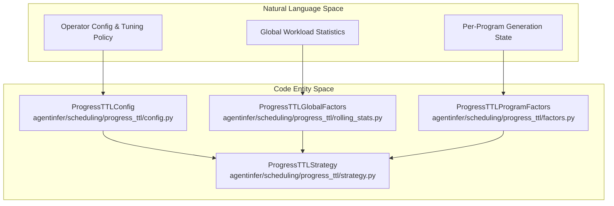
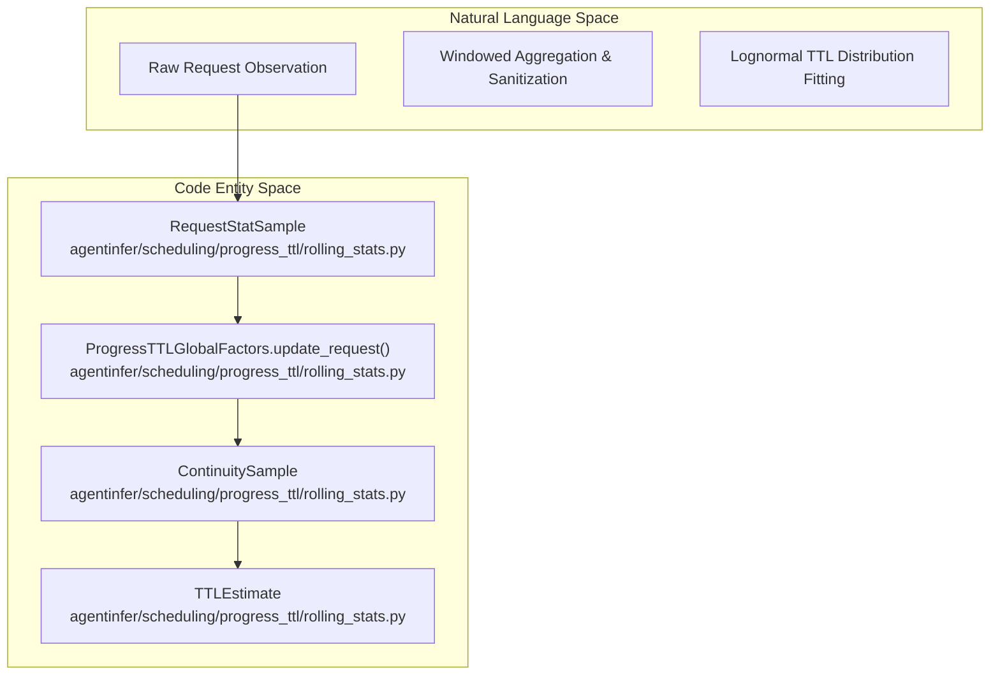

<!-- source: DeepWiki mcp.deepwiki.com · repo openJiuwen-ai/agent-infer · extra page Configuration, Factors and Rolling Statistics · fetched 2026-11-02 -->

# Configuration, Factors and Rolling Statistics

Relevant source files

The following files were used as context for generating this wiki page:

- [agentinfer/scheduling/progress_ttl/__init__.py](agentinfer/scheduling/progress_ttl/__init__.py)
- [agentinfer/scheduling/progress_ttl/config.py](agentinfer/scheduling/progress_ttl/config.py)
- [agentinfer/scheduling/progress_ttl/factors.py](agentinfer/scheduling/progress_ttl/factors.py)
- [agentinfer/scheduling/progress_ttl/rolling_stats.py](agentinfer/scheduling/progress_ttl/rolling_stats.py)
- [tests/scheduling/test_progress_ttl_rolling_stats.py](tests/scheduling/test_progress_ttl_rolling_stats.py)

## Purpose and Scope
This document covers the configuration framework, global rolling workload statistics, per-program decision factors, and bounded-window metrics that underpin the Progress-TTL scheduling policy in `agent-infer`. The Progress-TTL policy combines workload-derived continuous-growth protection, capacity-aware pause/resume logic, and an active Time-To-Live (TTL) derived from estimated cold-prefill costs. 

The implementation resides in `agentinfer/scheduling/progress_ttl/` and provides policy-owned configuration classes, request sample accumulators, factor trackers, and validation pipelines that operate independently of router or backend transport layers.

---

## 1. `ProgressTTLConfig`: Parameters and Validation Semantics

The static policy configuration is governed by `ProgressTTLConfig`, defined in `agentinfer/scheduling/progress_ttl/config.py`. It controls segment constraints, TTL bounds, prefill regression models, decode cost models, and scheduling behavior modes.

### Control Modes and Resume Ordering
Two primary enums define top-level behavior and tie-breaking rules:
- `ProgressTTLMode`: Operator-selected control mode (`ON = "on"`, `OFF = "off"`, `AUTO = "auto"`). Defined in `agentinfer/scheduling/progress_ttl/config.py:16-22` [agentinfer/scheduling/progress_ttl/config.py:16-22]().
- `ProgressTTLResumeOrder`: Ordering strategy applied to ordinary paused reasoning programs (`MRU = "mru"`, `FCFS = "fcfs"`). Defined in `agentinfer/scheduling/progress_ttl/config.py:24-29` [agentinfer/scheduling/progress_ttl/config.py:24-29]().

### Validation Logic
`ProgressTTLConfig` enforces invariants during initialization within its `__post_init__` method (`agentinfer/scheduling/progress_ttl/config.py:66-131`) [agentinfer/scheduling/progress_ttl/config.py:66-131](). Key validation checks include:
- `target_max_segment_rounds` must be strictly positive (`agentinfer/scheduling/progress_ttl/config.py:72-73`) [agentinfer/scheduling/progress_ttl/config.py:72-73]().
- All timing bounds, prefill quadratic model intercept/linear/quadratic coefficients, and decode throughput alpha parameters must be finite and non-negative (`agentinfer/scheduling/progress_ttl/config.py:74-95`) [agentinfer/scheduling/progress_ttl/config.py:74-95]().
- `ttl_max_seconds` must be greater than or equal to `ttl_min_seconds` (`agentinfer/scheduling/progress_ttl/config.py:96-97`) [agentinfer/scheduling/progress_ttl/config.py:96-97]().
- `ttl_max_cache_miss_impact_ratio` must fall within `[0, 1]` (`agentinfer/scheduling/progress_ttl/config.py:100-101`) [agentinfer/scheduling/progress_ttl/config.py:100-101]().
- `resume_capacity_ratio` and `pause_capacity_ratio` must fall within `(0, 1]` (`agentinfer/scheduling/progress_ttl/config.py:110-115`) [agentinfer/scheduling/progress_ttl/config.py:110-115]().

Sources: `agentinfer/scheduling/progress_ttl/config.py:1-132` [agentinfer/scheduling/progress_ttl/config.py:1-131](), `tests/scheduling/test_progress_ttl_rolling_stats.py:12-48` [tests/scheduling/test_progress_ttl_rolling_stats.py:12-48]().

---

## 2. Global Rolling Statistics (`ProgressTTLGlobalFactors`)

Global workload dynamics are maintained by `ProgressTTLGlobalFactors` in `agentinfer/scheduling/progress_ttl/rolling_stats.py`. This class provides windowed tracking of token usage, request latencies, queue durations, active program counts, and busy-time request throughput.

### Data Structures
- `RequestStatSample`: Sanitized observation representing a completed request, capturing prompt tokens, cached prefix tokens, completion tokens, latency, active/waiting program counts, and inter-request gaps (`agentinfer/scheduling/progress_ttl/rolling_stats.py:18-35`) [agentinfer/scheduling/progress_ttl/rolling_stats.py:18-35]().
- `RequestIntervalSample`: Records start and finish monotonic timestamps for busy-time throughput estimation (`agentinfer/scheduling/progress_ttl/rolling_stats.py:58-63`) [agentinfer/scheduling/progress_ttl/rolling_stats.py:58-63]().

### Cold-Start and Half-Window Rules
`ProgressTTLGlobalFactors` initializes with sensible defaults (e.g., `avg_prompt_tokens = 1024.0`, `request_window_size = 100`) (`agentinfer/scheduling/progress_ttl/rolling_stats.py:66-93`) [agentinfer/scheduling/progress_ttl/rolling_stats.py:66-93](). To prevent skew from initial default constants during cold start, metrics wait for half of the `request_window_size` samples before replacing baseline parameters (`tests/scheduling/test_progress_ttl_rolling_stats.py:148-157`) [tests/scheduling/test_progress_ttl_rolling_stats.py:148-157]().

Sources: `agentinfer/scheduling/progress_ttl/rolling_stats.py:1-147` [agentinfer/scheduling/progress_ttl/rolling_stats.py:1-147](), `tests/scheduling/test_progress_ttl_rolling_stats.py:50-168` [tests/scheduling/test_progress_ttl_rolling_stats.py:50-168]().

---

## 3. Per-Program Decision Factors (`ProgressTTLProgramFactors`)

While global rolling stats track aggregate system behavior, per-program state is managed via `ProgressTTLProgramFactors` in `agentinfer/scheduling/progress_ttl/factors.py`. 

### Responsibilities and Attributes
`ProgressTTLProgramFactors` tracks generation-specific metadata without duplicating the lifecycle facts owned directly by the Scheduler runtime:
- **Segment Execution**: `segment_served_rounds`, `segment_started_at_monotonic_s`, `segment_prompt_tokens`, `segment_completion_tokens`.
- **TTL and Deadlines**: `ttl_deadline_monotonic_s`, `ttl_expiry_observed`, `previous_ttl_seconds`, `rounds_since_ttl_pause`.
- **Privilege & Timeouts**: `is_privileged`, `privilege_reason`, `privilege_deadline_monotonic_s`, `force_resume_timeout_seconds`, `force_resume_deadline_monotonic_s`.
- **Pause/Resume Handoffs**: `last_pause_at_monotonic_s`, `last_resume_at_monotonic_s`, `pause_reason`, `resume_reason`.

`__post_init__` verifies that all numeric counters are non-negative, timestamps are finite and non-negative, and boolean factors are valid booleans (`agentinfer/scheduling/progress_ttl/factors.py:57-113`) [agentinfer/scheduling/progress_ttl/factors.py:57-112]().

Sources: `agentinfer/scheduling/progress_ttl/factors.py:1-113` [agentinfer/scheduling/progress_ttl/factors.py:1-112]().

---

## 4. Bounded Windows and Lognormal TTL Fitting

### Throughput Calculation over Bounded Intervals
Busy-time request throughput is computed using a bounded queue of `RequestIntervalSample` records. Overlapping request execution intervals are merged or counted correctly to avoid overestimating system throughput during bursty or idle workloads (`tests/scheduling/test_progress_ttl_rolling_stats.py:83-123`) [tests/scheduling/test_progress_ttl_rolling_stats.py:83-123]().

### Architecture and Data Flow

Diagram: Architecture of Progress-TTL Configuration and State Containers

Sources: `agentinfer/scheduling/progress_ttl/config.py` [agentinfer/scheduling/progress_ttl/config.py](), `agentinfer/scheduling/progress_ttl/rolling_stats.py` [agentinfer/scheduling/progress_ttl/rolling_stats.py](), `agentinfer/scheduling/progress_ttl/factors.py` [agentinfer/scheduling/progress_ttl/factors.py]()

Diagram: Data Flow for Rolling Statistics and TTL Fitting

Sources: `agentinfer/scheduling/progress_ttl/rolling_stats.py` [agentinfer/scheduling/progress_ttl/rolling_stats.py]()

---

## Sources
- `agentinfer/scheduling/progress_ttl/config.py` [agentinfer/scheduling/progress_ttl/config.py]()
- `agentinfer/scheduling/progress_ttl/factors.py` [agentinfer/scheduling/progress_ttl/factors.py]()
- `agentinfer/scheduling/progress_ttl/rolling_stats.py` [agentinfer/scheduling/progress_ttl/rolling_stats.py]()
- `tests/scheduling/test_progress_ttl_rolling_stats.py` [tests/scheduling/test_progress_ttl_rolling_stats.py]()

---

