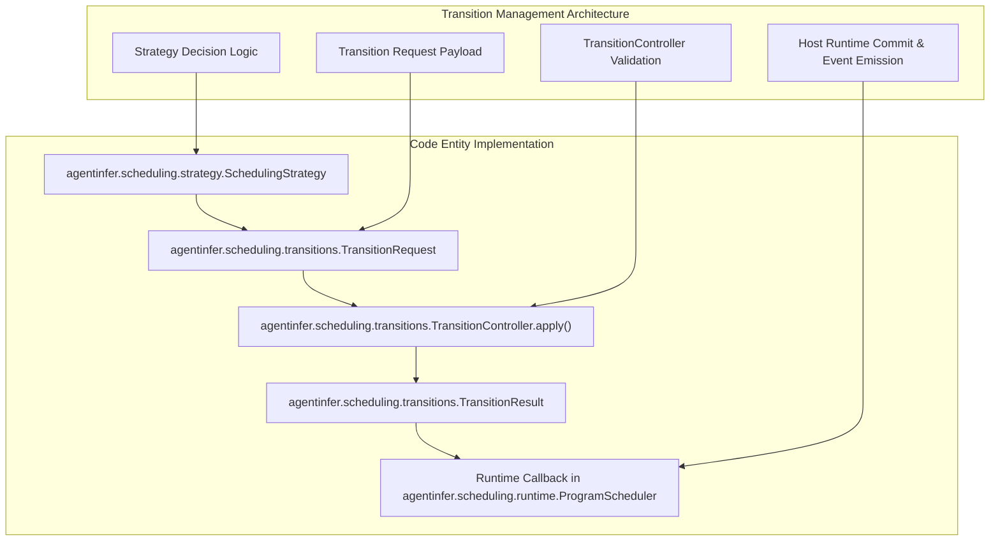
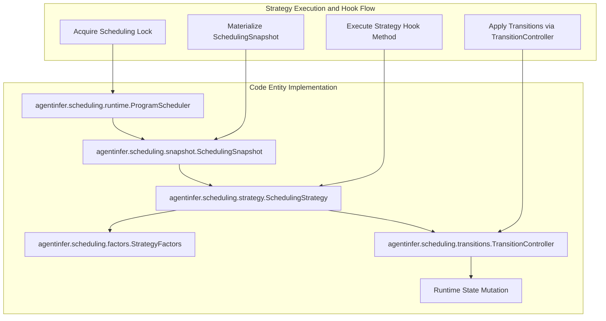
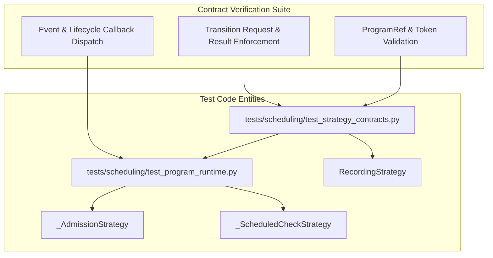

<!-- source: DeepWiki mcp.deepwiki.com · repo openJiuwen-ai/agent-infer · extra page Transitions and Strategy Interface · fetched 2026-11-02 -->

# Transitions and Strategy Interface

Relevant source files

The following files were used as context for generating this wiki page:

- [agentinfer/agentcache/core/vllm_logging.py](agentinfer/agentcache/core/vllm_logging.py)
- [agentinfer/scheduling/__init__.py](agentinfer/scheduling/__init__.py)
- [agentinfer/scheduling/observability.py](agentinfer/scheduling/observability.py)
- [agentinfer/scheduling/program_registry.py](agentinfer/scheduling/program_registry.py)
- [agentinfer/scheduling/program_runtime.py](agentinfer/scheduling/program_runtime.py)
- [agentinfer/scheduling/request_pool.py](agentinfer/scheduling/request_pool.py)
- [agentinfer/scheduling/strategy.py](agentinfer/scheduling/strategy.py)
- [agentinfer/scheduling/transitions.py](agentinfer/scheduling/transitions.py)
- [design/module/scheduling/program-state-machine.md](design/module/scheduling/program-state-machine.md)
- [tests/scheduling/test_program_runtime.py](tests/scheduling/test_program_runtime.py)
- [tests/scheduling/test_strategy_contracts.py](tests/scheduling/test_strategy_contracts.py)

## Purpose and Scope

This page details the scheduling transition semantics, the lock-scoped strategy interface, and their corresponding contract tests within `agentinfer.scheduling`. It covers how strategies inspect immutable scheduling snapshots and request state mutations exclusively through typed controllers without bypassing host runtime synchronization or state machines.

---

## 1. Transition Semantics and Controller

The host-neutral scheduling boundary uses strict typed requests to decouple strategy decisions from host runtime execution. `TransitionRequest` and `TransitionResult` represent attempted and committed state modifications against exact generation-safe program identities (`ProgramRef`) [agentinfer/scheduling/transitions.py:3-10]().

### Core Transition Kinds

`TransitionKind` enumerates the six supported core transitions validated and executed by the host runtime [agentinfer/scheduling/transitions.py:22-31]():
- `ADMIT`: Move a waiting candidate program into active execution on a specific target backend. Requires a valid `backend_id` [agentinfer/scheduling/transitions.py:63-65]().
- `QUEUE`: Place a candidate program into the waiting pool.
- `PAUSE`: Immediately pause an eligible active/acting program.
- `MARK_FOR_PAUSE`: Request a delayed pause for an in-flight reasoning program upon completion of its current model request.
- `RESUME`: Resume a paused program on a target backend. Requires a valid `backend_id` [agentinfer/scheduling/transitions.py:63-65]().
- `RELEASE`: Terminate and release a program.

### Validation and Controller Mechanics

`TransitionRequest.__post_init__()` validates that every transition specifies a non-empty reason and strictly enforces that `backend_id` is supplied *only* for `ADMIT` and `RESUME` requests [agentinfer/scheduling/transitions.py:59-68](). 

`TransitionResult.__post_init__()` guarantees consistency by ensuring that applied transitions carry their matching committed `SchedulingEvent`, and that unapplied transitions carry no event or mismatched event kinds [agentinfer/scheduling/transitions.py:88-98]().

`TransitionController` wraps the underlying host runtime application callback (`apply_transition`), filtering and recording all accepted transition requests during a single lock-scoped strategy Hook execution [agentinfer/scheduling/transitions.py:100-123]().

*Sources: [agentinfer/scheduling/transitions.py:43-123](), [agentinfer/scheduling/strategy.py:31-90]()*

---

## 2. Strategy Protocol and Lifecycle Hooks

`SchedulingStrategy` is the abstract base protocol implemented by concrete scheduling policies (such as the Progress-TTL family) [agentinfer/scheduling/strategy.py:31-33](). For each decision cycle, the caller holds the scheduling lock and passes an immutable `SchedulingSnapshot`, strategy-owned decision factors (`StrategyFactors`), and a lock-scoped `TransitionController` [agentinfer/scheduling/strategy.py:5-10]().

### Abstract and Optional Hooks

Concrete strategies must implement the following core methods:
- `handle_admission(...)`: Adopts or queues a candidate program generation, returning an `AdmissionOutcome` [agentinfer/scheduling/strategy.py:45-60]().
- `schedule_resume(...)`: Selects and applies a fixed resume batch from the current snapshot [agentinfer/scheduling/strategy.py:62-75]().
- `repair_capacity(...)`: Selects and applies a pause or mark-for-pause plan when resource bounds are exceeded [agentinfer/scheduling/strategy.py:77-90]().

Optional hooks include `handle_request_completion(...)`, `on_schedule_cycle_start(...)`, `diagnostics(...)`, and `event_diagnostics(...)` [agentinfer/scheduling/strategy.py:92-144](). Additionally, the strategy protocol defines an optional timer contract via `next_check_at(...)` and `handle_scheduled_check(...)` to allow monotonic deadline-driven checks without stale factors [agentinfer/scheduling/strategy.py:12-15]().

*Sources: [agentinfer/scheduling/strategy.py:31-144](), [agentinfer/scheduling/transitions.py:100-153]()`*

---

## 3. Contract Tests and Verification

The scheduling subsystem includes comprehensive test suites under `tests/scheduling/` to verify execution boundaries, generation safety, and transition validation independently of concrete policies [tests/scheduling/test_strategy_contracts.py:3-9]().

### Key Contract Test Suites

- `tests/scheduling/test_strategy_contracts.py`: Validates `ProgramRef` generation constraints (rejecting empty ids and negative generations), token observation bounds, snapshot immutability, lock-protected factors, single lifecycle callback dispatches, and multi-step transition ledgers [tests/scheduling/test_strategy_contracts.py:196-214]() et al.
- `tests/scheduling/test_program_runtime.py`: Exercises generation-safe programs, retained requests, and runtime lifecycle hooks using test double strategies such as `_AdmissionStrategy`, `_ScheduledCheckStrategy`, and `_SnapshotLedgerStrategy` [tests/scheduling/test_program_runtime.py:3-180]().

*Sources: [tests/scheduling/test_strategy_contracts.py:3-10](), [tests/scheduling/test_program_runtime.py:3-180]()`*

---

