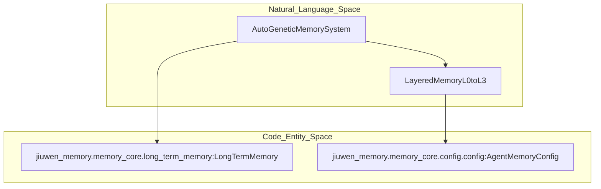
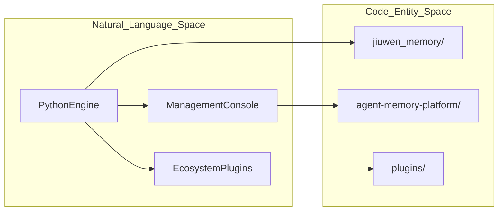

<!-- source: DeepWiki mcp.deepwiki.com · repo openJiuwen-ai/agent-memory · page 1 Overview · fetched 2026-11-02 -->

# Overview

Relevant source files

The following files were used as context for generating this wiki page:

- [README.md](README.md)
- [README.zh.md](README.zh.md)
- [docs/en/API Docs/long_term_memory.md](docs/en/API Docs/long_term_memory.md)

## Purpose and Scope
This page serves as the parent overview of **JiuwenMemory** (`agent-memory`), an open-source AutoGenetic memory system designed for AI agents [README.md:1-8](). This document outlines the core concepts, the L0–L3 layered memory architecture, and the overall repository layout. 

As a parent page, this overview provides a high-level summary. For detailed instructions on installation, configuration, and entrypoints, see [Getting Started and Configuration](#1.1). For an in-depth breakdown of module interactions and data flows, see [Architecture Map](#1.2).

Sources: `README.md:1-8`

---

## AutoGenetic Memory System and L0-L3 Architecture
JiuwenMemory rearchitects AI memory from passive storage into an autonomous, self-evolving data asset [README.md:13-26](). Treating memory pieces as "gene segments," the system focuses on precision, efficiency, and cross-organism replication [README.md:7-8](). 

The core architecture relies on a progressive four-tier model (**L0–L3**):
- **L0 (Raw Information)**: Captures raw conversational messages and context.
- **L1 (Summary Memory)**: Compresses dialogs into thematic summaries via background processing [README.md:19-23]().
- **L2 (Structured Memory)**: Extracts semantic, episodic, and variable records [README.md:19]().
- **L3 (User Profile)**: Maintains persistent long-term user characteristics and preferences [README.md:19]().

Sources: `README.md:5-26`, `docs/en/API Docs/long_term_memory.md:1-10`

---

## Repository Layout
The codebase is organized into a modular structure separating the Python core engine, the Java/Vue enterprise management console, plugins, documentation, and test suites [README.md:35-40]().

- `jiuwen_memory/`: The core Python engine containing memory management, storage foundations, retrieval mechanisms, and server interfaces.
- `agent-memory-platform/`: A Java Spring Boot and Vue 3 console for multi-tenant management, configuration control, and operational logging.
- `plugins/`: Integration modules such as OpenClaw lifecycle hooks and agent extensions [README.md:37-39]().
- `docs/`: Comprehensive bilingual API and user documentation.
- `tests/`: Unit and integration test suites covering the engine and REST endpoints.

Sources: `README.md:35-40`

---

## Child Pages Navigation
For deeper technical specifications, refer to the following child pages:
- [Getting Started and Configuration](#1.1) — Covers pyproject extras, environment variables, CLI entrypoints, and scope configurations.
- [Architecture Map](#1.2) — Covers internal module coupling (`memory_core`, `foundation`, `server`, `retrieval`) and data flow trajectories.

Sources: `README.md:49-110`

---

