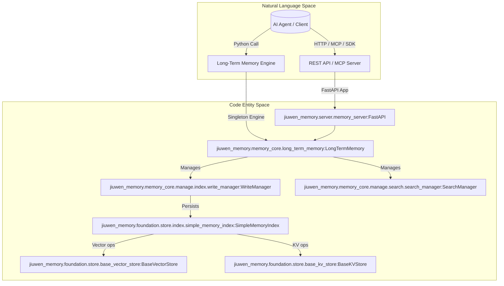
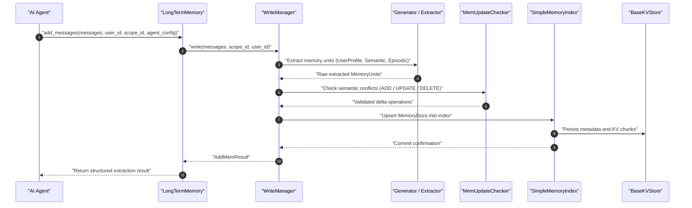
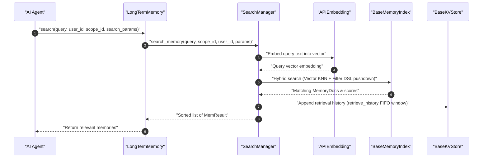

<!-- source: DeepWiki mcp.deepwiki.com · repo openJiuwen-ai/agent-memory · page 1.2 Architecture Map · fetched 2026-11-02 -->

# Architecture Map

Relevant source files

The following files were used as context for generating this wiki page:

- [README.md](README.md)
- [README.zh.md](README.zh.md)
- [jiuwen_memory/memory_core/long_term_memory.py](jiuwen_memory/memory_core/long_term_memory.py)
- [jiuwen_memory/server/memory_server.py](jiuwen_memory/server/memory_server.py)

## Purpose and Scope
This page details the macro-architecture of the `jiuwen_memory` (agent-memory) codebase. It maps the logical subsystems—`memory_core`, `foundation`, `server`, `retrieval`, `plugins`, and the Java/Vue management console (`agent-memory-platform`)—to their underlying Python and Java code entities. It outlines the complete execution lifecycle and data flow for core operations, focusing specifically on the write path (from `add_messages` to extraction and storage) and the search path (from user queries to vector/hybrid retrieval and ranking).

Sources: `README.md`, `README.zh.md`, `jiuwen_memory/memory_core/long_term_memory.py`, `jiuwen_memory/server/memory_server.py`

---

## 1. Subsystem Decomposition and Code Mapping

The JiuwenMemory engine is structured into modular layers that decouple high-level agent memory workflows from low-level storage backends, cryptographic codecs, and communication interfaces.

*Figure 1: Subsystem Mapping from Natural Language Space to Code Entity Space.*

### Subsystem Directory Layout & Responsibilities
* **`jiuwen_memory/memory_core/`**: Contains the core cognitive engine, including `LongTermMemory` [jiuwen_memory/memory_core/long_term_memory.py:112-122] singleton, memory managers (`WriteManager`, `SearchManager`, `FragmentMemoryManager`, `SummaryManager`, `VariableManager`) [jiuwen_memory/memory_core/long_term_memory.py:38-45], and background processes like the Auto-Dreaming orchestrator and Ebbinghaus forgetting evaluator.
* **`jiuwen_memory/foundation/`**: Implements foundational infrastructure abstractions, including storage contracts (`BaseKVStore`, `BaseDbStore`, `BaseVectorStore`, `BaseMessageStore`, `BaseMemoryIndex`) [jiuwen_memory/memory_core/long_term_memory.py:37-56], the Filter DSL, storage codecs (`AesStorageCodec`) [jiuwen_memory/memory_core/long_term_memory.py:65-69], and LLM client abstractions.
* **`jiuwen_memory/retrieval/`**: Houses vector embedding clients (`APIEmbedding`) [jiuwen_memory/memory_core/long_term_memory.py:54] and search ranking utilities.
* **`jiuwen_memory/server/`**: Provides FastAPI endpoints (`memory_server.py`) [jiuwen_memory/server/memory_server.py:8], store factories (`store_factory.py`) [jiuwen_memory/server/memory_server.py:26-32], config centers, and Model Context Protocol (MCP) servers.
* **`agent-memory-plugin/`**: Contains agent integration lifecycle scripts (e.g., OpenClaw bindings).
* **`agent-memory-platform/`**: Spring Boot backend and Vue 3 frontend console managing tenants, scopes, configs, logs, and operational telemetry.

Sources: `README.md`, `jiuwen_memory/memory_core/long_term_memory.py`, `jiuwen_memory/server/memory_server.py`

---

## 2. Write Path: Data Flow from `add_messages` to Storage

When an agent calls `add_messages(...)`, the engine processes raw conversation chunks through extraction pipelines, conflict detection checks, and persistent indexing.

*Figure 2: Write Path Data Flow for `add_messages`.*

### Step-by-Step Write Lifecycle
1. **Entry Point**: The agent invokes `LongTermMemory.add_messages(...)`, supplying user messages, assistant responses, scope identifiers, and `AgentMemoryConfig`.
2. **Routing**: `LongTermMemory` delegates conversation persistence and memory extraction to `WriteManager`.
3. **Extraction**: The extraction pipeline processes the dialogue context, categorizing extracted insights into L0–L3 memory tiers (e.g., `FragmentMemoryUnit`, `SummaryUnit`, `VariableUnit`) [jiuwen_memory/memory_core/long_term_memory.py:43-44].
4. **Conflict Resolution**: `MemUpdateChecker` evaluates newly extracted memories against existing records using LLM analysis to determine whether to `ADD`, `UPDATE`, or `DELETE`.
5. Data Indexing & Persistence: `SimpleMemoryIndex` [jiuwen_memory/memory_core/long_term_memory.py:57] or `FileMemoryIndex` coordinates vector embedding generation via `APIEmbedding` [jiuwen_memory/memory_core/long_term_memory.py:54] and persists payloads across `BaseVectorStore` and `BaseKVStore` [jiuwen_memory/memory_core/long_term_memory.py:134-135].

Sources: `README.md`, `README.zh.md`, `jiuwen_memory/memory_core/long_term_memory.py`

---

## 3. Search Path: Retrieval and Ranking Flow

When an agent needs context for a user prompt, it queries the memory engine using semantic search parameters handled by `SearchManager`.

*Figure 3: Search Path Data Flow and Retrieval Pipeline.*

### Step-by-Step Search Lifecycle
1. **Query Dispatch**: `LongTermMemory.search(...)` passes the query string and filtering criteria to `SearchManager` [jiuwen_memory/memory_core/long_term_memory.py:45].
2. **Vectorization**: The query string is transformed into a dense vector via the configured embedding model (`APIEmbedding`) [jiuwen_memory/memory_core/long_term_memory.py:54].
3. **Hybrid Search & Filtering**: `BaseMemoryIndex` executes similarity search against `BaseVectorStore` while applying filter conditions via the Filter DSL.
4. **Retrieval History Logging**: `SearchManager` records the retrieval event in a FIFO rolling window (`retrieve_history` prefix, bounded by `_RETRIEVAL_HISTORY_MAX_LEN = 20`) [jiuwen_memory/memory_core/long_term_memory.py:74-88], which feeds recency reinforcement for the Ebbinghaus forgetting scoring mechanism.

Sources: `README.md`, `jiuwen_memory/memory_core/long_term_memory.py`, `jiuwen_memory/server/memory_server.py`

---

