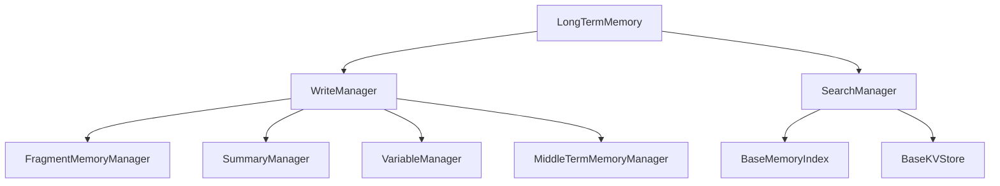
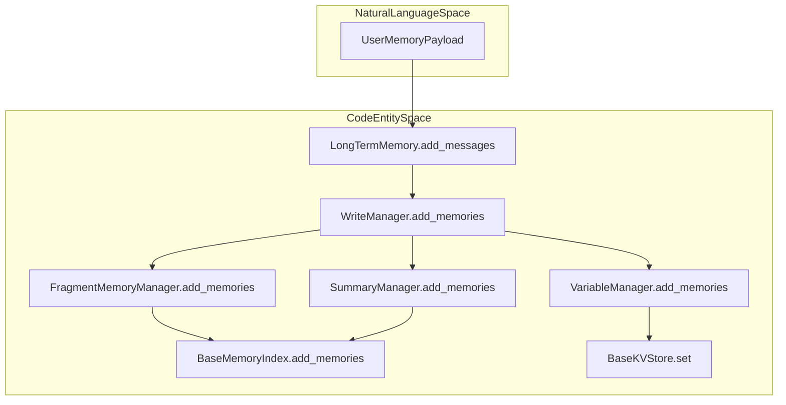
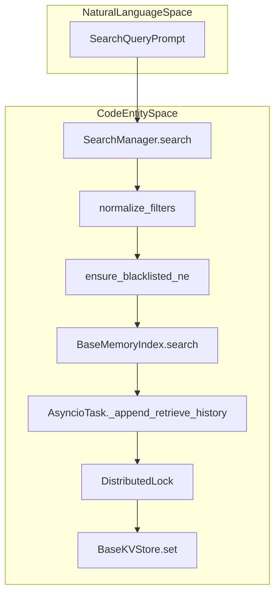

<!-- source: DeepWiki mcp.deepwiki.com · repo openJiuwen-ai/agent-memory · page 2.2 Memory Managers (Write and Search Paths) · fetched 2026-11-02 -->

# Memory Managers (Write and Search Paths)

Relevant source files

The following files were used as context for generating this wiki page:

- [jiuwen_memory/foundation/store/base_memory_index.py](jiuwen_memory/foundation/store/base_memory_index.py)
- [jiuwen_memory/memory_core/manage/index/middle_mem_manager.py](jiuwen_memory/memory_core/manage/index/middle_mem_manager.py)
- [jiuwen_memory/memory_core/manage/index/variable_manager.py](jiuwen_memory/memory_core/manage/index/variable_manager.py)
- [jiuwen_memory/memory_core/manage/index/write_manager.py](jiuwen_memory/memory_core/manage/index/write_manager.py)
- [jiuwen_memory/memory_core/manage/mem_meta/__init__.py](jiuwen_memory/memory_core/manage/mem_meta/__init__.py)
- [jiuwen_memory/memory_core/manage/search/search_manager.py](jiuwen_memory/memory_core/manage/search/search_manager.py)
- [jiuwen_memory/server/config_center_api.py](jiuwen_memory/server/config_center_api.py)
- [jiuwen_memory/server/log_center_api.py](jiuwen_memory/server/log_center_api.py)
- [tests/unit_tests/core/memory/manage/index/test_manage.py](tests/unit_tests/core/memory/manage/index/test_manage.py)
- [tests/unit_tests/core/memory/process/forgetting/test_delete_mem_cleanup.py](tests/unit_tests/core/memory/process/forgetting/test_delete_mem_cleanup.py)
- [tests/unit_tests/core/memory/test_long_term_memory_middle_mutations.py](tests/unit_tests/core/memory/test_long_term_memory_middle_mutations.py)

## Purpose and Scope
This page details the implementation, routing logic, and execution pathways of memory managers within the `jiuwen_memory` engine (`jiuwen_memory/memory_core/manage/`). It covers the architectural division of labor between `WriteManager`, `SearchManager`, and concrete subclass managers (`FragmentMemoryManager`, `SummaryManager`, `VariableManager`, and `MiddleTermMemoryManager`), alongside filter DSL normalization and retrieval history tracking.

---

## 1. Memory Manager Architecture & Component Hierarchy

The memory management subsystem coordinates persistence, retrieval, updates, and deletions across heterogeneous storage backends (vector indices, relational/KV stores). The engine delegates operations through centralized coordinator classes (`WriteManager` and `SearchManager`) to specific memory domain managers implementing `BaseMemoryManager`.

*Sources: `[jiuwen_memory/memory_core/manage/index/write_manager.py:12-26]`, `[jiuwen_memory/memory_core/manage/search/search_manager.py:59-77]()`*

---

## 2. The Write Path (`WriteManager`)

`WriteManager` acts as the entry router for ingesting, modifying, and purging memory units. It inspects memory types, routes payloads to corresponding managers, and handles fallback or cross-tier cleanup between long-term and middle-term memory stores.

### Key Write Operations
* **`add_memories`**: Iterates through registered managers in `self.managers`, invoking their respective batch insertion methods `[jiuwen_memory/memory_core/manage/index/write_manager.py:27-46]()`.
* **`update_mem_by_id`**: Resolves memory type via index lookup (`__get_mem_type_from_index`). If absent from long-term storage, it optionally checks middle-term storage (`_enable_middle_memory`) before delegating to `middle_manager.update` or rejecting `[jiuwen_memory/memory_core/manage/index/write_manager.py:58-106]()`.
* **`delete_mem_by_id`**: Identifies memory type from index or middle-term cache and routes the deletion request to the appropriate manager `[jiuwen_memory/memory_core/manage/index/write_manager.py:108-155]()`.

*Sources: `[jiuwen_memory/memory_core/manage/index/write_manager.py:27-160]`, `[jiuwen_memory/memory_core/manage/index/variable_manager.py:39-75]()`*

---

## 3. Concrete Memory Managers

### FragmentMemoryManager & SummaryManager
These managers handle unstructured and semi-structured text units (e.g., user profiles, conversational chunks). They interface directly with `BaseMemoryIndex` to persist embedded documents with scalar metadata (`is_important`, `blacklisted`).

### VariableManager
`VariableManager` manages scoped key-value variables (`user_var` and `session_var`) directly inside `BaseKVStore` using prefixed namespace keys separated by `VariableManager.SEPARATOR` (`/`) `[jiuwen_memory/memory_core/manage/index/variable_manager.py:16-34]()`. It supports upsert semantics via `update_user_variable` and prefix-based batch purges via `delete_by_user_id` `[jiuwen_memory/memory_core/manage/index/variable_manager.py:87-132]()`.

### MiddleTermMemoryManager
`MiddleTermMemoryManager` handles middle-term cache persistence and vector storage synchronization (`SemanticStore`). It supports atomic updates by deleting existing vector documents before inserting updated `MiddleTermUnit` instances `[jiuwen_memory/memory_core/manage/index/middle_mem_manager.py:18-95]()`.

*Sources: `[jiuwen_memory/memory_core/manage/index/variable_manager.py:16-145]`, `[jiuwen_memory/memory_core/manage/index/middle_mem_manager.py:18-126]()`*

---

## 4. The Search Path & Ebbinghaus Reinforcement (`SearchManager`)

`SearchManager` coordinates execution across underlying index backends while maintaining background trace logs for the Ebbinghaus forgetting curve reinforcement model (`retrieve_history`).

### Search Data Flow
1. **Parameter Packaging**: Input queries are encapsulated in `SearchParams`, which accept optional `FilterGroup` filters `[jiuwen_memory/memory_core/manage/search/search_manager.py:42-56]()`.
2. **Filter Normalization**: Applies automatic exclusion rules (`ensure_blacklisted_ne`) to filter out forgotten memories unless explicitly overridden by caller DSL conditions `[jiuwen_memory/memory_core/manage/search/search_manager.py:49-56]()`.
3. **Index Execution**: Queries the underlying `BaseMemoryIndex` for top-k semantic matches.
4. **Background Trace Recording**: Fires a non-blocking `asyncio.Task` (`_append_retrieve_history`) protected by a `DistributedLock` to update the FIFO rolling-window retrieve history (`_RETRIEVE_HISTORY_MAX_LEN = 20`) in `BaseKVStore` `[jiuwen_memory/memory_core/manage/search/search_manager.py:84-154]()`.

*Sources: `[jiuwen_memory/memory_core/manage/search/search_manager.py:42-154]`, `[jiuwen_memory/foundation/store/base_memory_index.py:162-186]()`*

---

## 5. Filter DSL Usage

The memory managers rely on a backend-neutral `FilterGroup` and condition DSL defined in the foundation layer (`[jiuwen_memory/foundation/store/filter_dsl.py]()`). 

* **Default-Injected Filters**: By default, `SearchManager` ensures that any search filter without an explicit `blacklisted` condition receives a `NE("blacklisted", True)` predicate injected via `ensure_blacklisted_ne` `[jiuwen_memory/memory_core/manage/search/search_manager.py:49-56]()`.
* **Explicit Overrides**: Callers requiring access to blacklisted or forgotten memories must explicitly supply filter expressions targeting the `blacklisted` field (e.g., `EQ("blacklisted", True)`).

*Sources: `[jiuwen_memory/memory_core/manage/search/search_manager.py:42-56]`, `[jiuwen_memory/foundation/store/base_memory_index.py:162-186]()`*

---

## 6. Summary of Key Classes and Roles

| Class Name | File Path | Primary Role |
| :--- | :--- | :--- |
| `WriteManager` | `jiuwen_memory/memory_core/manage/index/write_manager.py` | Routes add, update, and delete requests across memory managers and index stores. |
| `SearchManager` | `jiuwen_memory/memory_core/manage/search/search_manager.py` | Coordinates search requests, applies filter DSL rules, and logs hit traces for Ebbinghaus forgetting. |
| `VariableManager` | `jiuwen_memory/memory_core/manage/index/variable_manager.py` | Manages user and session key-value variables in `BaseKVStore` with namespaced prefixes. |
| `MiddleTermMemoryManager` | `jiuwen_memory/memory_core/manage/index/middle_mem_manager.py` | Manages middle-term cache units and vector store synchronization. |
| `SearchParams` | `jiuwen_memory/memory_core/manage/search/search_manager.py` | Pydantic data model encapsulating query parameters and custom `FilterGroup` rules. |

*Sources: `[jiuwen_memory/memory_core/manage/index/write_manager.py:12-26]`, `[jiuwen_memory/memory_core/manage/search/search_manager.py:42-77]`, `[jiuwen_memory/memory_core/manage/index/variable_manager.py:16-34]`, `[jiuwen_memory/memory_core/manage/index/middle_mem_manager.py:18-27]()`*

---

