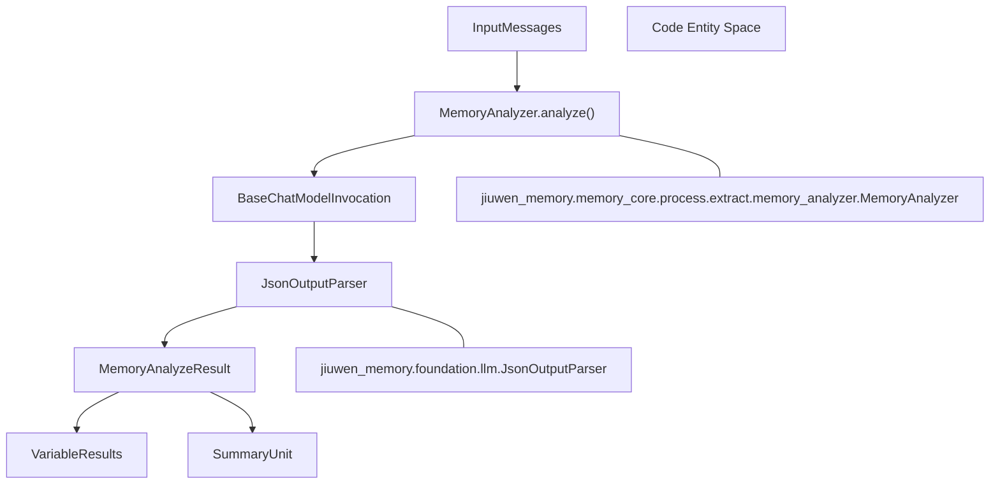
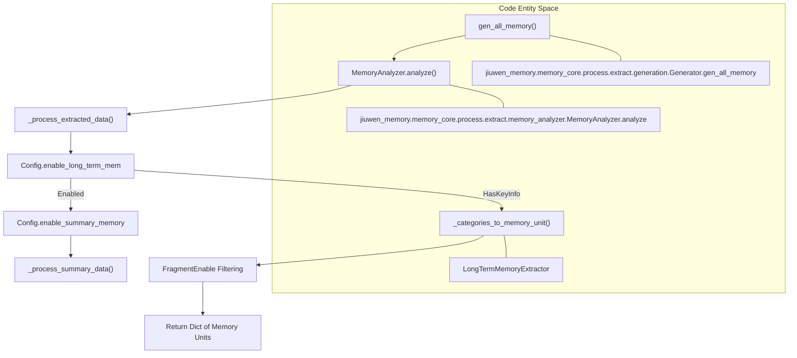

<!-- source: DeepWiki mcp.deepwiki.com · repo openJiuwen-ai/agent-memory · page 2.4 Extraction and Generation Pipeline · fetched 2026-11-02 -->

# Extraction and Generation Pipeline

Relevant source files

The following files were used as context for generating this wiki page:

- [jiuwen_memory/memory_core/config/config.py](jiuwen_memory/memory_core/config/config.py)
- [jiuwen_memory/memory_core/manage/mem_model/memory_unit.py](jiuwen_memory/memory_core/manage/mem_model/memory_unit.py)
- [jiuwen_memory/memory_core/process/dreaming/store.py](jiuwen_memory/memory_core/process/dreaming/store.py)
- [jiuwen_memory/memory_core/process/dreaming/sweeper.py](jiuwen_memory/memory_core/process/dreaming/sweeper.py)
- [jiuwen_memory/memory_core/process/extract/generation.py](jiuwen_memory/memory_core/process/extract/generation.py)
- [tests/unit_tests/core/memory/test_add_messages_result_and_proactive_memory.py](tests/unit_tests/core/memory/test_add_messages_result_and_proactive_memory.py)

## Purpose and Scope
This page details the implementation of the memory extraction and generation pipeline in `jiuwen_memory.memory_core`. The pipeline processes incoming dialogue messages, analyzes conversation content for summary and variables, extracts long-term memory fragments (`user_profile`, `semantic_memory`, `episodic_memory`), and routes them through update verification strategies (`MemUpdateChecker`) to perform `ADD`, `UPDATE`, or `DELETE` operations on persistent memory stores.

Sources: [jiuwen_memory/memory_core/process/extract/generation.py:1-481](), [jiuwen_memory/memory_core/manage/mem_model/memory_unit.py:1-68]()

---

## 1. Memory Analyzer and Variable Extraction (`MemoryAnalyzer`)
The `MemoryAnalyzer` inspects conversational history and incoming messages to determine if key information is present, extracts runtime variables, and generates conversation summaries.

- **`MemoryAnalyzer.analyze()`**: Coordinates LLM-based analysis using schema prompts to return a structured evaluation containing `has_key_information`, `variables`, and `summary`.
- **Variable Extraction**: Captures key-value pairs (`VariableResult`) from user input, filtering out forbidden variables defined in `MemoryEngineConfig.forbidden_variables`.
- **Summary Generation**: Produces a concise summary of the dialogue turn bounded by `summary_max_token`.

*Figure 1: Memory Analyzer Workflow bridging natural language ingestion to structured memory outputs.*

Sources: [jiuwen_memory/memory_core/process/extract/generation.py:65-73]()

---

## 2. Long-Term Memory Extractor (`LongTermMemoryExtractor`)
When key information is detected by the analyzer, `LongTermMemoryExtractor` processes the dialogue to extract granular long-term memory categories.

- **Categories Extracted**:
  - `user_profile`: Facts regarding user identity, preferences, relationships, and asset status.
  - `semantic_memory`: Time-independent factual statements or concepts.
  - `episodic_memory`: Time-dependent episodic events or occurrences.
- **Explicit Instructions**: Detects explicit user instructions (`instruct_memories`) requiring immediate procedural updates.
- **Configurable Definitions**: Customizes extraction behavior using scope-specific settings defined in `MemoryScopeConfig` (e.g., `user_profile_definition`, `semantic_memory_definition`, `episodic_memory_definition`).

Sources: [jiuwen_memory/memory_core/config/config.py:49-68](), [jiuwen_memory/memory_core/process/extract/long_term_memory_extractor.py:1-123]()

---

## 3. Generation Coordinator (`Generator`)
The `Generator` class orchestrates the complete extraction workflow. Its primary entry point, `Generator.gen_all_memory()`, coordinates analyzer and extractor tasks.

*Figure 2: Generator pipeline sequence and method execution flow.*

- **Parameters Required**: `messages`, `config`, `user_id`, `scope_id`, and `base_chat_model` [jiuwen_memory/memory_core/process/extract/generation.py:33-54]().
- **Error Handling**: Catches `AttributeError`, `ValueError`, and general exceptions during conflict resolution, logging failures via `memory_logger` without failing the entire message ingestion flow [jiuwen_memory/memory_core/process/extract/generation.py:120-146]().

Sources: [jiuwen_memory/memory_core/process/extract/generation.py:33-160]()

---

## 4. Prompt Management and Templating (`PromptApplier`)
The extraction and generation pipeline relies on template-driven prompts managed by `PromptApplier`.

- **Template Resolution**: Fetches base system prompts and injects dynamic context placeholders (e.g., dialogue history, token budgets, custom domain definitions from `MemoryScopeConfig`).
- **JSON Parsing**: Integrates with `JsonOutputParser` to ensure LLM responses conform to expected dictionary or list schemas before unit instantiation.

Sources: [jiuwen_memory/memory_core/prompts/prompt_applier.py:1-100](), [jiuwen_memory/memory_core/process/dreaming/sweeper.py:103-157]()

---

## 5. Memory Update Checker and ADD/UPDATE/DELETE Strategy (`MemUpdateChecker`)
Extracted memory units undergo conflict resolution and deduplication via the memory update checking mechanism before being committed to storage.

- **Operation Types (`OperationType`)**:
  - `ADD`: Inserts a brand new memory unit when no overlapping semantic matches exist.
  - `UPDATE`: Modifies an existing memory unit if new information refines or supersedes previous records.
  - `DELETE`: Removes obsolete or explicitly contradicted memory units.
- **Conflict Validation**: Evaluates incoming fragment memory units against existing vector index entries to maintain coherence and prevent redundancy.

Sources: [jiuwen_memory/memory_core/manage/mem_model/memory_unit.py:19-23](), [tests/unit_tests/core/memory/test_add_messages_result_and_proactive_memory.py:1-200]()

---

