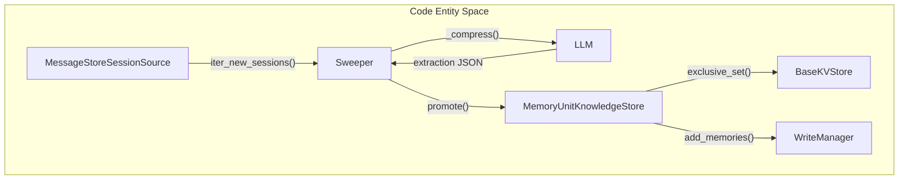
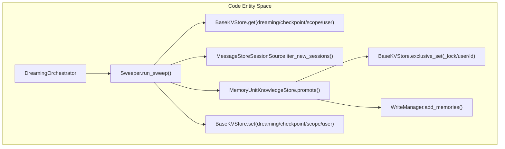
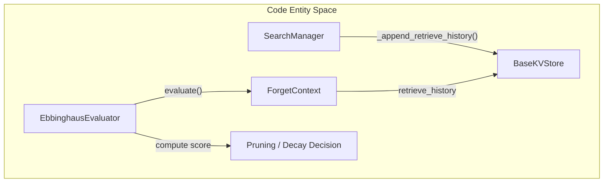

<!-- source: DeepWiki mcp.deepwiki.com · repo openJiuwen-ai/agent-memory · page 2.5 Dreaming and Ebbinghaus Forgetting · fetched 2026-11-02 -->

# Dreaming and Ebbinghaus Forgetting

Relevant source files

The following files were used as context for generating this wiki page:

- [jiuwen_memory/memory_core/long_term_memory.py](jiuwen_memory/memory_core/long_term_memory.py)
- [jiuwen_memory/server/memory_server.py](jiuwen_memory/server/memory_server.py)
- [tests/unit_tests/core/memory/process/dreaming/test_source.py](tests/unit_tests/core/memory/process/dreaming/test_source.py)
- [tests/unit_tests/core/memory/process/dreaming/test_start_stop_dreaming.py](tests/unit_tests/core/memory/process/dreaming/test_start_stop_dreaming.py)
- [tests/unit_tests/core/memory/process/dreaming/test_store.py](tests/unit_tests/core/memory/process/dreaming/test_store.py)
- [tests/unit_tests/core/memory/process/dreaming/test_sweeper.py](tests/unit_tests/core/memory/process/dreaming/test_sweeper.py)

## Purpose and Scope
This section covers the background memory consolidation subsystem (Dreaming) and the Ebbinghaus forgetting mechanism in the `jiuwen_memory` engine. The dreaming engine asynchronously extracts higher-level semantic and episodic knowledge from conversation message logs and promotes them into long-term storage. The Ebbinghaus forgetting subsystem computes memory decay and reinforcement based on retrieval history, applying decay evaluations, pruning, and blacklisting to keep the memory space relevant and bounded.

Sources:
- [jiuwen_memory/memory_core/long_term_memory.py:25-34]()

---

## Dreaming Subsystem Architecture

The dreaming pipeline mimics human memory consolidation during sleep. It reads unprocessed session logs from message stores, compresses dialogue events, prompts an LLM to extract durable knowledge items, and writes them back through the write manager.

The subsystem consists of four core components:
1. `DreamingOrchestrator`: Coordinates background looping, lifecycle startup, and shutdown per user/scope `[tests/unit_tests/core/memory/process/dreaming/test_start_stop_dreaming.py:28-36]()`.
2. `MessageStoreSessionSource`: Fetches conversation sessions from `BaseMessageStore` matching minimum round thresholds and filtering out already-scanned sessions `[tests/unit_tests/core/memory/process/dreaming/test_source.py:44-56]()`.
3. `Sweeper`: Manages token compression (`_compress`), LLM extraction invocation, session checkpoint persistence, and error isolation `[tests/unit_tests/core/memory/process/dreaming/test_sweeper.py:75-94]()`.
4. `MemoryUnitKnowledgeStore`: Validates and groups extracted knowledge items, acquiring user-level distributed locks (`_lock/user/{user_id}`) before invoking `WriteManager.add_memories()` `[tests/unit_tests/core/memory/process/dreaming/test_store.py:49-70]()`.

Sources:
- [jiuwen_memory/memory_core/long_term_memory.py:25-30]()
- [tests/unit_tests/core/memory/process/dreaming/test_store.py:49-121]()
- [tests/unit_tests/core/memory/process/dreaming/test_source.py:44-67]()
- [tests/unit_tests/core/memory/process/dreaming/test_sweeper.py:75-94]()

---

## Checkpointing and Concurrency Control

To guarantee idempotency across dreaming sweeps, the `Sweeper` maintains scanned session checkpoints in the key-value store under the prefix key `dreaming/checkpoint/{scope_id}/{user_id}` [tests/unit_tests/core/memory/process/dreaming/test_sweeper.py:91-93](). 

If an extraction or promotion fails for a specific session, its state is not written to the checkpoint, allowing subsequent sweeps to retry safely [tests/unit_tests/core/memory/process/dreaming/test_sweeper.py:124-163](). Concurrency across multiple workers or simultaneous writes is governed by `DistributedLock` utilizing `BaseKVStore.exclusive_set()` with automatic cleanup via `delete()` [tests/unit_tests/core/memory/process/dreaming/test_store.py:111-120]().

Sources:
- [tests/unit_tests/core/memory/process/dreaming/test_store.py:111-120]()
- [tests/unit_tests/core/memory/process/dreaming/test_sweeper.py:91-148]()

---

## Ebbinghaus Forgetting and Evaluator

Memory units degrade over time following the Ebbinghaus forgetting curve. The subsystem relies on `EbbinghausEvaluator` and `ForgetContext` [jiuwen_memory/memory_core/long_term_memory.py:31-34]().

Retrieval events are logged into a FIFO rolling window (`RETRIEVE_HISTORY_PREFIX`, bounded by `_RETRIEVE_HISTORY_MAX_LEN = 20`) stored inside the KV backend [jiuwen_memory/memory_core/long_term_memory.py:74-88](). The recency reinforcement term computes decay based on access frequency and time deltas, ensuring frequently or recently accessed memories resist pruning.

Sources:
- [jiuwen_memory/memory_core/long_term_memory.py:31-34]()
- [jiuwen_memory/memory_core/long_term_memory.py:74-89]()

---

## Blacklisting and Recall

When memories drop below the retention threshold determined by the `EbbinghausEvaluator`, or are explicitly deleted via public APIs, they enter a blacklisted state. Blacklisting prevents pruned or deleted memory IDs from resurfacing during vector similarity searches or keyword retrievals. The underlying KV records and retrieve history (`retrieve_history{SEP}{user_id}{SEP}{scope_id}{SEP}{mem_id}`) are cleaned up during batch maintenance operations [jiuwen_memory/memory_core/long_term_memory.py:74-80]().

Sources:
- [jiuwen_memory/memory_core/long_term_memory.py:74-81]()

---

