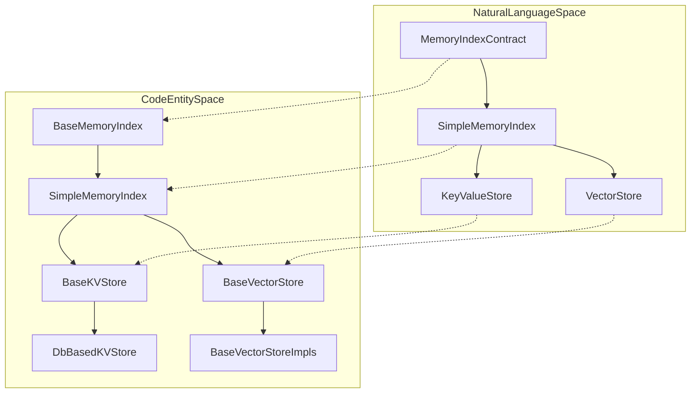
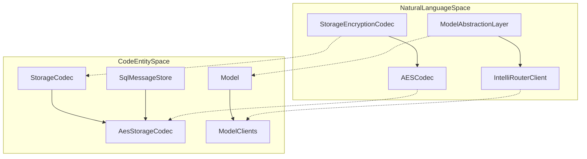

<!-- source: DeepWiki mcp.deepwiki.com · repo openJiuwen-ai/agent-memory · page 3 Foundation Layer · fetched 2026-11-02 -->

# Foundation Layer

Relevant source files

The following files were used as context for generating this wiki page:

- [jiuwen_memory/foundation/store/index/simple_memory_index.py](jiuwen_memory/foundation/store/index/simple_memory_index.py)
- [jiuwen_memory/foundation/store/kv/db_based_kv_store.py](jiuwen_memory/foundation/store/kv/db_based_kv_store.py)
- [jiuwen_memory/memory_core/manage/index/fragment_memory_manager.py](jiuwen_memory/memory_core/manage/index/fragment_memory_manager.py)
- [jiuwen_memory/memory_core/manage/index/summary_manager.py](jiuwen_memory/memory_core/manage/index/summary_manager.py)
- [jiuwen_memory/memory_core/manage/mem_model/sql_message_store.py](jiuwen_memory/memory_core/manage/mem_model/sql_message_store.py)

The Foundation Layer provides unified data access, storage abstraction, cryptographic security, and model invocation interfaces for the `jiuwen_memory` engine. It decouples high-level memory managers from concrete physical storage backends (such as KV databases, vector engines, and relational SQL stores) and abstracts AI model providers through pluggable clients.

Sources: `jiuwen_memory/foundation/store/index/simple_memory_index.py:1-40` [], `jiuwen_memory/foundation/store/kv/db_based_kv_store.py:1-55` []

---

## Storage Abstractions and Index Backends

### Memory Index Backends
The index layer defines the `BaseMemoryIndex` contract for compound memory storage operations. Legacy architectures are supported via `SimpleMemoryIndex`, which coordinates `BaseKVStore` and `BaseVectorStore` instances for hybrid retrieval. For details, see [Memory Index Backends](#3.1).

Sources: `jiuwen_memory/foundation/store/index/simple_memory_index.py:40-69` []

### Vector Stores
Vector retrieval is abstracted through `BaseVectorStore`, offering uniform collection management and similarity search capabilities across physical backends including Milvus, Chroma, Elasticsearch, and GaussDB. For details, see [Vector Stores](#3.2).

Sources: `jiuwen_memory/foundation/store/index/simple_memory_index.py:31-36` []

### KV, DB and Message Stores
Persistence of raw metadata, state flags, and conversational logs is managed by components such as `DbBasedKVStore` (backed by SQLAlchemy engines supporting SQLite, MySQL, and GaussDB) and `SqlMessageStore`. For details, see [KV, DB and Message Stores](#3.3).

Sources: `jiuwen_memory/foundation/store/kv/db_based_kv_store.py:51-62` [], `jiuwen_memory/memory_core/manage/mem_model/sql_message_store.py:25-53` []

### Filter DSL
Complex conditional queries are decoupled from database dialects using the `FilterGroup` and `FilterCondition` domain-specific language. Filters are parsed and rendered dynamically per backend. For details, see [Filter DSL](#3.4).

Sources: `jiuwen_memory/foundation/store/filter_dsl` [jiuwen_memory/foundation/store/index/simple_memory_index.py:37-37]()

---

Diagram: Foundation Storage Abstractions Map

Sources: `jiuwen_memory/foundation/store/index/simple_memory_index.py:28-69` [], `jiuwen_memory/foundation/store/kv/db_based_kv_store.py:51-62` []

---

## Security, Codecs, and Model Infrastructure

### Storage Codecs and Security
Data encryption and serialization are handled via the `StorageCodec` interface. Implementations include AES-256-GCM (`AesStorageCodec`) and SM4 codecs registered via a central cryptographic registry. For details, see [Storage Codecs and Security](#3.5).

Sources: `jiuwen_memory/memory_core/manage/mem_model/sql_message_store.py:18-49` []

### LLM, Embedding and Prompt Layer
Model interactions use a unified `Model` abstraction alongside intelligent routers (`intelli router`), message chunk parsers, prompt templates, and retrieval embedding wrappers. For details, see [LLM, Embedding and Prompt Layer](#3.6).

Sources: `jiuwen_memory/memory_core/manage/index/fragment_memory_manager.py:7-8` []

---

Diagram: LLM and Codec Abstractions Map

Sources: `jiuwen_memory/memory_core/manage/mem_model/sql_message_store.py:18-49` [], `jiuwen_memory/memory_core/manage/index/fragment_memory_manager.py:7-8` []

---

