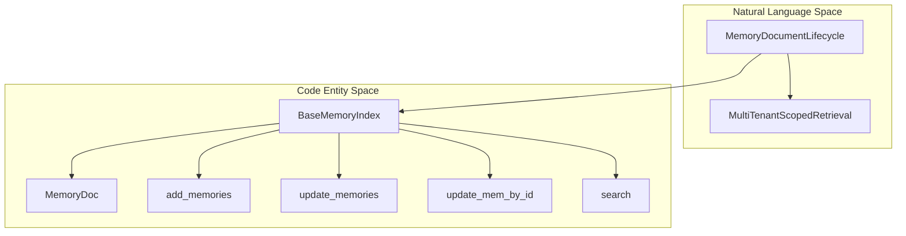
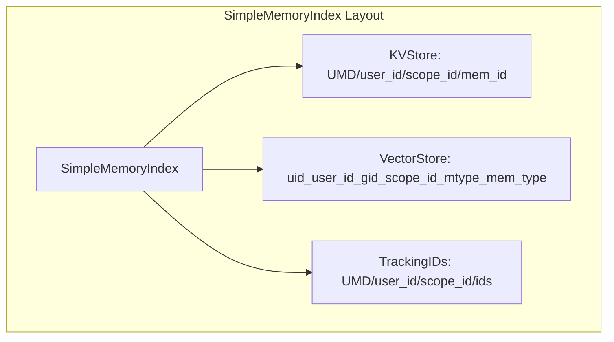

<!-- source: DeepWiki mcp.deepwiki.com · repo openJiuwen-ai/agent-memory · page 3.1 Memory Index Backends · fetched 2026-11-02 -->

# Memory Index Backends

Relevant source files

The following files were used as context for generating this wiki page:

- [jiuwen_memory/foundation/store/base_memory_index.py](jiuwen_memory/foundation/store/base_memory_index.py)
- [jiuwen_memory/foundation/store/index/simple_memory_index.py](jiuwen_memory/foundation/store/index/simple_memory_index.py)
- [jiuwen_memory/foundation/store/kv/db_based_kv_store.py](jiuwen_memory/foundation/store/kv/db_based_kv_store.py)
- [jiuwen_memory/memory_core/manage/index/fragment_memory_manager.py](jiuwen_memory/memory_core/manage/index/fragment_memory_manager.py)
- [jiuwen_memory/memory_core/manage/index/summary_manager.py](jiuwen_memory/memory_core/manage/index/summary_manager.py)
- [jiuwen_memory/memory_core/manage/mem_meta/__init__.py](jiuwen_memory/memory_core/manage/mem_meta/__init__.py)
- [jiuwen_memory/memory_core/manage/mem_model/sql_message_store.py](jiuwen_memory/memory_core/manage/mem_model/sql_message_store.py)
- [jiuwen_memory/memory_core/manage/search/search_manager.py](jiuwen_memory/memory_core/manage/search/search_manager.py)
- [jiuwen_memory/server/config_center_api.py](jiuwen_memory/server/config_center_api.py)
- [jiuwen_memory/server/log_center_api.py](jiuwen_memory/server/log_center_api.py)

## Purpose and Scope

Section 3.1 covers the storage indexing abstractions and hybrid backends within the JiuwenMemory foundation layer (`jiuwen_memory/foundation/store/`). Memory index backends manage the persistence, retrieval, and scalar filtering of memory documents across multi-tenant scopes (`user_id` and `scope_id`). 

This page outlines the core `BaseMemoryIndex` contract and the legacy hybrid `SimpleMemoryIndex` design. For file-based markdown and SQLite indexing backends, see [File Memory Index (Markdown + SQLite)](#3.1.1).

---

## 1. BaseMemoryIndex Contract and Data Model

The `BaseMemoryIndex` abstract base class defines the contract for memory storage, updates, deletion, and semantic search operations. Concrete implementations bind storage providers (such as key-value stores and vector databases) to handle tenant-scoped memory operations.

*Sources: [jiuwen_memory/foundation/store/base_memory_index.py:24-186]()*

Memory documents are represented by the `MemoryDoc` Pydantic model, which encapsulates unique identifiers, text content, memory types, importance flags, blacklisting states (forgetting), and extensible metadata fields.

Sources: [jiuwen_memory/foundation/store/base_memory_index.py:24-42]()

---

## 2. SimpleMemoryIndex (KV + Vector Hybrid) Design

`SimpleMemoryIndex` provides a backward-compatible hybrid index over legacy key-value stores and vector collections (`[jiuwen_memory/foundation/store/index/simple_memory_index.py:40-48]()`). It pairs a `BaseKVStore` for raw JSON document persistence with a `BaseVectorStore` for dense vector search and scalar filtering.

*Sources: [jiuwen_memory/foundation/store/index/simple_memory_index.py:13-17](), [jiuwen_memory/foundation/store/index/simple_memory_index.py:50-98]()*

### Key Layout and Tracking

The key layout utilizes specific hierarchical prefixes to partition data per tenant and scope:
- **KV Document Key:** `UMD/{user_id}/{scope_id}/{mem_id}` storing the JSON serialization of memory attributes `[jiuwen_memory/foundation/store/index/simple_memory_index.py:13-14]`, `[jiuwen_memory/foundation/store/index/simple_memory_index.py:90-91]()`.
- **Vector Collection Naming:** `uid_{user_id}_gid_{scope_id}_mtype_{mem_type}` isolating collections by type and scope `[jiuwen_memory/foundation/store/index/simple_memory_index.py:15-16]()`.
- **ID Tracking Keys:** `UMD/{user_id}/{scope_id}/ids` and type-specific tracking keys used to maintain consistency across storage backends `[jiuwen_memory/foundation/store/index/simple_memory_index.py:52-98]()`.

Sources: [jiuwen_memory/foundation/store/index/simple_memory_index.py:11-98]()

### Filter Pushdown and Scalar Filtering

`SimpleMemoryIndex` translates backend-neutral scalar filter expressions (`FilterGroup`) into native vector store query filters and post-processes results against the KV store when necessary. Top-level scalar fields such as `is_important` and `blacklisted` are pushed directly into the vector store schema for efficient pruning during similarity search.

Sources: [jiuwen_memory/foundation/store/index/simple_memory_index.py:161-167](), [jiuwen_memory/foundation/store/base_memory_index.py:110-115]()

---

## 3. Child Indexing Backends

For modern local-first and file-oriented deployments, JiuwenMemory provides file-based markdown and SQLite indexing strategies.

- For implementation details on parsing markdown chunks, FTS5 full-text search, `sqlite-vec` vector integration, and background file watching, see [File Memory Index (Markdown + SQLite)](#3.1.1).

Sources: [jiuwen_memory/foundation/store/index/simple_memory_index.py:40-48]()

---

