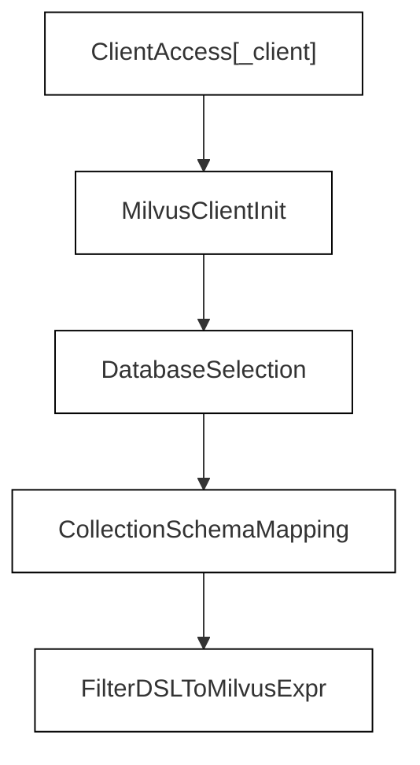
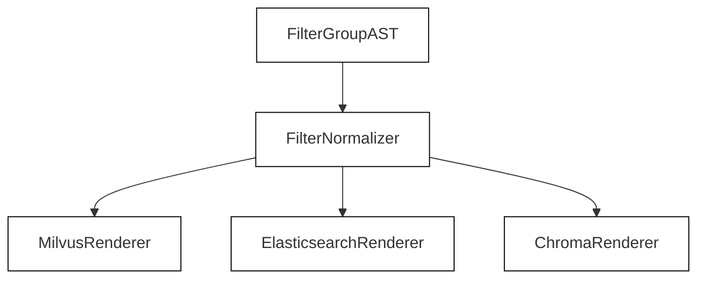
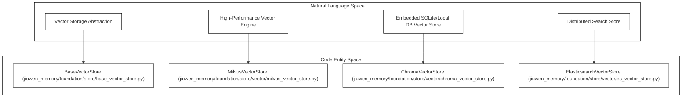
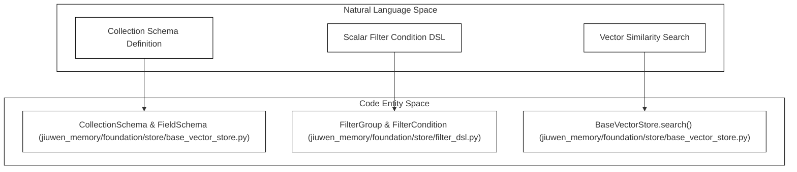

<!-- source: DeepWiki mcp.deepwiki.com · repo openJiuwen-ai/agent-memory · page 3.2 Vector Stores · fetched 2026-11-02 -->

# Vector Stores

Relevant source files

The following files were used as context for generating this wiki page:

- [jiuwen_memory/common/exception/codes.py](jiuwen_memory/common/exception/codes.py)
- [jiuwen_memory/foundation/store/base_vector_store.py](jiuwen_memory/foundation/store/base_vector_store.py)
- [jiuwen_memory/foundation/store/filter_dsl.py](jiuwen_memory/foundation/store/filter_dsl.py)
- [jiuwen_memory/foundation/store/vector/chroma_vector_store.py](jiuwen_memory/foundation/store/vector/chroma_vector_store.py)
- [jiuwen_memory/foundation/store/vector/es_vector_store.py](jiuwen_memory/foundation/store/vector/es_vector_store.py)
- [jiuwen_memory/foundation/store/vector/milvus_vector_store.py](jiuwen_memory/foundation/store/vector/milvus_vector_store.py)
- [jiuwen_memory/memory_core/manage/mem_model/message_manager.py](jiuwen_memory/memory_core/manage/mem_model/message_manager.py)
- [jiuwen_memory/memory_core/manage/search/filter_dsl.py](jiuwen_memory/memory_core/manage/search/filter_dsl.py)
- [tests/unit_tests/server/test_server_endpoints.py](tests/unit_tests/server/test_server_endpoints.py)

## Purpose and Scope
This page details the vector storage abstraction and backend implementations within the JiuwenMemory foundation layer (`jiuwen_memory/foundation/store/`). The vector store subsystem provides a unified, backend-agnostic interface (`BaseVectorStore`) for managing high-dimensional vector collections, inserting multi-field documents, executing similarity searches (Cosine, L2, Inner Product), and translating declarative filter DSL expressions (`FilterGroup`) into native database queries across supported backends: Milvus, ChromaDB, and Elasticsearch.

Sources: `[jiuwen_memory/foundation/store/base_vector_store.py:1-15]()`, `[jiuwen_memory/foundation/store/vector/milvus_vector_store.py:39-44]()`, `[jiuwen_memory/foundation/store/vector/chroma_vector_store.py:38-43]()`, `[jiuwen_memory/foundation/store/vector/es_vector_store.py:41-43]()`

---

## 1. The `BaseVectorStore` Abstraction and Data Models

The foundation contract is defined by `BaseVectorStore` alongside strict Pydantic data schemas that normalize collection definitions and data types across distinct vector database engines.

### Key Classes & Schemas
- `BaseVectorStore`: The abstract base class defining core lifecycle and data operation signatures (`create_collection`, `insert`, `search`, `delete`, `update`, `list_docs`) `[jiuwen_memory/foundation/store/base_vector_store.py:4-15]()`.
- `VectorDataType`: An enum supporting types such as `VARCHAR`, `FLOAT_VECTOR`, `INT64`, `INT32`, `FLOAT`, `DOUBLE`, `BOOL`, and `JSON` `[jiuwen_memory/foundation/store/base_vector_store.py:17-31]()`.
- `FieldSchema`: Defines individual collection field properties, validating constraints like vector dimension (`dim`) for `FLOAT_VECTOR` types `[jiuwen_memory/foundation/store/base_vector_store.py:33-65]()`.
- `CollectionSchema`: Manages collection-level field lists, single primary key constraints, and dynamic field toggles (`enable_dynamic_field`) `[jiuwen_memory/foundation/store/base_vector_store.py:109-135]()`.

Sources: `[jiuwen_memory/foundation/store/base_vector_store.py:1-175]()`

---

## 2. Backend Implementations

### 2.1 Milvus Vector Store
`MilvusVectorStore` integrates with PyMilvus using `MilvusClient`. Connections and database namespaces are initialized lazily on the first operation to support fault-tolerant startup sequences `[jiuwen_memory/foundation/store/vector/milvus_vector_store.py:39-128]`.

*Figure 1: MilvusVectorStore Initialization and Execution Pipeline*

Sources: `[jiuwen_memory/foundation/store/vector/milvus_vector_store.py:39-183]()`

### 2.2 Chroma Vector Store
`ChromaVectorStore` wraps `chromadb.PersistentClient` (or in-memory clients if no persistence path is provided) `[jiuwen_memory/foundation/store/vector/chroma_vector_store.py:38-55]`. It maps user-defined collection schemas onto Chroma's internal metadata model, serializing field definitions and distance configurations (`cosine`, `l2`, `ip`) into collection metadata attributes `[jiuwen_memory/foundation/store/vector/chroma_vector_store.py:76-147]`.

Sources: `[jiuwen_memory/foundation/store/vector/chroma_vector_store.py:38-161]()`

### 2.3 Elasticsearch Vector Store
`ElasticsearchVectorStore` utilizes `AsyncElasticsearch` to manage vector indices prefixed by `index_prefix` `[jiuwen_memory/foundation/store/vector/es_vector_store.py:41-64]`. It maps `FLOAT_VECTOR` fields to Elasticsearch `dense_vector` mappings with configured dimensions and similarity functions (`cosine`, `l2_norm`, `dot_product`), while maintaining collection metadata within a dedicated metadata document (`_METADATA_DOC_ID`) `[jiuwen_memory/foundation/store/vector/es_vector_store.py:67-141]`.

Sources: `[jiuwen_memory/foundation/store/vector/es_vector_store.py:41-130]()`

---

## 3. Filter DSL and Backend Rendering

The filter subsystem uses a backend-neutral AST (`FilterGroup` and `FilterCondition`) supporting scalar operations (`eq`, `ne`) and logical grouping (`and`, `or`) up to a maximum nesting depth (`MAX_NESTING_DEPTH = 16`) `[jiuwen_memory/foundation/store/filter_dsl.py:1-105]()`.

*Figure 2: Filter DSL Normalization and Translation Flow*

Sources: `[jiuwen_memory/foundation/store/filter_dsl.py:1-105]()`

---

## 4. Architecture: Natural Language Space to Code Entity Space

The following diagrams bridge conceptual memory retrieval terms with concrete Python classes and methods in the codebase.

*Figure 3: System-to-Code Mapping for Vector Store Backends*

Sources: `[jiuwen_memory/foundation/store/base_vector_store.py:4-15]`, `[jiuwen_memory/foundation/store/vector/milvus_vector_store.py:39-44]`, `[jiuwen_memory/foundation/store/vector/chroma_vector_store.py:38-43]`, `[jiuwen_memory/foundation/store/vector/es_vector_store.py:41-43]`

*Figure 4: Schema and Filtering Components Mapping*

Sources: `[jiuwen_memory/foundation/store/base_vector_store.py:33-135]`, `[jiuwen_memory/foundation/store/filter_dsl.py:42-105]`

---

