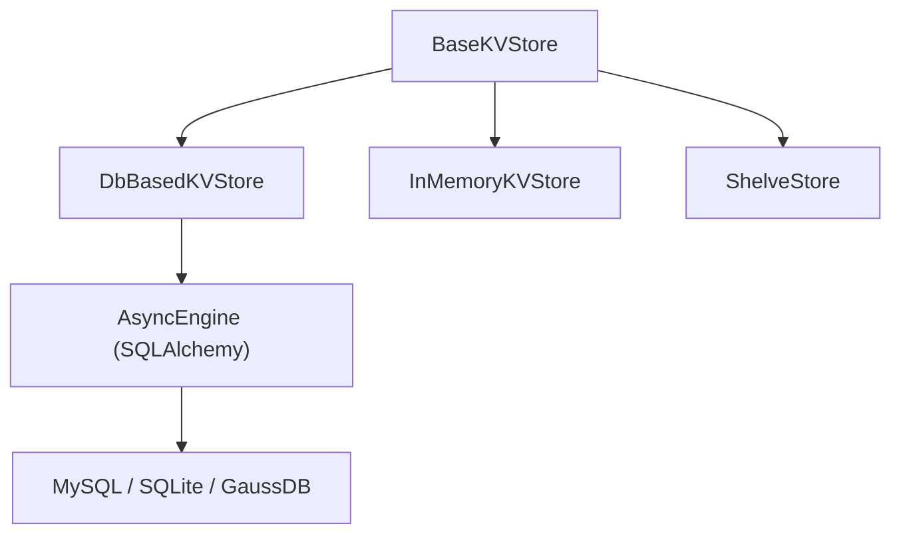
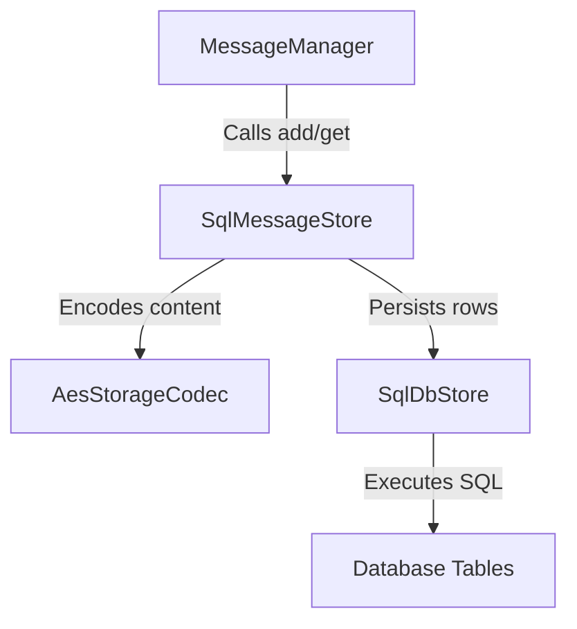

<!-- source: DeepWiki mcp.deepwiki.com · repo openJiuwen-ai/agent-memory · page 3.3 KV, DB and Message Stores · fetched 2026-11-02 -->

# KV, DB and Message Stores

Relevant source files

The following files were used as context for generating this wiki page:

- [jiuwen_memory/foundation/store/base_kv_store.py](jiuwen_memory/foundation/store/base_kv_store.py)
- [jiuwen_memory/foundation/store/index/simple_memory_index.py](jiuwen_memory/foundation/store/index/simple_memory_index.py)
- [jiuwen_memory/foundation/store/kv/db_based_kv_store.py](jiuwen_memory/foundation/store/kv/db_based_kv_store.py)
- [jiuwen_memory/foundation/store/kv/in_memory_kv_store.py](jiuwen_memory/foundation/store/kv/in_memory_kv_store.py)
- [jiuwen_memory/foundation/store/kv/shelve_store.py](jiuwen_memory/foundation/store/kv/shelve_store.py)
- [jiuwen_memory/foundation/store/vector/milvus_vector_store.py](jiuwen_memory/foundation/store/vector/milvus_vector_store.py)
- [jiuwen_memory/memory_core/common/distributed_lock.py](jiuwen_memory/memory_core/common/distributed_lock.py)
- [jiuwen_memory/memory_core/manage/index/fragment_memory_manager.py](jiuwen_memory/memory_core/manage/index/fragment_memory_manager.py)
- [jiuwen_memory/memory_core/manage/index/summary_manager.py](jiuwen_memory/memory_core/manage/index/summary_manager.py)
- [jiuwen_memory/memory_core/manage/mem_model/message_manager.py](jiuwen_memory/memory_core/manage/mem_model/message_manager.py)
- [jiuwen_memory/memory_core/manage/mem_model/scope_user_mapping_manager.py](jiuwen_memory/memory_core/manage/mem_model/scope_user_mapping_manager.py)
- [jiuwen_memory/memory_core/manage/mem_model/sql_db_store.py](jiuwen_memory/memory_core/manage/mem_model/sql_db_store.py)
- [jiuwen_memory/memory_core/manage/mem_model/sql_message_store.py](jiuwen_memory/memory_core/manage/mem_model/sql_message_store.py)
- [jiuwen_memory/memory_core/migration/migrator/memory_meta_manager.py](jiuwen_memory/memory_core/migration/migrator/memory_meta_manager.py)
- [tests/unit_tests/core/memory/manage/mem_model/test_sql_db_store.py](tests/unit_tests/core/memory/manage/mem_model/test_sql_db_store.py)
- [tests/unit_tests/server/test_server_endpoints.py](tests/unit_tests/server/test_server_endpoints.py)

This section details the persistence layer and storage abstractions within the `jiuwen_memory` engine. It covers Key-Value storage backends (`DbBasedKVStore`, `InMemoryKVStore`, `ShelveStore`), relational database wrappers (`SqlDbStore`), message persistence subsystems (`SqlMessageStore` and `MessageManager`), distributed concurrency control via `DistributedLock`, and multi-tenant user-scope mappings via `ScopeUserMappingManager`.

Sources: [jiuwen_memory/foundation/store/base_kv_store.py:16-190](), [jiuwen_memory/foundation/store/kv/db_based_kv_store.py:51-173]()

---

## 1. Key-Value Store Abstractions (`BaseKVStore` & Implementations)

The foundation of the key-value subsystem is the `BaseKVStore` abstract base class, which specifies asynchronous operations for key-value manipulation, including batch operations, prefix querying, and atomic exclusive locking `[jiuwen_memory/foundation/store/base_kv_store.py:16-190]()`.

### `DbBasedKVStore` Implementation
`DbBasedKVStore` implements `BaseKVStore` using an asynchronous SQLAlchemy engine `[jiuwen_memory/foundation/store/kv/db_based_kv_store.py:51-62]`. It handles differences across SQL dialects (MySQL, SQLite, and GaussDB):
* **Upsert Statements**: Generates dialect-specific upserts via `_get_upsert_stmt()` (`mysql_insert` for MySQL, `sqlite_insert` for SQLite) `[jiuwen_memory/foundation/store/kv/db_based_kv_store.py:63-86]`.
* **GaussDB Manual Upsert**: Since GaussDB lacks standard native upsert syntax in certain driver configurations, `_manual_upsert()` executes an explicit `SELECT` followed by an `UPDATE` or `INSERT` protected by application-level guards `[jiuwen_memory/foundation/store/kv/db_based_kv_store.py:88-111]`.
* **Binary Handling**: Encodes arbitrary `bytes` payloads using a `__BYTES__:` string prefix and Base64 encoding via `_encode_value()` and `_decode_value()` `[jiuwen_memory/foundation/store/kv/db_based_kv_store.py:112-123]`.
* **Atomic Locking**: Provides `exclusive_set()` and `renew_exclusive()` to support atomic locks with expiration timestamps `[jiuwen_memory/foundation/store/kv/db_based_kv_store.py:136-189]`.

### In-Memory and Shelve KV Stores
For lightweight or embedded scenarios, `InMemoryKVStore` and `ShelveStore` provide in-memory dictionary backing and Python `shelve`-based disk persistence respectively, adhering to the same asynchronous contract.

*Sources: [jiuwen_memory/foundation/store/base_kv_store.py:16-190](), [jiuwen_memory/foundation/store/kv/db_based_kv_store.py:51-189]()*

---

## 2. Relational Database Abstractions (`SqlDbStore`)

`SqlDbStore` wraps `BaseDbStore` to provide table-level relational database operations for structured models and metadata `[jiuwen_memory/memory_core/manage/mem_model/sql_db_store.py:21-29]`.

Key functions include:
* `write(table, data)`: Inserts rows into the target table, propagating `IntegrityError` upon primary key or unique constraint violations so callers can distinguish between successful operations and conflicts `[jiuwen_memory/memory_core/manage/mem_model/sql_db_store.py:30-49]`.
* `insert_or_update(...)`: Executes atomic upserts (`INSERT ... ON CONFLICT DO UPDATE` or MySQL equivalents, with manual `UPDATE`/`INSERT` fallback for GaussDB) to prevent race conditions during concurrent updates `[jiuwen_memory/memory_core/manage/mem_model/sql_db_store.py:59-165]`.

Sources: [jiuwen_memory/memory_core/manage/mem_model/sql_db_store.py:21-165]()

---

## 3. Message Stores and Message Management (`SqlMessageStore` & `MessageManager`)

### `SqlMessageStore`
`SqlMessageStore` extends `BaseMessageStore` to persist conversational turns and agent messages in relational tables `[jiuwen_memory/memory_core/manage/mem_model/sql_message_store.py:25-48]`.
* **Encryption**: Uses `AesStorageCodec` (or an injected `StorageCodec`) to encode and decode message content securely `[jiuwen_memory/memory_core/manage/mem_model/sql_message_store.py:48-52]`.
* **Unique ID Generation**: `_generate_message_id()` combines a SHA-256 hash of the message content, timestamp, and a random hex nonce (`uuid.uuid4().hex[:8]`) to guarantee unique IDs even during concurrent batch writes of identical messages `[jiuwen_memory/memory_core/manage/mem_model/sql_message_store.py:54-66]`.

### `MessageManager`
`MessageManager` provides a high-level orchestration API over `BaseMessageStore` `[jiuwen_memory/memory_core/manage/mem_model/message_manager.py:24-31]`:
* `add(req, msg_id)`: Validates required request fields (`user_id`, `scope_id`, `content`), wraps content into a `BaseMessage`, and persists it `[jiuwen_memory/memory_core/manage/mem_model/message_manager.py:32-61]`.
* `get(...)` and `get_with_metadata(...)`: Retrieve message history ordered chronologically, with or without auxiliary metadata `[jiuwen_memory/memory_core/manage/mem_model/message_manager.py:62-114]`.
* Deletion APIs: `delete_by_user_and_scope()` and `delete_by_id()` clean up stored records `[jiuwen_memory/memory_core/manage/mem_model/message_manager.py:146-157]`.

*Sources: [jiuwen_memory/memory_core/manage/mem_model/sql_message_store.py:25-115](), [jiuwen_memory/memory_core/manage/mem_model/message_manager.py:24-157]()*

---

## 4. Distributed Concurrency Control (`DistributedLock`)

`DistributedLock` provides multiprocess-safe distributed locking backed by any KV store implementing `exclusive_set()` and `renew_exclusive()` `[jiuwen_memory/memory_core/common/distributed_lock.py:9-24]`.
* **Watchdog Loop**: Once a lock is acquired (`acquire()`), a background coroutine (`_watchdog()`) automatically renews the lock every `RENEW_INTERVAL_SEC` (3 seconds) with a TTL of 10 seconds `[jiuwen_memory/memory_core/common/distributed_lock.py:30-49]`. This ensures that long-running tasks (such as LLM extraction workflows) do not experience lock expiration.
* **Deadlock Prevention**: If the holding process crashes, the watchdog halts and the lock automatically expires after 10 seconds.
* **Context Manager**: Supports asynchronous context management via `__aenter__` and `__aexit__` `[jiuwen_memory/memory_core/common/distributed_lock.py:104-109]`.

Sources: [jiuwen_memory/memory_core/common/distributed_lock.py:9-109]()

---

## 5. Scope and User Mapping (`ScopeUserMappingManager`)

`ScopeUserMappingManager` manages the relationship between execution scopes and user identities within the memory engine, facilitating tenant isolation and scope resolution across memory subsystems `[jiuwen_memory/memory_core/manage/mem_model/scope_user_mapping_manager.py]`.

Sources: [jiuwen_memory/memory_core/manage/mem_model/scope_user_mapping_manager.py]()

---

