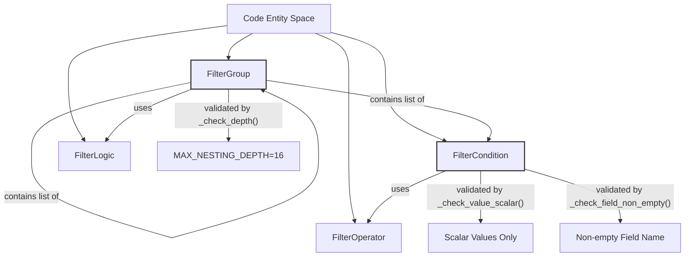
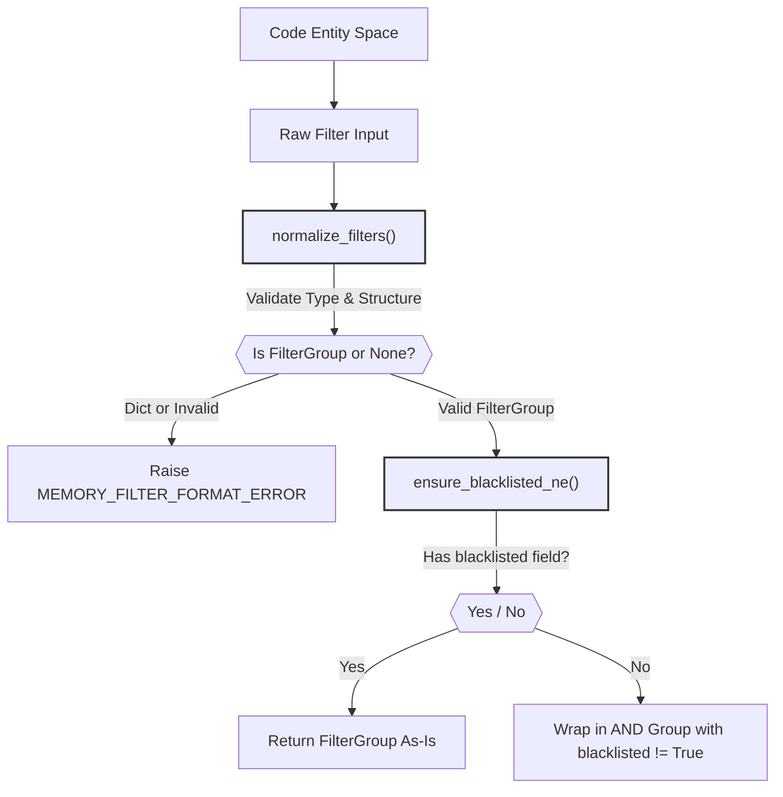

<!-- source: DeepWiki mcp.deepwiki.com · repo openJiuwen-ai/agent-memory · page 3.4 Filter DSL · fetched 2026-11-02 -->

# Filter DSL

Relevant source files

The following files were used as context for generating this wiki page:

- [jiuwen_memory/common/exception/codes.py](jiuwen_memory/common/exception/codes.py)
- [jiuwen_memory/foundation/store/base_vector_store.py](jiuwen_memory/foundation/store/base_vector_store.py)
- [jiuwen_memory/foundation/store/filter_dsl.py](jiuwen_memory/foundation/store/filter_dsl.py)
- [jiuwen_memory/foundation/store/vector/chroma_vector_store.py](jiuwen_memory/foundation/store/vector/chroma_vector_store.py)
- [jiuwen_memory/foundation/store/vector/es_vector_store.py](jiuwen_memory/foundation/store/vector/es_vector_store.py)
- [jiuwen_memory/foundation/store/vector/gauss_vector_store.py](jiuwen_memory/foundation/store/vector/gauss_vector_store.py)
- [jiuwen_memory/memory_core/manage/search/filter_dsl.py](jiuwen_memory/memory_core/manage/search/filter_dsl.py)
- [tests/unit_tests/core/foundation/store/filter/test_filter_dsl.py](tests/unit_tests/core/foundation/store/filter/test_filter_dsl.py)
- [tests/unit_tests/core/foundation/store/filter/test_filter_normalizer.py](tests/unit_tests/core/foundation/store/filter/test_filter_normalizer.py)
- [tests/unit_tests/core/foundation/store/filter/test_render_filters.py](tests/unit_tests/core/foundation/store/filter/test_render_filters.py)

## Purpose and Scope

This page documents section 3.4 of the `agent-memory` engine, focusing on the backend-neutral `FilterGroup` and `FilterCondition` Domain Specific Language (DSL). It covers the data models, strict validation rules (such as scalar type restrictions and nesting depth caps), the single-entry normalization pipeline, default filter injection (`ensure_blacklisted_ne`), and per-backend rendering logic targeting Milvus, ChromaDB, Elasticsearch, and GaussVector stores.

Sources: `jiuwen_memory/foundation/store/filter_dsl.py`, `jiuwen_memory/memory_core/manage/search/filter_normalizer.py`

---

## 1. Filter DSL Core Architecture & Data Models

The filter DSL is implemented as a set of Pydantic models designed to express backend-agnostic structured queries. It decouples the memory engine's search and retrieval logic from underlying vector store query syntaxes.

### Key Classes and Enums

*   `FilterOperator`: Defines supported scalar comparison operators (`EQ` for equality, `NE` for inequality). Future operators (like GT, LT, IN, CONTAINS) are intentionally excluded from the initial scope [jiuwen_memory/foundation/store/filter_dsl.py:23-29]().
*   `FilterLogic`: Defines logical combiners (`AND`, `OR`) for grouping multiple conditions [jiuwen_memory/foundation/store/filter_dsl.py:31-36]().
*   `MAX_NESTING_DEPTH`: Hard integer cap set to `16` to prevent stack overflow or deep recursion during rendering and validation [jiuwen_memory/foundation/store/filter_dsl.py:38-39]().
*   `FilterCondition`: Represents a single scalar comparison node (`field <op> value`). It validates that field names are non-empty strings and that values for `EQ` and `NE` are strictly scalar types (`str`, `int`, `float`, `bool`, `None`), rejecting lists and dictionaries [jiuwen_memory/foundation/store/filter_dsl.py:42-67]().
*   `FilterGroup`: Represents a logical container holding a `logic` operator and a list of child conditions or nested `FilterGroup` instances. It enforces recursive depth validation up to `MAX_NESTING_DEPTH` [jiuwen_memory/foundation/store/filter_dsl.py:69-94]().

*Figure 1: Architectural mapping of the Filter DSL data structures and their validation boundaries.*

Sources: `jiuwen_memory/foundation/store/filter_dsl.py`, `tests/unit_tests/core/foundation/store/filter/test_filter_dsl.py`

---

## 2. Normalization and Default Filter Injection

Before queries reach storage backends, user-supplied filter payloads undergo preprocessing via the filter normalizer module.

### Normalization Pipeline

The normalization workflow handles raw inputs through two primary functions:
1. `normalize_filters(filters)`: Accepts `FilterGroup` instances directly or `None`. Passing raw dictionaries or unsupported types raises a `StatusCode.MEMORY_FILTER_FORMAT_ERROR` [jiuwen_memory/common/exception/codes.py:7-12](), [jiuwen_memory/memory_core/manage/search/filter_normalizer.py:14-48]().
2. `ensure_blacklisted_ne(filters)`: Automatically injects a safety filter ensuring soft-deleted or blacklisted records (`blacklisted != true`) are excluded from search results unless an explicit `blacklisted` condition is already present in the AST [jiuwen_memory/memory_core/manage/search/filter_normalizer.py:50-94]().

*Figure 2: Data flow and execution path of the filter normalization and blacklisted-exclusion injection pipeline.*

Sources: `jiuwen_memory/memory_core/manage/search/filter_normalizer.py`, `tests/unit_tests/core/foundation/store/filter/test_filter_normalizer.py`

---

## 3. Per-Backend Renderer Implementations

Each vector and index storage backend implements a `_render_filters` method to translate the `FilterGroup` abstract syntax tree into backend-native query expressions.

### Backend-Specific Rendering Strategies

*   **MilvusVectorStore**: Renders expressions into string-based relational snippets, such as `category == "work" && blacklisted != true`, using boolean operators (`&&`, `||`, `==`, `!=`) [tests/unit_tests/core/foundation/store/filter/test_render_filters.py:32-110]().
*   **ChromaVectorStore**: Translates conditions into nested dictionary structures compatible with ChromaDB's `where` clauses, utilizing operators such as `$eq`, `$nin`, `$and`, and `$or` [tests/unit_tests/core/foundation/store/filter/test_render_filters.py:115-180]().
*   **GaussVectorStore**: Renders filters into SQL `WHERE` clauses. It incorporates strict identifier sanitization (`_validate_identifier`) against a Postgres identifier regex `^[A-Za-z_][A-Za-z0-9_]*$` to prevent SQL injection during dynamic column interpolation [jiuwen_memory/foundation/store/vector/gauss_vector_store.py:155-188]().
*   **ElasticsearchVectorStore**: Translates the filter tree into Elasticsearch query DSL query objects.

Sources: `jiuwen_memory/foundation/store/vector/gauss_vector_store.py`, `tests/unit_tests/core/foundation/store/filter/test_render_filters.py`, `jiuwen_memory/foundation/store/vector/es_vector_store.py`

---

