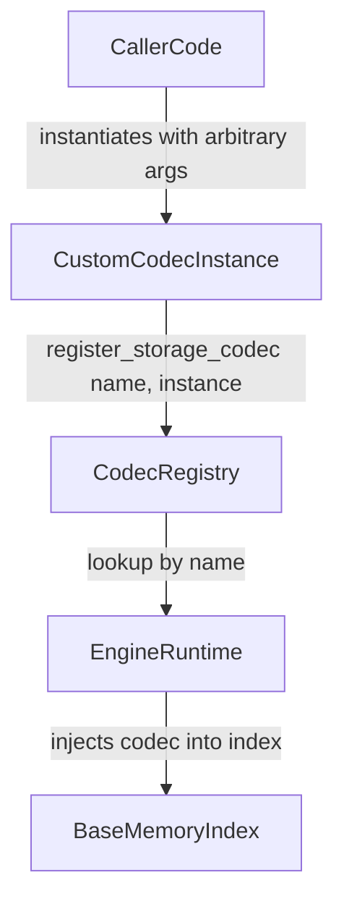
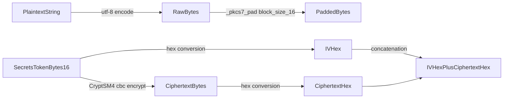

<!-- source: DeepWiki mcp.deepwiki.com · repo openJiuwen-ai/agent-memory · page 3.5 Storage Codecs and Security · fetched 2026-11-02 -->

# Storage Codecs and Security

<details>
<summary>Relevant source files</summary>

The following files were used as context for generating this wiki page:

- [jiuwen_memory/foundation/codec/__init__.py](jiuwen_memory/foundation/codec/__init__.py)
- [jiuwen_memory/foundation/codec/aes_storage_codec.py](jiuwen_memory/foundation/codec/aes_storage_codec.py)
- [jiuwen_memory/foundation/codec/codec_registry.py](jiuwen_memory/foundation/codec/codec_registry.py)
- [jiuwen_memory/foundation/codec/sm4_storage_codec.py](jiuwen_memory/foundation/codec/sm4_storage_codec.py)
- [jiuwen_memory/foundation/codec/storage_codec.py](jiuwen_memory/foundation/codec/storage_codec.py)
- [jiuwen_memory/foundation/store/base_message_store.py](jiuwen_memory/foundation/store/base_message_store.py)
- [tests/unit_tests/core/memory/codec/test_sm4_storage_codec.py](tests/unit_tests/core/memory/codec/test_sm4_storage_codec.py)

</details>


The storage codec framework provides a pluggable, transparent encryption layer for sensitive memory contents within the `jiuwen_memory.foundation.codec` package. It decouples cryptographic algorithms from core memory operations, allowing engines to securely persist memory document texts, variable values, and message payloads using either industry-standard AES-256-GCM or Chinese National Standard SM4-128-CBC encryption.

---

## 1. The `StorageCodec` Protocol Contract

To prevent circular import dependencies between storage modules and the heavy `memory_core` engine lifecycle, the encryption interface contract is defined in `[jiuwen_memory/foundation/codec/storage_codec.py]()`. 

`StorageCodec` is a runtime-checkable protocol (`@runtime_checkable`) requiring two primary methods: `encode(text)` and `decode(data)`. Conforming implementations must satisfy key architectural invariants:
- **Pass-through behavior**: Passing `None`, empty strings, or operating with an empty encryption key returns the payload unmodified.
- **Roundtrip consistency**: `decode(encode(x)) == x` must hold true for any string payload.
- **Payload encapsulation**: Encrypted output strings combine initialization vectors (IV) and ciphertexts into a self-contained string format.

```mermaid
graph TD
    A["MemoryEngineConfig"] -->|references codec name| B["CodecRegistry"]
    B -->|get storage codec| C["StorageCodec"]
    C -->|implemented by| D["AesStorageCodec"]
    C -->|implemented by| E["SM4StorageCodec"]
    D -->|encrypts via| F["CryptUtils"]
    E -->|encrypts via| G["CryptSM4"]

    sub-graph NaturalLanguageSpace
        H["EncryptionContract"] -->|realized by| C
    end
```

**Sources:**
- `[jiuwen_memory/foundation/codec/storage_codec.py:25-65]()`
- `[jiuwen_memory/foundation/codec/__init__.py:1-53]()`

---

## 2. Codec Registry Architecture

The engine manages available codecs through `CodecRegistry`, defined in `[jiuwen_memory/foundation/codec/codec_registry.py]`. Unlike factories that require deferred instantiation signatures, the registry stores **pre-built instances**. This design allows complex, multi-parameter initialization (such as Hardware Security Modules requiring certificates, slots, and PINs) to be handled entirely by the caller prior to registration.



Key functions provided by the registry module include:
- `register_storage_codec(name, codec)`: Registers a pre-built codec instance onto the process-default registry [jiuwen_memory/foundation/codec/codec_registry.py:69-90]().
- `unregister_storage_codec(name)`: Removes a codec binding [jiuwen_memory/foundation/codec/codec_registry.py:93-94]().
- `CodecRegistry`: An isolated registry container class that can be instantiated independently during unit testing to avoid global state contamination [jiuwen_memory/foundation/codec/codec_registry.py:24-53]().

**Sources:**
- `[jiuwen_memory/foundation/codec/codec_registry.py:1-94]()`
- `[jiuwen_memory/foundation/codec/__init__.py:1-53]()`

---

## 3. Built-in Codecs: AES-256-GCM and SM4

Two built-in encryption codecs ship with the framework, supporting international and national cryptographic standards respectively.

### AES-256-GCM Codec
`AesStorageCodec` acts as a wrapper around the engine's internal cryptographic utility `CryptUtils` [jiuwen_memory/foundation/codec/aes_storage_codec.py:9-57](). It expects a 32-byte AES key and delegates encryption and decryption operations directly to the AES-GCM implementation.

### SM4-128-CBC Codec
`SM4StorageCodec` implements the Chinese National Standard SM4 algorithm using CBC mode and PKCS7 padding [jiuwen_memory/foundation/codec/sm4_storage_codec.py:30-177]().



Important implementation details for `SM4StorageCodec`:
- **Key Validation**: The initialization key `key` must be precisely 16 bytes (128 bits); otherwise, a `ValueError` is raised [jiuwen_memory/foundation/codec/sm4_storage_codec.py:45-58]().
- **Padding**: Explicit `_pkcs7_pad` and `_pkcs7_unpad` methods handle block alignment [jiuwen_memory/foundation/codec/sm4_storage_codec.py:60-95]().
- **Serialization Format**: Ciphertexts are stored as a concatenated hex string consisting of a 16-byte random initialization vector (IV) followed by the encrypted payload (`IV_hex + ciphertext_hex`) [jiuwen_memory/foundation/codec/sm4_storage_codec.py:40-43]().
- **Error Resilience**: Decryption failures or invalid ciphertexts log warnings via `memory_logger` and safely fall back to returning the raw input string [jiuwen_memory/foundation/codec/sm4_storage_codec.py:126-132, 171-177]().

Unit tests verifying roundtrip compliance, invalid key lengths, and padding edge cases are located at `[tests/unit_tests/core/memory/codec/test_sm4_storage_codec.py:10-166]()`.

**Sources:**
- `[jiuwen_memory/foundation/codec/aes_storage_codec.py:1-57]()`
- `[jiuwen_memory/foundation/codec/sm4_storage_codec.py:1-177]()`
- `[tests/unit_tests/core/memory/codec/test_sm4_storage_codec.py:1-166]()`

---

## 4. Store Injection and Lifecycle

Once registered, storage codecs are injected into underlying persistence stores (such as message stores, vector indexes, and markdown file stores) during engine initialization. 

Abstract base classes like `BaseMessageStore` define an optional injection hook `set_codec()` [jiuwen_memory/foundation/store/base_message_store.py:177-193](). Stores requiring encryption override this method to assign the codec to their internal persistence handlers, while unencrypted stores safely inherit a pass-through default.

**Sources:**
- `[jiuwen_memory/foundation/store/base_message_store.py:177-193]()`

---

