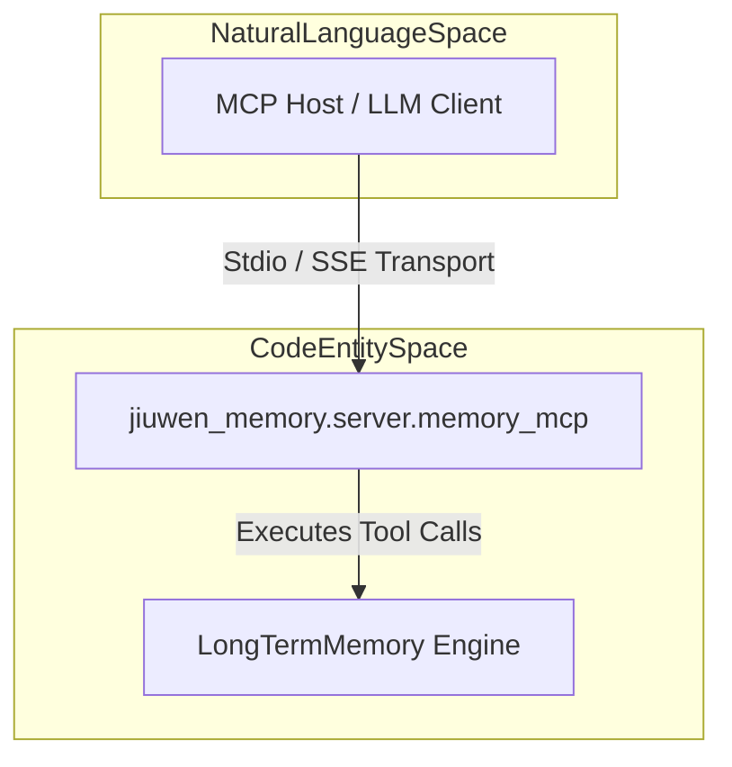

<!-- source: DeepWiki mcp.deepwiki.com · repo openJiuwen-ai/agent-memory · page 4 Servers and Interfaces · fetched 2026-11-02 -->

# Servers and Interfaces

<details>
<summary>Relevant source files</summary>

The following files were used as context for generating this wiki page:

- [docs/en/API Docs/memory_server.md](docs/en/API Docs/memory_server.md)

</details>


## Purpose and Scope

The **Servers and Interfaces** subsystem (`jiuwen_memory.server`) bridges external consumers, AI agents, and platforms with the core memory engine. It provides standardized access channels so that HTTP clients, Model Context Protocol (MCP) compliant environments, and agent frameworks can ingest messages, execute semantic searches, manage variables, and perform administrative tasks. 

This parent page outlines the high-level architecture of the HTTP REST server, the MCP server, and the agent integration plugins. For comprehensive technical details, implementation steps, and endpoint references, refer to the child pages:
- For REST API routing, startup sequence, and configuration, see [REST Memory Server](#4.1).
- For Model Context Protocol tools and transports, see [MCP Server](#4.2).
- For agent lifecycle hooks and platform plugins, see [Agent Memory Plugins](#4.3).

---

## 4.1 REST Memory Server

The REST Memory Server is a FastAPI-based web service that exposes the core `LongTermMemory` capabilities over HTTP [docs/en/API Docs/memory_server.md:1-3](). It handles environment-driven backend assembly through `server.store_factory` [docs/en/API Docs/memory_server.md:96-98](), registers embedding models, and manages optional Bearer Token authentication via `MEMORY_API_KEY` [docs/en/API Docs/memory_server.md:5-11]().

The application can be booted via the entrypoint script `memory-server` defined in project metadata or directly as a Python module [docs/en/API Docs/memory_server.md:16-39]().

```mermaid
graph TD
    UserReq[""HTTP Request (Client)""] -->|"POST /messages, GET /search"| FastApiApp[""jiuwen_memory.server.memory_server:main""]
    FastApiApp -->|"Assembles Backends"| StoreFactory[""server.store_factory""]
    FastApiApp -->|"Invokes Engine"| LongTermMemory[""LongTermMemory API""]
    StoreFactory -->|"Initializes"| Storage[""KV / DB / Vector Backends""]

    subgraph CodeEntitySpace
        FastApiApp
        StoreFactory
        LongTermMemory
        Storage
    end

    subgraph NaturalLanguageSpace
        UserReq
    end
```
*Figure 1: REST Memory Server request and initialization flow.*

For detailed information on startup pipelines, security middleware, environment variable priorities (`~/.jiuwenmemory/.env`), and admin/reload endpoints, see [REST Memory Server](#4.1).

Sources: `docs/en/API Docs/memory_server.md:1-44`

---

## 4.2 MCP Server

The Model Context Protocol (MCP) server enables LLM applications and MCP-compatible agent frameworks to interact natively with the JiuwenMemory engine. It exposes standardized tools for storing conversations, retrieving context, and searching long-term memories without requiring custom REST integration code.

The MCP server relies on standard environment variables to configure default users, scopes, and transport mechanisms (such as Stdio or SSE).

For detailed information on exposed tools, transport implementations, and environment configuration, see [MCP Server](#4.2).


*Figure 2: MCP Server communication and tool execution flow.*

Sources: `docs/en/API Docs/memory_server.md:1-25`

---

## 4.3 Agent Memory Plugins

The `agent-memory-plugin` directory contains integration packages and skill scripts designed to embed JiuwenMemory directly into popular agent runtimes and development frameworks. These plugins hook into agent lifecycles (such as initialization, message pre-processing, and post-execution summary generation) to provide automated memory persistence and retrieval.

Key integrations include:
- OpenClaw lifecycle hooks for session state management.
- Hermes plugin bindings for conversational context injection.
- Code agent utility scripts and skill extensions.

For detailed instructions on installing, configuring, and extending these plugins, see [Agent Memory Plugins](#4.3).

```mermaid
graph TD
    AgentRuntime[""Agent Runtime (OpenClaw / Hermes)""] -->|"Lifecycle Hook"| Plugin[""agent-memory-plugin""]
    Plugin -->|"API / SDK Call"| MemoryEngine[""LongTermMemory / Server""]

    subgraph CodeEntitySpace
        Plugin
        MemoryEngine
    end

    subgraph NaturalLanguageSpace
        AgentRuntime
    end
```
*Figure 3: Agent lifecycle plugin integration architecture.*

Sources: `docs/en/API Docs/memory_server.md:1-12`

---

