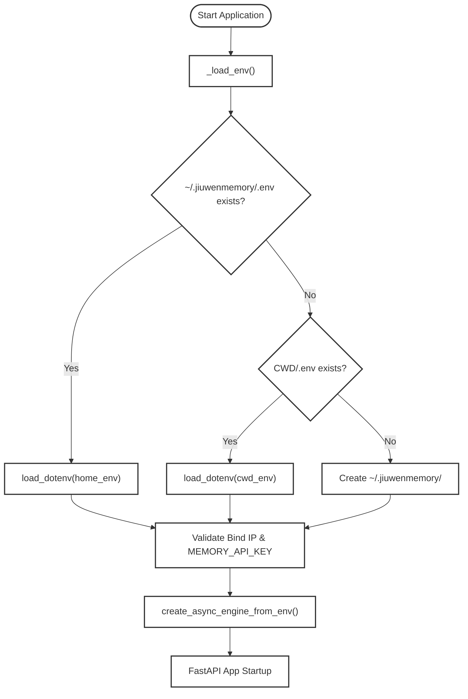
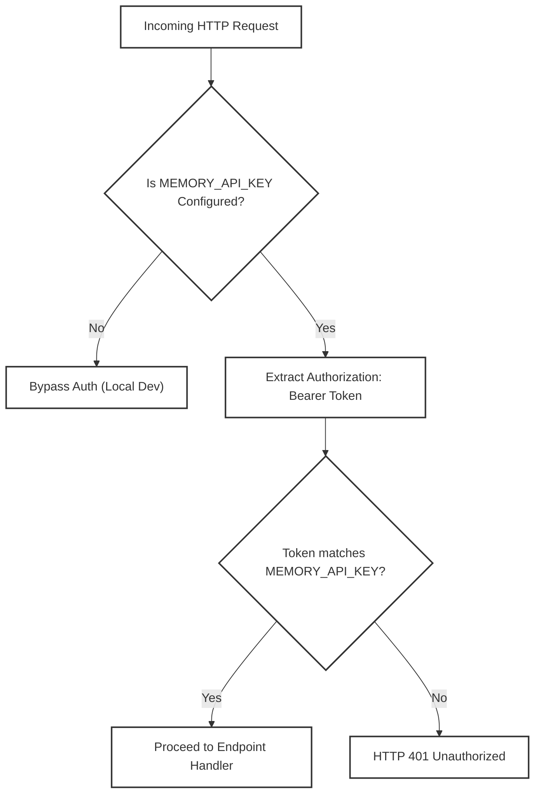
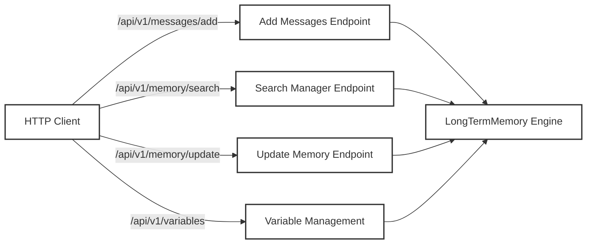

<!-- source: DeepWiki mcp.deepwiki.com · repo openJiuwen-ai/agent-memory · page 4.1 REST Memory Server · fetched 2026-11-02 -->

# REST Memory Server

Relevant source files

The following files were used as context for generating this wiki page:

- [docs/en/API Docs/memory_server.md](docs/en/API Docs/memory_server.md)
- [jiuwen_memory/memory_core/long_term_memory.py](jiuwen_memory/memory_core/long_term_memory.py)
- [jiuwen_memory/server/memory_server.py](jiuwen_memory/server/memory_server.py)

## Purpose and Scope

The `REST Memory Server` component (`server.memory_server`) serves as the primary HTTP service gateway for JiuwenMemory. Built on top of FastAPI, it exposes the capabilities of the core `LongTermMemory` engine via standard RESTful endpoints, allowing external services and agents to perform message ingestion, semantic search, variable management, and memory maintenance over HTTP [docs/en/API Docs/memory_server.md:1-12](). 

This page provides a high-level parent overview of the FastAPI application structure, its startup pipeline, environment configuration, authentication middleware, and administrative control flows. For specific subsystem details, refer to the child pages:
- For backend initialization and store creation, see [Store Factory and Backend Selection](#4.1.1).
- For administrative, configuration center, and logging endpoints, see [Admin, Config Center and Log Center APIs](#4.1.2).

Sources: `jiuwen_memory/server/memory_server.py`, `docs/en/API Docs/memory_server.md`

---

## Startup Pipeline and Environment Configuration

The server initializes by locating and loading environment variables from a tiered fallback sequence: first checking `~/.jiuwenmemory/.env`, and second checking the current working directory `.env` [jiuwen_memory/server/memory_server.py:39-64](). If neither exists, the application automatically provisions the `~/.jiuwenmemory/` directory [jiuwen_memory/server/memory_server.py:55-63]().

*Figure 1: Startup and Environment Loading Pipeline.*

Sources: `jiuwen_memory/server/memory_server.py:39-76`, `docs/en/API Docs/memory_server.md:64-72`

---

## Authentication and Security Middleware

Security enforcement is handled at startup and via request-level dependency checks. When binding to a non-local network address (i.e., any IP other than `127.0.0.1` or `localhost`), the server enforces that `MEMORY_API_KEY` is explicitly configured [docs/en/API Docs/memory_server.md:61-62](). If omitted, the initialization sequence aborts immediately to prevent unauthenticated network exposure.

Requests entering protected endpoints undergo Bearer token validation against the active `MEMORY_API_KEY`. If authentication is left unconfigured (empty string), token checks are bypassed for local development convenience [docs/en/API Docs/memory_server.md:79-81]().

*Figure 2: Request Authentication Flow.*

Sources: `jiuwen_memory/server/memory_server.py:117-120`, `docs/en/API Docs/memory_server.md:61-81`

---

## Core REST Endpoints and Routing

The FastAPI application maps incoming HTTP routes to core memory engine operations. The service handles data mutations such as message addition and unit extraction, alongside search retrieval tasks [docs/en/API Docs/memory_server.md:5-10]().

*Figure 3: Core API Routing to `LongTermMemory`.*

Sources: `jiuwen_memory/server/memory_server.py:1-176`, `docs/en/API Docs/memory_server.md:1-12`

---

## Admin, Reload, and Restart Operations

To support dynamic configuration adjustments without process termination, the server implements a concurrency-safe reload mechanism managed via an asynchronous lock (`_reload_lock`) [jiuwen_memory/server/memory_server.py:36-118](). 

The `_reload_memory_engine` function follows a safe-swap protocol:
1. Instantiates new storage backends and configurations from the updated `.env` state while the current engine continues processing active requests [jiuwen_memory/server/memory_server.py:103-162]().
2. Atomically swaps the global singletons and stops outdated background file watchers to prevent thread leaks [jiuwen_memory/server/memory_server.py:117-127]().

Sources: `jiuwen_memory/server/memory_server.py:36-176`

---

## Sub-Topics and Child Pages

For more granular technical information, please refer to the following child documentation pages:
- **Store Factory and Backend Selection**: Detailed breakdown of environment-driven engine assembly, SQLite WAL configurations, lazy imports, and vector/KV store bindings. See [Store Factory and Backend Selection](#4.1.1).
- **Admin, Config Center and Log Center APIs**: Comprehensive coverage of metadata management, configuration center integrations, and log monitoring endpoints. See [Admin, Config Center and Log Center APIs](#4.1.2).

---

