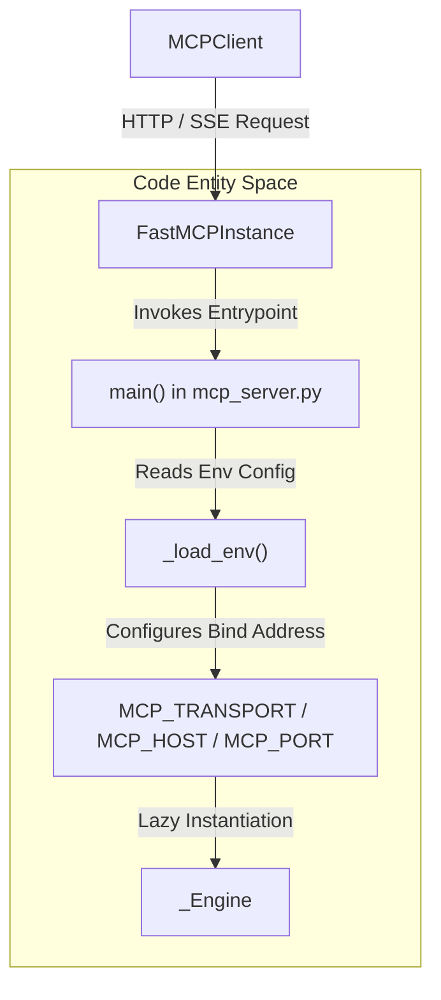
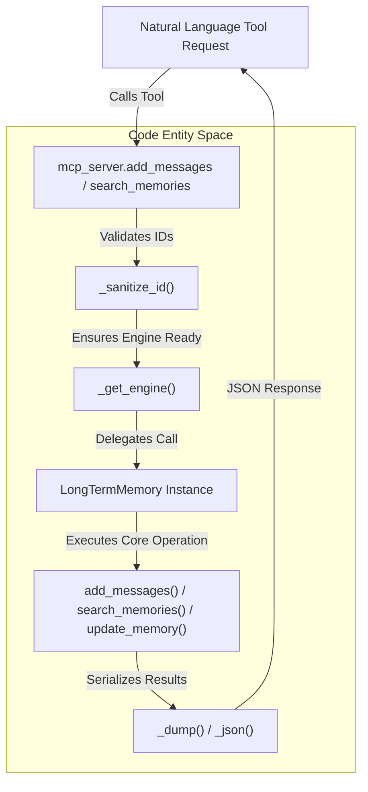

<!-- source: DeepWiki mcp.deepwiki.com · repo openJiuwen-ai/agent-memory · page 4.2 MCP Server · fetched 2026-11-02 -->

# MCP Server

Relevant source files

The following files were used as context for generating this wiki page:

- [docs/en/API Docs/mcp_server.md](docs/en/API Docs/mcp_server.md)
- [jiuwen_memory/server/mcp_server.py](jiuwen_memory/server/mcp_server.py)
- [tests/unit_tests/server/test_mcp_server.py](tests/unit_tests/server/test_mcp_server.py)

## Purpose and Scope

The `jiuwen_memory.server.mcp_server` module provides a Model Context Protocol (MCP) server dedicated to long-term memory operations (`profile`, `semantic`, `episodic`, and `summary` CRUD) [jiuwen_memory/server/mcp_server.py:3-7](). It exposes tools directly to MCP-compatible clients (such as Claude Code, Codex, Cursor, and VS Code) [jiuwen_memory/server/mcp_server.py:9-10]() without requiring a separate HTTP gateway service [jiuwen_memory/server/mcp_server.py:12-15](). 

Unlike the REST memory server, the MCP server assembles a local `LongTermMemory` engine **in-process** via the SDK using the same KV, DB, Vector, and Embedding store assembly configuration [jiuwen_memory/server/mcp_server.py:12-15](). It is scoped strictly to long-term memory and does **not** expose variable management tools [jiuwen_memory/server/mcp_server.py:6-7]().

Sources: `jiuwen_memory/server/mcp_server.py:3-20`, `docs/en/API Docs/mcp_server.md:3-8`

---

## Environment Configuration and Default Scope/User

The MCP server initializes its configuration by loading environment files through a priority chain identical to the REST memory server [jiuwen_memory/server/mcp_server.py:35-36](). The environment loading sequence is managed by `_load_env()` [jiuwen_memory/server/mcp_server.py:62-80]():

1. `~/.jiuwenmemory/.env` (User-level configuration) [jiuwen_memory/server/mcp_server.py:59-67]()
2. `./.env` (Current working directory configuration) [jiuwen_memory/server/mcp_server.py:68-71]()

If neither environment file exists, the server creates the `~/.jiuwenmemory` directory and logs a warning [jiuwen_memory/server/mcp_server.py:72-77]().

### Configuration Variables

| Variable | Default | Description |
| --- | --- | --- |
| `MCP_TRANSPORT` | `http` | Transport protocol (`http`/`streamable-http` or `sse`) [docs/en/API Docs/mcp_server.md:81]() |
| `MCP_HOST` | `127.0.0.1` | Bind address for the MCP server [jiuwen_memory/server/mcp_server.py:32](), [docs/en/API Docs/mcp_server.md:82]() |
| `MCP_PORT` | `8765` | Port number for the MCP server [jiuwen_memory/server/mcp_server.py:32](), [docs/en/API Docs/mcp_server.md:83]() |
| `MCP_DEFAULT_USER_ID` | `__default__` | Default user identity context (`_DEFAULT_ID`) [jiuwen_memory/server/mcp_server.py:53-83]() |
| `MCP_DEFAULT_SCOPE_ID` | `__default__` | Default scope identity context (`_DEFAULT_ID`) [jiuwen_memory/server/mcp_server.py:53-84]() |

Identity values passed to tool invocations are sanitized via `_sanitize_id()` to ensure they contain no path traversal tokens (`/`, `\`) and conform to length constraints [jiuwen_memory/server/mcp_server.py:87-91]().

Sources: `jiuwen_memory/server/mcp_server.py:35-91`, `docs/en/API Docs/mcp_server.md:66-86`

---

## Transports and Startup Architecture

The MCP server supports two transport layers selected via the `MCP_TRANSPORT` environment variable [jiuwen_memory/server/mcp_server.py:22-33]():
- **Streamable HTTP** (`http` / `streamable-http`): Implements the persistent Streamable HTTP service spec at endpoint `/mcp` [jiuwen_memory/server/mcp_server.py:24-28]().
- **Server-Sent Events** (`sse`): Implements the persistent SSE service at endpoint `/sse` [jiuwen_memory/server/mcp_server.py:30]()

### Architecture Map: Transport to Code Entities

Sources: `jiuwen_memory/server/mcp_server.py:22-37`, `docs/en/API Docs/mcp_server.md:18-64`, `tests/unit_tests/server/test_mcp_server.py:18-24`

---

## Lazy Initialization and Resilient Error Handling

To prevent startup blockage or crashes when storage backends or model credentials are misconfigured, the MCP server employs lazy initialization [jiuwen_memory/server/mcp_server.py:17-20](). 

The `_Engine` class manages the lifecycle of the in-process `LongTermMemory` instance [jiuwen_memory/server/mcp_server.py:120-128](). On the first tool invocation, `_Engine.initialize()` executes [jiuwen_memory/server/mcp_server.py:140-172]():
1. Constructs the async database engine via `create_async_engine_from_env()` [jiuwen_memory/server/mcp_server.py:156]()
2. Instantiates `kv_store`, `db_store`, and `vector_store` using storage factory methods [jiuwen_memory/server/mcp_server.py:157-159]()
3. Configures the embedding client using `APIEmbedding` and `EmbeddingConfig` [jiuwen_memory/server/mcp_server.py:160-166]()
4. Registers stores with `LongTermMemory` [jiuwen_memory/server/mcp_server.py:168-172]()

If initialization fails, the server remains running, and individual tool wrappers catch exceptions to return readable error dictionaries rather than crashing [jiuwen_memory/server/mcp_server.py:17-20]().

Sources: `jiuwen_memory/server/mcp_server.py:120-172`, `docs/en/API Docs/mcp_server.md:106-117`

---

## Exposed Tools API

The MCP server exposes seven core long-term memory tools through `FastMCP` [docs/en/API Docs/mcp_server.md:3-13](). Each tool wraps corresponding asynchronous methods on the `LongTermMemory` engine [tests/unit_tests/server/test_mcp_server.py:31-39]() with parameter sanitization, default identity fallback (`DEFAULT_USER_ID`, `DEFAULT_SCOPE_ID`), and JSON serialization [jiuwen_memory/server/mcp_server.py:83-114]().

### Tool Summary Table

| Tool Function | Engine Method Called | Description |
| --- | --- | --- |
| `add_messages` | `add_messages` | Ingests dialogue turns and extracts long-term profiles, semantic memories, and summaries [tests/unit_tests/server/test_mcp_server.py:35](), [tests/unit_tests/server/test_mcp_server.py:67-86]() |
| `search_memories` | `search_memories` | Performs vector and keyword search across long-term memory units [tests/unit_tests/server/test_mcp_server.py:35](), [tests/unit_tests/server/test_mcp_server.py:114-127]() |
| `search_history_summaries` | `search_history_summaries` | Searches conversation history summaries [tests/unit_tests/server/test_mcp_server.py:35](), [tests/unit_tests/server/test_mcp_server.py:140-151]() |
| `get_memories` | `get_memories` | Paginates and retrieves stored memory records by type and scope [tests/unit_tests/server/test_mcp_server.py:36](), [tests/unit_tests/server/test_mcp_server.py:157-169]() |
| `update_memory` | `update_memory` | Updates an existing memory record by `mem_id` [tests/unit_tests/server/test_mcp_server.py:36](), [tests/unit_tests/server/test_mcp_server.py:175-184]() |
| `delete_memory` | `delete_memory` | Deletes a specific memory record by `mem_id` [tests/unit_tests/server/test_mcp_server.py:36]() |
| `delete_all_memories` | `delete_all_memories` | Clears all memory records, protected by a confirmation flag guard [tests/unit_tests/server/test_mcp_server.py:5]() |

### Architecture Map: Natural Language Tool Space to Code Entities

Sources: `jiuwen_memory/server/mcp_server.py:83-115`, `tests/unit_tests/server/test_mcp_server.py:31-184`, `docs/en/API Docs/mcp_server.md:3-13`

---

## Serialization and Data Flow

Result objects returned from the `LongTermMemory` engine are serialized via helper functions before being transmitted to MCP clients [jiuwen_memory/server/mcp_server.py:97-114]():
- `_dump(obj)`: Performs recursive JSON-friendly conversions [jiuwen_memory/server/mcp_server.py:97-110](). It inspects objects for a `.model_dump(mode="json")` method to seamlessly support Pydantic v2 models (such as `MemInfo`, `MemResult`, and memory units) [jiuwen_memory/server/mcp_server.py:105-109]().
- `_json(value)`: Serializes dictionary and list structures using `json.dumps` with `ensure_ascii=False` and a `str` fallback for unhandled types [jiuwen_memory/server/mcp_server.py:113-114]().

Sources: `jiuwen_memory/server/mcp_server.py:97-114`, `tests/unit_tests/server/test_mcp_server.py:27-30`

---

