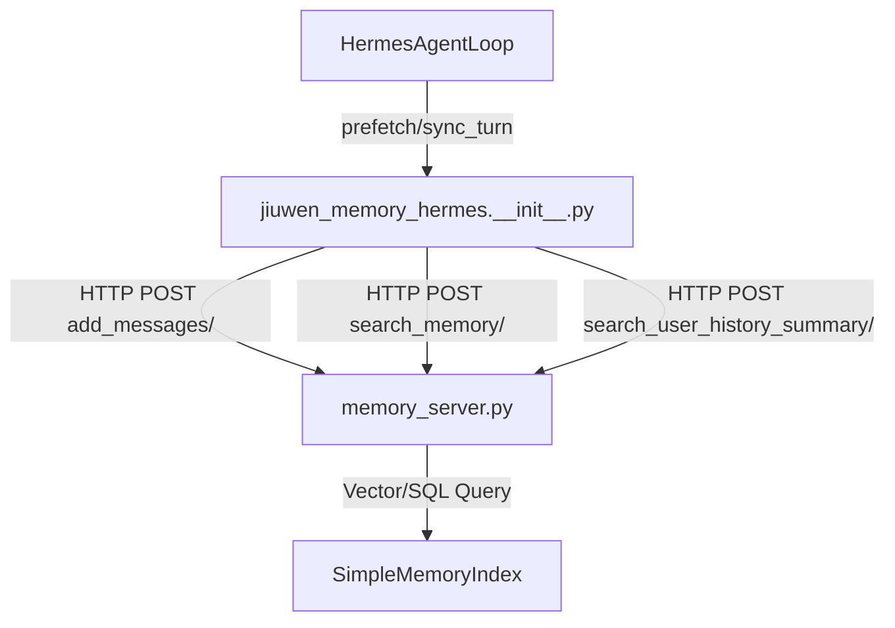
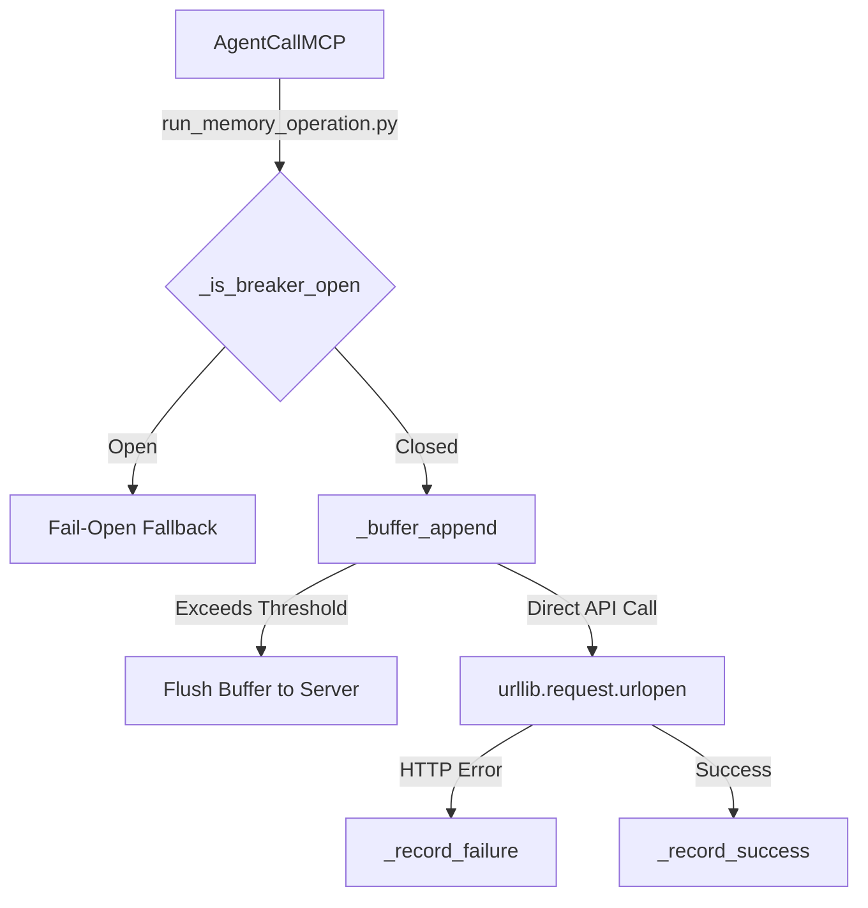

<!-- source: DeepWiki mcp.deepwiki.com · repo openJiuwen-ai/agent-memory · page 4.3 Agent Memory Plugins · fetched 2026-11-02 -->

# Agent Memory Plugins

<details>
<summary>Relevant source files</summary>

The following files were used as context for generating this wiki page:

- [jiuwen_memory/agent-memory-plugin/JiuwenMemory-OpenClaw/README.md](jiuwen_memory/agent-memory-plugin/JiuwenMemory-OpenClaw/README.md)
- [jiuwen_memory/agent-memory-plugin/agent-memory1.0_skill/SKILL.md](jiuwen_memory/agent-memory-plugin/agent-memory1.0_skill/SKILL.md)
- [jiuwen_memory/agent-memory-plugin/agent-memory1.0_skill/scripts/run_memory_operation.py](jiuwen_memory/agent-memory-plugin/agent-memory1.0_skill/scripts/run_memory_operation.py)
- [jiuwen_memory/agent-memory-plugin/jiuwen_memory_hermes/README.md](jiuwen_memory/agent-memory-plugin/jiuwen_memory_hermes/README.md)
- [jiuwen_memory/agent-memory-plugin/jiuwen_memory_hermes/__init__.py](jiuwen_memory/agent-memory-plugin/jiuwen_memory_hermes/__init__.py)
- [jiuwen_memory/agent-memory-plugin/jiuwen_memory_hermes/_compat.py](jiuwen_memory/agent-memory-plugin/jiuwen_memory_hermes/_compat.py)
- [jiuwen_memory/agent-memory-plugin/jiuwen_memory_hermes/plugin.yaml](jiuwen_memory/agent-memory-plugin/jiuwen_memory_hermes/plugin.yaml)

</details>


The `agent-memory-plugin` directory contains lightweight, decoupled integrations that connect external AI agent frameworks—such as OpenClaw and Hermes Agent—as well as standalone skill scripts to the core `jiuwen_memory` server (`memory_server`). These plugins communicate via HTTP APIs, operating independently without requiring direct in-process SDK dependencies or complex event loop bindings in the host agent runtime.

Sources: [jiuwen_memory/agent-memory-plugin/jiuwen_memory_hermes/__init__.py:13-18](), [jiuwen_memory/agent-memory-plugin/agent-memory1.0_skill/SKILL.md:16-17]()

---

## 1. OpenClaw Lifecycle Plugin

The OpenClaw lifecycle plugin (`JiuwenMemory-OpenClaw`) integrates with OpenClaw via conversational hooks declared in `openclaw.json`. It intercepts the agent execution loop at conversation boundaries to inject recalled context prior to generation and capture conversation turns upon completion.

### Configuration and Conversation Access
To ensure both memory recall and memory writing function correctly, the OpenClaw configuration requires `hooks.allowConversationAccess` to be set to `true`. Without this setting, OpenClaw restricts access to conversation-end hooks, rendering the `add_messages` capture mechanism inactive while allowing `search_memory` to execute.

Key configuration fields managed in `openclaw.json` include:
- `baseUrl`: The target `memory_server` HTTP endpoint (default `http://127.0.0.1:8000`).
- `userId` and `scopeId`: Identifiers used for tenant and user-level memory isolation.
- `captureStrategy`: Determines how message turns are batched (e.g., `last_turn`).
- `threshold` and `num`: Controls vector similarity cutoff limits and top-k retrieval bounds.

```json
{
  "plugins": {
    "entries": {
      "openjiuwen-memory-index": {
        "enabled": true,
        "hooks": {
          "allowConversationAccess": true
        },
        "config": {
          "baseUrl": "http://127.0.0.1:8000",
          "userId": "openclaw-user",
          "scopeId": "openclaw-scope"
        }
      }
    }
  }
}
```

Sources: [jiuwen_memory/agent-memory-plugin/JiuwenMemory-OpenClaw/README.md:4-92]()

---

## 2. Hermes Agent Plugin (`jiuwen_memory_hermes`)

The `jiuwen_memory_hermes` package provides a deep integration for Hermes Agent, mirroring lifecycle events and injecting long-term memory into the agent context.

### Compatibility Layer and ABC (`_compat.py`)
The plugin isolates framework glue code in `jiuwen_memory_hermes/_compat.py`. It inspects the host runtime using `importlib.util.find_spec("agent.memory_provider")` to locate the native `MemoryProvider` base class. If the host environment is absent, it dynamically constructs a `MemoryProvider` ABC stub containing mandatory hooks (`name`, `is_available`, `initialize`, `get_tool_schemas`, `handle_tool_call`) and optional hook defaults (`prefetch`, `sync_turn`, `on_session_end`, `on_pre_compress`, `on_memory_write`) via `_build_abc()` [jiuwen_memory/agent-memory-plugin/jiuwen_memory_hermes/_compat.py:36-94].

Environment bootstrapping is handled by `preload_env()`, which reads configuration variables from `~/.jiuwenmemory/.env` and populates `os.environ` using `os.environ.setdefault()` so that shell-level overrides take precedence [jiuwen_memory/agent-memory-plugin/jiuwen_memory_hermes/_compat.py:103-121]. An `AuthGuard` class verifies secure transmission of bearer tokens across plaintext connections [jiuwen_memory/agent-memory-plugin/jiuwen_memory_hermes/_compat.py:161-163].

Sources: [jiuwen_memory/agent-memory-plugin/jiuwen_memory_hermes/_compat.py:36-163]()

### Hook Architecture and Tool Routing (`__init__.py`)
The main entry point `jiuwen_memory_hermes/__init__.py` implements the `MemoryProvider` interface, mapping Hermes agent events to `memory_server` endpoints using standard library `urllib` and background daemon threads to prevent blocking the LLM generation loop [jiuwen_memory/agent-memory-plugin/jiuwen_memory_hermes/__init__.py:13-18].


*Figure 1: Hermes Plugin Integration Architecture mapping agent lifecycle hooks to `memory_server` endpoints.*

Sources: [jiuwen_memory/agent-memory-plugin/jiuwen_memory_hermes/__init__.py:10-84](), [jiuwen_memory/agent-memory-plugin/jiuwen_memory_hermes/README.md:10-84]()

Sources: [jiuwen_memory/agent-memory-plugin/jiuwen_memory_hermes/__init__.py:10-84](), [jiuwen_memory/agent-memory-plugin/jiuwen_memory_hermes/README.md:10-84]()

---

## 3. Skill Scripts and Standalone Operations (`agent-memory1.0_skill`)

The `agent-memory1.0_skill` directory implements standalone skill scripts executed via `call_mcp` tool commands. These scripts interface directly with the `agent-memory1.0` HTTP container (port `8517`) without relying on the `MemoryRail` framework.

### Circuit Breaker & File Persistence (`run_memory_operation.py`)
`run_memory_operation.py` implements robust failure handling through a file-backed circuit breaker and batch write buffer stored in `MEM1_STATE_DIR` (default `/tmp/mem1_skill_state`) [jiuwen_memory/agent-memory-plugin/agent-memory1.0_skill/scripts/run_memory_operation.py:23-75].

- **Circuit Breaker**: Tracks consecutive failures via `_record_failure()`. When failures meet or exceed `MEM1_CIRCUIT_BREAKER_THRESHOLD`, the breaker trips open until `MEM1_CIRCUIT_BREAKER_COOLDOWN` elapses, after which it automatically resets [jiuwen_memory/agent-memory-plugin/agent-memory1.0_skill/scripts/run_memory_operation.py:104-128].
- **Batch Write Buffer**: Appends messages to local JSONL files via `_buffer_append()`. When character counts exceed `MEM1_BUFFER_CHARS_THRESHOLD`, messages are automatically flushed to the server [jiuwen_memory/agent-memory-plugin/agent-memory1.0_skill/scripts/run_memory_operation.py:139-159].


*Figure 2: Skill Operation & Resiliency Pipeline illustrating circuit breaker checks and buffer flushing logic.*

Sources: [jiuwen_memory/agent-memory-plugin/agent-memory1.0_skill/scripts/run_memory_operation.py:23-189]()

Sources: [jiuwen_memory/agent-memory-plugin/agent-memory1.0_skill/scripts/run_memory_operation.py:23-189]()

---

