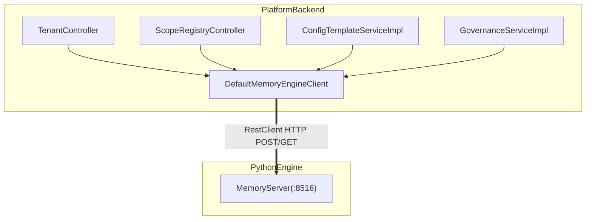
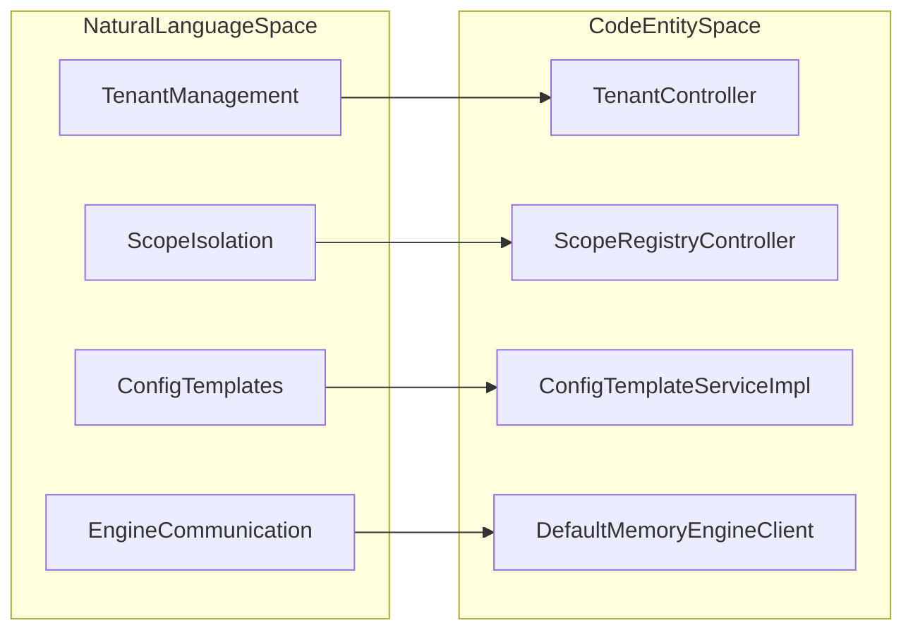

<!-- source: DeepWiki mcp.deepwiki.com · repo openJiuwen-ai/agent-memory · page 5.1 Platform Backend Services · fetched 2026-11-02 -->

# Platform Backend Services

Relevant source files

The following files were used as context for generating this wiki page:

- [agent-memory-platform/platform/src/main/java/com/openjiuwen/memory/common/client/DefaultMemoryEngineClient.java](agent-memory-platform/platform/src/main/java/com/openjiuwen/memory/common/client/DefaultMemoryEngineClient.java)
- [agent-memory-platform/platform/src/main/java/com/openjiuwen/memory/common/client/MemoryEngineClient.java](agent-memory-platform/platform/src/main/java/com/openjiuwen/memory/common/client/MemoryEngineClient.java)
- [agent-memory-platform/platform/src/main/java/com/openjiuwen/memory/configcenter/service/impl/ConfigTemplateServiceImpl.java](agent-memory-platform/platform/src/main/java/com/openjiuwen/memory/configcenter/service/impl/ConfigTemplateServiceImpl.java)
- [agent-memory-platform/platform/src/main/java/com/openjiuwen/memory/logcenter/service/LogCollectAsyncService.java](agent-memory-platform/platform/src/main/java/com/openjiuwen/memory/logcenter/service/LogCollectAsyncService.java)
- [agent-memory-platform/platform/src/main/java/com/openjiuwen/memory/opscenter/controller/FeatureFlagController.java](agent-memory-platform/platform/src/main/java/com/openjiuwen/memory/opscenter/controller/FeatureFlagController.java)
- [agent-memory-platform/platform/src/main/java/com/openjiuwen/memory/opscenter/controller/OpsCommandController.java](agent-memory-platform/platform/src/main/java/com/openjiuwen/memory/opscenter/controller/OpsCommandController.java)
- [agent-memory-platform/platform/src/main/java/com/openjiuwen/memory/opscenter/service/impl/GovernanceServiceImpl.java](agent-memory-platform/platform/src/main/java/com/openjiuwen/memory/opscenter/service/impl/GovernanceServiceImpl.java)
- [agent-memory-platform/platform/src/main/java/com/openjiuwen/memory/scopecenter/controller/ScopeRegistryController.java](agent-memory-platform/platform/src/main/java/com/openjiuwen/memory/scopecenter/controller/ScopeRegistryController.java)
- [agent-memory-platform/platform/src/main/java/com/openjiuwen/memory/tenantcenter/controller/TenantController.java](agent-memory-platform/platform/src/main/java/com/openjiuwen/memory/tenantcenter/controller/TenantController.java)
- [agent-memory-platform/platform/src/main/java/com/openjiuwen/memory/webui/service/impl/UiAggregatorServiceImpl.java](agent-memory-platform/platform/src/main/java/com/openjiuwen/memory/webui/service/impl/UiAggregatorServiceImpl.java)

## Purpose and Scope

The `agent-memory-platform` backend services layer provides an enterprise-grade Java Spring Boot management console and API gateway for the JiuwenMemory system. It orchestrates multi-tenant environments, manages dynamic configurations, monitors runtime operations, collects logs, and securely bridges administrative interfaces to the Python-based Long-Term Memory core engine through a unified client abstraction.

Sources: 
- `agent-memory-platform/platform/src/main/java/com/openjiuwen/memory/common/client/MemoryEngineClient.java:20-26`

---

## Core Spring Boot Modules & Engine Bridge

The platform backend is organized into specialized functional modules operating under a unified Spring Boot application context:

- **`authcenter`**: Manages authentication, JSON Web Tokens (JWT), security configuration, auth filters, token blacklists, and user services. For details, see [Auth Center and Security](#5.1.1).
- **`tenantcenter`**: Implements multi-tenant registration, lifecycle management, and tenant-to-scope mapping bindings via `TenantController` [agent-memory-platform/platform/src/main/java/com/openjiuwen/memory/tenantcenter/controller/TenantController.java:34-36] and `TenantService`.
- **`scopecenter`**: Handles namespace isolation registries, resource quotas, and scope validators via `ScopeRegistryController` [agent-memory-platform/platform/src/main/java/com/openjiuwen/memory/scopecenter/controller/ScopeRegistryController.java:19-21].
- **`configcenter`**: Provides hierarchical configuration templates (`ConfigTemplateServiceImpl`), instance-level singletons, and kernel synchronization models (`ConfigTemplateServiceImpl` [agent-memory-platform/platform/src/main/java/com/openjiuwen/memory/configcenter/service/impl/ConfigTemplateServiceImpl.java:64-65]).
- **`logcenter` & `opscenter`**: Collects runtime logs, audit logs, message logs, and processes administrative operations/governance workflows. For details, see [Log Center and Ops Center](#5.1.2).
- **`MemoryEngineClient` Bridge**: The HTTP communication layer (`DefaultMemoryEngineClient` [agent-memory-platform/platform/src/main/java/com/openjiuwen/memory/common/client/DefaultMemoryEngineClient.java:40-40]) that wraps REST calls over `RestClient` to connect the Java platform to the Python core engine endpoints (`:8516`) [agent-memory-platform/platform/src/main/java/com/openjiuwen/memory/common/client/DefaultMemoryEngineClient.java:28-28].

### Architecture Overview Diagram

Sources: 
- `agent-memory-platform/platform/src/main/java/com/openjiuwen/memory/tenantcenter/controller/TenantController.java:34-36`
- `agent-memory-platform/platform/src/main/java/com/openjiuwen/memory/scopecenter/controller/ScopeRegistryController.java:19-21`
- `agent-memory-platform/platform/src/main/java/com/openjiuwen.memory/common/client/DefaultMemoryEngineClient.java:28-44`

---

## Natural Language Space to Code Entity Space Mapping

The following diagram bridges high-level administrative concepts to their concrete Spring Boot controllers, services, and client communication interfaces within the codebase.

Sources:
- `agent-memory-platform/platform/src/main/java/com/openjiuwen/memory/tenantcenter/controller/TenantController.java:34-36`
- `agent-memory-platform/platform/src/main/java/com/openjiuwen/memory/scopecenter/controller/ScopeRegistryController.java:19-21`
- `agent-memory-platform/platform/src/main/java/com/openjiuwen/memory/configcenter/service/impl/ConfigTemplateServiceImpl.java:64-65`
- `agent-memory-platform/platform/src/main/java/com/openjiuwen/memory/common/client/DefaultMemoryEngineClient.java:40-44`

---

## Sub-Topics and Child Pages

### 5.1.1 Auth Center and Security
The `authcenter` module provides security infrastructure including JWT authentication providers, Spring Security filter chains, token blacklists, user management services, and request path/scope validators.
- For details, see [Auth Center and Security](#5.1.1).

### 5.1.2 Log Center and Ops Center
The `logcenter` and `opscenter` modules handle system diagnostics, asynchronous log packaging (`LogCollectAsyncService` [agent-memory-platform/platform/src/main/java/com/openjiuwen/logcenter/service/LogCollectAsyncService.java:40-41]), governance rule evaluations (`GovernanceServiceImpl` [agent-memory-platform/platform/src/main/java/com/openjiuwen/memory/opscenter/service/impl/GovernanceServiceImpl.java:40-41]), remote command dispatching (`OpsCommandController` [agent-memory-platform/platform/src/main/java/com/openjiuwen/memory/opscenter/controller/OpsCommandController.java:14-16]), and feature flag rollouts (`FeatureFlagController` [agent-memory-platform/platform/src/main/java/com/openjiuwen/memory/opscenter/controller/FeatureFlagController.java:12-14]).
- For details, see [Log Center and Ops Center](#5.1.2).

### 5.1.3 Platform Persistence and Migrations
Platform persistence relies on Flyway schema migration scripts targeting MySQL, GaussDB, and SQLite, alongside multi-profile configuration application properties, schema compatibility initializers, and mock engine clients for testing.
- For details, see [Platform Persistence and Migrations](#5.1.3).

Sources:
- `agent-memory-platform/platform/src/main/java/com/openjiuwen/memory/common/client/DefaultMemoryEngineClient.java:28-44`
- `agent-memory-platform/platform/src/main/java/com/openjiuwen/memory/opscenter/service/impl/GovernanceServiceImpl.java:40-41`
- `agent-memory-platform/platform/src/main/java/com/openjiuwen/memory/opscenter/controller/OpsCommandController.java:14-16`
- `agent-memory-platform/platform/src/main/java/com/openjiuwen/memory/opscenter/controller/FeatureFlagController.java:12-14`

---

