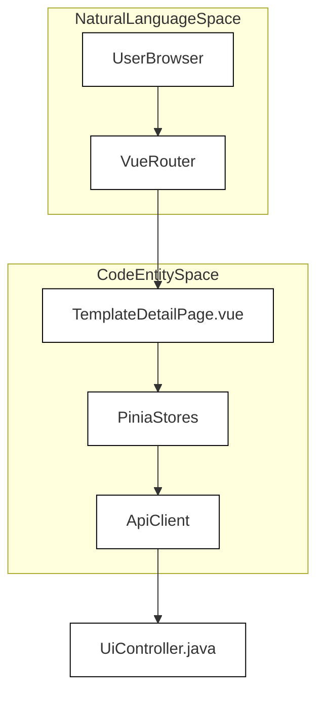
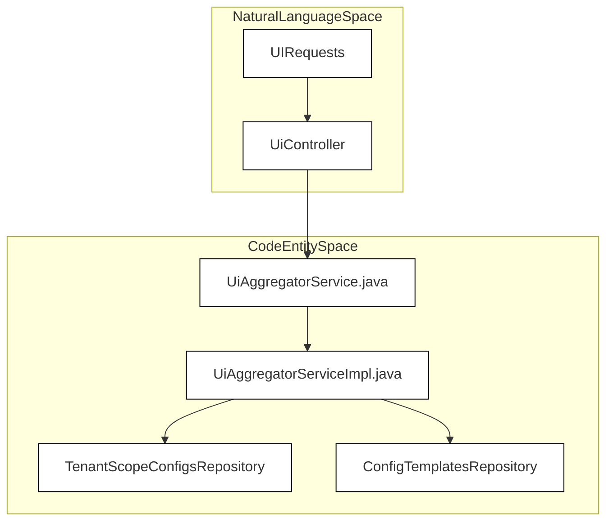

<!-- source: DeepWiki mcp.deepwiki.com · repo openJiuwen-ai/agent-memory · page 5.2 Platform Web UI (Vue) · fetched 2026-11-02 -->

# Platform Web UI (Vue)

Relevant source files

The following files were used as context for generating this wiki page:

- [agent-memory-platform/platform/src/main/java/com/openjiuwen/memory/webui/UiController.java](agent-memory-platform/platform/src/main/java/com/openjiuwen/memory/webui/UiController.java)
- [agent-memory-platform/platform/src/main/java/com/openjiuwen/memory/webui/service/UiAggregatorService.java](agent-memory-platform/platform/src/main/java/com/openjiuwen/memory/webui/service/UiAggregatorService.java)
- [agent-memory-platform/platform/src/main/resources/db/migration/V3__config_center_init_gaussdb.sql](agent-memory-platform/platform/src/main/resources/db/migration/V3__config_center_init_gaussdb.sql)
- [agent-memory-platform/platform/src/main/resources/db/migration/V3__config_center_init_mysql.sql](agent-memory-platform/platform/src/main/resources/db/migration/V3__config_center_init_mysql.sql)
- [agent-memory-platform/platform/src/main/resources/db/migration/V3__config_center_init_sqlite.sql](agent-memory-platform/platform/src/main/resources/db/migration/V3__config_center_init_sqlite.sql)
- [agent-memory-platform/server/src/views/config-center/TemplateDetailPage.vue](agent-memory-platform/server/src/views/config-center/TemplateDetailPage.vue)

## Purpose and Scope
This section covers the Vue 3 frontend architecture of the `agent-memory-platform`. The Platform Web UI provides administrative consoles for managing configuration centers, multi-tenant scopes, runtime logs, and operational workflows. It communicates with the backend Spring Boot application via aggregated REST endpoints routed through `UiController` [agent-memory-platform/platform/src/main/java/com/openjiuwen/memory/webui/UiController.java:23-84]() and processed by `UiAggregatorService` [agent-memory-platform/platform/src/main/java/com/openjiuwen/memory/webui/service/UiAggregatorService.java:11-39]().

---

## 1. Frontend Architecture & Layouts
The frontend is built using Vue 3, utilizing Pinia for state management, Vue Router for view navigation, and Element Plus for UI component styling. The application architecture separates views into functional modules:
- **Config Center**: Manages scope configurations, template versioning, and draft/published states (`TemplateDetailPage.vue`) [agent-memory-platform/server/src/views/config-center/TemplateDetailPage.vue:1-172]().
- **Tenant Management**: Oversees tenant-to-scope mappings and isolation properties.
- **Log Center**: Aggregates operation logs, audit events, and message traces.
- **Ops Center**: Provides runtime engine control and health telemetry.

*Figure 1: Frontend Client-Side Routing and Architecture Mapping.*

Sources: 
- `agent-memory-platform/server/src/views/config-center/TemplateDetailPage.vue:1-172`
- `agent-memory-platform/platform/src/main/java/com/openjiuwen/memory/webui/UiController.java:23-84`

---

## 2. Backend Aggregator Layer (`UiController` and `UiAggregatorService`)
To minimize round-trips between the Vue frontend and the Spring Boot backend, the platform employs a thin controller and aggregator service design pattern.

`UiController` [agent-memory-platform/platform/src/main/java/com/openjiuwen/memory/webui/UiController.java:23-84] exposes HTTP GET endpoints under `/api/v1/ui`:
- `memoryBrowse`: Retrieves paginated memory items filtered by `scope_id`, `user_id`, and `memory_type` [agent-memory-platform/platform/src/main/java/com/openjiuwen/memory/webui/UiController.java:35-43].
- `configPage`: Aggregates configuration center metadata and scope states [agent-memory-platform/platform/src/main/java/com/openjiuwen/memory/webui/UiController.java:47-52].
- `logsPage`: Gathers operational and audit logs with pagination and tab separation [agent-memory-platform/platform/src/main/java/com/openjiuwen/memory/webui/UiController.java:57-63].
- `opsPage`: Provides operational states for engines and scopes [agent-memory-platform/platform/src/main/java/com/openjiuwen/memory/webui/UiController.java:67-73].
- `tracePage`: Tracks lineage and debugging info for individual memories (`mem_id`) [agent-memory-platform/platform/src/main/java/com/openjiuwen/memory/webui/UiController.java:77-83].

These methods delegate all business logic assembly to `UiAggregatorService` [agent-memory-platform/platform/src/main/java/com/openjiuwen/memory/webui/service/UiAggregatorService.java:11-39].

*Figure 2: Backend Aggregation Data Flow from Controller to Services.*

Sources:
- `agent-memory-platform/platform/src/main/java/com/openjiuwen/memory/webui/UiController.java:23-84`
- `agent-memory-platform/platform/src/main/java/com/openjiuwen/memory/webui/service/UiAggregatorService.java:11-39`

---

## 3. Configuration Center Views (`TemplateDetailPage.vue`)
The `TemplateDetailPage.vue` view handles configuration templates (`SCOPE` and `INSTANCE` types) [agent-memory-platform/server/src/views/config-center/TemplateDetailPage.vue:88-97]. Key features implemented in this view include:
- **Draft vs. Published Status**: Visual indicators showing whether a template draft has been synced to the memory kernel [agent-memory-platform/server/src/views/config-center/TemplateDetailPage.vue:13-18].
- **Dynamic Configuration Table**: An interactive key-value editor (`configItems`) allowing administrators to modify parameters like `model_cfg.model`, `temperature`, and memory definitions [agent-memory-platform/server/src/views/config-center/TemplateDetailPage.vue:131-159].
- **Template Inheritance**: Support for cloning existing source templates (`selectedSourceTemplateId`) to bootstrap new configurations [agent-memory-platform/server/src/views/config-center/TemplateDetailPage.vue:62-77].

Sources:
- `agent-memory-platform/server/src/views/config-center/TemplateDetailPage.vue:1-172`

---

## 4. Persistence and Database Schemas for the UI
The UI configuration views are backed by relational database tables defined across MySQL, GaussDB, and SQLite migrations. 

The core tables supporting the Config Center and Tenant management include:
- `tenant_scope_configs`: Stores 1:1 tenant-to-scope configuration snapshots (`config_json`), linking templates with versioning for drift detection (`template_version` vs `current_version`) [agent-memory-platform/platform/src/main/resources/db/migration/V3__config_center_init_mysql.sql:11-23], [agent-memory-platform/platform/src/main/resources/db/migration/V3__config_center_init_sqlite.sql:31-41].
- `config_templates`: Manages `SCOPE` and `INSTANCE` templates, tracking status (`published`/`draft`), parent inheritance (`parent_id`), and JSON configurations [agent-memory-platform/platform/src/main/resources/db/migration/V3__config_center_init_mysql.sql:25-44], [agent-memory-platform/platform/src/main/resources/db/migration/V3__config_center_init_sqlite.sql:52-67].
- `config_audit_logs`: Records operator actions, before/after JSON states, and success indicators for audit compliance [agent-memory-platform/platform/src/main/resources/db/migration/V3__config_center_init_mysql.sql:75-90], [agent-memory-platform/platform/src/main/resources/db/migration/V3__config_center_init_sqlite.sql:92-105].

Sources:
- `agent-memory-platform/platform/src/main/resources/db/migration/V3__config_center_init_mysql.sql:11-90`
- `agent-memory-platform/platform/src/main/resources/db/migration/V3__config_center_init_sqlite.sql:31-105`

---

