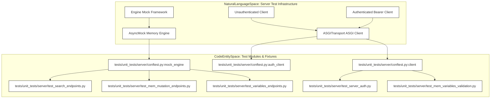
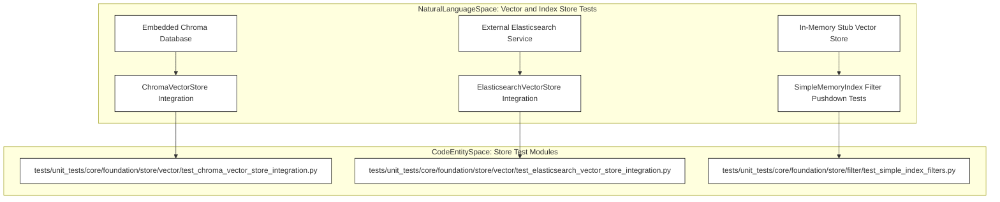

<!-- source: DeepWiki mcp.deepwiki.com · repo openJiuwen-ai/agent-memory · page 6.2 Testing Strategy · fetched 2026-11-02 -->

# Testing Strategy

Relevant source files

The following files were used as context for generating this wiki page:

- [tests/unit_tests/core/foundation/store/filter/test_simple_index_filters.py](tests/unit_tests/core/foundation/store/filter/test_simple_index_filters.py)
- [tests/unit_tests/core/foundation/store/index/__init__.py](tests/unit_tests/core/foundation/store/index/__init__.py)
- [tests/unit_tests/core/foundation/store/vector/test_chroma_vector_store_integration.py](tests/unit_tests/core/foundation/store/vector/test_chroma_vector_store_integration.py)
- [tests/unit_tests/core/foundation/store/vector/test_elasticsearch_vector_store_integration.py](tests/unit_tests/core/foundation/store/vector/test_elasticsearch_vector_store_integration.py)
- [tests/unit_tests/core/memory/manage/search/test_search_manager.py](tests/unit_tests/core/memory/manage/search/test_search_manager.py)
- [tests/unit_tests/core/memory/process/dreaming/test_dreaming_integration.py](tests/unit_tests/core/memory/process/dreaming/test_dreaming_integration.py)
- [tests/unit_tests/server/__init__.py](tests/unit_tests/server/__init__.py)
- [tests/unit_tests/server/conftest.py](tests/unit_tests/server/conftest.py)
- [tests/unit_tests/server/test_mem_mutation_endpoints.py](tests/unit_tests/server/test_mem_mutation_endpoints.py)
- [tests/unit_tests/server/test_mem_variables_validation.py](tests/unit_tests/server/test_mem_variables_validation.py)
- [tests/unit_tests/server/test_search_endpoints.py](tests/unit_tests/server/test_search_endpoints.py)
- [tests/unit_tests/server/test_server_auth.py](tests/unit_tests/server/test_server_auth.py)
- [tests/unit_tests/server/test_variables_endpoints.py](tests/unit_tests/server/test_variables_endpoints.py)

## Purpose and Scope
This page details the testing infrastructure and unit test layout located under `tests/unit_tests/` in the codebase. The testing framework is structured into distinct tiers to isolate system components: FastAPI server endpoint tests utilizing `ASGITransport` and `AsyncMock` fixtures, core memory engine validation tests, and real-backend store integration tests for vector indexes (Chroma and Elasticsearch).

---

## 1. Server Endpoint Tests and Conftest Isolation
The server test suite (`tests/unit_tests/server/`) validates FastAPI routing, request validation via Pydantic models, authentication middleware, and error translation without requiring network port binding or external LLM calls. 

Isolation is achieved through `httpx.ASGITransport` bound directly to the FastAPI `app` object and `pytest-asyncio` fixtures defined in `tests/unit_tests/server/conftest.py`.

*Sources: `tests/unit_tests/server/conftest.py:1-90`*, `tests/unit_tests/server/test_search_endpoints.py:1-88`*, `tests/unit_tests/server/test_server_auth.py:1-81`*

### Key Test Categories in `tests/unit_tests/server/`
- **Search Endpoints (`test_search_endpoints.py`)**: Tests parameter passthrough (`query`, `num`, `threshold`, `user_id`, `scope_id`), enum serialization for `MemoryType`, and `500` error translation on engine exceptions [tests/unit_tests/server/test_search_endpoints.py:1-87]().
- **Mutation & Variables Endpoints (`test_mem_mutation_endpoints.py`, `test_variables_endpoints.py`)**: Verifies `/update_mem_by_id/`, `/delete_mem_by_scope/`, and variable state operations [tests/unit_tests/server/test_mem_mutation_endpoints.py:1-119](), [tests/unit_tests/server/test_variables_endpoints.py:1-163]().
- **Authentication & Security Guard (`test_server_auth.py`)**: Validates the Bearer token middleware, health check bypasses, and the startup security guard function `is_host_exposed_without_key` [tests/unit_tests/server/test_server_auth.py:1-153]().
- **Narrow Model Validation (`test_mem_variables_validation.py`)**: Tests strict Pydantic deserialization of `MemVariable` models under `AddMessagesRequest`, ensuring malformed types or missing required fields raise `422 Unprocessable Entity` before touching the engine [tests/unit_tests/server/test_mem_variables_validation.py:1-105]().

Sources: `tests/unit_tests/server/conftest.py:1-90`, `tests/unit_tests/server/test_search_endpoints.py:1-88`, `tests/unit_tests/server/test_server_auth.py:1-153`, `tests/unit_tests/server/test_mem_variables_validation.py:1-105`

---

## 2. Core Engine and Dreaming Integration Tests
Core engine tests validate internal memory pipelines, including message processing, multi-term synchronization, and background routines such as dreaming.

### Dreaming End-to-End Flow
Integration tests like `test_dreaming_end_to_end` verify the complete chain: ingesting raw session messages via `add_messages`, triggering consolidation through `LongTermMemory.start_dreaming`, deduplicating via `MemUpdateChecker`, and retrieving consolidated memories [tests/unit_tests/core/memory/process/dreaming/test_dreaming_integration.py:1-168](). Because real LLM outputs are mocked using deterministic fixtures (`_smart_llm` and `_InMemoryIndex`), tests execute reliably in CI environments without external API overhead [tests/unit_tests/core/memory/process/dreaming/test_dreaming_integration.py:36-157]().

Sources: `tests/unit_tests/core/memory/process/dreaming/test_dreaming_integration.py:1-168`

---

## 3. Store Integration and Vector Index Tests
The foundation layer features integration tests for vector backends (`ChromaVectorStore`, `ElasticsearchVectorStore`) and hybrid search indices (`SimpleMemoryIndex`) [tests/unit_tests/core/foundation/store/vector/test_chroma_vector_store_integration.py:1-79](), [tests/unit_tests/core/foundation/store/vector/test_elasticsearch_vector_store_integration.py:1-64](), [tests/unit_tests/core/foundation/store/filter/test_simple_index_filters.py:1-153]().

*Sources: `tests/unit_tests/core/foundation/store/vector/test_chroma_vector_store_integration.py:1-79`*, `tests/unit_tests/core/foundation/store/vector/test_elasticsearch_vector_store_integration.py:1-64`*, `tests/unit_tests/core/foundation/store/filter/test_simple_index_filters.py:1-153`*

### Backend-Specific Validation Strategies
- **ChromaVectorStore (`test_chroma_vector_store_integration.py`)**: Runs against a local, ephemeral directory via `chromadb.PersistentClient`. Validates schema creation with Ebbinghaus boolean scalar fields (`blacklisted`, `is_important`), filter pushdown to Chroma's `where` clause, and partial field updates [tests/unit_tests/core/foundation/store/vector/test_chroma_vector_store_integration.py:52-132]().
- **ElasticsearchVectorStore (`test_elasticsearch_vector_store_integration.py`)**: Conditionally executed when `ES_HOSTS` environment variables are present (`pytest.importorskip`). Validates index mapping, vector similarity searches, and filter query generation [tests/unit_tests/core/foundation/store/vector/test_elasticsearch_vector_store_integration.py:18-135]().
- **SimpleMemoryIndex Filters (`test_simple_index_filters.py`)**: Uses `_StubVectorStore` and `_DummyEmbedding` collaborators to verify filter clause evaluation, blacklisted memory exclusion, and metadata retention during `update_mem_by_id` calls without invoking external services [tests/unit_tests/core/foundation/store/filter/test_simple_index_filters.py:30-153]().

Sources: `tests/unit_tests/core/foundation/store/vector/test_chroma_vector_store_integration.py:1-132`, `tests/unit_tests/core/foundation/store/vector/test_elasticsearch_vector_store_integration.py:1-135`, `tests/unit_tests/core/foundation/store/filter/test_simple_index_filters.py:1-153`

---

