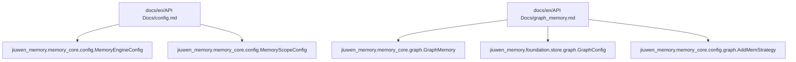
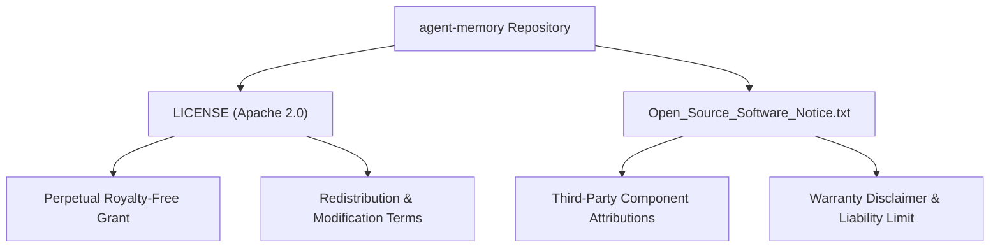

<!-- source: DeepWiki mcp.deepwiki.com · repo openJiuwen-ai/agent-memory · page 6.3 Documentation and Licensing · fetched 2026-11-02 -->

# Documentation and Licensing

Relevant source files

The following files were used as context for generating this wiki page:

- [LICENSE](LICENSE)
- [Open_Source_Software_Notice.txt](Open_Source_Software_Notice.txt)
- [README.md](README.md)
- [README.zh.md](README.zh.md)
- [docs/en/API Docs/config.md](docs/en/API Docs/config.md)
- [docs/en/API Docs/graph_memory.md](docs/en/API Docs/graph_memory.md)
- [tests/unit_tests/core/memory/graph/graph_memory/test_base.py](tests/unit_tests/core/memory/graph/graph_memory/test_base.py)

## Purpose and Scope

Section 6.3 covers the comprehensive documentation architecture, bilingual entry points, and open-source compliance framework of the `agent-memory` repository (`JiuwenMemory`). This includes the English and Chinese API documentation sets under `docs/en/` and `docs/zh/`, the bilingual README pair (`README.md` and `README.zh.md`), and the legal governance assets (`LICENSE` and `Open_Source_Software_Notice.txt`).

Sources: `README.md:1-109` [README.md:1-109](), `LICENSE:1-126` [LICENSE:1-126](), `Open_Source_Software_Notice.txt:1-35` [Open_Source_Software_Notice.txt:1-35]()

---

## Documentation Architecture and API Doc Set

The documentation subsystem provides technical references for configuring engines, orchestrating memory layers, and integrating specialized subsystems such as graph memory. The API documentation set maps user-facing parameters directly to underlying Python classes and configuration schemas.

### Configuration Reference Documentation
The configuration documentation defined in `docs/en/API Docs/config.md` outlines engine-level and scope-level parameters [docs/en/API Docs/config.md:1-41]`:
- `MemoryEngineConfig`: Manages global parameters including `default_model_cfg`, `default_model_client_cfg`, `input_msg_max_len`, `crypto_key`, and third-party cryptographic extension registries via `codec` [docs/en/API Docs/config.md:11-28]().
- `MemoryScopeConfig`: Manages namespace isolation, overriding model requests, embedding configurations (`embedding_cfg`), and profile definitions per `scope_id` [docs/en/API Docs/config.md:92-102]().

### Graph Memory Documentation
The graph memory reference in `docs/en/API Docs/graph_memory.md` specifies the usage patterns for extracting entities, relations, and episodes using `GraphMemory` [docs/en/API Docs/graph_memory.md:1-139]():
- `GraphMemory`: Orchestrates Milvus or alternative graph backends, parsing input streams (`EpisodeType`) into structured `Entity` and `Relation` nodes [docs/en/API Docs/graph_memory.md:108-139]().
- Attachment APIs: `attach_embedder(embedder: Embedding)` and `attach_reranker(reranker: Reranker)` inject retrieval dependencies required prior to invoking `add_memory` or `search` [docs/en/API Docs/graph_memory.md:140-166]().

### Diagram: Documentation Set to Code Entity Mapping

Sources: `docs/en/API Docs/config.md:1-102` [docs/en/API Docs/config.md:1-102](), `docs/en/API Docs/graph_memory.md:1-166` [docs/en/API Docs/graph_memory.md:1-166]()

---

## Bilingual README Pair

The project provides an entry point via a synchronized bilingual README structure:
- `README.md`: English documentation detailing the AutoGenetic memory philosophy (L0-L3 architecture), installation extras (`pip install JiuwenMemory[all]`), and code examples [README.md:1-109]().
- `README.zh.md`: Chinese localization of the core architecture descriptions, installation guides, and complete programmatic examples using `LongTermMemory` [README.zh.md:1-211]().

Both documents cover the four-tier progressive architecture (L0 Raw Information, L1 Summary Memory, L2 Structured Memory, L3 User Profile), Auto Dreaming, MemoryTurbo acceleration, and AES-256-GCM encryption hardening [README.md:17-48](), [README.zh.md:19-48]().

Sources: `README.md:1-109` [README.md:1-109](), `README.zh.md:1-211` [README.zh.md:1-211]()

---

## Open-Source Licensing and Notice Framework

JiuwenMemory is distributed under open-source governance terms defined by the Apache License Version 2.0, alongside explicit third-party attribution notices.

### Apache License v2.0 (`LICENSE`)
The repository includes the standard Apache 2.0 license text (`LICENSE`), granting users:
- Perpetual, worldwide, non-exclusive, royalty-free copyright and patent licenses to reproduce, prepare derivative works of, publicly display, and distribute the work [LICENSE:67-88]().
- Conditions requiring prominent notices of file modifications, retention of copyright/patent notices, and distribution of a copy of the license with any derivative works [LICENSE:90-126]().

### Third-Party Software Notices (`Open_Source_Software_Notice.txt`)
The `Open_Source_Software_Notice.txt` file compiles attribution notices, warranty disclaimers, and license texts for dependencies embedded or distributed alongside the product (such as `aiofiles` under Apache 2.0) [Open_Source_Software_Notice.txt:1-35](). It asserts that open-source licenses prevail over other terms while disclaiming implied warranties of merchantability or fitness for a particular purpose [Open_Source_Software_Notice.txt:1-7]().

### Diagram: Licensing and Compliance Data Flow

Sources: `LICENSE:1-126` [LICENSE:1-126](), `Open_Source_Software_Notice.txt:1-35` [Open_Source_Software_Notice.txt:1-35]()

---

