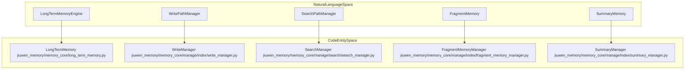
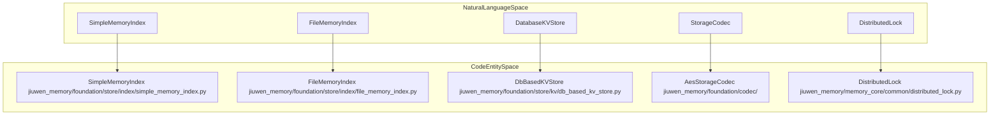

<!-- source: DeepWiki mcp.deepwiki.com · repo openJiuwen-ai/agent-memory · page 7 Glossary · fetched 2026-11-02 -->

# Glossary

Relevant source files

The following files were used as context for generating this wiki page:

- [README.md](README.md)
- [README.zh.md](README.zh.md)
- [docs/en/API Docs/long_term_memory.md](docs/en/API Docs/long_term_memory.md)
- [jiuwen_memory/foundation/store/index/simple_memory_index.py](jiuwen_memory/foundation/store/index/simple_memory_index.py)
- [jiuwen_memory/foundation/store/kv/db_based_kv_store.py](jiuwen_memory/foundation/store/kv/db_based_kv_store.py)
- [jiuwen_memory/memory_core/long_term_memory.py](jiuwen_memory/memory_core/long_term_memory.py)
- [jiuwen_memory/memory_core/manage/index/fragment_memory_manager.py](jiuwen_memory/memory_core/manage/index/fragment_memory_manager.py)
- [jiuwen_memory/memory_core/manage/index/summary_manager.py](jiuwen_memory/memory_core/manage/index/summary_manager.py)
- [jiuwen_memory/memory_core/manage/mem_model/sql_message_store.py](jiuwen_memory/memory_core/manage/mem_model/sql_message_store.py)
- [jiuwen_memory/server/memory_server.py](jiuwen_memory/server/memory_server.py)

## Purpose and Scope

This wiki page defines codebase-specific terms, architectural concepts, data structures, and core classes implemented in the `agent-memory` (`jiuwen_memory`) repository. It serves as an authoritative technical reference mapping natural language domain concepts to their exact Python implementations, classes, and file paths.

---

## 1. Core Architectural & Conceptual Terms

### AutoGenetic Memory
The overarching paradigm of JiuwenMemory where memory operates as a self-evolving, gene-like digital asset rather than static logs. Memories replicate, mutate (via extraction/deduplication), and consolidate autonomously.
- **Source Files**: [README.md:5-15](), [README.zh.md:5-15]()

### L0–L3 Layered Memory
The four progressive tiers of memory abstraction:
- **L0 (Raw Information)**: Unprocessed chat messages stored via `SqlMessageStore`.
- **L1 (Summary Memory)**: Chunked/topic-level conversation summaries managed by `SummaryManager`.
- **L2 (Structured Memory)**: Granular entries like semantic and episodic memory units.
- **L3 (User Profile)**: Long-term traits and preferences extracted into `FragmentMemoryUnit`.
- **Source Files**: [README.md:17-21](), [jiuwen_memory/memory_core/long_term_memory.py:36-44]()

### scope_id
A tenant/application isolation boundary string used to namespace configurations, keys, vector collections, and SQL filters, ensuring multi-tenant security separation.
- **Source Files**: [README.md:46-48](), [jiuwen_memory/memory_core/long_term_memory.py:124-124]()

### MemoryTurbo
An asynchronous middle-term caching and acceleration mechanism where incoming conversation turns are written immediately to cache (`MiddleTermMemoryManager`), while heavy extraction runs asynchronously in the background.
- **Source Files**: [README.md:21-25](), [jiuwen_memory/memory_core/long_term_memory.py:42-42]()

### Dreaming
A background sleep-time memory consolidation pipeline inspired by cognitive neuroscience (light sleep filtering, REM extraction, deep sleep deduplication and conflict resolution) orchestrated by `DreamingOrchestrator`.
- **Source Files**: [README.md:21-23](), [jiuwen_memory/memory_core/long_term_memory.py:25-30]()

### Ebbinghaus forgetting
A memory decay and reinforcement evaluation mechanism using an Ebbinghaus curve evaluator (`EbbinghausEvaluator`) combined with retrieval history scoring to prune or retain memory documents.
- **Source Files**: [README.md:21-23](), [jiuwen_memory/memory_core/long_term_memory.py:31-34]()

### blacklisted
A boolean flag on memory documents indicating that a specific memory unit has been excluded from active retrieval recall due to administrative actions or conflict resolution.
- **Source Files**: [README.md:27-30](), [jiuwen_memory/foundation/store/base_memory_index.py:56-56]()

### MCP (Model Context Protocol)
The Model Context Protocol server interface exposing memory tools and transports for agent integration.
- **Source Files**: [README.md:35-41](), [jiuwen_memory/server/memory_server.py:1-35]()

### mem_meta
A metadata manager and statistics tracking subsystem (`MemoryMetaManager`) handling versioned KV, SQL, and index schema migrations.
- **Source Files**: [README.md:31-35](), [jiuwen_memory/memory_core/migration/migrator/memory_meta_manager.py:1-46]()

Sources: [README.md:1-523](), [jiuwen_memory/memory_core/long_term_memory.py:1-140]()

---

## 2. Data Models & Units

### MemoryDoc
The unified internal document schema used by `BaseMemoryIndex` implementations, containing fields such as `id`, `text`, `type`, `timestamp`, and extensible metadata dictionaries.
- **Source Files**: [jiuwen_memory/foundation/store/base_memory_index.py:56-65]()

### MemoryType
An enumeration defining categorical memory classifications including `USER_PROFILE`, `SEMANTIC_MEMORY`, `EPISODIC_MEMORY`, `SUMMARY`, and `VARIABLE`.
- **Source Files**: [jiuwen_memory/memory_core/manage/mem_model/memory_unit.py:10-20](), [jiuwen_memory/memory_core/long_term_memory.py:42-44]()

### MiddleTermUnit
A middle-term cache unit processed inside `MiddleTermMemoryManager` prior to promotion into long-term storage via `middle_mem_to_long`.
- **Source Files**: [jiuwen_memory/memory_core/manage/index/middle_mem_manager.py:1-50]()

### FilterGroup
A composite filtering DSL structure used for conditional query building across relational stores and vector indexes.
- **Source Files**: [jiuwen_memory/foundation/store/filter_dsl.py:1-50](), [jiuwen_memory/memory_core/long_term_memory.py:11-13]()

Sources: [jiuwen_memory/foundation/store/base_memory_index.py:30-70](), [jiuwen_memory/memory_core/long_term_memory.py:40-50]()

---

## 3. Storage, Index & Security Foundations

### SimpleMemoryIndex
A backward-compatible hybrid memory index combining KV storage (`DbBasedKVStore`) and a vector store collection for legacy data layouts (`UMD/{user_id}/{scope_id}/{mem_id}`).
- **Source Files**: [jiuwen_memory/foundation/store/index/simple_memory_index.py:40-70]()

### FileMemoryIndex
A file-system-based memory index storing long-term memories as Markdown files paired with SQLite and `sqlite-vec` full-text/vector indexing.
- **Source Files**: [README.md:83-86](), [docs/en/API Docs/long_term_memory.md:113-121]()

### StorageCodec
An interface for transparent cryptographic encoding and decoding of stored data, concretely implemented by `AesStorageCodec` (AES-256-GCM) and SM4 codecs.
- **Source Files**: [README.md:41-45](), [jiuwen_memory/foundation/codec/__init__.py:1-30](), [jiuwen_memory/memory_core/long_term_memory.py:65-69]()

### DistributedLock
A concurrency control primitive built on top of `DbBasedKVStore` (using `exclusive_set`) to guarantee atomic user-level data operations across multi-instance deployments.
- **Source Files**: [README.md:43-47](), [jiuwen_memory/memory_core/common/distributed_lock.py:1-40](), [jiuwen_memory/foundation/store/kv/db_based_kv_store.py:136-173]()

Sources: [jiuwen_memory/foundation/store/index/simple_memory_index.py:40-70](), [jiuwen_memory/foundation/store/kv/db_based_kv_store.py:136-173]()

---

## 4. Memory Managers & Routing

### WriteManager
The high-level orchestration component that routes incoming messages and extracted memory units to their respective managers (`FragmentMemoryManager`, `SummaryManager`, `VariableManager`).
- **Source Files**: [jiuwen_memory/memory_core/long_term_memory.py:40-41](), [jiuwen_memory/memory_core/manage/index/write_manager.py:1-40]()

### SearchManager
The query routing and execution component responsible for vector similarity searches, keyword filtering, and appending retrieve history records.
- **Source Files**: [jiuwen_memory/memory_core/long_term_memory.py:45-45](), [jiuwen_memory/memory_core/manage/search/search_manager.py:1-50]()

### TenantScope
The configuration and scoping container linking user identifiers and execution parameters to isolated `MemoryScopeConfig` instances within the singleton engine.
- **Source Files**: [README.md:46-48](), [jiuwen_memory/memory_core/long_term_memory.py:17-23]()

Sources: [jiuwen_memory/memory_core/long_term_memory.py:40-45](), [jiuwen_memory/memory_core/manage/index/write_manager.py:1-40]()

---

## 5. Architectural Space Mappings

### Diagram 1: Natural Language Concepts to Core Engine Code Entities

Sources: [jiuwen_memory/memory_core/long_term_memory.py:35-45](), [jiuwen_memory/memory_core/manage/index/fragment_memory_manager.py:53-60]()

### Diagram 2: Storage & Index Terminology to Code Artifacts

Sources: [jiuwen_memory/foundation/store/index/simple_memory_index.py:40-70](), [jiuwen_memory/foundation/store/kv/db_based_kv_store.py:51-62]()