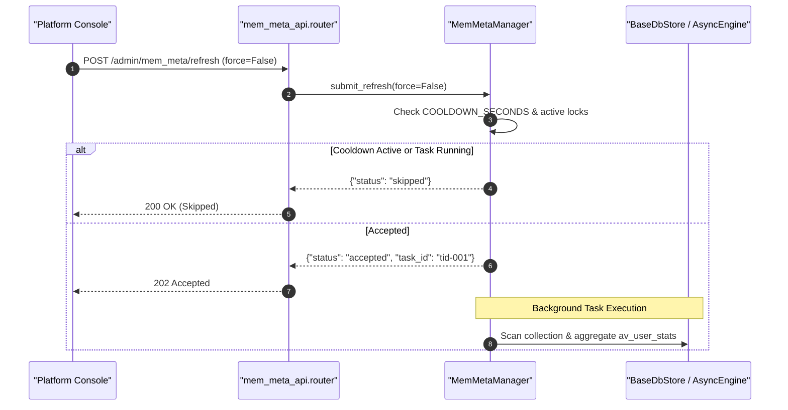
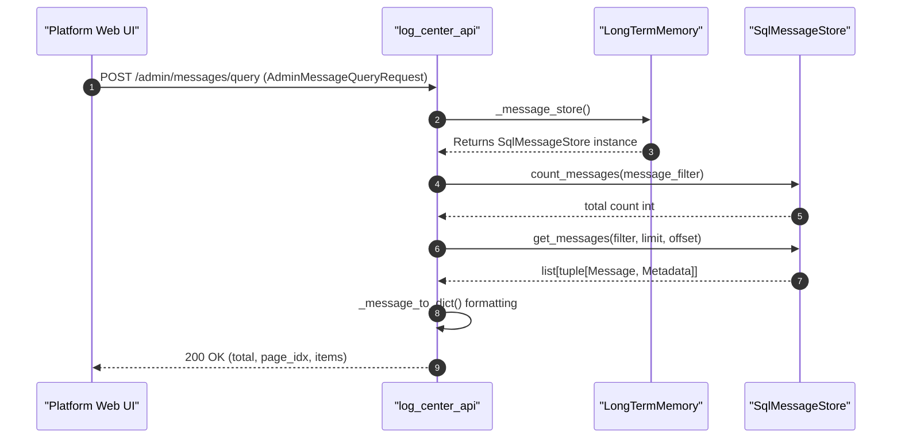

<!-- source: DeepWiki mcp.deepwiki.com · repo openJiuwen-ai/agent-memory · extra page Admin, Config Center and Log Center APIs · fetched 2026-11-02 -->

# Admin, Config Center and Log Center APIs

<details>
<summary>Relevant source files</summary>

The following files were used as context for generating this wiki page:

- [jiuwen_memory/foundation/store/base_memory_index.py](jiuwen_memory/foundation/store/base_memory_index.py)
- [jiuwen_memory/memory_core/manage/mem_meta/__init__.py](jiuwen_memory/memory_core/manage/mem_meta/__init__.py)
- [jiuwen_memory/memory_core/manage/mem_meta/manager.py](jiuwen_memory/memory_core/manage/mem_meta/manager.py)
- [jiuwen_memory/memory_core/manage/search/search_manager.py](jiuwen_memory/memory_core/manage/search/search_manager.py)
- [jiuwen_memory/server/config_center_api.py](jiuwen_memory/server/config_center_api.py)
- [jiuwen_memory/server/log_center_api.py](jiuwen_memory/server/log_center_api.py)
- [jiuwen_memory/server/mem_meta_api.py](jiuwen_memory/server/mem_meta_api.py)
- [tests/unit_tests/server/test_mem_meta_endpoints.py](tests/unit_tests/server/test_mem_meta_endpoints.py)

</details>


## Purpose and Scope
This page details the implementation, routing logic, and data flows of the administrative, configuration, and logging subsystems within the JiuwenMemory REST server. These modules—`mem_meta_api`, `config_center_api`, and `log_center_api`—expose administrative control planes that bridge the agent platform console with the Python memory engine (`LongTermMemory`) [jiuwen_memory/server/mem_meta_api.py:1-12](), [jiuwen_memory/server/config_center_api.py:1-13](), [jiuwen_memory/server/log_center_api.py:1-12]().

---

## 1. Memory Metadata & Batch Deletion Administration (`mem_meta_api`)

The `mem_meta_api` module provides asynchronous governance tools for tracking user memory statistics and executing bulk purges of expired or blacklisted memories [jiuwen_memory/server/mem_meta_api.py:1-12](). All endpoints are prefixed with `/admin/mem_meta` and rely on `MemMetaManager` [jiuwen_memory/server/mem_meta_api.py:28-85]().

### Core Endpoints and Pydantic Models

| Endpoint | Method | Request Model | Response Code | Description |
| :--- | :--- | :--- | :--- | :--- |
| `/admin/mem_meta/refresh` | `POST` | `RefreshRequest` | `202 Accepted` / `200 OK` | Asynchronously refreshes user metadata and stats tables [jiuwen_memory/server/mem_meta_api.py:35-40, 95-105](). |
| `/admin/mem_meta/expired_memorys` | `POST` | `ExpiredMemorysRequest` | `200 OK` | Synchronously queries Top $N$ users exceeding inactivity thresholds [jiuwen_memory/server/mem_meta_api.py:42-49, 108-114](). |
| `/admin/mem_meta/batch_delete` | `POST` | `BatchDeleteRequest` | `202 Accepted` | Submits an asynchronous batch deletion task for expired user data [jiuwen_memory/server/mem_meta_api.py:51-62, 117-143](). |
| `/admin/mem_meta/task_status` | `GET` | Query Parameter (`task_id`) | `200 OK` / `404 Not Found` | Queries progress, status, and summaries of background tasks [jiuwen_memory/server/mem_meta_api.py:146-155](). |

### `MemMetaManager` Persistence Schema
`MemMetaManager` interacts with two primary SQLAlchemy tables managed via an abstract `BaseDbStore` layer supporting SQLite, GaussDB, and PostgreSQL [jiuwen_memory/memory_core/manage/mem_meta/manager.py:9-11, 78-111]():
1. **`av_user_stats`**: Stores aggregated counts per `scope_user`, tracking `total_count`, `active_count`, `superseded_count`, `expired_30d_count`, and memory tiers (`tier_episodic`, `tier_semantic`) [jiuwen_memory/memory_core/manage/mem_meta/manager.py:78-91]().
2. **`mem_meta_task`**: Tracks asynchronous background tasks with state machines (`pending`, `running`, `completed`, `failed`), holding execution parameters and deleted counts [jiuwen_memory/memory_core/manage/mem_meta/manager.py:93-111]().

### Diagram: Metadata Refresh and Batch Deletion Data Flow

*Sources: [jiuwen_memory/server/mem_meta_api.py:95-105](), [jiuwen_memory/memory_core/manage/mem_meta/manager.py:33-187]()*, [tests/unit_tests/server/test_mem_meta_endpoints.py:33-48]()

---

## 2. Configuration Center & Dynamic Engine Control (`config_center_api`)

The `config_center_api` module exposes dynamic inspection and mutation capabilities for server architecture, engine parameters, scope configurations, and Dreaming workflows [jiuwen_memory/server/config_center_api.py:1-13]().

### Configuration Taxonomy
Parameters are categorized to prevent unsafe mutations of core architectural bindings while allowing operational tuning:
* **`ARCHITECTURE_PARAMS`**: Immutable runtime bindings such as `IP`, `PORT`, `MEMORY_DATA_DIR`, and store type selectors (`KV_STORE_TYPE`, `DB_STORE_TYPE`, `VECTOR_STORE_TYPE`) [jiuwen_memory/server/config_center_api.py:33-42]().
* **`EDITABLE_ENV_PARAMS`**: Hot-reloadable parameters including LLM providers (`MODEL_PROVIDER`, `API_KEY`, `MODEL_NAME`), embedding models, vector store URIs, and forgetting/dreaming intervals [jiuwen_memory/server/config_center_api.py:44-88]().
* **`SENSITIVE_KEYS`**: Fields masked during retrieval queries (e.g., API keys, passwords, bearer tokens) [jiuwen_memory/server/config_center_api.py:90-100]().

### CONFIG_SCHEMA Layout
The `CONFIG_SCHEMA` dictionary maps configuration categories to metadata schemas utilized by frontend consoles to render dynamic form controls [jiuwen_memory/server/config_center_api.py:113-162]():

```python
CONFIG_SCHEMA = {
    "runtime": { "ip": ..., "port": ..., "memory_api_key": ... },
    "storage": { "kv_store_type": ..., "db_url": ..., "index_backend": ... },
    "vector_engine": { "milvus_uri": ..., "es_hosts": ..., "gauss_host": ... },
    "engine": { "model_provider": ..., "embed_model_name": ..., "rerank_threshold": ... },
    ...
}
```
*Sources: [jiuwen_memory/server/config_center_api.py:113-162]()*

---

## 3. Log Center & Message Audit APIs (`log_center_api`)

The `log_center_api` module implements administrative monitoring and audit endpoints for both file-based execution logs and structured user messages stored in relational message stores [jiuwen_memory/server/log_center_api.py:1-12]().

### Structured Message Query and Export APIs
Users and administrators can query conversation memory logs via structured models [jiuwen_memory/server/log_center_api.py:38-62]():
* **`AdminMessageQueryRequest`**: Supports filtering by `scope_id`, `user_id`, `session_id`, time windows (`start_time`, `end_time`), offset pagination (`page_idx`, `page_size`), and scope blacklisting (`exclude_scopes`) [jiuwen_memory/server/log_center_api.py:38-47]().
* **`MessageExportParams`**: Consolidates parameters for bulk export operations [jiuwen_memory/server/log_center_api.py:49-62]().
* **Message Back-Reference (`/get_message_by_id/`)**: Allows downstream components to trace memory sources back to original dialogue chunks using `GetMessageByIdRequest` [jiuwen_memory/server/log_center_api.py:34-36, 130-146]().

### Diagram: Log Center and Message Audit Data Flow

*Sources: [jiuwen_memory/server/log_center_api.py:75-183]*

---

## Summary of Integration Interfaces

| Module File Path | Router Prefix | Primary Manager / Store | Key Responsibilities |
| :--- | :--- | :--- | :--- |
| `jiuwen_memory/server/mem_meta_api.py` [jiuwen_memory/server/mem_meta_api.py:1-155]() | `/admin/mem_meta` | `MemMetaManager` [jiuwen_memory/memory_core/manage/mem_meta/manager.py:117-122]() | Metadata sync, expiration analytics, asynchronous batch deletion tasks. |
| `jiuwen_memory/server/config_center_api.py` [jiuwen_memory/server/config_center_api.py:1-162]() | `/admin/config` (injected) | `MemoryScopeConfig`, Env variables [jiuwen_memory/server/config_center_api.py:27-88]() | Scope config hot-loading, Dreaming lifecycle control, environment variable mutation. |
| `jiuwen_memory/server/log_center_api.py` [jiuwen_memory/server/log_center_api.py:1-186]() | `/`, `/admin/messages` | `SqlMessageStore`, File I/O [jiuwen_memory/server/log_center_api.py:75-118]() | Execution log tailing/downloading, structured message query/stats/export, message back-reference. |

*Sources: [jiuwen_memory/server/mem_meta_api.py:1-155](), [jiuwen_memory/server/config_center_api.py:1-162](), [jiuwen_memory/server/log_center_api.py:1-186]()*

---

