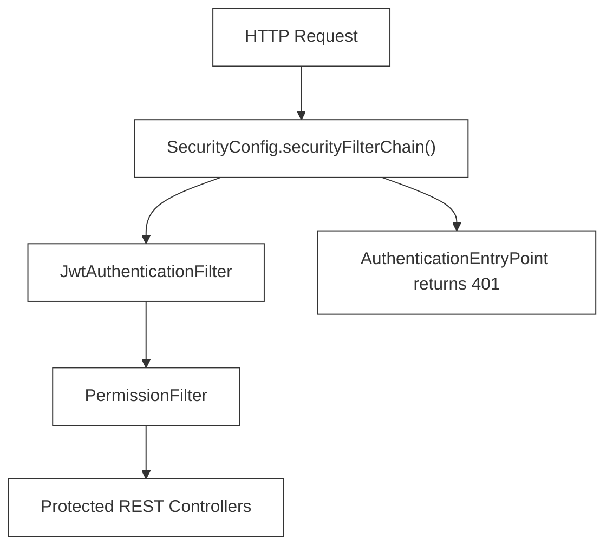

<!-- source: DeepWiki mcp.deepwiki.com · repo openJiuwen-ai/agent-memory · extra page Auth Center and Security · fetched 2026-11-02 -->

# Auth Center and Security

<details>
<summary>Relevant source files</summary>

The following files were used as context for generating this wiki page:

- [agent-memory-platform/platform/src/main/java/com/openjiuwen/memory/authcenter/config/JwtTokenProvider.java](agent-memory-platform/platform/src/main/java/com/openjiuwen/memory/authcenter/config/JwtTokenProvider.java)
- [agent-memory-platform/platform/src/main/java/com/openjiuwen/memory/authcenter/config/SecurityConfig.java](agent-memory-platform/platform/src/main/java/com/openjiuwen/memory/authcenter/config/SecurityConfig.java)
- [agent-memory-platform/platform/src/main/java/com/openjiuwen/memory/authcenter/mapper/TokenBlacklistMapper.java](agent-memory-platform/platform/src/main/java/com/openjiuwen/memory/authcenter/mapper/TokenBlacklistMapper.java)
- [agent-memory-platform/platform/src/main/java/com/openjiuwen/memory/authcenter/service/TokenBlacklistService.java](agent-memory-platform/platform/src/main/java/com/openjiuwen/memory/authcenter/service/TokenBlacklistService.java)
- [agent-memory-platform/platform/src/main/java/com/openjiuwen/memory/common/util/ScopeIdValidator.java](agent-memory-platform/platform/src/main/java/com/openjiuwen/memory/common/util/ScopeIdValidator.java)

</details>


The **Auth Center and Security** module is a core subsystem of the `agent-memory-platform` management console. It provides stateless authentication via JSON Web Tokens (JWT), role-based and permission-based authorization filters, a token revocation blacklist with scheduled cleanup, and security configuration rules for public and protected endpoints. Additionally, it provides structural validators like `ScopeIdValidator` to ensure that parameters such as `scope_id` conform strictly to kernel specifications.

---

## 1. JWT Provider and Token Lifecycle

The `JwtTokenProvider` component handles the creation, parsing, validation, and claim extraction of JWT tokens [agent-memory-platform/platform/src/main/java/com/openjiuwen/memory/authcenter/config/JwtTokenProvider.java:17-125](). It uses an HMAC-SHA signing key (`SECRET_KEY`) that requires a minimum of 256 bits [agent-memory-platform/platform/src/main/java/com/openjiuwen/memory/authcenter/config/JwtTokenProvider.java:22-24]().

### Key Methods and Claims
- **`generateToken(String userId, String username, String role)`**: Constructs a JWT containing custom claims (`userId`, `username`, `role`), a unique JWT ID (`jti`) via `UUID.randomUUID()`, an issuance timestamp, and a 30-minute expiration window [agent-memory-platform/platform/src/main/java/com/openjiuwen/memory/authcenter/config/JwtTokenProvider.java:36-50]().
- **Claim Extractors**: Methods like `getUserIdFromToken()`, `getUsernameFromToken()`, `getRoleFromToken()`, and `getJtiFromToken()` extract payloads safely through `getClaimsFromToken()` [agent-memory-platform/platform/src/main/java/com/openjiuwen/memory/authcenter/config/JwtTokenProvider.java:53-90]().
- **`validateToken(String token)`**: Parses the token signature and verifies whether the token has expired [agent-memory-platform/platform/src/main/java/com/openjiuwen/memory/authcenter/config/JwtTokenProvider.java:95-102]().

```mermaid
graph TD
    sub511_NaturalLanguage ["Client Authentication Request"] --> sub511_JwtProvider["JwtTokenProvider.generateToken()"]
    sub511_JwtProvider --> sub511_Token["JWT Token with jti, userId, role"]
    sub511_Token --> sub511_Parser["JwtTokenProvider.getClaimsFromToken()"]
    sub511_Parser --> sub511_Validation["JwtTokenProvider.validateToken()"]
    
    classDef default fill:#fff,stroke:#333,stroke-width:1px;
```
*Figure 5.1.1-1: JWT token generation and validation flow linking natural language steps to `JwtTokenProvider` methods.*

Sources: `agent-memory-platform/platform/src/main/java/com/openjiuwen/memory/authcenter/config/JwtTokenProvider.java`

---

## 2. Security Configuration and Filter Chain

The `SecurityConfig` class configures Spring Security to operate in a stateless, sessionless architecture appropriate for REST APIs [agent-memory-platform/platform/src/main/java/com/openjiuwen/memory/authcenter/config/SecurityConfig.java:36-79](). 

### Configuration Highlights
- **Session Management**: Configured as `SessionCreationPolicy.STATELESS` [agent-memory-platform/platform/src/main/java/com/openjiuwen/memory/authcenter/config/SecurityConfig.java:68-69]().
- **CSRF**: Disabled since authentication relies entirely on bearer tokens [agent-memory-platform/platform/src/main/java/com/openjiuwen/memory/authcenter/config/SecurityConfig.java:67]().
- **Public Paths**: Dynamic parsing of comma-separated paths from the configuration property `platform.security.public-paths` (defaulting to login, register, info, logout, and refresh endpoints) [agent-memory-platform/platform/src/main/java/com/openjiuwen/memory/authcenter/config/SecurityConfig.java:53-62]().
- **Filter Chain Ordering**:
  1. `JwtAuthenticationFilter` executes before `UsernamePasswordAuthenticationFilter` to extract credentials and populate the `SecurityContextHolder` [agent-memory-platform/platform/src/main/java/com/openjiuwen/memory/authcenter/config/SecurityConfig.java:75]().
  2. `PermissionFilter` executes after `JwtAuthenticationFilter` for fine-grained authorization checks [agent-memory-platform/platform/src/main/java/com/openjiuwen/memory/authcenter/config/SecurityConfig.java:76]().
- **Authentication Entry Point**: Returns an explicit HTTP `401 Unauthorized` status with a JSON error body when authentication fails, adhering to REST semantics [agent-memory-platform/platform/src/main/java/com/openjiuwen/memory/authcenter/config/SecurityConfig.java:86-98]().


*Figure 5.1.1-2: Security filter chain execution routing from `SecurityConfig` to individual filter beans.*

Sources: `agent-memory-platform/platform/src/main/java/com/openjiuwen/memory/authcenter/config/SecurityConfig.java`

---

## 3. Token Blacklist and Logout Management

To handle user logouts and prevent token reuse before natural expiration, `TokenBlacklistService` manages a database-backed blacklist [agent-memory-platform/platform/src/main/java/com/openjiuwen/memory/authcenter/service/TokenBlacklistService.java:18-77]().

### Mechanism
- **Revocation (`addToBlacklist`)**: Records the token's unique `jti`, full token string, username, and expiration timestamp into the repository via `TokenBlacklistMapper` [agent-memory-platform/platform/src/main/java/com/openjiuwen/memory/authcenter/service/TokenBlacklistService.java:34-49](). It is idempotent and skips insertion if the `jti` already exists [agent-memory-platform/platform/src/main/java/com/openjiuwen/memory/authcenter/service/TokenBlacklistService.java:38-41]().
- **Lookup (`isBlacklisted`)**: Checked during JWT validation filters to reject logged-out sessions [agent-memory-platform/platform/src/main/java/com/openjiuwen/memory/authcenter/service/TokenBlacklistService.java:57-62]().
- **Scheduled Cleanup (`cleanExpiredTokens`)**: A Spring `@Scheduled` task executes every 30 minutes to purge expired token rows from the blacklist table where `expires_at` is older than the current time [agent-memory-platform/platform/src/main/java/com/openjiuwen/memory/authcenter/service/TokenBlacklistService.java:68-76]().

Sources: `agent-memory-platform/platform/src/main/java/com/openjiuwen/memory/authcenter/service/TokenBlacklistService.java`, `agent-memory-platform/platform/src/main/java/com/openjiuwen/memory/authcenter/mapper/TokenBlacklistMapper.java`

---

## 4. Scope and Path Validation

The `ScopeIdValidator` class validates scope identifiers to maintain consistency with the underlying Python memory engine's `_validate_id` rules [agent-memory-platform/platform/src/main/java/com/openjiuwen/memory/common/util/ScopeIdValidator.java:7-15]().

### Validation Rules
- **Non-Blank Constraint**: Throws a `BizException` with `ResultCode.BAD_REQUEST` if `scope_id` is null or blank [agent-memory-platform/platform/src/main/java/com/openjiuwen/memory/common/util/ScopeIdValidator.java:28-31]().
- **Slash Restriction**: Prohibits the forward slash character (`/`) because the kernel uses `/` as a delimiter for nested scope paths [agent-memory-platform/platform/src/main/java/com/openjiuwen/memory/common/util/ScopeIdValidator.java:32-34]().
- **Length Limit**: Enforces a strict maximum length of 128 characters [agent-memory-platform/platform/src/main/java/com/openjiuwen/memory/common/util/ScopeIdValidator.java:20,35-37]().

Sources: `agent-memory-platform/platform/src/main/java/com/openjiuwen/memory/common/util/ScopeIdValidator.java`

---

