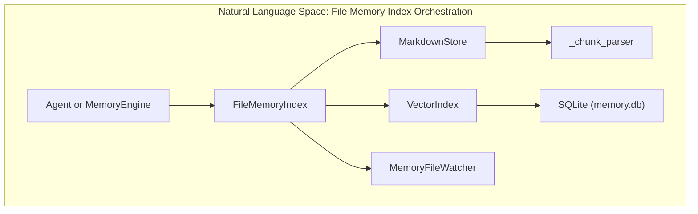
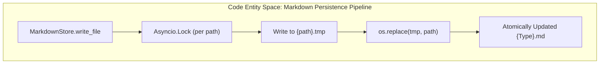
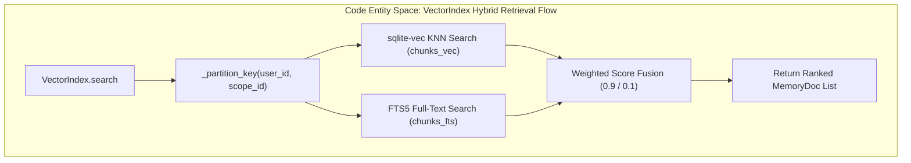

<!-- source: DeepWiki mcp.deepwiki.com · repo openJiuwen-ai/agent-memory · extra page File Memory Index (Markdown + SQLite) · fetched 2026-11-02 -->

# File Memory Index (Markdown + SQLite)

Relevant source files

The following files were used as context for generating this wiki page:

- [jiuwen_memory/foundation/store/index/file_index/__init__.py](jiuwen_memory/foundation/store/index/file_index/__init__.py)
- [jiuwen_memory/foundation/store/index/file_index/_chunk_parser.py](jiuwen_memory/foundation/store/index/file_index/_chunk_parser.py)
- [jiuwen_memory/foundation/store/index/file_index/_file_watcher.py](jiuwen_memory/foundation/store/index/file_index/_file_watcher.py)
- [jiuwen_memory/foundation/store/index/file_index/_md_store.py](jiuwen_memory/foundation/store/index/file_index/_md_store.py)
- [jiuwen_memory/foundation/store/index/file_index/_vector_index.py](jiuwen_memory/foundation/store/index/file_index/_vector_index.py)
- [jiuwen_memory/foundation/store/index/file_index/file_memory_index.py](jiuwen_memory/foundation/store/index/file_index/file_memory_index.py)
- [tests/unit_tests/core/foundation/store/index/test_file_memory_index.py](tests/unit_tests/core/foundation/store/index/test_file_memory_index.py)

## Purpose and Scope
The `FileMemoryIndex` implements the `BaseMemoryIndex` contract by combining human-readable Markdown files grouped by memory type with a SQLite-backed hybrid vector and keyword index. It provides per-type file partitioning under user and scope namespaces, robust frontmatter parsing with tolerance for malformed or unclosed blocks, atomic file operations, incremental re-indexing based on file hashing, and background change detection via an optional watchdog file watcher.

Sources:
- `jiuwen_memory/foundation/store/index/file_index/file_memory_index.py:1-89`
- `jiuwen_memory/foundation/store/index/file_index/_vector_index.py:1-28`

---

## 1. Architecture and Component Decomposition

`FileMemoryIndex` acts as an orchestrator across four specialized sub-modules:
- `MarkdownStore`: Manages multi-memory markdown files with YAML frontmatter under `memories/{user_id}/{scope_id}/{type_name}.md` [jiuwen_memory/foundation/store/index/file_index/_md_store.py:68-82] and applies optional `StorageCodec` encryption to body texts [jiuwen_memory/foundation/store/index/file_index/_md_store.py:10-11].
- `VectorIndex`: Maintains the SQLite database (`memory.db`) containing schema tables for files, chunks, sqlite-vec vectors (`chunks_vec`), FTS5 full-text indices (`chunks_fts`), and embedding caches [jiuwen_memory/foundation/store/index/file_index/_vector_index.py:7-15].
- `MemoryFileWatcher`: Uses the `watchdog` library to monitor memory directories recursively with a debounce timer and thread-safe event handoff [jiuwen_memory/foundation/store/index/file_index/_file_watcher.py:44-61].
- `_chunk_parser`: Parses `.md` files into structured `Block` objects and serializes blocks back to markdown [jiuwen_memory/foundation/store/index/file_index/_chunk_parser.py:36-71].

Sources:
- `jiuwen_memory/foundation/store/index/file_index/file_memory_index.py:55-88`
- `jiuwen_memory/foundation/store/index/file_index/_md_store.py:68-82`
- `jiuwen_memory/foundation/store/index/file_index/_vector_index.py:7-15`
- `jiuwen_memory/foundation/store/index/file_index/_file_watcher.py:44-61`

---

## 2. Chunk Parsing and Markdown Persistence

The underlying files store multiple memories in a single `{Type}.md` file separated by YAML frontmatter blocks [jiuwen_memory/foundation/store/index/file_index/_chunk_parser.py:5-26]. Each block maps to a `Block` dataclass containing memory identification, type, line-number tracking (`start_line`, `end_line`), timestamps, and text hashes [jiuwen_memory/foundation/store/index/file_index/_chunk_parser.py:36-67].

### Chunk Parser Robustness
- **Unclosed Frontmatter Handling**: If a frontmatter block lacks a closing `---`, the parser recovers remaining lines as body content rather than dropping the block [jiuwen_memory/foundation/store/index/file_index/_chunk_parser.py:119-127].
- **Malformed YAML Fallback**: If `yaml.safe_load()` raises an exception, the parser performs a line-by-line fallback scan to extract known keys (`id`, `type`) and recover text contents [jiuwen_memory/foundation/store/index/file_index/_chunk_parser.py:153-194].

### MarkdownStore Atomic Writes
`MarkdownStore.write_file()` prevents partial-write corruption during system crashes by writing to a temporary file (`{path}.tmp`) and replacing the destination atomically via `os.replace()` [jiuwen_memory/foundation/store/index/file_index/_md_store.py:161-174]. Path traversal attempts are blocked via `_validate_path_segment()` checks [jiuwen_memory/foundation/store/index/file_index/_md_store.py:43-65, 115-131].

Sources:
- `jiuwen_memory/foundation/store/index/file_index/_chunk_parser.py:36-194`
- `jiuwen_memory/foundation/store/index/file_index/_md_store.py:43-182`

---

## 3. SQLite Vector Index and Hybrid Retrieval

`VectorIndex` manages the SQLite database backend [jiuwen_memory/foundation/store/index/file_index/_vector_index.py:150-174].

### Database Schema
- `files`: Tracks per-file hashes, mtimes, and sizes for dirty checking [jiuwen_memory/foundation/store/index/file_index/_vector_index.py:9-10].
- `chunks`: Stores per-memory metadata, text, embedding BLOBs, and physical line coordinates (`path`, `start_line`, `end_line`) [jiuwen_memory/foundation/store/index/file_index/_vector_index.py:11-12].
- `chunks_vec`: Vector search table utilizing `vec0` with cosine distance and partition keys (`user_id \x1f scope_id`) [jiuwen_memory/foundation/store/index/file_index/_vector_index.py:13, 113-120].
- `chunks_fts`: FTS5 full-text search table with `jieba` CJK segmentation (`_segment_chinese`) [jiuwen_memory/foundation/store/index/file_index/_vector_index.py:14, 123-147].
- `embedding_cache`: Caches embedding results to prevent redundant API calls [jiuwen_memory/foundation/store/index/file_index/_vector_index.py:15].

### Hybrid Search Execution
Searches combine vector KNN (`VECTOR_WEIGHT = 0.9`) and FTS5 keyword matching (`FTS_WEIGHT = 0.1`) using weighted score fusion [jiuwen_memory/foundation/store/index/file_index/_vector_index.py:58-59]. If `sqlite-vec` is unavailable, the system falls back to pure-Python cosine similarity [jiuwen_memory/foundation/store/index/file_index/_vector_index.py:22-23].

Sources:
- `jiuwen_memory/foundation/store/index/file_index/_vector_index.py:7-148, 150-174`

---

## 4. Incremental Re-indexing and File Watcher

When external editors modify `.md` files or programmatic updates occur, `FileMemoryIndex` synchronizes state without unnecessary embedding overhead.

### Incremental Re-Index Logic (`sync_file`)
1. Computes the hash of the target file and checks the `files` table for modifications.
2. Parses blocks from the updated content using `parse_blocks()` [jiuwen_memory/foundation/store/index/file_index/_vector_index.py:48-51].
3. Compares block hashes against existing database records:
   - **Unchanged text with drifted line numbers**: Executes a cheap `UPDATE` to adjust `start_line` and `end_line` without re-embedding [jiuwen_memory/foundation/store/index/file_index/_vector_index.py:17-20].
   - **New or modified text**: Generates embeddings and upserts records.
   - **Deleted blocks**: Removes corresponding chunks from vector and FTS tables [jiuwen_memory/foundation/store/index/file_index/_vector_index.py:17-18].

### Background File Watcher (`MemoryFileWatcher`)
`MemoryFileWatcher` wraps the `watchdog` library, running recursively on `{root_dir}/memories/` [jiuwen_memory/foundation/store/index/file_index/_file_watcher.py:44-52]. Events pass through a 2-second debounce timer before invoking `_on_file_changed()` on the main event loop via thread-safe task scheduling (`call_soon_threadsafe`) [jiuwen_memory/foundation/store/index/file_index/_file_watcher.py:47-48, 178-189]. If `watchdog` is uninstalled, the watcher gracefully degrades to a no-op, falling back to lazy synchronization during searches [jiuwen_memory/foundation/store/index/file_index/_file_watcher.py:10-11, 117-119].

Sources:
- `jiuwen_memory/foundation/store/index/file_index/file_memory_index.py:127-161`
- `jiuwen_memory/foundation/store/index/file_index/_file_watcher.py:44-189`
- `jiuwen_memory/foundation/store/index/file_index/_vector_index.py:17-20`

---

