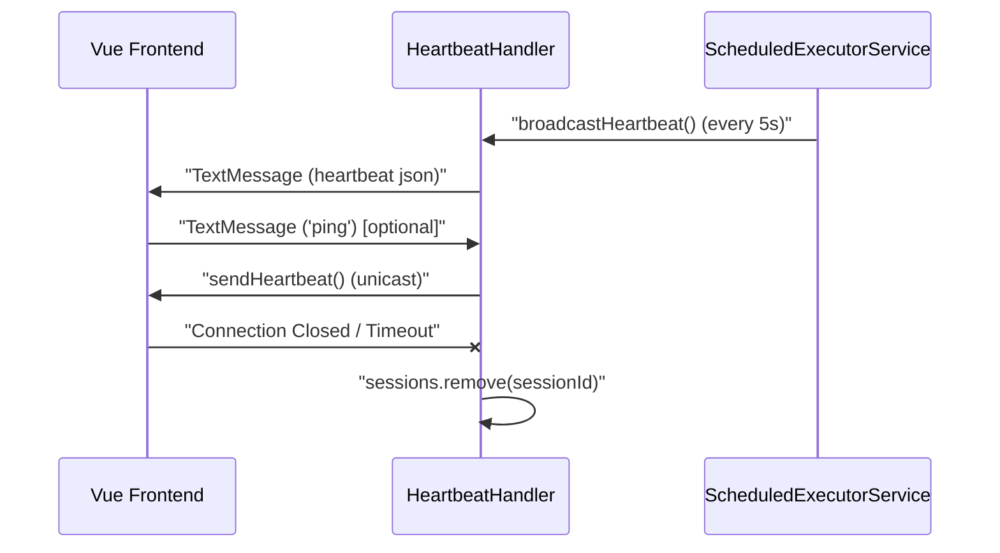

<!-- source: DeepWiki mcp.deepwiki.com · repo openJiuwen-ai/agent-memory · extra page Log Center and Ops Center · fetched 2026-11-02 -->

# Log Center and Ops Center

<details>
<summary>Relevant source files</summary>

The following files were used as context for generating this wiki page:

- [agent-memory-platform/platform/src/main/java/com/openjiuwen/memory/logcenter/controller/RuntimeLogController.java](agent-memory-platform/platform/src/main/java/com/openjiuwen/memory/logcenter/controller/RuntimeLogController.java)
- [agent-memory-platform/platform/src/main/java/com/openjiuwen/memory/logcenter/service/impl/LogStatsServiceImpl.java](agent-memory-platform/platform/src/main/java/com/openjiuwen/memory/logcenter/service/impl/LogStatsServiceImpl.java)
- [agent-memory-platform/platform/src/main/java/com/openjiuwen/memory/opscenter/service/impl/MemoryManageServiceImpl.java](agent-memory-platform/platform/src/main/java/com/openjiuwen/memory/opscenter/service/impl/MemoryManageServiceImpl.java)
- [agent-memory-platform/platform/src/main/java/com/openjiuwen/memory/opscenter/websocket/HeartbeatHandler.java](agent-memory-platform/platform/src/main/java/com/openjiuwen/memory/opscenter/websocket/HeartbeatHandler.java)

</details>


This page covers the architecture, controller implementations, and services for the **Log Center** and **Ops Center** within the `agent-memory-platform` Java Spring Boot backend. These modules handle runtime log streaming, file log management, log statistics, WebSocket heartbeat health monitoring, operational commands, and memory management services bridging the platform to the Python core engine.

---

## 1. Runtime and Message Log Controllers

The `agent-memory-platform` exposes log management through `RuntimeLogController`, bypassing local DB storage for runtime logs and instead querying the Python kernel engine directly via HTTP.

### Runtime Log Controller Implementation
`RuntimeLogController` provides endpoints for tailing runtime logs and listing or downloading log files from the kernel or platform storage [agent-memory-platform/platform/src/main/java/com/openjiuwen/memory/logcenter/controller/RuntimeLogController.java:37-152]().

*   `GET /api/v1/logs/runtime/tail`: Treads recent lines (`lines`, `level`, `event_type`, `source`). For `source=kernel`, it invokes `MemoryEngineClient.tailKernelLogs(...)`; for `source=platform`, it reads the local platform log via `PlatformLogReader` [agent-memory-platform/platform/src/main/java/com/openjiuwen/memory/logcenter/controller/RuntimeLogController.java:64-88]().
*   `GET /api/v1/logs/runtime/files`: Enumerates kernel or platform log files available for download, with optional date filtering (`start_date`, `end_date`) [agent-memory-platform/platform/src/main/java/com/openjiuwen/memory/logcenter/controller/RuntimeLogController.java:98-152]().

```mermaid
graph TD
    Client["Platform UI Client"] -->| "GET /api/v1/logs/runtime/tail" | RTC[RuntimeLogController]
    RTC -->| "source=kernel" | MEC[MemoryEngineClient]
    RTC -->| "source=platform" | PLR[PlatformLogReader]
    MEC -->| "HTTP /logs/tail" | PythonKernel["Python Memory Engine"]
    
    style RTC fill:none,stroke:#000,stroke-width:2px
    style MEC fill:none,stroke:#000,stroke-width:2px
    style PythonKernel fill:none,stroke:#000,stroke-width:2px
```
*Sources: [agent-memory-platform/platform/src/main/java/com/openjiuwen/memory/logcenter/controller/RuntimeLogController.java:37-152]()*.

---

## 2. Log Statistics Dashboard and Audit Filtering

The log statistics layer routes aggregate statistics based on log types via `LogStatsServiceImpl`.

### Log Stats Service
`LogStatsServiceImpl` implements `LogStatsService`, branching requests for `operations` and `messages` logs while explicitly rejecting `runtime` logs from database queries since runtime logs are transient and not stored in the relational database [agent-memory-platform/platform/src/main/java/com/openjiuwen/memory/logcenter/service/impl/LogStatsServiceImpl.java:19-81]().

```mermaid
graph TD
    LSS[LogStatsServiceImpl] -->| "logType=operations" | OLS[OperationLogService]
    LSS -->| "logType=messages" | MLS[MessageLogService]
    LSS -->| "logType=runtime" | Err[Throw IllegalArgumentException]
    
    style LSS fill:none,stroke:#000,stroke-width:2px
    style OLS fill:none,stroke:#000,stroke-width:2px
    style MLS fill:none,stroke:#000,stroke-width:2px
```
*Sources: [agent-memory-platform/platform/src/main/java/com/openjiuwen/memory/logcenter/service/impl/LogStatsServiceImpl.java:19-81]()*.

---

## 3. WebSocket Heartbeat Health Monitoring

Real-time connection monitoring and session maintenance are managed by `HeartbeatHandler`.

### Heartbeat Handler
`HeartbeatHandler` extends `TextWebSocketHandler` to maintain active client sessions, scheduling periodic heartbeats and cleaning up disconnected sessions [agent-memory-platform/platform/src/main/java/com/openjiuwen/memory/opscenter/websocket/HeartbeatHandler.java:36-175]().

*   **Scheduled Execution**: Uses a single-threaded scheduled executor to broadcast heartbeat JSON frames every 5,000 milliseconds (`HEARTBEAT_INTERVAL_MS`) [agent-memory-platform/platform/src/main/java/com/openjiuwen/memory/opscenter/websocket/HeartbeatHandler.java:40-57]().
*   **Session Lifecycle**: `afterConnectionEstablished` registers sessions and triggers an immediate heartbeat; `afterConnectionClosed` and IO exceptions remove stale sessions [agent-memory-platform/platform/src/main/java/com/openjiuwen/memory/opscenter/websocket/HeartbeatHandler.java:60-108]().


*Sources: [agent-memory-platform/platform/src/main/java/com/openjiuwen/memory/opscenter/websocket/HeartbeatHandler.java:36-175]()*.

---

## 4. Ops Commands and Memory Management Service

The `MemoryManageServiceImpl` bridges platform administrative interfaces to the underlying memory engine via `MemoryEngineClient`.

### Memory Management Service
`MemoryManageServiceImpl` implements `MemoryManageService`, performing permission checks (`permissionChecker.check(...)`), scope validations (`validateScopeAccess(...)`), and forwarding operations to the Python engine [agent-memory-platform/platform/src/main/java/com/openjiuwen/memory/opscenter/service/impl/MemoryManageServiceImpl.java:37-147]().

*   `list(...)`: Retrieves a paginated list of user memories, handling default scope fallback and null memory-type sanitization [agent-memory-platform/platform/src/main/java/com/openjiuwen/memory/opscenter/service/impl/MemoryManageServiceImpl.java:69-97]().
*   `detail(...)`: Locates specific memory items via page-based scanning [agent-memory-platform/platform/src/main/java/com/openjiuwen/memory/opscenter/service/impl/MemoryManageServiceImpl.java:99-127]().
*   `create(...)`: Injects messages and variables through `MemoryEngineClient.addMessages(...)` with feature-flag resolution [agent-memory-platform/platform/src/main/java/com/openjiuwen/memory/opscenter/service/impl/MemoryManageServiceImpl.java:129-147]().

```mermaid
graph TD
    MMS[MemoryManageServiceImpl] -->| "check permissions & scope" | PC[PermissionChecker]
    MMS -->| "resolve feature flags" | FFS[FeatureFlagService]
    MMS -->| "invoke client API" | MEC[MemoryEngineClient]
    MMS -->| "record change snapshot" | CML[MemoryChangeLogSnapshotMapper]
    
    style MMS fill:none,stroke:#000,stroke-width:2px
    style MEC fill:none,stroke:#000,stroke-width:2px
```
*Sources: [agent-memory-platform/platform/src/main/java/com/openjiuwen/memory/opscenter/service/impl/MemoryManageServiceImpl.java:37-147]().*

---

