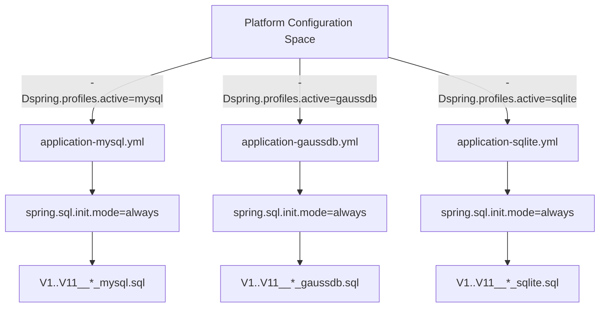
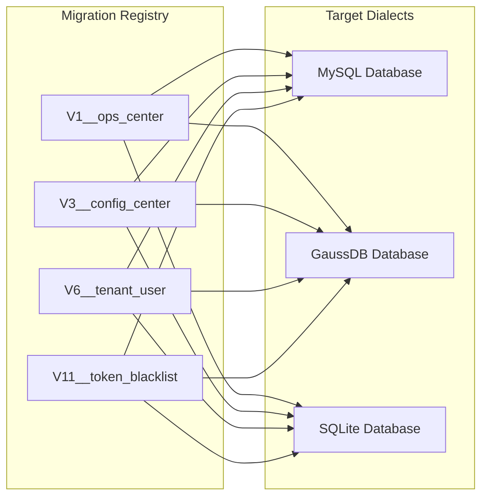
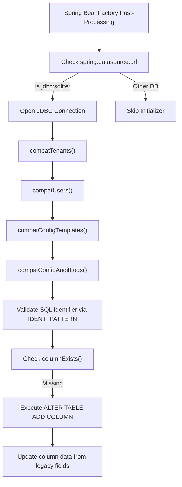
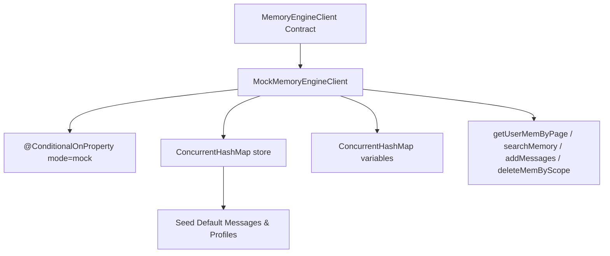

<!-- source: DeepWiki mcp.deepwiki.com · repo openJiuwen-ai/agent-memory · extra page Platform Persistence and Migrations · fetched 2026-11-02 -->

# Platform Persistence and Migrations

Relevant source files

The following files were used as context for generating this wiki page:

- [agent-memory-platform/platform/src/main/java/com/openjiuwen/memory/common/client/mock/MockMemoryEngineClient.java](agent-memory-platform/platform/src/main/java/com/openjiuwen/memory/common/client/mock/MockMemoryEngineClient.java)
- [agent-memory-platform/platform/src/main/java/com/openjiuwen/memory/common/config/SqliteSchemaCompatInitializer.java](agent-memory-platform/platform/src/main/java/com/openjiuwen/memory/common/config/SqliteSchemaCompatInitializer.java)
- [agent-memory-platform/platform/src/main/resources/application-gaussdb.yml](agent-memory-platform/platform/src/main/resources/application-gaussdb.yml)
- [agent-memory-platform/platform/src/main/resources/application-mysql.yml](agent-memory-platform/platform/src/main/resources/application-mysql.yml)
- [agent-memory-platform/platform/src/main/resources/application-sqlite.yml](agent-memory-platform/platform/src/main/resources/application-sqlite.yml)
- [agent-memory-platform/platform/src/main/resources/db/migration/V11__token_blacklist_init_mysql.sql](agent-memory-platform/platform/src/main/resources/db/migration/V11__token_blacklist_init_mysql.sql)

## Purpose and Scope
Section 5.1.3 covers the persistence infrastructure of the `agent-memory-platform` Java Spring Boot console. It manages database connections across multiple database dialects (MySQL, GaussDB, and SQLite), applies schema versioning and initialization scripts (simulating Flyway-style migrations via Spring SQL initialization), handles legacy SQLite schema upgrades dynamically through `SqliteSchemaCompatInitializer`, and offers an isolated fallback development engine via `MockMemoryEngineClient`.

---

## 1. Multi-Profile Database Configuration Architecture
The platform isolates environment-specific persistence configurations using Spring profiles (`mysql`, `gaussdb`, `sqlite`). Each profile specifies its own JDBC URL, driver class name, pool settings (HikariCP), and a ordered list of schema initialization scripts (`spring.sql.init.schema-locations`).

- **MySQL Profile**: Uses `com.mysql.cj.jdbc.Driver` with environment variable overrides for URL, user, and password [agent-memory-platform/platform/src/main/resources/application-mysql.yml:3-8]().
- **GaussDB Profile**: Uses `com.huawei.gaussdb.jdbc.Driver` with custom HikariCP sizing configurations [agent-memory-platform/platform/src/main/resources/application-gaussdb.yml:4-30]().
- **SQLite Profile**: Uses `org.sqlite.JDBC` targeting a local file database at `./data/platform.db` [agent-memory-platform/platform/src/main/resources/application-sqlite.yml:2-7]().

*Sources: [agent-memory-platform/platform/src/main/resources/application-mysql.yml:1-23](), [agent-memory-platform/platform/src/main/resources/application-gaussdb.yml:1-46](), [agent-memory-platform/platform/src/main/resources/application-sqlite.yml:1-22]()*

---

## 2. Database Migration Scripts and Versioning
Schema scripts are split by database dialect under `db/migration/`. Versioned scripts cover operational logs, task registries, governance, configuration centers, tenants, users, scope registries, and token blacklists. 

For instance, the token blacklist feature is initialized across dialects:
- MySQL script: `V11__token_blacklist_init_mysql.sql` [agent-memory-platform/platform/src/main/resources/db/migration/V11__token_blacklist_init_mysql.sql:1-15]()
- Equivalent scripts exist for SQLite and GaussDB.

All scripts adhere to idempotent DDL principles using `CREATE TABLE IF NOT EXISTS` clauses, allowing `spring.sql.init.mode=always` to safely run startup scripts repeatedly.

*Sources: [agent-memory-platform/platform/src/main/resources/application-mysql.yml:9-23](), [agent-memory-platform/platform/src/main/resources/application-gaussdb.yml:32-46](), [agent-memory-platform/platform/src/main/resources/application-sqlite.yml:8-22](), [agent-memory-platform/platform/src/main/resources/db/migration/V11__token_blacklist_init_mysql.sql:1-15]()*

---

## 3. SQLite Schema Compatibility Initializer
To support schema migrations on legacy SQLite databases without native full alter-table support in older schema iterations, `SqliteSchemaCompatInitializer` runs prior to Spring's SQL initialization phase.

### Key Components & Data Flow
- **Lifecycle Hook**: Implements `BeanFactoryPostProcessor` and `EnvironmentAware` [agent-memory-platform/platform/src/main/java/com/openjiuwen/memory/common/config/SqliteSchemaCompatInitializer.java:21]().
- **URL Check**: Intercepts initialization only if `spring.datasource.url` starts with `jdbc:sqlite:` [agent-memory-platform/platform/src/main/java/com/openjiuwen.memory.common.config/SqliteSchemaCompatInitializer.java:31-35]().
- **Table Patches**: Updates tables (`tenants`, `users`, `config_templates`, `config_audit_logs`) by invoking `addColumnIfMissing()` to append missing columns and backfill historical data [agent-memory-platform/platform/src/main/java/com/openjiuwen.memory.common.config/SqliteSchemaCompatInitializer.java:36-87]().
- **SQL Injection Defense**: Validates table and column identifiers against a strict regex pattern `IDENT_PATTERN` before executing DDL statements [agent-memory-platform/platform/src/main/java/com/openjiuwen.memory.common.config/SqliteSchemaCompatInitializer.java:103-134]().

*Sources: [agent-memory-platform/platform/src/main/java/com/openjiuwen.memory.common.config/SqliteSchemaCompatInitializer.java:20-134]()*

---

## 4. Mock Memory Engine Client
When the platform is operated in offline or decoupled testing modes, `MockMemoryEngineClient` replaces the remote Python memory service engine.

### Implementation Details
- **Conditional Activation**: Enabled via `@ConditionalOnProperty(prefix = "platform.memory-service", name = "mode", havingValue = "mock")` [agent-memory-platform/platform/src/main/java/com/openjiuwen.memory.common.client.mock/MockMemoryEngineClient.java:44-46]().
- **In-Memory State**: Maintains memory items and variables inside concurrent hash maps (`ConcurrentHashMap`) instead of binding to external ports or databases [agent-memory-platform/platform/src/main/java/com/openjiuwen.memory.common.client.mock/MockMemoryEngineClient.java:50-51]().
- **Seed Initialization**: Automatically seeds default records (`__default__` scope and user profiles) on instantiation to mirror real Python engine responses [agent-memory-platform/platform/src/main/java/com/openjiuwen.memory.common.client.mock/MockMemoryEngineClient.java:53-58]().
- **Interface Conformance**: Implements all methods defined in the `MemoryEngineClient` contract (such as `getUserMemByPage`, `searchMemory`, `addMessages`, and scoped deletion endpoints) to ensure zero frontend disruption when switching between real and mock modes [agent-memory-platform/platform/src/main/java/com/openjiuwen.memory.common.client.mock/MockMemoryEngineClient.java:46-162]().

*Sources: [agent-memory-platform/platform/src/main/java/com/openjiuwen.memory.common.client.mock/MockMemoryEngineClient.java:44-162]()*

---

