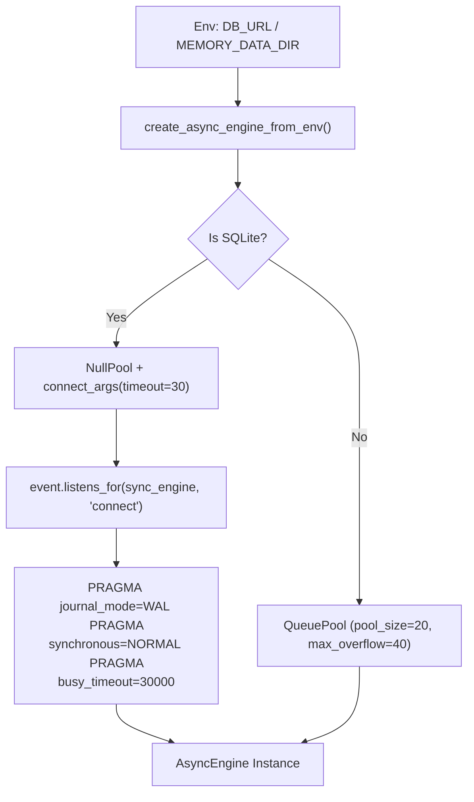
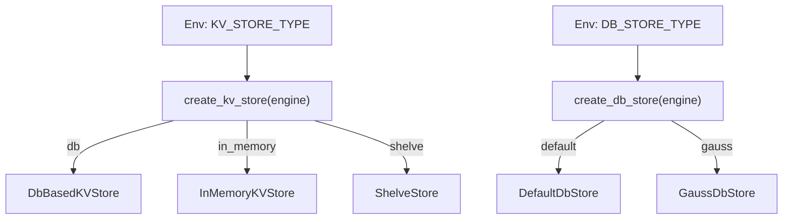
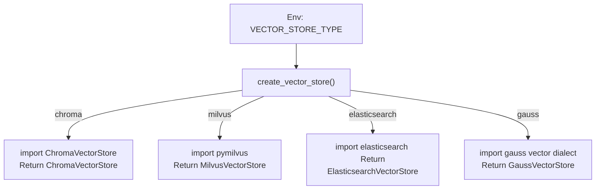

<!-- source: DeepWiki mcp.deepwiki.com · repo openJiuwen-ai/agent-memory · extra page Store Factory and Backend Selection · fetched 2026-11-02 -->

# Store Factory and Backend Selection

Relevant source files

The following files were used as context for generating this wiki page:

- [jiuwen_memory/foundation/store/base_kv_store.py](jiuwen_memory/foundation/store/base_kv_store.py)
- [jiuwen_memory/foundation/store/kv/in_memory_kv_store.py](jiuwen_memory/foundation/store/kv/in_memory_kv_store.py)
- [jiuwen_memory/foundation/store/kv/shelve_store.py](jiuwen_memory/foundation/store/kv/shelve_store.py)
- [jiuwen_memory/memory_core/common/distributed_lock.py](jiuwen_memory/memory_core/common/distributed_lock.py)
- [jiuwen_memory/memory_core/manage/mem_model/scope_user_mapping_manager.py](jiuwen_memory/memory_core/manage/mem_model/scope_user_mapping_manager.py)
- [jiuwen_memory/memory_core/manage/mem_model/sql_db_store.py](jiuwen_memory/memory_core/manage/mem_model/sql_db_store.py)
- [jiuwen_memory/memory_core/migration/migrator/memory_meta_manager.py](jiuwen_memory/memory_core/migration/migrator/memory_meta_manager.py)
- [jiuwen_memory/server/store_factory.py](jiuwen_memory/server/store_factory.py)
- [tests/unit_tests/core/memory/manage/mem_model/test_sql_db_store.py](tests/unit_tests/core/memory/manage/mem_model/test_sql_db_store.py)

The purpose of this page is to detail the environment-driven creation of engines, Key-Value (KV) stores, relational database (DB) stores, and vector stores within `jiuwen_memory`. It covers SQLite WAL tuning strategies for high concurrency, directory resolution rules, and lazy-import mechanisms that isolate optional third-party vector store dependencies.

---

## 1. Environment-Driven Engine Creation and SQLite WAL Tuning

The server initialization process relies on environment variables to construct the underlying SQLAlchemy asynchronous database engine. This is handled centrally by `create_async_engine_from_env()`, which sets up connection pooling and configures database dialects [jiuwen_memory/server/store_factory.py:48-115]().

Directories for memory data are resolved via `_data_dir()` (defaulting to `~/.jiuwenmemory/memory_data`) and `create_file_root_dir()` (defaulting to `~/.jiuwenmemory/file_memory_data`), ensuring explicit directory creation even if environment variables are left blank [jiuwen_memory/server/store_factory.py:20-45]().

When operating on SQLite, standard asynchronous configurations are insufficient for high-concurrency workloads. `create_async_engine_from_env()` applies critical SQLite configurations:
- Uses `poolclass = pool.NullPool` with aiosqlite [jiuwen_memory/server/store_factory.py:86-87]().
- Sets `connect_args={"timeout": 30, "check_same_thread": False}` to expand the writer lock wait threshold and bypass thread safety checks [jiuwen_memory/server/store_factory.py:83-85]().
- Registers a connection-level SQLite event listener that enforces `PRAGMA journal_mode=WAL`, `PRAGMA synchronous=NORMAL`, and `PRAGMA busy_timeout=30000` on every new connection [jiuwen_memory/server/store_factory.py:101-114]().

*Sources: [jiuwen_memory/server/store_factory.py:20-115]()*

---

## 2. KV Store and DB Store Factories

The system abstracts storage instantiation behind factory functions that parse environment configurations.

- **KV Store Factory**: `create_kv_store(engine)` reads `KV_STORE_TYPE` (supporting `db`, `in_memory`, and `shelve`) [jiuwen_memory/server/store_factory.py:118-144](). The `db` type instantiates `DbBasedKVStore` bound to the shared `AsyncEngine`, `in_memory` uses `InMemoryKVStore` [jiuwen_memory/foundation/store/kv/in_memory_kv_store.py:18](), and `shelve` instantiates `ShelveStore` [jiuwen_memory/foundation/store/kv/shelve_store.py:30]() with `KV_SHELVE_PATH`.
- **DB Store Factory**: `create_db_store(engine)` reads `DB_STORE_TYPE` (supporting `default` and `gauss`) [jiuwen_memory/server/store_factory.py:147-168](). It returns either `DefaultDbStore` or `GaussDbStore`.

*Sources: [jiuwen_memory/server/store_factory.py:118-168](), [jiuwen_memory/foundation/store/kv/in_memory_kv_store.py:18-21](), [jiuwen_memory/foundation/store/kv/shelve_store.py:30-48]()*

---

## 3. Lazy Imports and Vector Store Backend Selection

To prevent third-party dependency bloat (such as `pymilvus` or `elasticsearch`) from breaking core startup when unused, `create_vector_store()` uses lazy imports [jiuwen_memory/server/store_factory.py:170-184](). 

The function inspects `VECTOR_STORE_TYPE` and imports the specific vector store module on demand. If a package is missing, only the selected execution branch fails, ensuring default deployments using `chroma` start cleanly.

*Sources: [jiuwen_memory/server/store_factory.py:170-184]()*

---

## 4. Execution Integration with SqlDbStore

Once the database engine and store abstractions are generated by the factory methods, they are wrapped by high-level data managers such as `SqlDbStore`, which handles dialect-specific upserts and atomic operations for metadata and scope mappings [jiuwen_memory/memory_core/manage/mem_model/sql_db_store.py:21-68]().

| Component | Code Entity | Role |
| :--- | :--- | :--- |
| Store Factory | `jiuwen_memory.server.store_factory` | Parses environment variables to provision engines, KV, DB, and vector stores [jiuwen_memory/server/store_factory.py:1-184]() |
| Database Abstraction | `jiuwen_memory.foundation.store.base_db_store.BaseDbStore` | Base contract for relational storage backends [jiuwen_memory/foundation/store/base_db_store.py:1](). |
| SQL Wrapper | `jiuwen_memory.memory_core.manage.mem_model.sql_db_store.SqlDbStore` | Provides dialect-aware `write()` and `insert_or_update()` operations [jiuwen_memory/memory_core/manage/mem_model/sql_db_store.py:21-168]() |
| Metadata Manager | `jiuwen_memory.memory_core.migration.migrator.memory_meta_manager.MemoryMetaManager` | Manages schema version tracking tables using `SqlDbStore` [jiuwen_memory/memory_core/migration/migrator/memory_meta_manager.py:7-46]() |

*Sources: [jiuwen_memory/server/store_factory.py:1-184](), [jiuwen_memory/memory_core/manage/mem_model/sql_db_store.py:21-168](), [jiuwen_memory/memory_core/migration/migrator/memory_meta_manager.py:7-46]()*

---

