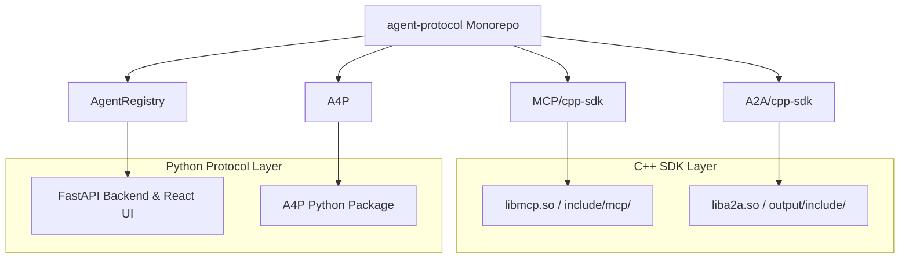
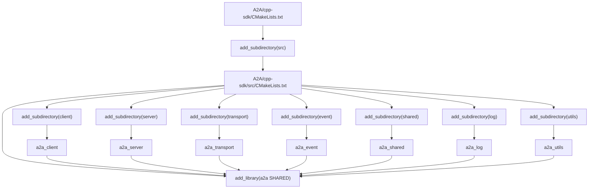

<!-- source: DeepWiki mcp.deepwiki.com · repo openJiuwen-ai/agent-protocol · page 1.1 Repository Layout · fetched 2026-11-02 -->

# Repository Layout

Relevant source files

The following files were used as context for generating this wiki page:

- [A2A/cpp-sdk/CMakeLists.txt](A2A/cpp-sdk/CMakeLists.txt)
- [A2A/cpp-sdk/README.md](A2A/cpp-sdk/README.md)
- [A2A/cpp-sdk/src/CMakeLists.txt](A2A/cpp-sdk/src/CMakeLists.txt)
- [A2A/cpp-sdk/src/transport/http_server_transport.cpp](A2A/cpp-sdk/src/transport/http_server_transport.cpp)
- [MCP/cpp-sdk/README.md](MCP/cpp-sdk/README.md)
- [README.md](README.md)

## Purpose and Scope
This page maps the top-level directories of the `agent-protocol` monorepo to their respective subsystems, implementation languages, and build systems. It serves as a structural reference for navigating the codebase, understanding dependency boundaries, and locating core build targets across the C++ and Python components (`MCP/`, `A2A/`, `AgentRegistry/`, and `A4P/`).

Sources: [`README.md:1-15]()`, [`MCP/cpp-sdk/README.md:1-24]()`, [`A2A/cpp-sdk/README.md:1-22]()`

---

## Top-Level Directory Mapping

The monorepo is organized into four primary product folders alongside top-level documentation and assets. Each subsystem utilizes distinct toolchains and build orchestrators.

| Top-Level Directory | Subsystem Description | Implementation Language | Build System / Package Manager | Key Artifacts / Targets |
| :--- | :--- | :--- | :--- | :--- |
| `MCP/cpp-sdk/` | Model Context Protocol C++ SDK (Server/Client, stdio, Streamable HTTP) | C++17 | CMake (`≥ 3.15`) | `libmcp.so`, `output/lib/` |
| `A2A/cpp-sdk/` | Agent-to-Agent Protocol C++ SDK (HTTP + JSON-RPC, SSE, Agent Cards) | C++17 | CMake (`≥ 3.15`) | `liba2a.so`, `output/bin/*` |
| `AgentRegistry/` | A2X Agent and Service Registry (FastAPI, hierarchical search, React/Vite UI) | Python / TypeScript | Python Poetry / pip, Vite | FastAPI backend, Web UI bundle |
| `A4P/` | Agentic Authentication, Authorization, and Audit Protocol SDK | Python | Python setuptools / pip | `a4p` Python package |

Sources: [`README.md:9-14]()`, [`MCP/cpp-sdk/README.md:33-51]()`, [`A2A/cpp-sdk/README.md:33-39]()`

---

## Subsystem Architecture & Build Systems

### 1. Model Context Protocol (MCP) C++ SDK (`MCP/cpp-sdk/`)
* **Subsystem**: Implements client and server capabilities for the Model Context Protocol, supporting `stdio` and `Streamable HTTP` transports.
* **Build System**: Managed via top-level and module-level `CMakeLists.txt` files, driven by wrapper scripts like `scripts/build.sh`.
* **Dependencies**: Relies on `OpenSSL` (TLS/crypto), `libcurl` (HTTP client), `libevent` (event loop), `http_parser`, and `nlohmann_json` (JSON serialization). Prefers system packages, falling back to local fetching under `third_party/`.

Sources: [`MCP/cpp-sdk/README.md:17-51]()`, [`MCP/cpp-sdk/README.md:157-196]()`

### 2. Agent2Agent Protocol (A2A) C++ SDK (`A2A/cpp-sdk/`)
* **Subsystem**: Implements v1.0 of the Agent-to-Agent specification, offering asynchronous connection engines via `libcurl`, Server-Sent Events (SSE) streaming via `StreamServerEmitter`, and JSON-RPC message dispatching.
* **Build System**: Orchestrated via CMake (`A2A/cpp-sdk/CMakeLists.txt`) with subdirectories compiled into object libraries and linked into a unified shared library target `a2a` (`A2A/cpp-sdk/src/CMakeLists.txt`).
* **Modular Targets**: Components are segmented into `a2a_client`, `a2a_server`, `a2a_transport`, `a2a_event`, `a2a_shared`, `a2a_log`, and `a2a_utils`.

Sources: [`A2A/cpp-sdk/README.md:15-39]()`, [`A2A/cpp-sdk/src/CMakeLists.txt:1-43]()`, [`A2A/cpp-sdk/CMakeLists.txt:1-66]()`

### 3. A2X Agent Registry (`AgentRegistry/`)
* **Subsystem**: Provides a hierarchical service catalog and agent search engine using FastAPI. It includes LLM-driven navigation tools, peer-to-peer cluster synchronization (merkle sync), token-based authorization modules, and a React/Vite web dashboard with D3.js visualizations.
* **Build System**: Python package management tooling paired with Node.js/Vite build steps for the frontend interface.

Sources: [`README.md:12-13]()`

### 4. A4P Python SDK (`A4P/`)
* **Subsystem**: Implements Agentic Authentication, Authorization, and Audit Protocols. Provides two-phase execution models (`prepare`/`complete`), intent mandates, quota tracking, Ed25519/WebAuthn cryptographic signatures, and SQLite persistence layers.
* **Build System**: Standard Python setuptools configuration.

Sources: [`README.md:14]()`

---

## Structural & Code Entity Mapping Diagrams

### Monorepo Top-Level Structure to Subsystem Entities
The following diagram connects natural language subsystem descriptions to concrete directories and core targets in the codebase.

Sources: [`README.md:1-15]()`, [`MCP/cpp-sdk/README.md:188-195]()`, [`A2A/cpp-sdk/src/CMakeLists.txt:3-52]()`

### A2A C++ SDK Modular Build Architecture
The diagram below maps the source directories and target objects that compose the `a2a` shared library build specification.

Sources: [`A2A/cpp-sdk/CMakeLists.txt:1-28]()`, [`A2A/cpp-sdk/src/CMakeLists.txt:3-42]()`

---

