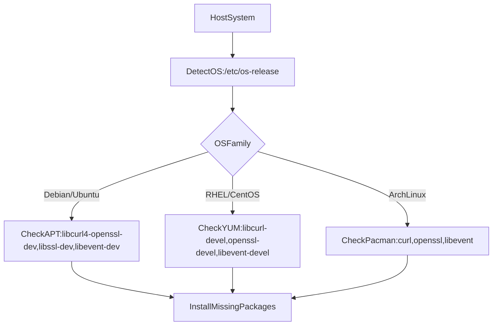
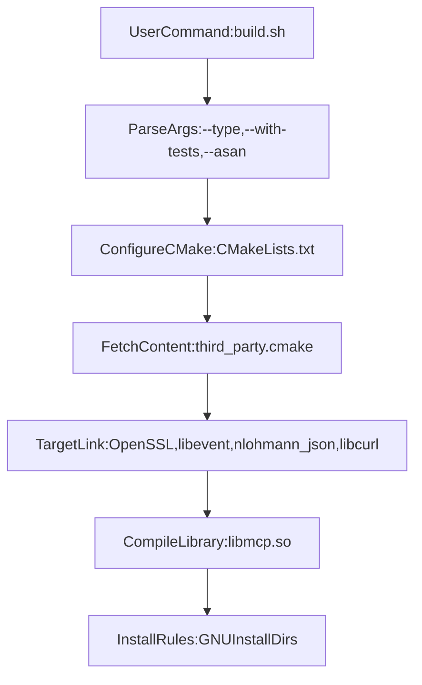

<!-- source: DeepWiki mcp.deepwiki.com · repo openJiuwen-ai/agent-protocol · page 1.2 Getting Started · fetched 2026-11-02 -->

# Getting Started

<details>
<summary>Relevant source files</summary>

The following files were used as context for generating this wiki page:

- [A2A/cpp-sdk/scripts/install_deps.sh](A2A/cpp-sdk/scripts/install_deps.sh)
- [MCP/cpp-sdk/.gitignore](MCP/cpp-sdk/.gitignore)
- [MCP/cpp-sdk/CMakeLists.txt](MCP/cpp-sdk/CMakeLists.txt)
- [MCP/cpp-sdk/scripts/build.sh](MCP/cpp-sdk/scripts/build.sh)
- [MCP/cpp-sdk/scripts/install_deps.sh](MCP/cpp-sdk/scripts/install_deps.sh)

</details>


## Purpose and Scope
This document covers the build and installation procedures for the C++ SDKs (`mcp_cpp` and `yellow_a2a`) and Python packages within the `agent-protocol` repository. It details system dependency requirements, installation helper scripts, `CMake` configuration options, compilation flags, sanitizers, and verification steps via examples and test suites.

---

## 1. System Dependencies and Installation Scripts
Both C++ SDKs provide automated helper scripts (`install_deps.sh`) to detect host operating systems (Debian/Ubuntu, RHEL/CentOS/Fedora, and Arch Linux) and provision missing development headers and libraries.

### A2A Dependency Script (`install_deps.sh`)
The A2A C++ SDK script verifies system packages for `libevent`, `nlohmann_json`, `http_parser`, `libcurl`, and `OpenSSL` [A2A/cpp-sdk/scripts/install_deps.sh:58-202](). It inspects package databases using `dpkg -l`, `rpm -q`, or `pacman -Q` and checks standard include paths (`/usr/include/event2/event.h`, `/usr/include/nlohmann/json.hpp`) [A2A/cpp-sdk/scripts/install_deps.sh:33-56]().

### MCP Dependency Script (`install_deps.sh`)
The MCP C++ SDK script focuses on provisioning secure transport requirements, verifying `libcurl` development packages and `OpenSSL` headers (`openssl/ssl.h`) [MCP/cpp-sdk/scripts/install_deps.sh:33-154]().


*Figure 1: Dependency Installation Data Flow*

Sources: [A2A/cpp-sdk/scripts/install_deps.sh:13-202](), [MCP/cpp-sdk/scripts/install_deps.sh:15-219]()

---

## 2. CMake Build Options and Configuration
The MCP C++ SDK root `CMakeLists.txt` exposes several configuration switches to tailor builds for clients, servers, HTTP transport, unit tests, and code coverage [MCP/cpp-sdk/CMakeLists.txt:8-16]().

### Configuration Options Table

| CMake Option | Default | Description |
| :--- | :---: | :--- |
| `MCP_ENABLE_TESTS` | `OFF` | Build unit test suites (`tests/ut`) [MCP/cpp-sdk/CMakeLists.txt:8]() |
| `MCP_ENABLE_EXAMPLES` | `OFF` | Enable example compilation hints [MCP/cpp-sdk/CMakeLists.txt:9]() |
| `MCP_ENABLE_COVERAGE` | `OFF` | Enable GCC/Clang code coverage instrumentation (`-fprofile-arcs -ftest-coverage`) [MCP/cpp-sdk/CMakeLists.txt:10,31-40]() |
| `MCP_BUILD_CLIENT` | `ON` | Build MCP client components [MCP/cpp-sdk/CMakeLists.txt:14]() |
| `MCP_BUILD_SERVER` | `ON` | Build MCP server components [MCP/cpp-sdk/CMakeLists.txt:15]() |
| `MCP_WITH_HTTP` | `ON` | Build HTTP client transport components and link `CURL::libcurl` [MCP/cpp-sdk/CMakeLists.txt:16,24-26]() |
| `MCP_ENABLE_ST_TESTS` | `OFF` | Build ST integration tests (`tests/ut/st`) [MCP/cpp-sdk/CMakeLists.txt:12]() |

### Security Hardening and Compiler Flags
The build system enforces strict compilation flags, including stack protection, fortify source, position-independent code (`-fPIC`), and linker-level security hardening (`-Wl,-z,noexecstack,-z,relro,-z,now`) [MCP/cpp-sdk/CMakeLists.txt:28,44,56,68]().


*Figure 2: C++ SDK Build Pipeline*

Sources: [MCP/cpp-sdk/CMakeLists.txt:1-180](), [MCP/cpp-sdk/scripts/build.sh:20-226]()

---

## 3. Unified Build Script (`build.sh`)
The `mcp_cpp` build orchestrator (`scripts/build.sh`) simplifies cross-platform compilation by managing parallel job counts, build directories, and sanitizers [MCP/cpp-sdk/scripts/build.sh:3-226]().

### Common Invocation Patterns
* **Release Build (Core Library Only):**
  ```bash
  ./scripts/build.sh
  ```
* **Debug Build with Unit Tests and AddressSanitizer (ASAN):**
  ```bash
  ./scripts/build.sh --type Debug --with-tests --asan
  ```
* **Code Coverage Instrumentation:**
  ```bash
  ./scripts/build.sh --coverage
  ```
* **Component-specific Compilation (No HTTP transport):**
  ```bash
  ./scripts/build.sh --no-http
  ```

Sources: [MCP/cpp-sdk/scripts/build.sh:1-226]()

---

## 4. Python Package Installation and Extras
Python components within the `agent-protocol` repository (such as `A4P Python SDK` and `A2X Agent Registry`) rely on standard Python packaging conventions. 

* **Package Installation:** Navigate to the specific component directory (`A4P/` or `AgentRegistry/`) and install via `pip`:
  ```bash
  pip install -e .
  ```
* **Development Extras:** Install test and development dependencies:
  ```bash
  pip install -e ".[dev,test]"
  ```

Sources: [AgentRegistry/](() ), [A4P/](() )

---

## 5. Running Examples and Verification
Once built, components can be verified using the provided example harnesses and unit test suites.

* **MCP Examples and Test Execution:**
  Examples are located under respective example directories and can be launched using integration harnesses. Unit tests are executed via CTest when `MCP_ENABLE_TESTS=ON`:
  ```bash
  cd build && ctest --output-on-failure
  ```

Sources: [MCP/cpp-sdk/CMakeLists.txt:8,139-142](), [MCP/cpp-sdk/scripts/build.sh:215-220]()

---

