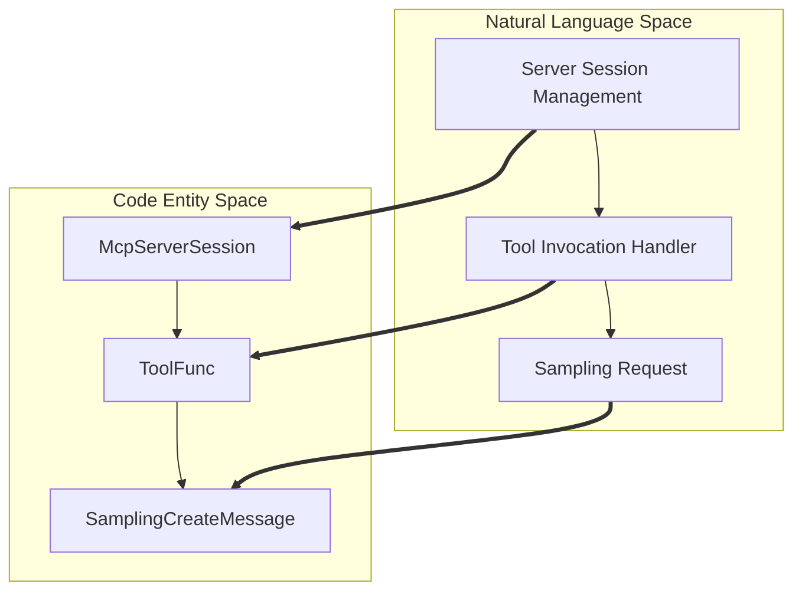
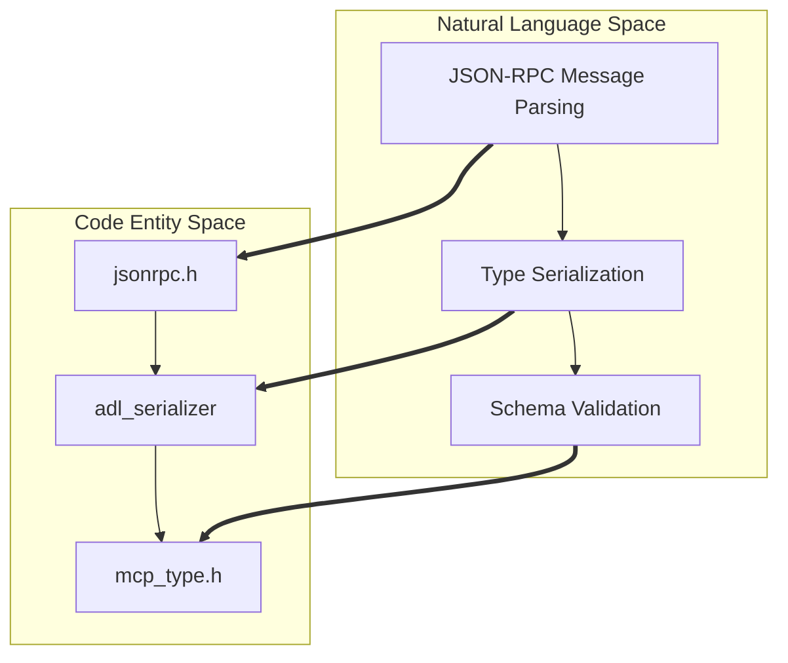

<!-- source: DeepWiki mcp.deepwiki.com · repo openJiuwen-ai/agent-protocol · page 2 MCP C++ SDK · fetched 2026-11-02 -->

# MCP C++ SDK

Relevant source files

The following files were used as context for generating this wiki page:

- [MCP/cpp-sdk/README.md](MCP/cpp-sdk/README.md)
- [MCP/cpp-sdk/include/mcp/mcp_server.h](MCP/cpp-sdk/include/mcp/mcp_server.h)

The MCP C++ SDK provides a complete C++ implementation of the [Model Context Protocol](https://modelcontextprotocol.io/) [MCP/cpp-sdk/README.md:19](). It enables developers to build robust MCP clients and servers supporting both **Streamable HTTP** and **stdio** transport layers [MCP/cpp-sdk/README.md:19](), with built-in primitives for tools, prompts, resources, sampling, and progress notifications [MCP/cpp-sdk/README.md:21-23] [MCP/cpp-sdk/include/mcp/mcp_server.h:80-97](). 

As a parent page, this document provides a high-level overview of the SDK architecture. For deeper technical details, consult the respective child pages linked throughout.

Sources: `MCP/cpp-sdk/README.md:1-24`, `MCP/cpp-sdk/include/mcp/mcp_server.h:1-97`

---

## 2.1. MCP Server Implementation

The server-side SDK centers around session management, method routing, and capability negotiation. The `McpServerSession` interface defines the core server-to-client operations, such as triggering list-changed notifications (`SendToolListChangedNotification`), querying client roots (`ListRoots`), and issuing sampling requests (`SamplingCreateMessage`) [MCP/cpp-sdk/include/mcp/mcp_server.h:75-97](). 

For full implementation details, method routing internals, and capability validation, see [MCP Server Implementation](#2.1).

*Figure 1: Mapping natural language server operations to C++ classes.*

Sources: `MCP/cpp-sdk/include/mcp/mcp_server.h:75-97`

### 2.1.1. Tool, Prompt and Resource Managers

Servers expose capabilities via dedicated manager registries. Tools are registered with schemas and optional annotations using structures like `AddToolOptionalParams` [MCP/cpp-sdk/include/mcp/mcp_server.h:28-36]() and invoked through `ToolFunc`, which supports both synchronous execution returning `ToolReturn` and asynchronous execution via `ServerContext` response callbacks [MCP/cpp-sdk/include/mcp/mcp_server.h:102-160](). Similar configuration structs exist for prompts (`AddPromptOptionalParams`) and resources (`AddResourceOptionalParams`) [MCP/cpp-sdk/include/mcp/mcp_server.h:41-58]().

For detailed mechanics on tool registration, listing, and resource subscription semantics, see [MCP Server Implementation](#2.1).

Sources: `MCP/cpp-sdk/include/mcp/mcp_server.h:28-160`

### 2.1.2. ServerManager and Concurrency

Handling concurrent requests across multiple client connections requires sophisticated worker thread pools, multi-producer single-consumer (`MPSC`) queues, and `eventfd`-based notifications. The `ServerManager` coordinates stateless versus stateful request handling and integrates custom authentication hooks.

For concurrency models, worker pool topologies, and session routing, see [MCP Server Implementation](#2.1).

Sources: `MCP/cpp-sdk/README.md:19-24`, `MCP/cpp-sdk/include/mcp/mcp_server.h:102-107`

---

## 2.2. MCP Protocol Types and JSON-RPC Layer

The protocol layer bridges raw JSON payloads with strongly-typed C++ data structures. Defined largely within `mcp_type.h`, `jsonrpc.h`, and `jsonrpc.cpp`, this layer implements `nlohmann::json` `adl_serializer` mappings, schema validation routines, and content block abstractions.

*Figure 2: Protocol message structures and JSON serialization bindings.*

For a full catalog of message classes, adl mappings, and schema definitions, see [MCP Protocol Types and JSON-RPC Layer](#2.2).

Sources: `MCP/cpp-sdk/README.md:48`, `MCP/cpp-sdk/include/mcp/mcp_server.h:18`

---

## 2.3. MCP Transports

The SDK decouples protocol message handling from underlying network and I/O mechanisms through abstract transport interfaces. It provides:
- **Stdio Transport**: For local, subprocess-based agent communication via standard input/output.
- **Streamable HTTP Transport**: For networked client-server communication utilizing non-blocking I/O, event loops (`libevent`), and HTTP framing.

For details on framing strategies, non-blocking descriptors, and the event system, see [MCP Transports](#2.3).

Sources: `MCP/cpp-sdk/README.md:19`, `MCP/cpp-sdk/README.md:49`

---

## 2.4. MCP Examples and Tests

To assist developers, the SDK ships with a suite of functional examples and test harness scripts. These include `server_example`, specialized tool/prompt/resource client examples, script automation (`run_example.sh`), and a comprehensive GoogleTest-based unit test suite located under `tests/ut` [MCP/cpp-sdk/README.md:111-143], [MCP/cpp-sdk/README.md:212-217]().

For instructions on compiling and executing example end-to-end flows and test trees, see [MCP Examples and Tests](#2.4).

Sources: `MCP/cpp-sdk/README.md:111-143`, `MCP/cpp-sdk/README.md:212-217`

---

