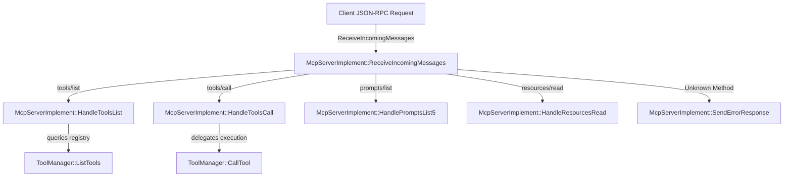

<!-- source: DeepWiki mcp.deepwiki.com · repo openJiuwen-ai/agent-protocol · page 2.1 MCP Server Implementation · fetched 2026-11-02 -->

# MCP Server Implementation

<details>
<summary>Relevant source files</summary>

The following files were used as context for generating this wiki page:

- [MCP/cpp-sdk/src/server/mcp_server_implement.cpp](MCP/cpp-sdk/src/server/mcp_server_implement.cpp)
- [MCP/cpp-sdk/src/server/mcp_server_implement.h](MCP/cpp-sdk/src/server/mcp_server_implement.h)
- [MCP/cpp-sdk/src/shared/common_type.h](MCP/cpp-sdk/src/shared/common_type.h)
- [MCP/cpp-sdk/src/shared/message_queue/lock_free_queue.h](MCP/cpp-sdk/src/shared/message_queue/lock_free_queue.h)

</details>


## Purpose and Scope

This page covers the core server implementation of the Model Context Protocol (MCP) C++ SDK. The primary component discussed is `McpServerImplement`, which manages the server lifecycle, handles incoming JSON-RPC message routing, validates capabilities, and coordinates request dispatch across specialized domain managers. 

As a parent page, this section provides a high-level architectural overview. For deep technical details on tool, prompt, and resource management, see [Tool, Prompt and Resource Managers](#2.1.1). For concurrency models, worker thread pools, and queue mechanics, see [ServerManager and Concurrency](#2.1.2).

Sources:
- `MCP/cpp-sdk/src/server/mcp_server_implement.h` [MCP/cpp-sdk/src/server/mcp_server_implement.h:1-109]()
- `MCP/cpp-sdk/src/server/mcp_server_implement.cpp` [MCP/cpp-sdk/src/server/mcp_server_implement.cpp:1-193]()

---

## Server Lifecycle and State Machine

The `McpServerImplement` class inherits from `McpServer` and manages server initialization, running state transitions, and clean termination [MCP/cpp-sdk/src/server/mcp_server_implement.h:37-44](). The server operates under three distinct states defined by `ServerState`: `INIT`, `RUNNING`, and `STOPPED` [MCP/cpp-sdk/src/server/mcp_server_implement.h:30-34]().

During construction, configuration parameters such as `ServerConfig` and `StreamableHttpServerConfig` are validated [MCP/cpp-sdk/src/server/mcp_server_implement.h:39-40, 88-91](). Invoking `Run()` transitions the server into `ServerState::RUNNING` [MCP/cpp-sdk/src/server/mcp_server_implement.h:43](), activating transport listeners and worker thread infrastructure managed by `ServerManager` [MCP/cpp-sdk/src/server/mcp_server_implement.h:98](). Calling `Stop()` terminates active session listeners and transitions the state to `ServerState::STOPPED` [MCP/cpp-sdk/src/server/mcp_server_implement.h:44]().

### Server Lifecycle State Transition Diagram

```mermaid
graph TD
    Init["ServerState::INIT"] -->|Run() called & ValidateConfig() succeeds| Running["ServerState::RUNNING"]
    Running -->|Stop() called| Stopped["ServerState::STOPPED"]
    Init -->|Stop() called| Stopped
```
Sources:
- `MCP/cpp-sdk/src/server/mcp_server_implement.h` [MCP/cpp-sdk/src/server/mcp_server_implement.h:30-48]()
- `MCP/cpp-sdk/src/server/mcp_server_implement.cpp` [MCP/cpp-sdk/src/server/mcp_server_implement.cpp:31-35]()

---

## JSON-RPC Method Routing Layer

Incoming transport messages are received and processed by `McpServerImplement::ReceiveIncomingMessages(...)`, which inspects the JSON-RPC `request.method_` field and dispatches the payload to the corresponding handler function [MCP/cpp-sdk/src/server/mcp_server_implement.cpp:39-105](). 

Request IDs and session contexts are tracked in active sessions (`ServerRequestContext`) [MCP/cpp-sdk/src/server/mcp_server_implement.cpp:39-48](). If a method does not match any known route, an error response with `JsonRpcErrorCode::METHOD_NOT_FOUND` is dispatched via `SendErrorResponse(...)` [MCP/cpp-sdk/src/server/mcp_server_implement.cpp:100]().

The core routing table maps JSON-RPC methods to implementation functions:
- `tools/list` $\rightarrow$ `HandleToolsList` [MCP/cpp-sdk/src/server/mcp_server_implement.cpp:51-54]()
- `tools/call` $\rightarrow$ `HandleToolsCall` [MCP/cpp-sdk/src/server/mcp_server_implement.cpp:55-58]()
- `prompts/list` $\rightarrow$ `HandlePromptsList` [MCP/cpp-sdk/src/server/mcp_server_implement.cpp:59-62]()
- `prompts/get` $\rightarrow$ `HandlePromptsGet` [MCP/cpp-sdk/src/server/mcp_server_implement.cpp:63-66]()
- `resources/list` $\rightarrow$ `HandleResourcesList` [MCP/cpp-sdk/src/server/mcp_server_implement.cpp:67-70]()
- `resources/read` $\rightarrow$ `HandleResourcesRead` [MCP/cpp-sdk/src/server/mcp_server_implement.cpp:71-74]()
- `resources/subscribe` $\rightarrow$ `HandleResourcesSubscribe` [MCP/cpp-sdk/src/server/mcp_server_implement.cpp:75-78]()
- `resources/unsubscribe` $\rightarrow$ `HandleResourcesUnsubscribe` [MCP/cpp-sdk/src/server/mcp_server_implement.cpp:79-82]()
- `resources/templates/list` $\rightarrow$ `HandleResourcesTemplatesList` [MCP/cpp-sdk/src/server/mcp_server_implement.cpp:83-86]()
- `logging/setLevel` $\rightarrow$ `HandleSetLoggingLevel` [MCP/cpp-sdk/src/server/mcp_server_implement.cpp:87-90]()
- `ping` $\rightarrow$ `HandlePing` [MCP/cpp-sdk/src/server/mcp_server_implement.cpp:91-94]()
- `completion/complete` $\rightarrow$ `HandleComplete` [MCP/cpp-sdk/src/server/mcp_server_implement.cpp:95-98]()

### Method Routing Architecture


Sources:
- `MCP/cpp-sdk/src/server/mcp_server_implement.cpp` [MCP/cpp-sdk/src/server/mcp_server_implement.cpp:39-105]()

---

## Domain Managers and Coordination

`McpServerImplement` delegates capability handling to specialized subsystem managers stored as member variables:
- `toolManager_` (`ToolManager`): Handles tool registration, parameter parsing, listing, and synchronous/asynchronous execution [MCP/cpp-sdk/src/server/mcp_server_implement.h:100]().
- `promptManager_` (`PromptManager`): Manages prompt templates and rendering handlers [MCP/cpp-sdk/src/server/mcp_server_implement.h:101]().
- `resourceManager_` (`ResourceManager`): Manages static resources, URI templates, read callbacks, and subscriptions [MCP/cpp-sdk/src/server/mcp_server_implement.h:102]().
- `serverManager_` (`ServerManager`): Manages transport sessions, worker thread dispatch, and asynchronous response callbacks [MCP/cpp-sdk/src/server/mcp_server_implement.h:98]().

### Child Page References
- For details on registration, listing, invocation, and subscription semantics, see [Tool, Prompt and Resource Managers](#2.1.1).
- For details on worker thread pools, MPSC/lock-free queues, eventfd notifications, and session routing, see [ServerManager and Concurrency](#2.1.2).

Sources:
- `MCP/cpp-sdk/src/server/mcp_server_implement.h` [MCP/cpp-sdk/src/server/mcp_server_implement.h:98-105]()
- `MCP/cpp-sdk/src/server/mcp_server_implement.cpp` [MCP/cpp-sdk/src/server/mcp_server_implement.cpp:125-189]()

---

