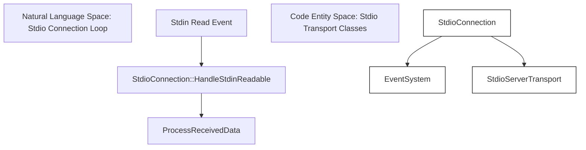
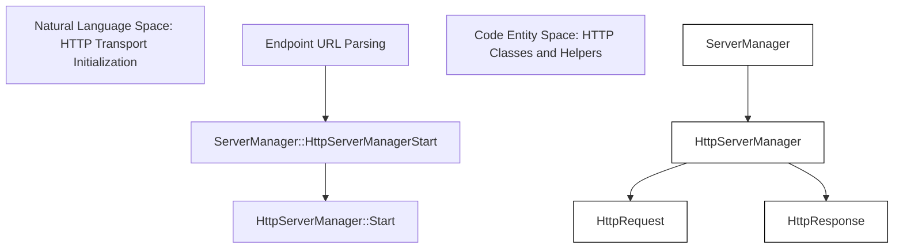

<!-- source: DeepWiki mcp.deepwiki.com · repo openJiuwen-ai/agent-protocol · page 2.3 MCP Transports · fetched 2026-11-02 -->

# MCP Transports

<details>
<summary>Relevant source files</summary>

The following files were used as context for generating this wiki page:

- [MCP/cpp-sdk/src/CMakeLists.txt](MCP/cpp-sdk/src/CMakeLists.txt)
- [MCP/cpp-sdk/src/server/server_manager.cpp](MCP/cpp-sdk/src/server/server_manager.cpp)
- [MCP/cpp-sdk/src/shared/http_common.h](MCP/cpp-sdk/src/shared/http_common.h)
- [MCP/cpp-sdk/src/transport/stdio_transport.cpp](MCP/cpp-sdk/src/transport/stdio_transport.cpp)

</details>


## Purpose and Scope

This page details the transport layer implementations within the Model Context Protocol (MCP) C++ SDK. It covers both local process communication via Stdio transport and remote/network communication via Streamable HTTP transport. It documents wire framing, non-blocking I/O operations, event system integration, and common HTTP protocol definitions shared across client-server interactions.

Sources: `[MCP/cpp-sdk/src/transport/stdio_transport.cpp:1-241]`, `[MCP/cpp-sdk/src/shared/http_common.h:1-186]`, `[MCP/cpp-sdk/src/server/server_manager.cpp:34-155]()`

---

## Stdio Transport and Framing

The Stdio transport mechanism manages bidirectional communication over standard input and standard output (or via a managed subprocess pipe). It is encapsulated by the `StdioConnection` class, which operates in a non-blocking asynchronous loop driven by an underlying event framework.


*Diagram 1: Stdio transport components mapping logical read loops to `StdioConnection` and `EventSystem` entities.*

Sources: `[MCP/cpp-sdk/src/transport/stdio_transport.cpp:40-125]()`

### Non-Blocking I/O and File Descriptors
When establishing a connection, `StdioConnection::Listen()` or `StdioConnection::Connect()` configures `STDIN_FILENO` and `STDOUT_FILENO` with the `O_NONBLOCK` flag using `fcntl()`:

```cpp
fcntl(STDIN_FILENO, F_SETFL, O_NONBLOCK);
fcntl(STDOUT_FILENO, F_SETFL, O_NONBLOCK);
```

Read events are registered into the event loop via `EventSystem::AddEvent()`, listening for `EventType::READ | EventType::PERSIST` [MCP/cpp-sdk/src/transport/stdio_transport.cpp:69-71]().

### Framing and Message Buffering
Incoming bytes from stdin are accumulated in `readBuffer_` inside `StdioConnection::HandleStdinReadable()` [MCP/cpp-sdk/src/transport/stdio_transport.cpp:229-241](). The transport relies on message framing boundaries (typically newline-delimited JSON-RPC messages) to parse complete payloads out of `readBuffer_` before dispatching them to message-received callbacks. 

Outgoing messages pass through `StdioConnection::SendMessage()`, which pushes data to a write queue (`writeQueue_`) protected by a `std::mutex` and triggers asynchronous write event handling via `EnableWriteEvent()` [MCP/cpp-sdk/src/transport/stdio_transport.cpp:175-189]().

Sources: `[MCP/cpp-sdk/src/transport/stdio_transport.cpp:40-241]()`

---

## Streamable HTTP Transport and `http_common`

For network-attached topologies, the SDK implements Streamable HTTP transport, supporting standard HTTP requests/responses alongside Server-Sent Events (SSE) for asynchronous streaming.


*Diagram 2: Streamable HTTP initialization mapping string endpoints to `ServerManager` and `HttpServerManager` objects.*

Sources: `[MCP/cpp-sdk/src/server/server_manager.cpp:54-141]()`, `[MCP/cpp-sdk/src/shared/http_common.h:112-137]()`

### Endpoint Parsing and Routing
`ServerManager::HttpServerManagerStart()` parses the endpoint string (formatted as `http://{host}:{port}/{uri}`) using regular expressions to extract host, port, and route URI paths [MCP/cpp-sdk/src/server/server_Manager.cpp:73-119](). Extracted components populate an `Http::HttpServerManagerConfig` structure, registering route handlers that map incoming HTTP requests to worker thread dispatchers (`DispatchRequest`) [MCP/cpp-sdk/src/server/server_manager.cpp:121-131]().

### `http_common.h` Definitions
The header `[MCP/cpp-sdk/src/shared/http_common.h]()` establishes shared protocol types, constants, and utilities used by both client and server HTTP components:

| Category | Symbols / Constants | Description |
| :--- | :--- | :--- |
| **HTTP Headers** | `MCP_SESSION_ID_HEADER`, `MCP_PROTOCOL_VERSION_HEADER` | Custom headers for MCP session identification and protocol versioning (`[MCP/cpp-sdk/src/shared/http_common.h:26-27]()`). |
| **Content Types** | `CONTENT_TYPE_JSON`, `CONTENT_TYPE_SSE` | Standard MIME types for JSON payloads and Server-Sent Events (`[MCP/cpp-sdk/src/shared/http_common.h:41-42]()`). |
| **SSE Struct** | `ServerSentEvent` | Holds event name, ID, data string, and retry attributes (`[MCP/cpp-sdk/src/shared/http_common.h:84-97]()`). |
| **Messages** | `HttpRequest`, `HttpResponse` | Structs representing HTTP request and response envelopes (`[MCP/cpp-sdk/src/shared/http_common.h:112-137]()`). |

### Endpoint Validation
URL strings are validated via `IsValidStreamableHttpEndpoint()`, ensuring adherence to `http://` or `https://` schemes, valid port boundaries `[1, 65535]`, and rejection of malformed hosts or illegal characters `[MCP/cpp-sdk/src/shared/http_common.h:172-182]()`.

Sources: `[MCP/cpp-sdk/src/server/server_manager.cpp:54-141]()`, `[MCP/cpp-sdk/src/shared/http_common.h:20-184]()`

---

## Event System and Concurrency Integration

Transports integrate tightly with the SDK's internal event notification and concurrency models. Stdio connections operate a dedicated background loop via `EventSystem::Start(true)` [MCP/cpp-sdk/src/transport/stdio_transport.cpp:80](), whereas HTTP servers operate multi-threaded worker pools managed inside `ServerManager` [MCP/cpp-sdk/src/server/server_manager.cpp:40-48]() and `[MCP/cpp-sdk/src/server/server_manager.cpp:163-180]()`.

When `ServerManager` initializes for network operations, it provisions per-thread event systems (`EventSystem`) paired with lock-safe queues and thread worker names (`MCP-Worker-{id}`) to process incoming requests concurrently without blocking I/O poll loops [MCP/cpp-sdk/src/server/server_manager.cpp:40-48]().

Sources: `[MCP/cpp-sdk/src/transport/stdio_transport.cpp:79-81]()`, `[MCP/cpp-sdk/src/server/server_manager.cpp:40-48]()`

---

