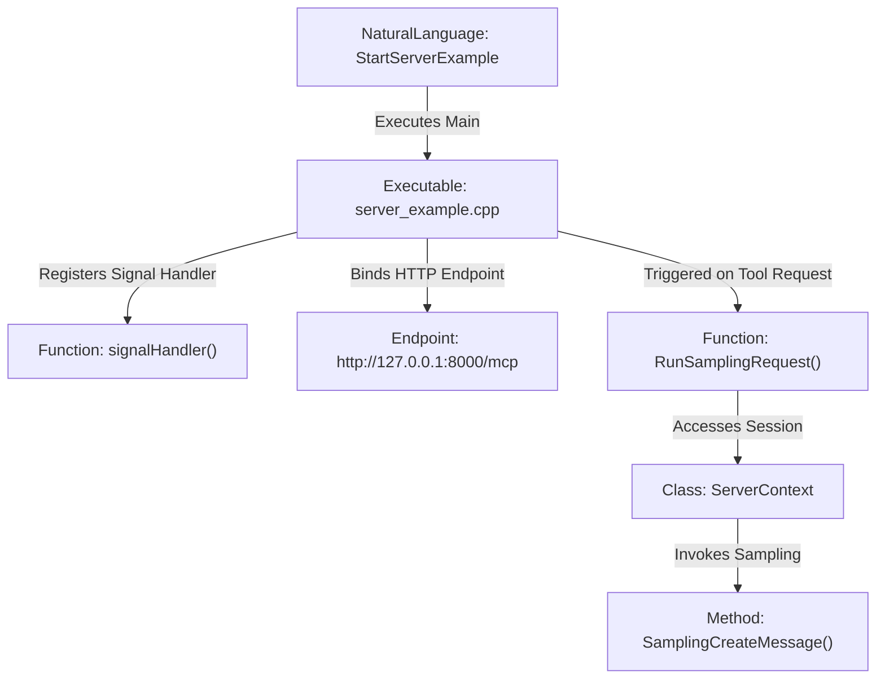
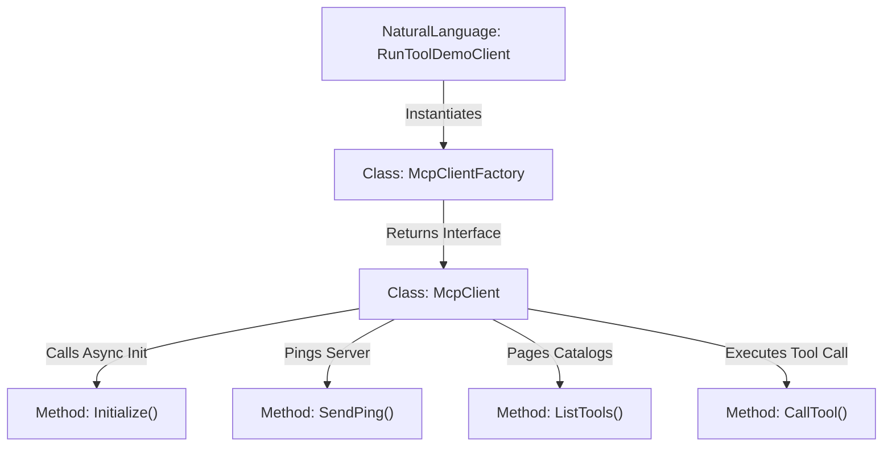
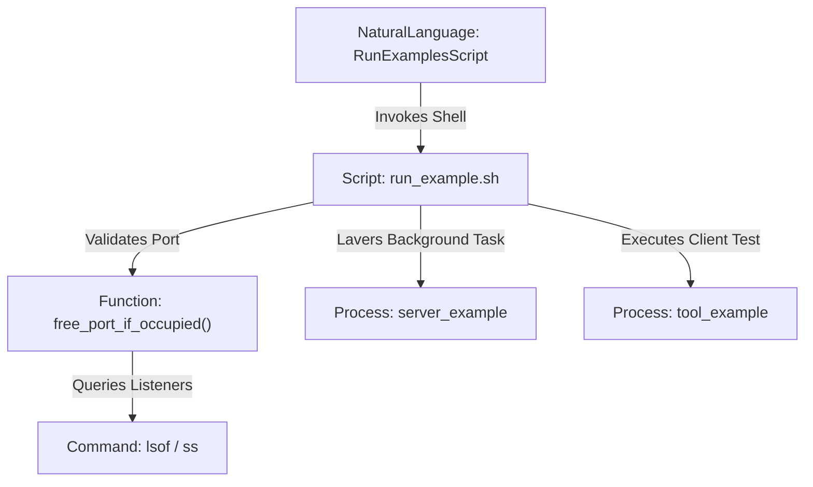
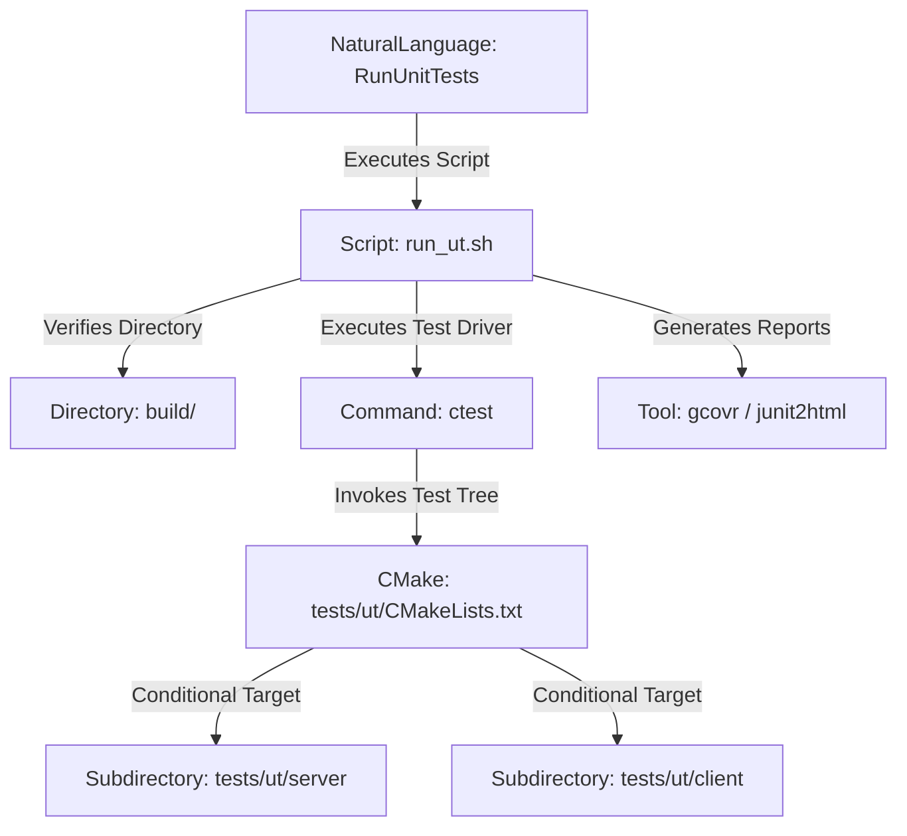

<!-- source: DeepWiki mcp.deepwiki.com · repo openJiuwen-ai/agent-protocol · page 2.4 MCP Examples and Tests · fetched 2026-11-02 -->

# MCP Examples and Tests

Relevant source files

The following files were used as context for generating this wiki page:

- [MCP/cpp-sdk/example/client_example/tool_example/tool_example.cpp](MCP/cpp-sdk/example/client_example/tool_example/tool_example.cpp)
- [MCP/cpp-sdk/example/server_example/server_example.cpp](MCP/cpp-sdk/example/server_example/server_example.cpp)
- [MCP/cpp-sdk/scripts/run_example.sh](MCP/cpp-sdk/scripts/run_example.sh)
- [MCP/cpp-sdk/scripts/run_ut.sh](MCP/cpp-sdk/scripts/run_ut.sh)
- [MCP/cpp-sdk/tests/CMakeLists.txt](MCP/cpp-sdk/tests/CMakeLists.txt)
- [MCP/cpp-sdk/tests/ut/CMakeLists.txt](MCP/cpp-sdk/tests/ut/CMakeLists.txt)

## Purpose and Scope
This page details the implementation, data flow, and execution harnesses for the Model Context Protocol (MCP) C++ SDK examples (`server_example` and client examples such as `tool_example`), the automation script `run_example.sh`, and the unit test framework anchored by `tests/CMakeLists.txt` and `tests/ut/CMakeLists.txt`. These artifacts serve both as integration validation suites and as developer references for building custom MCP servers and clients.

---

## 1. Reference Server and Client Examples

The `example` directory provides complete reference applications demonstrating how to instantiate MCP components, handle JSON-RPC messaging, register tools/prompts/resources, and process asynchronous operations or sampling.

### Server Example Architecture
The server example (`TestMCPServer`) configures an HTTP streamable transport endpoint with thread pools, auth verification, and dynamic handler registration.

*   **Initialization and Signal Handling**: The server sets up signal handlers (`signalHandler`) for `SIGINT` and `SIGTERM` to coordinate graceful shutdowns [MCP/cpp-sdk/example/server_example/server_example.cpp:63-69] using control flags (`stopFlag`) [MCP/cpp-sdk/example/server_example/server_example.cpp:26]. Logging is redirected via file callbacks (`FileLogCallback`) [MCP/cpp-sdk/example/server_example/server_example.cpp:72-80].
*   **Server Constants**: Defines worker thread counts, server metadata (`SERVER_NAME`, `SERVER_VERSION`), endpoints (`ENDPOINT`, `AUTH_ENDPOINT`), and security validation scopes (`VALID_TOKEN`, `REQUIRED_SCOPES`) [MCP/cpp-sdk/example/server_example/server_example.cpp:28-62].
*   **Sampling Integration**: Implements client-to-server and server-to-client sampling loops where tools can request text generation from the client session via `ServerContext` (`RunSamplingRequest`, `BuildSamplingParams`, `ExtractTextContentFromResult`) [MCP/cpp-sdk/example/server_example/server_example.cpp:84-180].

*Sources: `MCP/cpp-sdk/example/server_example/server_example.cpp`*

### Tool Client Example
The tool client example demonstrates client initialization, protocol ping checks, paginated tool discovery, and tool execution with progress callbacks.

*   **Client Configuration**: Configures `Mcp::ClientConfig` and `Mcp::StreamableHttpClientConfig` pointing to local test endpoints without TLS [MCP/cpp-sdk/example/client_example/tool_example/tool_example.cpp:27-34].
*   **Initialization & Ping**: Establishes session state asynchronously using `mcpClient->Initialize()` and checks liveness via `mcpClient->SendPing()` [MCP/cpp-sdk/example/client_example/tool_example/tool_example.cpp:37-69].
*   **Paginated Listing & Execution**: Iterates through tool catalogs using cursor-based pagination via `mcpClient->ListTools(cursor)` [MCP/cpp-sdk/example/client_example/tool_example/tool_example.cpp:71-99] and invokes tools with optional progress handlers using `mcpClient->CallTool(...)` [MCP/cpp-sdk/example/client_example/tool_example/tool_example.cpp:101-157].

*Sources: `MCP/cpp-sdk/example/client_example/tool_example/tool_example.cpp`*

---

## 2. Example Runner Harness (`run_example.sh`)

The script `run_example.sh` automates the compilation, background server management, port conflict resolution, and client test execution lifecycle.

*   **Master Log & FIFO Setup**: Sets up master log redirection (`setup_master_log`) using named pipes (`mkfifo`) and background `tee` processes to capture stdout and stderr concurrently [MCP/cpp-sdk/scripts/run_example.sh:18-43].
*   **Port Management**: Inspects listening ports via `lsof` or `ss` utilities (`get_listening_pids_by_port`) and provides automated port release mechanisms (`free_port_if_occupied`) when forced termination (`--force-kill-port`) is enabled [MCP/cpp-sdk/scripts/run_example.sh:84-141].
*   **Execution Modes**: Accepts command-line parameters (`-t`, `--type`) to target specific components (`all`, `server`, `client`, `tool`, `prompt`, `resource`, `sampling`) [MCP/cpp-sdk/scripts/run_example.sh:147-234].

*Sources: `MCP/cpp-sdk/scripts/run_example.sh`*

---

## 3. Unit Testing Infrastructure and CMake Tree

The unit testing framework is managed through a hierarchical CMake setup and executed via coverage-enabled test harness scripts.

### GoogleTest Dependency Management
The top-level test configuration located in `tests/CMakeLists.txt` locates existing system GoogleTest installations or dynamically fetches GoogleTest (`v1.16.0`) via `FetchContent` while enforcing shared runtime configurations (`gtest_force_shared_crt`) [MCP/cpp-sdk/tests/CMakeLists.txt:1-33].

### Unit Test Subdirectory Routing (`tests/ut/CMakeLists.txt`)
The `tests/ut/CMakeLists.txt` script conditionally includes subdirectories based on compiled feature flags (`MCP_WITH_HTTP`, `MCP_BUILD_CLIENT`, `MCP_BUILD_SERVER`, `MCP_ENABLE_STDIO`, `MCP_ENABLE_ST_TESTS`):

*   Core modules: `event`, `auth`, `net`, `shared`, `log` [MCP/cpp-sdk/tests/ut/CMakeLists.txt:1-10].
*   Transport and Protocol modules: `transport`, `client`, `server`, `stdio`, `http` [MCP/cpp-sdk/tests/ut/CMakeLists.txt:5-41].
*   System Integration tests: `st` (enabled via `MCP_ENABLE_ST_TESTS`) [MCP/cpp-sdk/tests/ut/CMakeLists.txt:43-48].

### Coverage and Test Execution Harness (`run_ut.sh`)
The test runner script `run_ut.sh` automates environment verification, dependency resolution (`gcovr`, `junit2html`), ctest execution, and HTML coverage report generation [MCP/cpp-sdk/scripts/run_ut.sh:20-188].

*Sources: `MCP/cpp-sdk/tests/CMakeLists.txt`, `MCP/cpp-sdk/tests/ut/CMakeLists.txt`, `MCP/cpp-sdk/scripts/run_ut.sh`*

---

