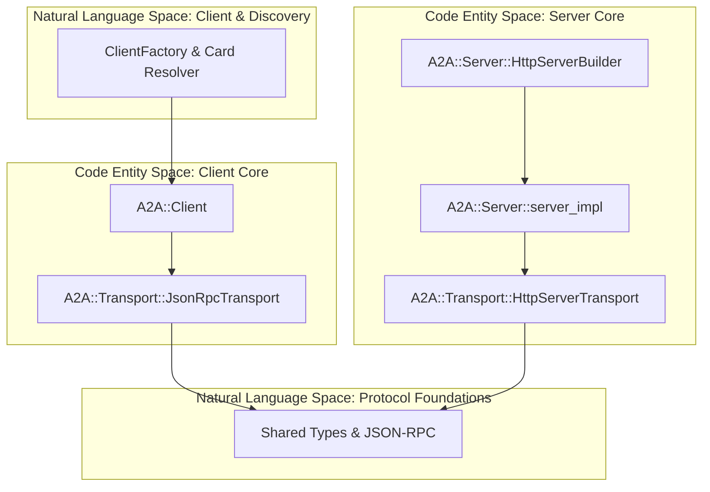
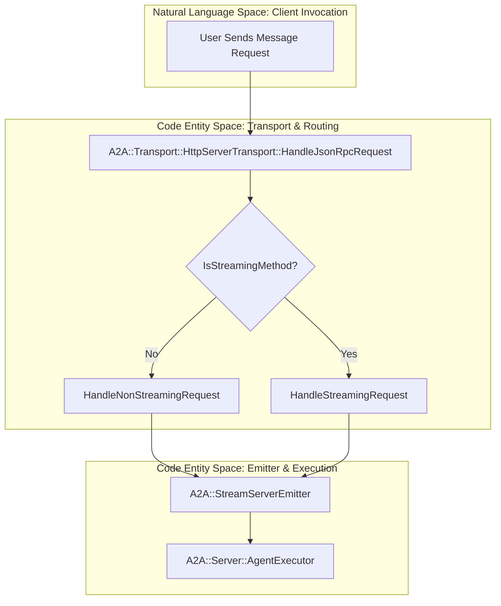

<!-- source: DeepWiki mcp.deepwiki.com · repo openJiuwen-ai/agent-protocol · page 3 A2A C++ SDK · fetched 2026-11-02 -->

# A2A C++ SDK

Relevant source files

The following files were used as context for generating this wiki page:

- [A2A/cpp-sdk/CMakeLists.txt](A2A/cpp-sdk/CMakeLists.txt)
- [A2A/cpp-sdk/README.md](A2A/cpp-sdk/README.md)
- [A2A/cpp-sdk/include/types.h](A2A/cpp-sdk/include/types.h)
- [A2A/cpp-sdk/src/CMakeLists.txt](A2A/cpp-sdk/src/CMakeLists.txt)
- [A2A/cpp-sdk/src/transport/http_server_transport.cpp](A2A/cpp-sdk/src/transport/http_server_transport.cpp)

The **A2A C++ SDK** is a high-performance C++ implementation of the Agent-to-Agent (A2A) protocol v1.0 (`[A2A/cpp-sdk/README.md:17-17]()`). It provides robust client and server infrastructure to support multi-agent communication over HTTP combined with JSON-RPC messaging (`[A2A/cpp-sdk/README.md:17-18]()`). The SDK compiles into a modular shared library (`liba2a.so`) managed via CMake (`[A2A/cpp-sdk/src/CMakeLists.txt:3-42]()`, `[A2A/cpp-sdk/README.md:126-130]()`).

This parent page provides a high-level summary of the build configuration, core modules (Client, Server, Transport, Shared Types), and test harnesses. For deep technical implementation details, consult the designated child pages:
- [A2A Server Side](#3.1)
- [A2A Client Side](#3.2)
- [A2A Shared Types and Messaging Utilities](#3.3)
- [A2A Examples, Smoke Tests and Unit Tests](#3.4)

---

### A2A SDK Component Architecture

*Sources: `[A2A/cpp-sdk/src/CMakeLists.txt:9-25]()`, `[A2A/cpp-sdk/src/transport/http_server_transport.cpp:47-85]()`*

---

## 3.1 A2A Server Side

The server-side subsystem exposes agent capabilities over HTTP and JSON-RPC endpoints. It centers around `HttpServerBuilder` and `server_impl`, providing the `AgentExecutor` and `TaskUpdater` contracts to govern task lifecycles, artifact generation, and helper utilities. The underlying transport layer (`HttpServerTransport`) handles incoming requests and supports Server-Sent Events (SSE) streaming for real-time task updates.

For detailed architecture, interface definitions, and state machine transitions, see [A2A Server Side](#3.1).

*Sources: `[A2A/cpp-sdk/src/CMakeLists.txt:17-25]()`, `[A2A/cpp-sdk/src/transport/http_server_transport.cpp:47-94]()`*

---

## 3.2 A2A Client Side

The client-side subsystem handles remote agent discovery, card resolution, and execution requests. Key components include the client factory, card resolvers (`a2a_card_resolver.h`), protocol version interceptors (`client_call_interceptor.h`), and a libcurl-based asynchronous connection engine (`client.h`) that parses SSE data streams via `jsonrpc_transport.h`.

For detailed API usage and connection lifecycle handling, see [A2A Client Side](#3.2).

*Sources: `[A2A/cpp-sdk/src/CMakeLists.txt:9-15]()`, `[A2A/cpp-sdk/src/CMakeLists.txt:75-86]()`*

---

## 3.3 A2A Shared Types and Messaging Utilities

Protocol data structures are defined across `types.h` and `common_types.h`, mapping directly to the JSON-RPC wire format (`[A2A/cpp-sdk/include/types.h:18-21]()`). Key entities include `Role`, `Part`, `Artifact`, `Task`, `Message`, and `TaskState` (`[A2A/cpp-sdk/include/types.h:32-168]()`). These are supported by jsonrpc serialization mappings (`jsonrpc.h`), HTTP constants (`http_common.h`), and message-building helpers (`utils_message`).

For comprehensive data layouts and helper function references, see [A2A Shared Types and Messaging Utilities](#3.3).

*Sources: `[A2A/cpp-sdk/include/types.h:1-235]()`*

---

## 3.4 A2A Examples, Smoke Tests and Unit Tests

The SDK provides ready-to-run examples (`helloworld_server`, `helloworld_client`, `streaming_server`, and `streaming_client`) alongside the `run_example.sh` automated smoke test harness (`[A2A/cpp-sdk/README.md:140-172]()`). Additionally, modular unit test suites (`tests/ut`) validate components like the client factory, card resolvers, and server builder under CMake configuration options (`[A2A/cpp-sdk/CMakeLists.txt:11-13]`, `[A2A/cpp-sdk/CMakeLists.txt:82-85]()`).

For instructions on executing tests, manual debugging, and reviewing smoke harnesses, see [A2A Examples, Smoke Tests and Unit Tests](#3.4).

*Sources: `[A2A/cpp-sdk/README.md:136-200]()`, `[A2A/cpp-sdk/CMakeLists.txt:8-13]()`*

---

### Request Execution Pipeline

*Sources: `[A2A/cpp-sdk/src/transport/http_server_transport.cpp:115-140]()`*

---

### Build Targets and Configuration

The A2A C++ SDK build configuration supports modular feature selection through standard CMake options (`[A2A/cpp-sdk/CMakeLists.txt:8-13]()`):

| CMake Option | Default | Description |
| :--- | :--- | :--- |
| `A2A_BUILD_CLIENT` | `ON` | Compiles client-side modules (`a2a_client` object library) `[A2A/cpp-sdk/src/CMakeLists.txt:9-15]()` |
| `A2A_BUILD_SERVER` | `ON` | Compiles server-side and transport modules (`a2a_server`, `a2a_transport`) `[A2A/cpp-sdk/src/CMakeLists.txt:17-25]()` |
| `A2A_ENABLE_EXAMPLES` | `OFF` | Compiles example binaries (`helloworld_*`, `streaming_*`) `[A2A/cpp-sdk/CMakeLists.txt:10-10]()` |
| `A2A_ENABLE_TESTS` | `OFF` | Enables unit testing targets via CTest `[A2A/cpp-sdk/CMakeLists.txt:11-11]()` |
| `A2A_ENABLE_COVERAGE` | `OFF` | Instruments code coverage flags (`--coverage`) `[A2A/cpp-sdk/CMakeLists.txt:12-18]()` |

*Sources: `[A2A/cpp-sdk/CMakeLists.txt:8-23]`, `[A2A/cpp-sdk/src/CMakeLists.txt:3-25]()`*

---

