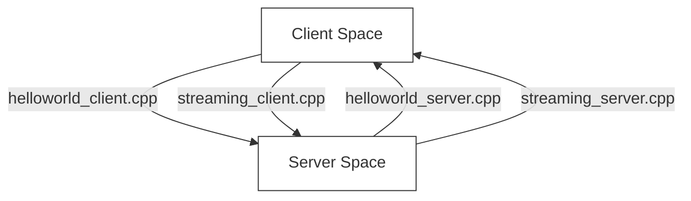
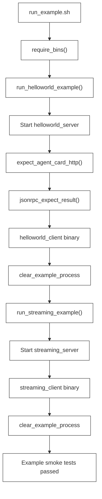

<!-- source: DeepWiki mcp.deepwiki.com · repo openJiuwen-ai/agent-protocol · page 3.4 A2A Examples, Smoke Tests and Unit Tests · fetched 2026-11-02 -->

# A2A Examples, Smoke Tests and Unit Tests

Relevant source files

The following files were used as context for generating this wiki page:

- [A2A/cpp-sdk/examples/helloworld_client.cpp](A2A/cpp-sdk/examples/helloworld_client.cpp)
- [A2A/cpp-sdk/examples/helloworld_server.cpp](A2A/cpp-sdk/examples/helloworld_server.cpp)
- [A2A/cpp-sdk/examples/streaming_client.cpp](A2A/cpp-sdk/examples/streaming_client.cpp)
- [A2A/cpp-sdk/examples/streaming_server.cpp](A2A/cpp-sdk/examples/streaming_server.cpp)
- [A2A/cpp-sdk/scripts/run_example.sh](A2A/cpp-sdk/scripts/run_example.sh)
- [A2A/cpp-sdk/tests/ut/client/test_client_factory.cpp](A2A/cpp-sdk/tests/ut/client/test_client_factory.cpp)
- [A2A/cpp-sdk/tests/ut/client/test_http_card_resolver.cpp](A2A/cpp-sdk/tests/ut/client/test_http_card_resolver.cpp)
- [A2A/cpp-sdk/tests/ut/client/test_http_card_resolver_build.cpp](A2A/cpp-sdk/tests/ut/client/test_http_card_resolver_build.cpp)
- [A2A/cpp-sdk/tests/ut/server/test_http_server_builder.cpp](A2A/cpp-sdk/tests/ut/server/test_http_server_builder.cpp)

This page details the reference examples (`helloworld` and `streaming` server/client pairs), the automated smoke test harness (`run_example.sh`), and the Google Test unit test suites covering the client factory, card resolvers, and server builder within the A2A C++ SDK.

---

## 1. Reference Examples: HelloWorld and Streaming

The A2A C++ SDK provides complete, runnable reference examples demonstrating basic request-response messaging as well as complex multi-turn orchestration with streaming task updates and artifacts.

### HelloWorld Server and Client
The `helloworld_server.cpp` defines a subclass of `A2A::Server::AgentExecutor` named `MyAgentExecutor` [A2A/cpp-sdk/examples/helloworld_server.cpp:44-90](). When a request arrives, `Execute()` is invoked, calling `taskUpdater->StartWork()` [A2A/cpp-sdk/examples/helloworld_server.cpp:52](), parsing input text parts, and returning a processed text message via `taskUpdater->SendResponseMessage()` [A2A/cpp-sdk/examples/helloworld_server.cpp:81](). The server is instantiated via `A2A::Server::HttpServerBuilder::Build()` [A2A/cpp-sdk/examples/helloworld_server.cpp:182-188]().

The `helloworld_client.cpp` uses `A2A::Client::HttpCardResolverBuilder` to fetch the agent card from `/.well-known/agent-card.json` [A2A/cpp-sdk/examples/helloworld_client.cpp:109-112]() and creates a client instance using `A2A::Client::ClientFactory::Create()` [A2A/cpp-sdk/examples/helloworld_client.cpp:128](). It then dispatches a message containing text and JSON data parts [A2A/cpp-sdk/examples/helloworld_client.cpp:135-147]() and waits on a condition variable via a callback handler [A2A/cpp-sdk/examples/helloworld_client.cpp:150-179]().

### Streaming Server and Client
The `streaming_server.cpp` implements `OrchestratorAgentExecutor` [A2A/cpp-sdk/examples/streaming_server.cpp:23-156](). It simulates a multi-step orchestration workflow (e.g., calling flight services and weather services) by pushing incremental task updates and task artifacts [A2A/cpp-sdk/examples/streaming_server.cpp:54-85]() before sending the final completion state [A2A/cpp-sdk/examples/streaming_server.cpp:93]().

The `streaming_client.cpp` configures a streaming-enabled client (`cfg.streaming = true`) [A2A/cpp-sdk/examples/streaming_client.cpp:107-110](), registers a global event consumer [A2A/cpp-sdk/examples/streaming_client.cpp:153-156](), and sends a trip-planning payload [A2A/cpp-sdk/examples/streaming_client.cpp:158-169]() alongside a `ClientCallContext` containing a session ID [A2A/cpp-sdk/examples/streaming_client.cpp:171-175]().

*(Diagram 1: Natural Language Space to Code Entity Space mapping for reference client-server examples)*

Sources:
- `A2A/cpp-sdk/examples/helloworld_server.cpp`
- `A2A/cpp-sdk/examples/streaming_server.cpp`
- `A2A/cpp-sdk/examples/helloworld_client.cpp`
- `A2A/cpp-sdk/examples/streaming_client.cpp`

---

## 2. Smoke Test Harness (`run_example.sh`)

The integration smoke test script `run_example.sh` orchestrates the compilation validation, lifecycle management, HTTP endpoint validation, and client invocation for both the helloworld and streaming examples [A2A/cpp-sdk/scripts/run_example.sh:1-143]().

### Execution Flow and Validation
1. **Binary Check:** `require_bins()` verifies that `helloworld_server`, `helloworld_client`, `streaming_server`, and `streaming_client` exist under the output binary directory [A2A/cpp-sdk/scripts/run_example.sh:26-38]().
2. **Server Startup & Card Inspection:** The script launches the server binary in the background, waits for initialization, and checks the agent card endpoint (`GET /.well-known/agent-card.json`) using `curl` [A2A/cpp-sdk/scripts/run_example.sh:84-96]().
3. **JSON-RPC Probing:** It issues direct JSON-RPC POST requests to `${JSON_RPC_BASE}` for `GetAgentCard` and `SendMessage` methods [A2A/cpp-sdk/scripts/run_example.sh:69-82]() and [A2A/cpp-sdk/scripts/run_example.sh:104-110]().
4. **Client Verification:** It invokes the corresponding client binary (`helloworld_client` or `streaming_client`) with a timeout limit [A2A/cpp-sdk/scripts/run_example.sh:113]().
5. **Process Clean-up:** Background server processes are inspected and terminated upon test completion [A2A/cpp-sdk/scripts/run_example.sh:45-67]().

*(Diagram 2: Data flow of the smoke test automation script)*

Sources:
- `A2A/cpp-sdk/scripts/run_example.sh`

---

## 3. Unit Test Suites (`ut/`)

The SDK unit tests reside under `tests/ut/` and utilize Google Test/Google Mock to validate subsystem contracts.

### Client Factory Tests (`test_client_factory.cpp`)
The client factory suite validates correct instantiation and parameter enforcement [A2A/cpp-sdk/tests/ut/client/test_client_factory.cpp:74-86]():
* **Basic & HTTP Client Creation:** Verifies that valid `AgentCard` and `ClientConfig` parameters successfully build client objects [A2A/cpp-sdk/tests/ut/client/test_client_factory.cpp:93-115]().
* **Validation Guards:** Ensures null pointers in interceptors, empty `supportedInterfaces`, missing URLs, or missing protocol bindings return `nullptr` [A2A/cpp-sdk/tests/ut/client/test_client_factory.cpp:121-187]().

### Card Resolver Tests (`test_http_card_resolver.cpp`, `test_http_card_resolver_build.cpp`)
* `HttpCardResolverBuilderTest` validates that empty base URLs or empty agent card paths correctly return `nullptr`, while valid inputs successfully construct resolver objects [A2A/cpp-sdk/tests/ut/client/test_http_card_resolver_build.cpp:15-63]().
* `HttpCardResolverMockTest` uses `MockJsonRpcTransport` to test asynchronous callback wiring and pending promise management [A2A/cpp-sdk/tests/ut/client/test_http_card_resolver.cpp:30-185]().

### Server Builder Tests (`test_http_server_builder.cpp`)
The `HttpServerBuilderTest` suite exercises `HttpServerBuilder::Build()` under edge conditions [A2A/cpp-sdk/tests/ut/server/test_http_server_builder.cpp:28-43]():
* Throws exceptions when `supportedInterfaces` are empty, primary URLs are empty, or port numbers are zero or out-of-range [A2A/cpp-sdk/tests/ut/server/test_http_server_builder.cpp:47-81]().
* Successfully instantiates server instances with valid custom paths, alternative IP formats, fallback defaults, and optional executors/task stores [A2A/cpp-sdk/tests/ut/server/test_http_server_builder.cpp:83-154]().

Sources:
- `A2A/cpp-sdk/tests/ut/client/test_client_factory.cpp`
- `A2A/cpp-sdk/tests/ut/client/test_http_card_resolver.cpp`
- `A2A/cpp-sdk/tests/ut/client/test_http_card_resolver_build.cpp`
- `A2A/cpp-sdk/tests/ut/server/test_http_server_builder.cpp`

---

