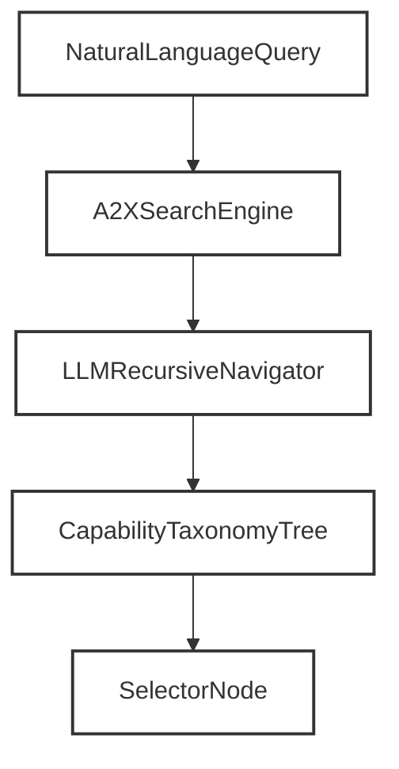
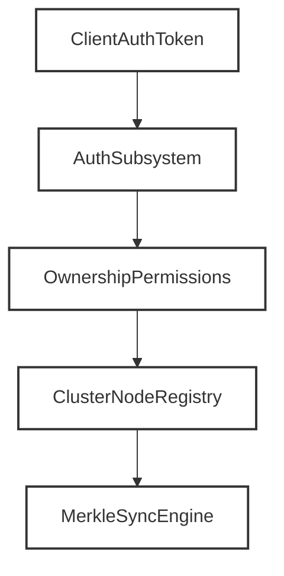

<!-- source: DeepWiki mcp.deepwiki.com · repo openJiuwen-ai/agent-protocol · page 4 A2X Agent Registry · fetched 2026-11-02 -->

# A2X Agent Registry

Relevant source files

The following files were used as context for generating this wiki page:

- [README.md](README.md)

## Purpose and Scope

The **A2X Agent Registry** is the Python-based service and capability discovery engine within the `agent-protocol` monorepo [README.md:13-14](). It provides a robust architecture for registering, cataloging, discovering, and securing distributed agents and tools across heterogeneous environments. 

This page serves as a high-level overview of the registry's subsystem domains. For deep technical specifications, implementation details, and algorithm walkthroughs, consult the designated child pages:
- [A2X Search Engine](#4.1)
- [Registration and Service Lifecycle](#4.2)
- [Backend API and Retrieval Baselines](#4.3)
- [Auth and Distributed Cluster Mode](#4.4)
- [Registry Client and Web UI](#4.5)

Sources: [README.md:1-29]()

---

## 4.1 A2X Search Engine

The A2X Search Engine introduces hierarchical capability catalog construction and LLM-driven recursive navigation. Instead of relying solely on flat vector embeddings, it organizes agent capabilities into a structured taxonomy tree, enabling precise multi-step navigation through navigator modules, selectors, and evaluation CLIs. Incremental updates ensure that capability catalogs stay synchronized as agents register or update their metadata.

For details, see [A2X Search Engine](#4.1).

*Diagram: Bridging natural language search queries to code entity structures in the A2X search engine.*

Sources: [README.md:1-29]()

---

## 4.2 Registration and Service Lifecycle

The `register/` module governs how services and agents enter, maintain, and exit the ecosystem [README.md:13-14](). It handles agent cards, metadata validation, and persistent storage. Supported service types include generic endpoints, A2A-compliant agents, and atomic Skills. Additionally, it implements status declarations, reservation leases, and a heartbeat subsystem to prune inactive or dropped instances automatically.

For details, see [Registration and Service Lifecycle](#4.2).

Sources: [README.md:1-29]()

---

## 4.3 Backend API and Retrieval Baselines

The backend architecture is built on FastAPI, exposing structured routers, Pydantic schemas, and service layers that manage application startup and request lifecycles [README.md:13-14](). It integrates both modern vector-based retrieval mechanisms and traditional MCP-style retrieval baselines alongside dataset management tools to support diverse benchmarking and operational querying needs.

For details, see [Backend API and Retrieval Baselines](#4.3).

Sources: [README.md:1-29]()

---

## 4.4 Auth and Distributed Cluster Mode

Security and scalability are core pillars managed via the `auth/` and `cluster/` modules [README.md:13-14](). The authentication subsystem handles token issuance, validation, and ownership permissions. In distributed scenarios, the clustering module manages node membership, Merkle tree-based state synchronization, peer-to-peer transport envelopes, and background sweepers to maintain consistency across registry replicas.

For details, see [Auth and Distributed Cluster Mode](#4.4).

*Diagram: Mapping authorization tokens and cluster synchronization components to code-level structures.*

Sources: [README.md:1-29]()

---

## 4.5 Registry Client and Web UI

To facilitate human interaction and programmatic integration, the registry provides the `a2x_registry_client` Python SDK and a React/Vite web frontend [README.md:13-14](). The frontend features D3.js-powered search visualization graphs, allowing operators to inspect agent relationships and cluster topologies visually. A unified launcher script simplifies local deployment and testing.

For details, see [Registry Client and Web UI](#4.5).

Sources: [README.md:1-29]()

---

