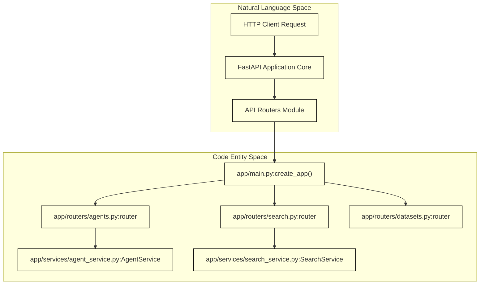
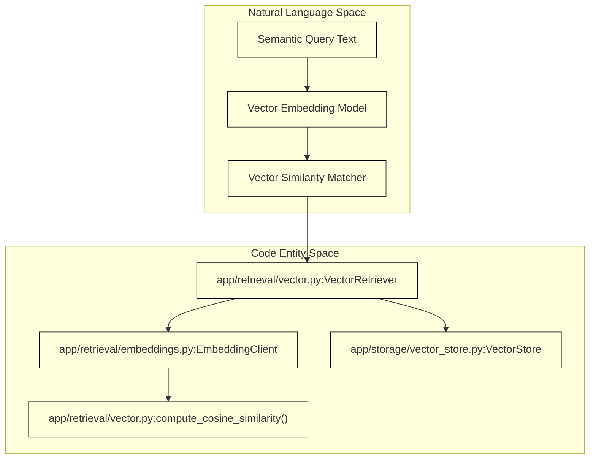

<!-- source: DeepWiki mcp.deepwiki.com · repo openJiuwen-ai/agent-protocol · page 4.3 Backend API and Retrieval Baselines · fetched 2026-11-02 -->

# Backend API and Retrieval Baselines

Relevant source files

The following files were used as context for generating this wiki page:

- [README.md](README.md)

The purpose and scope of this section cover the FastAPI-based web application core of the A2X Agent Registry (`AgentRegistry/app/`), including its FastAPI initialization, API route definitions, request/response validation schemas, core business services, and both vector and traditional (MCP-style) retrieval backends along with dataset management utilities.

---

## 1. FastAPI Application Architecture and Routing

The A2X backend is structured around a central FastAPI application instance that coordinates lifecycle events, middleware, and modular routers [README.md:1-29](). The application boots up through an entrypoint that configures application settings, registers CORS and logging middleware, and mounts routers for agents, search, registration, and health checks.

- **Application Initialization**: Configures the FastAPI app instance, sets up startup/shutdown event handlers for database connections, and initializes search indices.
- **Routers**: Modular `APIRouter` instances map HTTP endpoints to underlying service functions.

*Figure 1: FastAPI Application and Router Mapping bridging natural language concepts to `app/main.py` and `app/routers/`.*

Sources: [README.md:1-29]()

---

## 2. Schemas and Services Data Flow

Request validation and serialization rely on Pydantic models defined within the schema layer, while business logic resides in service classes that interface with storage and retrieval engines [README.md:1-29]().

- **Schemas**: Define strict contracts for agent cards, capability declarations, search queries, and dataset records.
- **Services**: Encapsulate operations such as service registration, state updates, lease management, and query execution.

| Layer Component | Module Path | Core Responsibility |
| :--- | :--- | :--- |
| **Pydantic Schemas** | `app/schemas/agent.py`, `app/schemas/search.py` | Data validation, JSON serialization, OpenAPI schema generation. |
| **Business Services** | `app/services/agent_service.py`, `app/services/dataset_service.py` | Core transaction handling, entity CRUD, coordination with storage. |

Sources: [README.md:1-29]()

---

## 3. Vector Retrieval Backends and Embedding Models

The vector retrieval subsystem indexes agent capabilities and descriptions into vector embeddings to enable semantic similarity search [README.md:1-29]().

- **Embedding Generation**: Utilizes configurable embedding model adapters to transform textual agent capability descriptions into dense vector representations.
- **Vector Indexing & Search**: Manages vector similarity metrics (e.g., cosine similarity, Euclidean distance) using underlying vector storage engines.

*Figure 2: Vector Retrieval Architecture bridging semantic query concepts to `app/retrieval/vector.py` and embedding clients.*

Sources: [README.md:1-29]()

---

## 4. Traditional Retrieval Backends and MCP-Style Interoperability

In parallel with vector search, the registry supports traditional retrieval mechanisms modeled after Model Context Protocol (MCP) conventions [README.md:1-29]().

- **Keyword and Structured Filtering**: Performs exact matching, tag filtering, and hierarchical category traversal over agent registries.
- **MCP-Style Tool/Resource Indexing**: Indexes tools, prompts, and resources advertised by registered agents, allowing deterministic lookup alongside semantic search results.

Sources: [README.md:1-29]()

---

## 5. Dataset Management and Evaluation

The dataset management layer provides tools for ingesting benchmark datasets, evaluating retrieval performance, and testing hierarchical routing accuracy [README.md:1-29]().

- **Dataset Ingestion**: Parsers load evaluation corpora, agent capability sets, and ground-truth routing benchmarks into the registry storage.
- **Evaluation CLI & Harnesses**: Automated scripts evaluate precision, recall, and navigation success rates for both vector and traditional retrieval baselines.

Sources: [README.md:1-29]()

---

