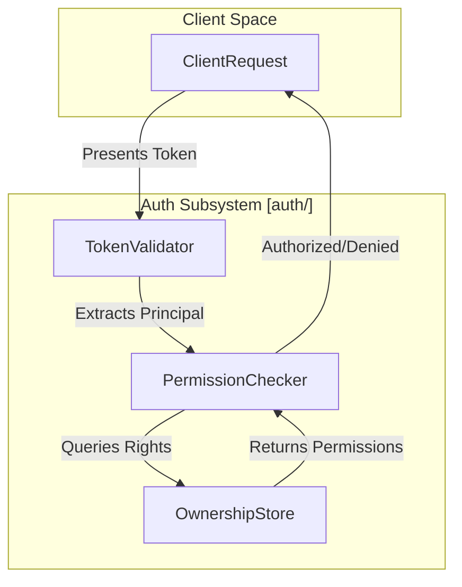
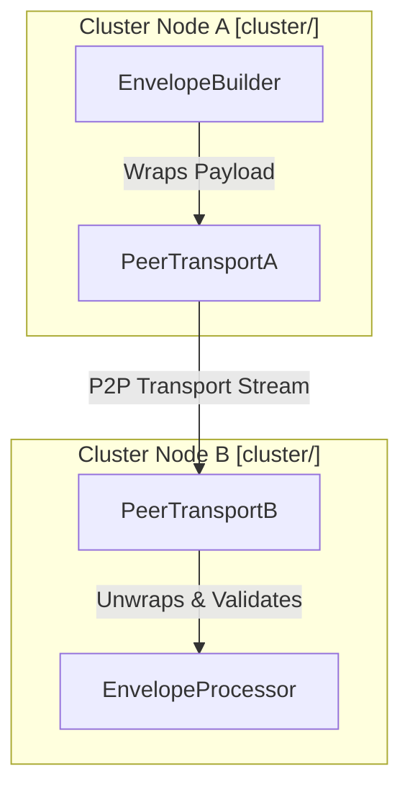

<!-- source: DeepWiki mcp.deepwiki.com · repo openJiuwen-ai/agent-protocol · page 4.4 Auth and Distributed Cluster Mode · fetched 2026-11-02 -->

# Auth and Distributed Cluster Mode

Relevant source files

The following files were used as context for generating this wiki page:

- [README.md](README.md)

## Purpose and Scope
This page details the architecture and implementation of the authentication, authorization, and distributed clustering subsystems within the A2X Agent Registry [README.md:13](). Specifically, it covers token issuance and ownership permission enforcement (`auth/`), cluster membership orchestration, Merkle tree state synchronization, peer-to-peer (P2P) transport mechanisms, message envelope handling, and background sweeper tasks (`cluster/`).

---

## Authentication and Ownership Permissions (`auth/`)

The `auth/` subsystem in the A2X Agent Registry governs API access, token issuance, and fine-grained resource ownership permissions. When agents or clients register or interact with services, the authentication layer validates identity tokens and evaluates whether the caller possesses ownership or administrative rights over target resources (such as agent cards, skill definitions, and reservation leases).

Key security components handle:
- **Token Issuance**: Cryptographic validation and generation of session/access tokens used by clients interacting with the FastAPI backend.
- **Ownership Verification**: Association of registered entities with specific principal identifiers, ensuring operations like updates or deletions require valid ownership proofs.
- **Permission Mapping**: Role-based and scope-based access checks integrated into registry route handlers.

*Figure 1: Token validation and ownership permission flow in the A2X auth subsystem.*

Sources: [README.md:1-29]()

---

## Distributed Cluster Membership and Peer Transport (`cluster/`)

To support horizontal scalability and high availability across multiple A2X registry instances, the `cluster/` module provides decentralized node discovery, membership tracking, and peer-to-peer communication. 

The clustering architecture relies on:
- **Membership Management**: Tracking active registry nodes, detecting node joins, failures, and graceful leaves via heartbeat and consensus mechanisms.
- **Peer Transport**: Low-latency RPC or HTTP-based transport layers enabling direct node-to-node communication for state replication and synchronization queries.
- **Message Envelopes**: Standardized payload wrappers that encapsulate registry updates, cluster control messages, and synchronization requests with cryptographic signatures or version headers.

*Figure 2: Peer-to-peer transport and envelope exchange between A2X cluster nodes.*

Sources: [README.md:1-29]()

---

## Merkle Tree Synchronization

Maintaining consistent state across distributed A2X registry replicas without heavy locking requires efficient state reconciliation. The `cluster/` module implements Merkle tree-based synchronization:

- **State Partitioning**: Registry entries (agent cards, service registrations, metadata) are hashed and organized into a hierarchical Merkle tree structure.
- **Incremental Diffing**: Nodes periodically exchange root hashes and branch summaries. If hashes diverge, nodes traverse down the tree to identify exact out-of-sync keys.
- **Targeted Reconciliation**: Only mismatched records are transmitted across the peer transport layer, minimizing network overhead during cluster healing or catch-up phases.

Sources: [README.md:1-29]()

---

## Background Sweepers and Lifecycle Management

Distributed registries must handle stale registrations, expired reservation leases, and dead nodes reliably. The background sweepers in the cluster and registry modules execute periodic maintenance routines:

- **Lease Sweeper**: Scans reservation leases and capability declarations, automatically revoking expired leases and updating agent status in the catalog.
- **Node Sweeper**: Monitors last-seen timestamps of cluster peers, evicting unresponsive nodes from the active membership view and triggering state re-balancing.
- **Garbage Collection**: Cleans up orphaned metadata, stale Merkle nodes, and expired authentication tokens from underlying stores.

Sources: [README.md:1-29]()

---

