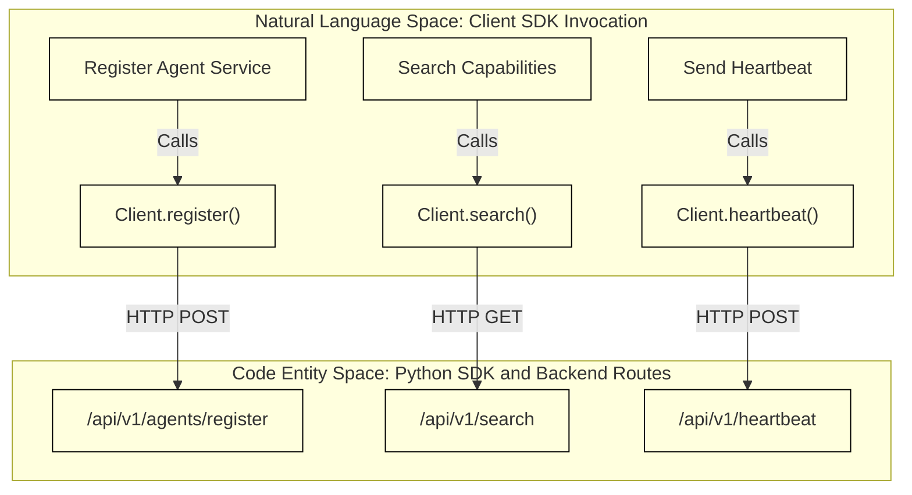
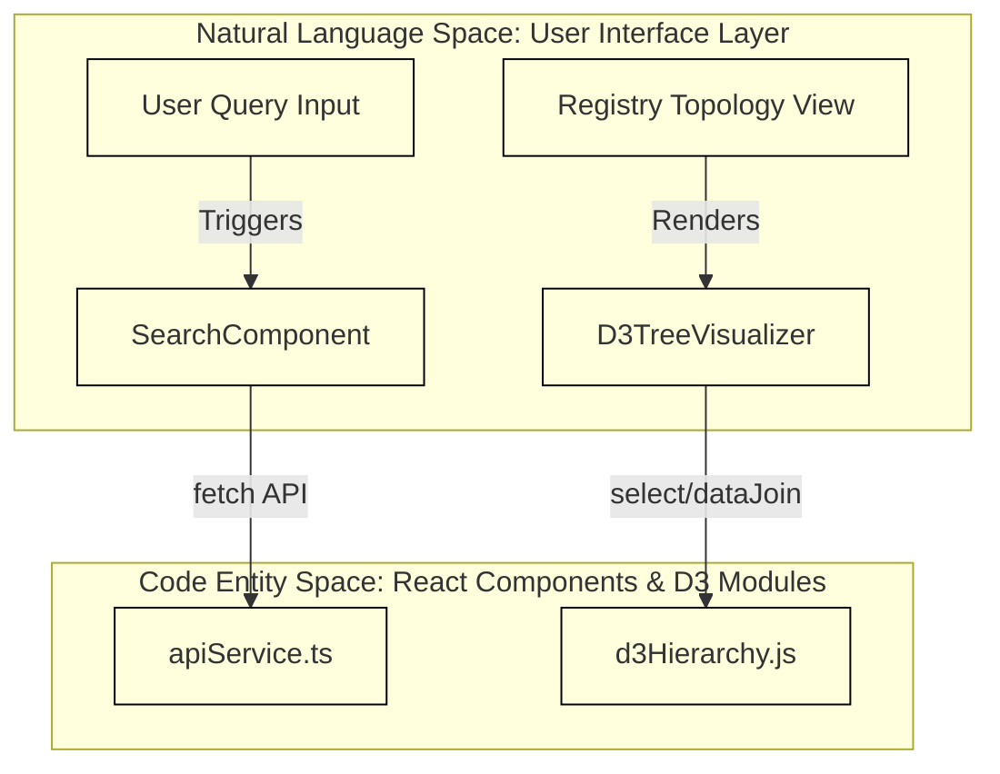

<!-- source: DeepWiki mcp.deepwiki.com · repo openJiuwen-ai/agent-protocol · page 4.5 Registry Client and Web UI · fetched 2026-11-02 -->

# Registry Client and Web UI

Relevant source files

The following files were used as context for generating this wiki page:

- [README.md](README.md)

This page covers the architecture and implementation of the `a2x_registry_client` Python SDK, the React/Vite frontend application incorporating D3.js search visualizations, and the launcher utility for the A2X Agent Registry subsystem.

Sources: [README.md:1-29]()

---

## 1. `a2x_registry_client` Python SDK

The `a2x_registry_client` provides a synchronous and asynchronous Python interface for interacting with the A2X Registry backend API. It handles service registration, heartbeat maintenance, dynamic capability lookups, and reservation lease acquisition.

### Client Methods and Transport
The client wraps HTTP/REST endpoints exposed by the FastAPI backend, translating Python data models (such as agent cards and query parameters) into JSON payloads.

*Figure 1: Bridging client SDK methods to backend REST routes.*

Sources: [README.md:1-29]()

---

## 2. React/Vite Frontend and D3.js Search Visualization

The frontend is built using React, Vite, and Tailwind CSS, featuring an interactive search interface backed by D3.js for rendering hierarchical capability catalogs and search trees.

### Frontend Component Layout

*Figure 2: Component interaction between user actions and D3.js visualization modules.*

Sources: [README.md:1-29]()

---

## 3. Registry Launcher

The launcher script orchestrates the startup of the A2X registry ecosystem, including the FastAPI server, database migrations, and optional cluster synchronization background workers.

### Initialization Sequence
- Parses environment variables and CLI flags.
- Initializes database connections and indexes.
- Spawns the uvicorn worker process running the FastAPI application instance.

Sources: [README.md:1-29]()

---

